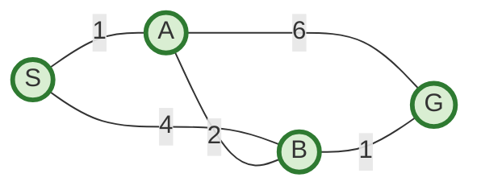
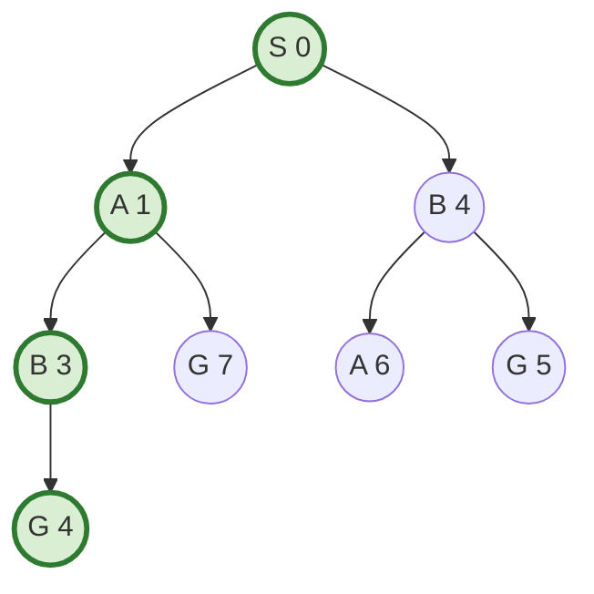
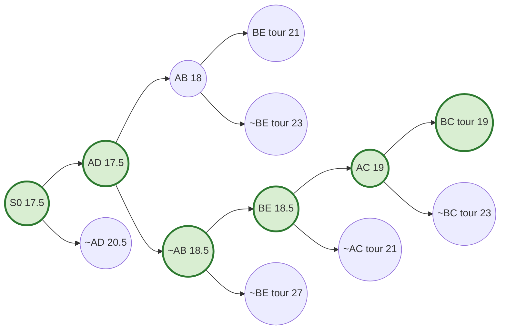
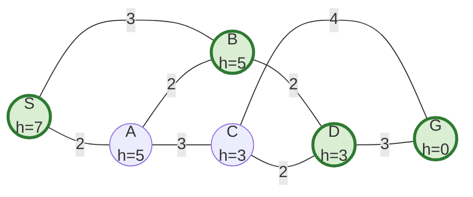
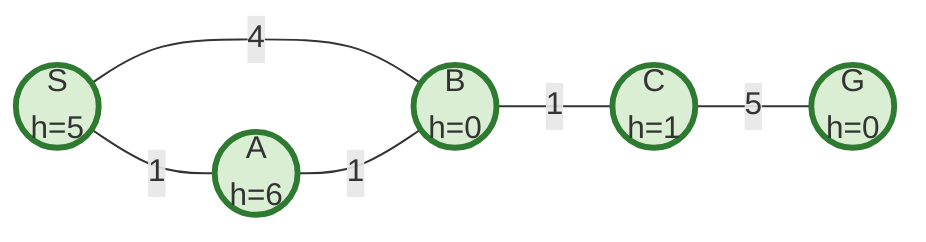
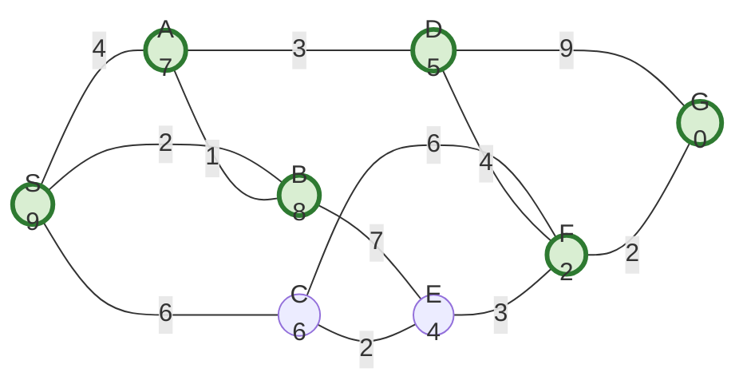

# Week 5 — Finding Optimal Paths

**Course:** BSCS3003 AI: Search Methods for Problem Solving · **Week 5** · Branch & Bound · Dijkstra · A\* · Admissibility · Weighted A\*

> **The one question of this week.** Weeks 2–4 asked *"can we reach the goal?"* and *"can we reach it quickly?"*. Week 5 asks *"can we reach it by the **cheapest** path — and **prove** it is the cheapest — while searching as little as possible?"*

**Contents**

1. Notation you must own
2. Why the earlier algorithms are not enough
3. Branch & Bound on a state space
4. Branch & Bound for TSP (refinement search)
5. Dijkstra's algorithm
6. Algorithm A\*
7. Admissibility of A\* (conditions and proof)
8. Informed heuristics — better h, less search
9. Weighted A\*
10. One graph, every algorithm — outcome comparison
11. Complexity — results and derivations
12. Merits and demerits
13. Exam traps and speed tricks
14. Difficult solved examples (exam pattern)
15. One-page revision sheet

---

## 1. Notation you must own

| Symbol | Meaning | Known when? |
|---|---|---|
| k(m, n) | cost of the edge (move) from m to n | given |
| g(n) | cost of the **best path found so far** from S to n | during search; can only go **down** |
| g\*(n) | cost of the **optimal** path from S to n | unknown (g(n) ≥ g\*(n) always) |
| h(n) | heuristic **estimate** of cost from n to the goal | given (a function you design) |
| h\*(n) | **true** optimal cost from n to the goal | unknown |
| f(n) = g(n) + h(n) | estimated cost of a solution that passes through n | during search |
| f\*(n) = g\*(n) + h\*(n) | cost of the best solution constrained to pass through n | unknown |
| C\* = f\*(S) = h\*(S) | cost of the optimal solution | unknown — what we want |
| admissible h | h(n) ≤ h\*(n) for every n (never overestimates) | property you must check |

Two directions of pull (Khemani's picture): **g is the pull of the source** (keeps checking whether a cheaper path exists), **h is the push towards the goal** (heads straight for it). Every algorithm this week is a different balance of the two.

---

## 2. Why the earlier algorithms are not enough

- **BFS** returns the path with the **fewest moves**. When moves have different costs, fewest moves ≠ cheapest.
- **DFS** returns *a* path with no quality guarantee.
- **Best First Search** (OPEN sorted on h only) heads for the goal fast but **ignores the cost already paid** — no guarantee.
- **Brute force** ("British Museum"): generate every path, keep the cheapest. Correct but mindlessly expensive — the number of paths grows exponentially (for TSP, factorially).

> **Goal of Week 5:** search **as little of the space as possible** while still **guaranteeing** the optimal solution. The key tool is a **lower bound**: if a partial solution can never become cheaper than its estimate, and a complete solution is already cheaper than that estimate, the partial one can be thrown away (**pruning**).

On the comparison graph G1 used in Section 10, BFS, DFS and Best First all return S → A → C → G with cost 9, while the optimal cost is 8.

---

## 3. Branch & Bound on a state space

### 3.1 The idea in simple words

Keep a collection of **partial paths** from S. Always **extend (refine) the cheapest partial path** first. Stop when the cheapest thing on OPEN is a **complete** path (one that ends in the goal).

Why does that work? Edge costs are non-negative, so extending a path can never make it cheaper. When a complete path is the cheapest item on OPEN, every other partial path already costs at least as much — and can only get dearer. So nothing left on OPEN can beat it. The cost so far, g, is the **lower bound** on every completion.

Two words in the name:

- **Branch** — refine (split) a candidate into its extensions (children).
- **Bound** — use a lower bound on cost to decide what to refine next and what can never win.

### 3.2 Algorithm from scratch

B&B works on the **search tree**: a node is a *path*, so the same state can appear many times (once per distinct path reaching it). The only loop check is on the node's own path.

```text
BranchAndBound(S)
1  OPEN ← [ (path = [S], g = 0) ]
2  while OPEN is not empty
3      P ← remove the path with the lowest g from OPEN      -- ties: alphabetical on the last state
4      N ← last state of P
5      if GoalTest(N) then return P                          -- test when PICKED, not when generated
6      for each M in MoveGen(N) such that M is not already on P
7          add ( P + [M], g(P) + k(N, M) ) to OPEN
8  return FAILURE
```

> **Line 5 is the whole trick.** Testing the goal when it is *generated* (as BFS does) breaks optimality: a goal generated early may be reached later by a cheaper path. B&B tests when the goal is **selected** from OPEN.

### 3.3 Simple solved example

Graph T (undirected). Edges: S–A 1, S–B 4, A–B 2, A–G 6, B–G 1. Start S, goal G. Ties broken alphabetically.



| Step | Refined (picked) path | g | Children added (path : g) | OPEN after (sorted on g) |
|---|---|---|---|---|
| 1 | S | 0 | SA:1, SB:4 | SA 1 · SB 4 |
| 2 | S-A | 1 | SAB:3, SAG:7 | SAB 3 · SB 4 · SAG 7 |
| 3 | S-A-B | 3 | SABG:4 (S, A already on path) | SB 4 · SABG 4 · SAG 7 |
| 4 | S-B | 4 | SBA:6, SBG:5 | SABG 4 · SBG 5 · SBA 6 · SAG 7 |
| 5 | S-A-B-G | 4 | **goal picked → stop** | — |

At step 3, two paths tie at g = 4: S-B and S-A-B-G; alphabetical order on the last state picks **B before G**. Result: **S → A → B → G, cost 4**, after 5 refinements.

Final search tree (state : g). Notice that B appears twice and G three times — B&B does not merge paths that reach the same state.



Occurrences in the final tree: S 1, A 2, B 2, G 3. (This is exactly the kind of count the quiz asks for.)

### 3.4 Why B&B returns the optimal path (derivation)

1. Every path P on OPEN has a cost g(P); every completion of P costs **≥ g(P)** because k ≥ 0.
2. B&B picks the path with the least g. Suppose it picks a complete path Pg with cost g(Pg).
3. Every other path on OPEN has g ≥ g(Pg), so all their completions cost ≥ g(Pg).
4. Every solution not yet on OPEN is a completion of some path on OPEN (the tree covers all paths).
5. Hence no solution is cheaper than Pg. ∎

The argument needs only a **lower bound**, not the exact future cost. That is the seed of A\*: replace "≥ g" by "≥ g + (something that never overestimates)".

### 3.5 Properties

| Property | Branch & Bound (state space) |
|---|---|
| Data structure | OPEN = priority queue on g; no CLOSED (tree search) |
| Complete? | Yes, if branching is finite and every edge costs ≥ ε > 0 |
| Optimal? | Yes (Section 3.4) |
| Time | O(b^(1 + ⌊C\*/ε⌋)) — derivation in Section 11 |
| Space | Same order as time — keeps the whole frontier |
| Main waste | The same state is reached and refined repeatedly via different paths |

---

## 4. Branch & Bound for TSP (refinement search)

### 4.1 Solution-space view

For TSP, a node of the B&B tree is **not** a city — it is a **set of tours**, described by constraints:

- **S0** = the set of all tours.
- **XY** = "tours that **include** edge X–Y"; **~XY** = "tours that **exclude** edge X–Y".
- **Refinement:** pick the **cheapest undecided edge** XY of the node and split it into two children: (…, XY) and (…, ~XY). The children partition the parent's set.
- A node is **fully refined** when its constraints pin down exactly one tour.

B&B always refines the node with the **lowest estimated cost** and stops when that node is a single complete tour.

### 4.2 The lower-bound estimate (and why it is a lower bound)

> **Estimate(node) = ½ × Σ over cities c of (sum of the two cheapest edges at c that the node allows)** — an edge already included at c must be one of the two; excluded edges are skipped.

Derivation: in any tour every city has exactly **two** tour edges. So

tour cost = ½ × Σ over c (cost of the two tour edges at c) ≥ ½ × Σ over c (cost of the two **cheapest allowed** edges at c).

The ½ is there because each edge is counted at both of its ends. Excluding an edge or forcing an edge can only **raise** this number, so the estimate is a lower bound for every tour inside the node. (Khemani: the higher the estimate, the better the pruning — but higher estimates cost more work to compute.)

### 4.3 Segment inferencing (making the node's constraints explicit)

After adding XY or ~XY, apply these until nothing changes:

| Rule | Condition | Inference |
|---|---|---|
| R1 — degree full | city c already has **2 included** edges | **exclude** all other edges at c |
| R2 — forced | city c has only **2 edges left** that are not excluded | **include** both |
| R3 — no premature cycle | undecided edge XY joins the two ends of one segment of fewer than N cities | **exclude** XY |
| Infeasible | a city has > 2 included or < 2 allowed edges, or a short cycle forms | node holds **no** tour → drop it |

Inference does **not** change *which* tour is optimal; it only tightens estimates and kills empty nodes early, so B&B refines fewer nodes. (Quiz fact: TSP B&B returns the optimal tour **even if inferencing is disabled**.)

### 4.4 Solved example — 5 cities

Distances:

| | A | B | C | D | E |
|---|---|---|---|---|---|
| **A** | – | 3 | 4 | 2 | 7 |
| **B** | 3 | – | 4 | 6 | 3 |
| **C** | 4 | 4 | – | 5 | 8 |
| **D** | 2 | 6 | 5 | – | 6 |
| **E** | 7 | 3 | 8 | 6 | – |

Edges sorted by cost: AD 2 · AB 3 · BE 3 · AC 4 · BC 4 · CD 5 · BD 6 · DE 6 · AE 7 · CE 8. Ties on cost are broken alphabetically.

**Root estimate S0** — two cheapest edges per city:
A: 2+3 = 5 · B: 3+3 = 6 · C: 4+4 = 8 · D: 2+5 = 7 · E: 3+6 = 9 → Σ = 35 → **17.5**.

| # | Node refined (est.) | Branch edge | Child with edge — inferences — estimate | Child without edge — inferences — estimate |
|---|---|---|---|---|
| 1 | S0 (17.5) | AD 2 | AD: nothing new; **17.5** | ~AD: A 3+4, D 5+6 → **20.5** |
| 2 | AD (17.5) | AB 3 | AD,AB: A full (R1) ⇒ ~AC, ~AE; BD would close D–A–B (R3) ⇒ ~BD; C now 4+5 → **18** | AD,~AB: A 2+4, B 3+4 → **18.5** |
| 3 | AD,AB (18) | BE 3 | B full ⇒ ~BC; C left with CD, CE (R2) ⇒ include; D full ⇒ ~DE → tour A-B-E-C-D-A = **21** | ~BE ⇒ BC forced … → tour A-B-C-E-D-A = **23** |
| 4 | AD,~AB (18.5) | BE 3 | AD,~AB,BE: **18.5** | ~BE: everything forced → tour = **27** |
| 5 | AD,~AB,BE (18.5) | AC 4 | A full ⇒ ~AE; CD would close C–A–D ⇒ ~CD; D now 2+6 → **19** | ~AC ⇒ AE forced … → tour = **21** |
| 6 | AD,~AB,BE,AC (19) | BC 4 | B full ⇒ ~BD; only DE remains to close the tour ⇒ tour **A-C-B-E-D-A = 19** (complete) | ~BC ⇒ BD forced → tour = **23** |
| 7 | **complete tour (19)** | — | **cheapest node is a full tour → stop** | |

Answer: **A → C → B → E → D → A, cost 4 + 4 + 3 + 6 + 2 = 19** (verified against all 12 tours by brute force). B&B needed **6 refinements**; with inferencing switched off the same instance needs **11** refinements and still returns 19.



### 4.5 Counting and size facts for TSP B&B

- Number of distinct tours on N cities (undirected): **(N − 1)! / 2**.
- Number of edges: **N(N − 1)/2**.
- **Relaxed tree** (split on include/exclude for every edge, no estimates, no tour constraints, no inference): every edge is decided in/out → **2^(N(N−1)/2) = O(2^(N²)) leaves**.
- Prune every node that violates the tour condition → the leaves are exactly the tours → **O(N!) leaves**.
- To count the tours a node represents: **apply inferencing first**, then count the ways to join the remaining segments into one cycle. (Worked in Problem P5.)

---

## 5. Dijkstra's algorithm

### 5.1 Idea in simple words

B&B (tree search) wastes effort because a state reached by two paths is kept twice. **Dijkstra keeps one entry per state** and remembers only the cheapest g found so far for it. It is B&B turned into **graph search**.

### 5.2 Algorithm

```text
Dijkstra(S)
1  for every node v: g(v) ← ∞, colour(v) ← WHITE ;  g(S) ← 0, parent(S) ← null
2  while some WHITE node has finite g
3      N ← the WHITE node with the least g            -- ties: alphabetical
4      colour(N) ← BLACK                               -- g(N) is now final (optimal)
5      for each neighbour M of N that is WHITE
6          if g(N) + k(N, M) < g(M)                    -- RELAXATION
7              g(M) ← g(N) + k(N, M) ;  parent(M) ← N
```

**Why a black node's g is final** (non-negative edges): when N is the cheapest white node, any other route to N must leave the black region through some white node W with g(W) ≥ g(N), and the rest of that route costs ≥ 0. So no route can beat g(N).

### 5.3 Solved example (graph G1, used again for A\*)

G1 (undirected): S–A 2, S–B 3, A–B 2, A–C 3, B–D 2, C–D 2, C–G 4, D–G 3.

| Black (picked) | g | Relaxations | White nodes after (g) |
|---|---|---|---|
| S | 0 | A ∞→2, B ∞→3 | A 2, B 3, C ∞, D ∞, G ∞ |
| A | 2 | C ∞→5 (B: 2+2 = 4, not < 3) | B 3, C 5, D ∞, G ∞ |
| B | 3 | D ∞→5 | C 5, D 5, G ∞ |
| C | 5 | G ∞→9 (D: 7, not < 5) | D 5, G 9 |
| D | 5 | **G 9→8**, parent(G) ← D | G 8 |
| G | 8 | — | — |

Path by parent pointers: G ← D ← B ← S → **S → B → D → G, cost 8**. Six nodes picked.

### 5.4 Properties

- **Dijkstra = B&B with duplicate states merged = A\* with h(n) = 0 for all n** (also called Uniform Cost Search).
- Time: O(V²) with a plain array, O((V + E) log V) with a heap. Space O(V).
- Needs **non-negative** edge costs (a negative edge can make a "final" black node cheaper later).
- Weakness: no sense of direction — it expands in growing circles of cost around S, in every direction equally.

---

## 6. Algorithm A\*

### 6.1 Idea in simple words

A\* = Dijkstra's **pull of the source** + Best First's **push towards the goal**.

Sort OPEN on **f(n) = g(n) + h(n)** — "what I have paid to reach n" + "what I estimate is left". If h never overestimates, f(n) is a lower bound on any solution through n, so the B&B argument (Section 3.4) still works — but the search now leans towards the goal and refines far fewer nodes.

Spectrum at a glance: **h = 0** → Dijkstra / B&B · **0 < h ≤ h\*** → A\*, optimal · **h = h\*** → walks only the optimal path · **h > h\*** somewhere → may lose optimality · **g ignored (f = h)** → Best First.

### 6.2 Algorithm from scratch (course version)

```text
A*(S)
 1  default value of g for every node is +∞
 2  parent(S) ← null ;  g(S) ← 0 ;  f(S) ← g(S) + h(S)
 3  OPEN ← [S] ;  CLOSED ← [ ]
 4  while OPEN is not empty
 5      N ← remove the node with the lowest f from OPEN     -- ties: alphabetical
 6      add N to CLOSED
 7      if GoalTest(N) then return ReconstructPath(N)        -- test when PICKED
 8      for each neighbour M in MoveGen(N)
 9          if g(N) + k(N, M) < g(M)                         -- found a cheaper path to M
10              parent(M) ← N
11              g(M) ← g(N) + k(N, M) ;  f(M) ← g(M) + h(M)
12              if M ∈ OPEN   then continue                  -- case 2: just re-sorted
13              if M ∈ CLOSED then PropagateImprovement(M)   -- case 3
14              else add M to OPEN                           -- case 1: new node
15  return empty list

PropagateImprovement(M)
 1  for each neighbour X of M
 2      if g(M) + k(M, X) < g(X)
 3          parent(X) ← M ;  g(X) ← g(M) + k(M, X) ;  f(X) ← g(X) + h(X)
 4          if X ∈ CLOSED then PropagateImprovement(X)        -- push the saving further down
```

**The three cases for a neighbour M (memorise this table):**

| Case | Where M is | What A\* does |
|---|---|---|
| 1 | Nowhere (never seen) | set g, f, parent; **add to OPEN** |
| 2 | On OPEN, new path cheaper | update g, f, **parent**; it simply moves up in the priority order |
| 3 | On CLOSED, new path cheaper | update g, f, parent **and propagate** the saving to its descendants (they already hold g values computed through the old, dearer path) |
| — | Seen, new path **not** cheaper | ignore |

Why case 3 can happen at all: a node can be picked (closed) before its cheapest path is found when h is admissible but **not monotone** (Week 6 shows that monotone h makes case 3 impossible).

### 6.3 Simple solved example — A\* on G1

Heuristic (admissible — checked against h\* in Section 10): h(S)=7, h(A)=5, h(B)=5, h(C)=3, h(D)=3, h(G)=0.



**Problem analysis.** S0 = S · Goal test: state = G · MoveGen: neighbours in G1 · Algorithm: A\*, ties alphabetical.

| Step | Picked N (g, f) | Children: g / h / f — case | OPEN after (f order) | CLOSED after |
|---|---|---|---|---|
| 1 | S (0, 7) | A 2/5/7 new · B 3/5/8 new | A7 · B8 | S |
| 2 | A (2, 7) | C 5/3/8 new · B: 2+2 = 4 > 3 ignore · S closed, not cheaper | B8 · C8 | S A |
| 3 | B (3, 8) | D 5/3/8 new · A: 5 > 2 ignore | C8 · D8 | S A B |
| 4 | C (5, 8) | G 9/0/9 new · D: 7 > 5 ignore | D8 · G9 | S A B C |
| 5 | D (5, 8) | **G: 8 < 9 → case 2**, parent(G) ← D, f = 8 | G8 | S A B C D |
| 6 | G (8, 8) | **goal picked → stop** | — | S A B C D G |

**Final:** path **S → B → D → G**, cost **8**, nodes expanded (picked) **6**.

Note the ties at f = 8 (steps 2–5) are settled alphabetically: B, then C, then D. The goal G was **generated** at step 4 with g = 9 but not accepted — it was improved to 8 before it was picked. A goal-test-on-generation version would have wrongly returned cost 9.

### 6.4 Solved example — PropagateImprovement in action (graph G2)

G2 (undirected): S–A 1, S–B 4, A–B 1, B–C 1, C–G 5. Heuristic: h(S)=5, h(A)=6, h(B)=0, h(C)=1, h(G)=0.

Check admissibility first: h\*(S)=8, h\*(A)=7, h\*(B)=6, h\*(C)=5, h\*(G)=0 → every h ≤ h\* ✓. But h(A) − h(B) = 6 > k(A,B) = 1 → **not monotone**, so a closed node may be improved later.



| Step | Picked (g, f) | What happens | OPEN after | CLOSED after |
|---|---|---|---|---|
| 1 | S (0, 5) | A 1/6/**7** · B 4/0/**4** | B4 · A7 | S |
| 2 | B (4, 4) | C 5/1/6 new · A: 5 > 1 ignore | C6 · A7 | S B |
| 3 | C (5, 6) | G 10/0/10 new | A7 · G10 | S B C |
| 4 | A (1, 7) | **B: 1+1 = 2 < 4, B ∈ CLOSED → case 3** → parent(B) ← A, g(B) = 2 → propagate: C 2+1 = 3 < 5 (C ∈ CLOSED, propagate again) → G 3+5 = 8 < 10 (G on OPEN, f = 8) | G8 | S B C A |
| 5 | G (8, 8) | goal picked → stop | — | S B C A G |

**Final:** path **S → A → B → C → G**, cost **8**, 5 nodes picked. Without step 4's propagation, G would keep g = 10 via the old parent chain and A\* would return the wrong cost 10.

---

## 7. Admissibility of A\*

An algorithm is **admissible** if it is guaranteed to return an optimal solution whenever a solution exists.

### 7.1 The three conditions

1. **Finite branching factor** — otherwise MoveGen cannot even generate all neighbours.
2. **Every edge costs more than some ε > 0** — rules out an infinite path with finite total cost (e.g. costs ½, ¼, ⅛, …), along which the search could run forever.
3. **h(n) ≤ h\*(n) for every n** — the heuristic never overestimates.

### 7.2 Proof, one lemma at a time

**L1 (finite graphs terminate).** Each node can re-enter OPEN only when a strictly cheaper path to it is found, and a finite graph has finitely many cycle-free paths. So A\* stops.

**L2 (an optimal-path node is always on OPEN).** Let S = n0, n1, …, nk = G be an optimal path. Before A\* terminates, let n′ be the first node on this path that is not on CLOSED with its optimal g. Its predecessor is closed with optimal g, and expanding it gave n′ the value g(n′) = g\*(n′). So n′ is on OPEN, and

f(n′) = g\*(n′) + h(n′) ≤ g\*(n′) + h\*(n′) = C\*.

**L3 (A\* terminates even on infinite graphs, if a solution exists).** By L2 every node A\* picks has f ≤ C\*, so g ≤ C\*. A path with more than C\*/ε edges costs more than C\*, and with finite branching there are only finitely many paths with at most C\*/ε edges. So only finitely many nodes can ever be picked.

**L4 (A\* terminates by picking a goal).** By L2, OPEN is never empty while a solution exists, so A\* cannot stop with failure.

**L5 (the goal it picks is optimal).** When goal t is picked, f(t) = g(t) + 0 = g(t), and t was picked ahead of n′ from L2:

g(t) = f(t) ≤ f(n′) ≤ C\*. Since no solution can cost less than C\*, **g(t) = C\***. ∎

**Corollary 1.** Every node A\* picks has f(n) ≤ C\* at the time it is picked.
**Corollary 2.** A node whose f exceeds C\* along every path to it is never picked. Nodes with f < C\* on their optimal path are surely picked; nodes with f = C\* may or may not be picked, depending on ties.

### 7.3 Sufficient, not necessary

h ≤ h\* everywhere guarantees optimality; violating it **may** cost optimality, but does not have to. On G1, raising h(B) to 6 (> h\*(B) = 5) still returns cost 8 with alphabetical ties; raising it to 7 makes A\* return S → A → C → G with cost 9 (Problem P4).

---

## 8. Informed heuristics — better h, less search

### 8.1 The theorem

If h1 and h2 are both admissible and **h2(n) > h1(n) for every non-goal n** ("h2 is more informed"), then **every node expanded by A\*(h2) is also expanded by A\*(h1)**. So A\*(h2) never expands more nodes.

**Proof sketch.** Suppose A\*(h2) expands n. By Corollary 1, g\*(n) + h2(n) ≤ C\*. Then g\*(n) + h1(n) < g\*(n) + h2(n) ≤ C\*, i.e. n's f-value under h1 is **strictly below** C\*. By induction on depth, n's ancestors on its optimal path are also expanded by A\*(h1), so n reaches OPEN with g\*(n), and A\*(h1) must expand every OPEN node with f < C\* before it can pick a goal of cost C\*. ∎

### 8.2 The 8-puzzle example

```text
   Start          Goal
  2  1  6       1  2  3
  4  _  8       8  _  4
  7  5  3       7  6  5
```

- **h1 = tiles out of place** (blank not counted): tiles 2, 1, 6, 4, 8, 5, 3 are misplaced; 7 is home → **h1 = 7**.
- **h2 = Manhattan distance** (sum over tiles of row + column displacement): 2→1, 1→1, 6→3, 4→2, 8→2, 7→0, 5→1, 3→2 → **h2 = 12**.
- True optimal cost (BFS over the state space): **h\* = 18**.

Both are admissible: every misplaced tile needs ≥ 1 move (h1), and every tile needs ≥ its Manhattan distance in moves since each move shifts one tile by one cell (h2). And h2 ≥ h1 always, because a misplaced tile has Manhattan distance ≥ 1.

Nodes expanded by A\* on this instance (one run, ties broken towards smaller g — exact counts change with tie-breaking, the ranking does not):

| Heuristic | h(start) | Nodes expanded | Effective branching factor b\* |
|---|---|---|---|
| h = 0 (Dijkstra) | 0 | 23,574 | 1.66 |
| h1 tiles out of place | 7 | 1,747 | 1.41 |
| h2 Manhattan | 12 | 229 | 1.23 |

b\* is the branching factor of a uniform tree of depth d (= 18) that would contain the same number of nodes: N + 1 = 1 + b\* + b\*² + … + b\*^d. A smaller b\* means a better-directed search.

### 8.3 The spectrum of h

| h | Behaviour of A\* |
|---|---|
| h = 0 | Dijkstra / B&B — optimal, no direction, expands most |
| 0 < h ≤ h\* | optimal; the larger (more informed) h, the fewer expansions |
| h = h\* | expands **only** nodes on an optimal path (with goal-favouring ties) |
| h > h\* somewhere | faster, may return a non-optimal path |
| g ignored (f = h) | Best First — fast, no guarantee |

---

## 9. Weighted A\*

### 9.1 Definition

**f(n) = g(n) + w · h(n)**, with w ≥ 0.

| w | Behaviour | Optimal? |
|---|---|---|
| 0 | Branch & Bound / Dijkstra (pull of the source only) | yes |
| 1 | A\* | yes, if h admissible |
| 1 < w < ∞ | Weighted A\* — leans towards the goal | **bounded**: cost ≤ w · C\* |
| → ∞ | Best First Search (push towards the goal only) | no |

Khemani's summary: Best First and Weighted A\* head off towards the goal directly; B&B and A\* keep checking whether a cheaper path is available.

### 9.2 Derivation of the w · C\* bound (h admissible, w ≥ 1)

When WA\* picks goal t, t was ahead of the optimal-path node n′ on OPEN (L2 still holds), so

g(t) = f_w(t) ≤ f_w(n′) = g\*(n′) + w·h(n′) ≤ w·g\*(n′) + w·h\*(n′) = w · C\*.

(The middle step uses w ≥ 1 for the g term and h ≤ h\* for the h term.)

### 9.3 Solved example — WA\* with w = 2 on G1

Same graph and heuristic as Section 6.3, now f = g + 2h.

| Step | Picked (g, f) | Children g / 2h / f | OPEN after |
|---|---|---|---|
| 1 | S (0, 14) | A 2/10/12 · B 3/10/13 | A12 · B13 |
| 2 | A (2, 12) | C 5/6/11 · B: 4 > 3 ignore | C11 · B13 |
| 3 | C (5, 11) | D 7/6/13 · G 9/0/9 | G9 · B13 · D13 |
| 4 | G (9, 9) | **goal picked → stop** | — |

WA\* returns **S → A → C → G, cost 9** after only **4** picks; A\* returned cost 8 after 6. The bound holds: 9 ≤ 2 × 8 = 16. This is exactly the shape of the quiz question "A\* finds S,B,D,G; WA\* with w = 2 finds S,A,C,G".

---

## 10. One graph, every algorithm — outcome comparison

Graph G1 from Sections 5.3 and 6.3. True costs to goal: h\*(S)=8, h\*(A)=7, h\*(B)=5, h\*(C)=4, h\*(D)=3, h\*(G)=0, so the heuristic used (7, 5, 5, 3, 3, 0) is admissible. All ties alphabetical.

| Algorithm | OPEN ordered by | Path returned | Cost | Picks | Optimal? |
|---|---|---|---|---|---|
| BFS | arrival (queue) | S-A-C-G | 9 | 6 | no |
| DFS | arrival (stack) | S-A-C-G | 9 | 5 | no |
| Best First | h | S-A-C-G | 9 | 4 | no |
| Branch & Bound (tree) | g | S-B-D-G | 8 | 13 refinements | yes |
| Dijkstra | g, one entry per state | S-B-D-G | 8 | 6 | yes |
| A\* (h admissible) | g + h | S-B-D-G | 8 | 6 | yes |
| A\* with h = h\* | g + h\* | S-B-D-G | 8 | 4 | yes |
| WA\*, w = 2 | g + 2h | S-A-C-G | 9 | 4 | no (≤ 2C\*) |

What the table teaches: the cost-aware algorithms all reach 8; B&B pays heavily for re-reaching states; A\* with a weak heuristic does no better than Dijkstra on a tiny graph, but with a strong heuristic it walks straight down the optimal path.

---

## 11. Complexity — results and derivations

Let b = branching factor, d = depth of the optimal solution, C\* = its cost, ε = smallest edge cost, V/E = nodes/edges of an explicit graph.

**B&B on the tree.** Every path picked has g ≤ C\*. A path with more than C\*/ε edges costs more than C\*, so the tree is explored to depth ≤ 1 + ⌊C\*/ε⌋. A tree of branching b to that depth has O(b^(1 + ⌊C\*/ε⌋)) nodes → **time and space O(b^(1 + ⌊C\*/ε⌋))**. With unit costs this is O(b^(d+1)), like BFS.

**Dijkstra on an explicit graph.** Each node turns black once; each edge is relaxed once from each end. Choosing the cheapest white node costs O(V) with an array → **O(V²)**; with a binary heap each pick and each decrease-key costs O(log V) → **O((V + E) log V)**. Space **O(V)**.

**A\*.**

- Worst case (h = 0 or useless h): same as Dijkstra/UCS → **O(b^d)** time and space in the implicit tree view.
- Best case (h = h\*): only nodes on an optimal path are expanded → d expansions, **O(b·d)** nodes generated.
- In between: time ≈ O((b\*)^d), with b\* the effective branching factor (Section 8.2).
- **Space is the real bottleneck**: A\* keeps every generated node (OPEN + CLOSED), so memory grows as fast as time. This is the motivation for Week 6 (IDA\*, RBFS, frontier search, beam stack search).
- With an admissible but non-monotone h, PropagateImprovement can reopen nodes repeatedly; on adversarial graphs the number of re-expansions can grow exponentially in the number of nodes. Monotone h removes this (Week 6).

**TSP B&B.** Relaxed tree O(2^(N²)) leaves; tour-valid leaves (N − 1)!/2 = O(N!). B&B's power is entirely in how much of this it prunes with good estimates and inferencing — worst case is still exponential (TSP is NP-hard).

---

## 12. Merits and demerits

| Algorithm | Merits | Demerits |
|---|---|---|
| Brute force | trivially correct | explores everything; infeasible beyond toy sizes |
| B&B (tree) | optimal; needs only a lower bound; works for refinement spaces (TSP) | re-explores the same state via many paths; exponential memory |
| Dijkstra | optimal; each state once; polynomial on explicit graphs | blind — expands in all directions; needs k ≥ 0 |
| A\* | optimal with admissible h; directed; with a monotone h no admissible algorithm using the same h expands fewer nodes (up to ties) | memory O(all generated nodes); reopening cost with non-monotone h; quality depends on h |
| Weighted A\* | much faster; solution cost ≤ w·C\* | gives up exact optimality |
| Best First | fastest to *a* solution | no cost guarantee at all |

---

## 13. Exam traps and speed tricks

1. **Goal test on pick, never on generation**, for B&B, Dijkstra, A\*, WA\*. A goal sitting on OPEN can still be improved (G1 step 4–5).
2. **OPEN is sorted on f = g + h**, not h. Sorting on h is Best First.
3. **Case 2 changes the parent.** When a node on OPEN gets a cheaper g, its parent pointer moves — the final path is read from the latest parents.
4. **Case 3 needs propagation.** Forgetting PropagateImprovement gives the right path to the improved node but wrong g for its descendants (G2).
5. **Admissibility is a global check** (h ≤ h\* at *every* node). Compute h\* backwards from the goal with Dijkstra — it takes a minute on a 6-node graph and settles every admissibility question.
6. **Admissible is sufficient, not necessary.** An overestimating h may still return the optimal path; a question asking "is optimality guaranteed?" wants "no", a question asking "what path is returned?" wants a trace.
7. **Ties decide traces.** Read the tie-break rule (usually alphabetical). With many f-ties, nodes with f = C\* that are off the optimal path may get expanded (Problem P1, node C and E).
8. **B&B tree counts**: the same state appears once per distinct loop-free path generated; goal nodes generated but never picked still count as tree nodes.
9. **TSP estimate**: always divide the sum by 2; include forced edges at both ends; recompute every city touched by the new constraint and its inferences.
10. **TSP inference before counting tours** — apply R1/R2/R3 repeatedly until stable.
11. **Hamiltonian-cycle parity trick**: a bipartite graph (grids, chessboards) with an **odd** number of vertices has **no** Hamiltonian cycle, so zero TSP tours along its edges.
12. **WA\* bound**: cost ≤ w·C\* needs h admissible and w ≥ 1.
13. **Squared Euclidean distance is not admissible** on a unit grid (it overestimates as soon as the distance exceeds 1). Plain Euclidean and Manhattan (4-connected grid) are admissible.

---

## 14. Difficult solved examples (exam pattern)

### P1 — Full A\* trace with OPEN improvements and many ties

Graph H (undirected), start S, goal G, ties alphabetical.

Edges: S–A 4, S–B 2, S–C 6, A–B 1, A–D 3, B–E 7, C–E 2, C–F 6, D–F 4, D–G 9, E–F 3, F–G 2.
h: S 9, A 7, B 8, C 6, D 5, E 4, F 2, G 0.



**(a) Is h admissible? monotone?** h\* by Dijkstra from G: S 12, A 9, B 10, C 7, D 6, E 5, F 2, G 0. Every h ≤ h\* → admissible. For every edge |h(m) − h(n)| ≤ k(m,n) (e.g. S–B: 1 ≤ 2, D–G: 5 ≤ 9, C–F: 4 ≤ 6) → monotone too, so case 3 cannot occur.

**(b) Trace.**

| Step | Picked (g, f) | Children / updates | OPEN after (f) | CLOSED |
|---|---|---|---|---|
| 1 | S (0, 9) | A 4/7/11 · B 2/8/10 · C 6/6/12 | B10 · A11 · C12 | S |
| 2 | B (2, 10) | **A: 3 < 4 → case 2**, parent(A)=B, f 10 · E 9/4/13 | A10 · C12 · E13 | S B |
| 3 | A (3, 10) | D 6/5/11 | D11 · C12 · E13 | S B A |
| 4 | D (6, 11) | F 10/2/12 · G 15/0/15 | C12 · F12 · E13 · G15 | S B A D |
| 5 | C (6, 12) | **E: 8 < 9 → case 2**, parent(E)=C, f 12 · F: 12 > 10 ignore | E12 · F12 · G15 | + C |
| 6 | E (8, 12) | F: 11 > 10 ignore · B: 15 > 2 ignore | F12 · G15 | + E |
| 7 | F (10, 12) | **G: 12 < 15 → case 2**, parent(G)=F | G12 | + F |
| 8 | G (12, 12) | goal → stop | — | |

**(c) Answers.** Path **S, B, A, D, F, G**; cost **12**; nodes picked **8** (S B A D C E F G). Nodes C and E (f = 12 = C\*) are expanded only because of alphabetical ties — with goal-first tie-breaking they would be skipped.

**(d) Which nodes is A\* guaranteed to expand, whatever the tie-breaking?** Those with g\* + h < C\* = 12: S (9), B (10), A (10), D (11). Nodes with g\* + h = 12 (C, E, F, G) depend on ties — F and G are on the optimal path, so they are expanded anyway.

**(e) WA\* with w = 2.** f(S) = 18; children A 4+14 = 18, B 2+16 = 18, C 6+12 = 18 → triple tie, A first. A: D 7+10 = 17. D: F 11+4 = 15, G 16. F: G improved to 13 (case 2), E 14+8 = 22. G picked: **S, A, D, F, G**, cost **13**, 5 picks; 13 ≤ 2 × 12 ✓.

### P2 — B&B tree mid-flight: count states in the final tree

Graph G1, B&B on the search tree (a child is not added if its state is already on its own path), ties alphabetical on the last state. Complete the B&B and count how many times each state appears in the final tree.

| # | Refined path (g) | # | Refined path (g) |
|---|---|---|---|
| 1 | S (0) | 8 | S-A-B-D (6) |
| 2 | S-A (2) | 9 | S-B-D-C (7) |
| 3 | S-B (3) | 10 | S-A-C-D (7) |
| 4 | S-A-B (4) | 11 | S-B-A-C (8) |
| 5 | S-B-A (5) | 12 | S-A-B-D-C (8) |
| 6 | S-A-C (5) | 13 | **S-B-D-G (8) → goal, stop** |
| 7 | S-B-D (5) | | |

At steps 9–10 the tie at g = 7 is between C and D (alphabetical: C first). At steps 11–13 three paths tie at g = 8 — two ending in C and one ending in G — and both C paths come first, so the goal waits two more refinements.

Count every node ever added (generated), including the goal leaves that were never refined:

| State | S | A | B | C | D | G |
|---|---|---|---|---|---|---|
| Occurrences | 1 | 3 | 3 | 4 | 4 | 7 |

Answer string: **1,3,3,4,4,7** (22 tree nodes). Speed trick: list paths by increasing g; stop as soon as the cheapest is a goal path; count children as you go rather than redrawing the tree.

### P3 — A\* and WA\* path questions (quiz format)

On G1: A\* → **`S,B,D,G`**; WA\* with w = 2 → `S,A,C,G` (Section 9.3). Why WA\* goes wrong: at step 2 the doubled heuristic makes C look like f = 11, ahead of B at 13, and G (f = 9) is then picked before the cheaper route through B is ever opened.

### P4 — How far can one h-value be pushed?

On G1, keep every other h-value and change only h(B). (a) Largest h(B) keeping h admissible? (b) Does A\* still return cost 8 at h(B) = 6? at 7?

- (a) h\*(B) = 5 → **h(B) ≤ 5**.
- (b) h(B) = 6: f(B) = 9. Picks S (7), A (7), C (8); now G (f 9) and B (f 9) tie → **B** first alphabetically → D improved from g 7 to 5 (case 2, f 8) → D picked → G improved to 8 → cost **8**, still optimal (luck of the tie: with goal-first ties A\* would return cost 9).
- h(B) = 7: f(B) = 10. Picks S, A, C, then G at f 9 < 10 → returns **S-A-C-G, cost 9**. Admissibility violated by 2 → optimality lost.

Lesson: admissibility is a sufficient guarantee, not a necessary one.

### P5 — TSP B&B node: how many tours? (Quiz pattern)

Six cities A–F. Node (S0, ~AB, ~AC, BE, ~DB, ~DA). Infer permanent segments, then count tours.

| Step | City examined | Reasoning | Inference |
|---|---|---|---|
| 1 | A | A's edges AB, AC, AD excluded → only AE, AF left (R2) | include **AE, AF** |
| 2 | E | E has BE and AE (R1) | exclude EC, ED, EF |
| 3 | D | DB, DA, DE excluded → only DC, DF left (R2) | include **DC, DF** |
| 4 | F | F has AF and DF (R1) | exclude FB, FC |
| 5 | B | B has BE; AB, BD, BF excluded → only BC left for its second edge | include **BC** |

Included edges: BE, AE, AF, DF, DC, BC → the single cycle **C-B-E-A-F-D-C**. Answer **1** tour.

Follow-ups from the same paper: TSP B&B returns the optimal tour **even if node refinement disables segment inferencing**; relaxed tree leaves **O(2^(N^2))**; after pruning tour-invalid nodes **O(N!)**.

### P6 — TSP estimate by hand (5-city matrix of Section 4.4)

Find the estimate of node (AD, ~AB).

City by city, two cheapest allowed edges, AD forced and AB forbidden:
A: AD 2 (forced) + AC 4 = 6 · B: BE 3 + BC 4 = 7 · C: AC 4 + BC 4 = 8 · D: AD 2 + CD 5 = 7 · E: BE 3 + DE 6 = 9 → Σ 37 → **18.5**. ✓ matches the table.

Common slip: forgetting that excluding AB also changes **B's** row, not only A's.

### P7 — Prove a heuristic admissible or not (grid problems)

4-connected unit grid, goal at (xg, yg). Which are admissible?

| h(x, y) | Admissible? | Reason |
|---|---|---|
| \|x − xg\| + \|y − yg\| (Manhattan) | yes | each move changes one coordinate by 1, so at least this many moves are needed; also monotone |
| √((x−xg)² + (y−yg)²) (Euclidean) | yes | Euclidean ≤ Manhattan ≤ h\* |
| (x−xg)² + (y−yg)² (squared) | **no** | at (2, 0) from the goal: h = 4 > h\* = 2 |
| max(\|x−xg\|, \|y−yg\|) | yes | ≤ Manhattan |
| 2 × Manhattan | **no** | doubles h\*; behaves like WA\* with w = 2 |

### P8 — Can a TSP tour run only along grid edges? (End-term pattern)

A square plane of side D (in metres) is covered by a grid of unit squares; the grid points are the cities and the grid sides the only usable edges.

- Grid points per side = D + 1, total = (D + 1)².
- A grid graph is **bipartite** (colour points by parity of x + y; every edge joins opposite colours). A cycle in a bipartite graph alternates colours, so it has even length; a tour visits every vertex once, so a tour needs an **even** number of vertices.
- **D even** → D + 1 odd → (D + 1)² odd → **0 tours**.
- **D odd** → (D + 1)² even and the grid is at least 2 × 2 → a Hamiltonian cycle exists (snake up and down the columns and return along one edge) → **yes**.

### P9 — Concept MSQ set (mark all true)

1. *A\* with h = 0 is the same as* — **Dijkstra / uniform cost search / B&B with duplicate merging** ✓; Best First ✗.
2. *For A\* to be admissible we need* — finite branching ✓; edge costs > ε > 0 ✓; h ≤ h\* ✓; monotone h ✗ (monotone is stronger than needed; it removes reopening).
3. *If h2 dominates h1 (both admissible)* — A\*(h2) expands a subset of the nodes of A\*(h1) ✓; A\*(h2) finds a cheaper path ✗ (both optimal, same cost).
4. *A\* terminates when* — the goal is **picked** from OPEN ✓; the goal is generated ✗; OPEN becomes empty (only if no solution exists) ✓.
5. *Weighted A\* with admissible h and w = 3 returns a path of cost* — ≤ 3C\* ✓; = C\* always ✗.
6. *In TSP B&B the estimate* — is a lower bound on every tour in the node ✓; can decrease when an edge is excluded ✗ (it can only stay or rise).

---

## 15. One-page revision sheet

**Formulas.** f = g + h · admissible: h ≤ h\* · WA\*: f = g + w·h, cost ≤ w·C\* (w ≥ 1) · TSP estimate = ½ Σ (two cheapest allowed edges per city) · tours = (N−1)!/2 · relaxed TSP tree O(2^(N²)), valid O(N!) · B&B time O(b^(1+⌊C\*/ε⌋)) · Dijkstra O((V+E) log V).

**Algorithm chain.** Brute force → **B&B** (cheapest partial path first, stop when a complete path is cheapest) → **Dijkstra** (merge duplicate states; h = 0) → **A\*** (add h; three neighbour cases; PropagateImprovement) → **WA\*** (weight h; faster, bounded loss).

**Admissibility proof in one line.** An optimal-path node n′ with f(n′) ≤ C\* is always on OPEN; the picked goal t has g(t) = f(t) ≤ f(n′) ≤ C\*.

**More informed is better.** h2 > h1 (both admissible) ⇒ nodes(A\*h2) ⊆ nodes(A\*h1). 8-puzzle: Manhattan beats tiles-out-of-place.

**Always check in an exam trace.** Tie rule · goal test at pick · parent changes in case 2 · propagation in case 3 · divide TSP sums by 2 · infer before counting.

**Bridge to Week 6.** A\* stores everything it generates → memory, not time, runs out first. Week 6: monotone condition (no reopening), IDA\*, RBFS, frontier search, DCFS, SMGS, beam stack search.
