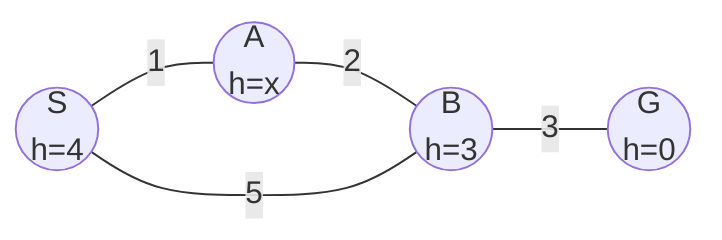
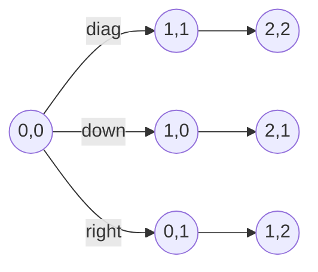
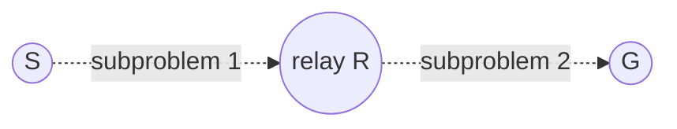

# Week 6 — Monotone Condition and Space-Saving A\*

**Course:** BSCS3003 AI: Search Methods for Problem Solving · **Week 6** · Monotone condition · IDA\* · RBFS · Sequence alignment · Frontier search · DCFS · SMGS · Beam stack search

> **The one question of this week.** A\* is optimal and well-directed, but it stores **every node it generates**. In practice memory runs out long before patience does. Week 6 asks: _how much of OPEN and CLOSED can we throw away and still keep the optimality guarantee?_

**Contents**

1. Recap and the memory problem
2. The monotone (consistent) condition
3. Iterative Deepening A\* (IDA\*)
4. Recursive Best First Search (RBFS)
5. Sequence alignment — the motivating problem
6. Pruning CLOSED: frontier search, DCFS, SMGS
7. Pruning OPEN: upper bound U, beam search, BFHS, beam stack search
8. Divide-and-conquer versions: DC-BFHS and DCBSS
9. One graph, every algorithm — outcome comparison
10. Complexity — results and derivations
11. Merits and demerits
12. Exam traps and speed tricks
13. Difficult solved examples (exam pattern)
14. One-page revision sheet

---

## 1. Recap and the memory problem

Week 5 notation carries over: k(m,n) edge cost, g(n), h(n), f(n) = g(n) + h(n), h\*(n) true cost-to-go, C\* optimal cost.

A\* keeps two lists:

| List | Holds | Why A\* keeps it |
|---|---|---|
| OPEN | generated, not yet expanded nodes (the **frontier**) | to choose the next node to expand |
| CLOSED | expanded nodes | (1) to avoid re-expanding a state, (2) to **reconstruct the path** through parent pointers, (3) to detect a cheaper path to an expanded node |

Both grow exponentially with depth in a tree-like space. In a grid-like space (sequence alignment), **OPEN grows linearly and CLOSED grows quadratically** — so CLOSED is the bigger target. Week 6 attacks the two lists from two sides:

- **Linear-space algorithms** that keep neither list: **IDA\***, **RBFS**.
- **Pruning CLOSED**: frontier search → **DCFS**, **SMGS**.
- **Pruning OPEN** with an upper bound U: **beam search**, **BFHS**, **beam stack search** → **DC-BFHS**, **DCBSS**.

The monotone condition (Section 2) is what makes several of these safe.

---

## 2. The monotone (consistent) condition

### 2.1 Definition in simple words

A heuristic h is **monotone** if, for every edge from m to its successor n,

**h(m) − h(n) ≤ k(m, n)**

In words: _the estimate cannot drop by more than the cost of the edge you just paid_. The heuristic underestimates the cost of **every edge**, not just the whole remaining path. It is a **triangle inequality**: h(m) ≤ k(m,n) + h(n). For an undirected graph the condition must hold in both directions, i.e. |h(m) − h(n)| ≤ k(m, n).

| Property | Admissible | Monotone (consistent) |
|---|---|---|
| Statement | h(n) ≤ h\*(n) | h(m) − h(n) ≤ k(m,n) on every edge, and h(goal) = 0 |
| Scope | global — compares with the whole optimal path | local — one edge at a time |
| How to check | need h\* (run Dijkstra backwards from the goal) | check each edge — no h\* needed |
| Relationship | weaker | **stronger: monotone ⇒ admissible** |

### 2.2 Three results you must be able to derive

**R1 — f never decreases along a path.** For a successor n of m on the path being built, g(n) = g(m) + k(m,n). Then

f(m) = g(m) + h(m) ≤ g(m) + k(m,n) + h(n) = g(n) + h(n) = f(n).

**R2 — monotone ⇒ admissible.** Take any path n = n0, n1, …, nk = goal. Adding the edge inequalities h(n_i) − h(n_{i+1}) ≤ k(n_i, n_{i+1}) for all i, the left side telescopes:

h(n) − h(goal) ≤ cost of the path. With h(goal) = 0 and the optimal path: h(n) ≤ h\*(n). ∎

**R3 — when A\* picks a node, it already has the optimal g for it.** Suppose A\* picks n with g(n) > g\*(n). By the Week 5 lemma there is a node n′ on OPEN on an optimal path to n with g(n′) = g\*(n′). By R1 along that optimal path, f(n′) ≤ g\*(n) + h(n) < g(n) + h(n) = f(n), so n′ would have been picked before n. Contradiction. ∎

**Consequences for A\*:**

- A node is closed with its final g — **case 3 (improving a CLOSED node) never happens**, so **PropagateImprovement is never needed**.
- Nodes are expanded in **non-decreasing order of f**. All nodes with f < C\* are expanded; none with f > C\*.
- CLOSED is needed only to stop re-expansion and to rebuild the path — which is exactly what frontier search (Section 6) exploits.

### 2.3 Simple solved example — monotone vs admissible

Graph (undirected): S–A 1, A–B 2, B–G 3, S–B 5. h(S) = 4, h(B) = 3, h(G) = 0, h(A) = x. For which x is h admissible? monotone?



- h\*: G 0, B 3, A 5 (A–B–G), S 6 (S–A–B–G). h(S) = 4 ≤ 6 and h(B) = 3 ≤ 3 are fine.
- **Admissible:** x ≤ h\*(A) = 5 → **0 ≤ x ≤ 5**.
- **Monotone:** edge S–A: |4 − x| ≤ 1 → 3 ≤ x ≤ 5. Edge A–B: |x − 3| ≤ 2 → 1 ≤ x ≤ 5. Edges S–B (|4 − 3| ≤ 5) and B–G (|3 − 0| ≤ 3) hold. → **3 ≤ x ≤ 5**.

So x = 0, 1, 2 are admissible but not monotone — exactly the Week 5 situation where a closed node may be reopened. (A\* still returns the optimal cost 6 for every x from 0 to 6 on this tiny graph; admissibility is sufficient, not necessary.)

---

## 3. Iterative Deepening A\* (IDA\*)

### 3.1 Idea in simple words

DFID (Week 2) gave BFS's guarantee with DFS's linear memory by re-running a depth-bounded DFS with bound 0, 1, 2, …. **IDA\* does the same with an f-bound instead of a depth-bound.**

- Iteration 1: bound = f(S) = h(S). Run DFS; never go below a node whose f exceeds the bound.
- Next iteration: bound = **the smallest f-value that exceeded the bound** in the previous iteration ("the cheapest unexpanded node on OPEN").
- Stop when the goal is reached within the bound.

### 3.2 Algorithm

```text
IDA*(S)
1  bound ← f(S) = h(S)
2  loop
3      (result, next) ← BoundedDFS(S, g = 0, bound)
4      if result = FOUND then return path
5      if next = ∞ then return FAILURE           -- nothing was cut off: no solution
6      bound ← next                               -- smallest f that exceeded the bound

BoundedDFS(N, g, bound)
1  f ← g + h(N)
2  if f > bound then return (CUT, f)               -- remember the overflow value
3  if GoalTest(N) then return (FOUND, f)
4  next ← ∞
5  for each child C of N not already on the current path
6      (r, v) ← BoundedDFS(C, g + k(N, C), bound)
7      if r = FOUND then return (FOUND, v)
8      next ← min(next, v)
9  return (CUT, next)
```

No OPEN priority queue and no CLOSED list — only the current path (a stack). **Space O(b·d).**

### 3.3 Simple solved example — IDA\* on graph H (from Week 5, Problem P1)

H (undirected): S–A 4, S–B 2, S–C 6, A–B 1, A–D 3, B–E 7, C–E 2, C–F 6, D–F 4, D–G 9, E–F 3, F–G 2. h: S 9, A 7, B 8, C 6, D 5, E 4, F 2, G 0 (admissible and monotone). Children tried alphabetically; a node already on the current path is skipped.

| Iteration | Bound | Nodes visited within bound, with f (DFS order) | Smallest overflow → next bound |
|---|---|---|---|
| 1 | 9 | S(9) | A 11, B 10, C 12 → **10** |
| 2 | 10 | S(9) B(10) A(10) [via B] | **11** |
| 3 | 11 | S(9) A(11) B(10) A(10) D(11) | **12** |
| 4 | 12 | S(9) A(11) D(12) B(10) A(10) D(11) F(12) G(12) | goal found |

Result: **S → B → A → D → F → G, cost 12** — the same optimal path as A\*. Total node visits 1 + 3 + 5 + 8 = **17**, against **8** picks for A\*. The extra work is the price of keeping only one path in memory.

Note iteration 3: A is reached twice — once directly from S (g 4, f 11) and once via B (g 3, f 10). IDA\* has no CLOSED list, so it cannot know it has seen A before.

### 3.4 Properties and problems

- **Optimal** with an admissible h; **complete** under the Week 5 conditions; **space O(b·d)**.
- Problem 1 — **no CLOSED list**: in graphs with many paths to the same state (grids!) it re-explores each path. In a grid the number of paths to a node grows exponentially even though the number of nodes grows only quadratically.
- Problem 2 — **bound grows only to the next f-value**: if f-values are all distinct (real-valued costs), each iteration adds just one new node → N iterations for N nodes → O(N²) work (Section 10).
- Problem 3 — **no sense of direction inside an iteration**: children are tried in a fixed order, not best-first.

---

## 4. Recursive Best First Search (RBFS)

### 4.1 Idea in simple words

RBFS is **hill climbing with backtracking**, in linear space. It goes down the best child, but it remembers the value of the **second-best alternative** seen higher up. The moment the best child below gets worse than that alternative, it **rolls back** to it — and on the way up it **backs up** the best f-value found below each node, so that if it ever returns it knows how good that subtree really is.

### 4.2 Algorithm (Korf's version, as described in the lectures)

```text
RBFS(N, F(N), limit)                        -- F(N): stored (backed-up) value of N
1  if GoalTest(N) then return SUCCESS
2  children ← MoveGen(N) minus nodes on the current path
3  if children is empty then return (FAIL, ∞)
4  for each child C
5      f(C) ← g(C) + h(C)
6      if f(N) < F(N) then F(C) ← max(f(C), F(N))   -- N was visited before: inherit its backed-up value
7      else F(C) ← f(C)
8  loop
9      best ← child with the lowest F           -- ties alphabetical
10     if F(best) > limit then return (FAIL, F(best))   -- back up the best value below N
11     alt ← lowest F among the other children (∞ if none)
12     (r, F(best)) ← RBFS(best, F(best), min(limit, alt))
13     if r = SUCCESS then return SUCCESS
```

Call: RBFS(S, h(S), ∞). Memory: the current path plus the children of each node on it → **O(b·d)**.

### 4.3 Simple solved example — RBFS on graph H

| Step | Call | What happens | Backed-up value |
|---|---|---|---|
| 1 | RBFS(S, 9, ∞) | children A 11, B 10, C 12 → best B, alt 11 | |
| 2 | RBFS(B, 10, 11) | children A 10, E 13 → best A, alt 13; limit min(11, 13) = 11 | |
| 3 | RBFS(A, 10, 11) | only child D 11 | |
| 4 | RBFS(D, 11, 11) | children F 12, G 15 → best 12 > 11 | D = **12** |
| 5 | back in A, then B | A's best is now 12 > 11; B's best (A) is 12 > 11 | A = 12, B = **12** |
| 6 | back at S | children A 11, B 12, C 12 → best A, alt 12 (B before C alphabetically) | |
| 7 | RBFS(A, 11, 12) | children B 13, D 12 → D | |
| 8 | RBFS(D, 12, 12) | children F 13, G 16 → 13 > 12 | D = 13, A = **13** |
| 9 | back at S | A 13, B 12, C 12 → best B, alt C 12, limit 12 | |
| 10 | RBFS(B, 12, 12) | f(B) = 10 < F(B) = 12 → children inherit: A max(10,12) = 12, E max(13,12) = 13 | |
| 11 | down A → D → F → G | each at F = 12 ≤ limit 12 | goal |

Result: **S → B → A → D → F → G, cost 12.** RBFS made 11 recursive calls here (A\*: 8 picks, IDA\*: 17 visits).

### 4.4 RBFS vs IDA\*

| | IDA\* | RBFS |
|---|---|---|
| Order inside an iteration | fixed (left to right) | best-first (lowest F) |
| Memory | O(b·d) | O(b·d) |
| Re-expansion | whole tree every iteration | only when it rolls back and returns |
| Node expansions (non-decreasing cost function) | more | **fewer than IDA\*** (Khemani) |
| Weakness | many iterations for distinct f-values | can thrash between two subtrees with close values |

---

## 5. Sequence alignment — the motivating problem

### 5.1 The problem

Given two DNA strings over {A, C, G, T}, write them one above the other, inserting gaps "-" anywhere, to make them as similar as possible. Costs (one common choice; use whatever the question gives):

| Event | Cost here |
|---|---|
| match (X aligned with the same letter) | 0 |
| **mismatch** (X aligned with a different letter Y) | 3 |
| **indel** (a letter aligned with a gap) | 2 |

(A **similarity** score is the opposite view — reward matches, penalise the rest — and turns the problem into maximisation. Minimising a distance is equivalent.)

### 5.2 As a search problem

- **State** (i, j): first i letters of X and first j letters of Y are already aligned. Start (0,0), goal (|X|, |Y|).
- **Moves** from (i, j): diagonal to (i+1, j+1) = align X[i] with Y[j] (match/mismatch); down to (i+1, j) = X[i] with a gap; right to (i, j+1) = Y[j] with a gap.
- The state space is a **grid graph**, and every alignment is a path from corner to corner.
- **Heuristic:** h(i, j) = indel × |(|X| − i) − (|Y| − j)|. The leftover lengths differ by that much, so at least that many gaps are still needed. Each move changes the difference by at most 1 and costs at least the change → **monotone** (and so admissible).



### 5.3 Simple solved example

X = GCAT, Y = GAT. Cost table D(i, j) = cheapest cost to reach (i, j) (rows i = 0..4, columns j = 0..3):

| i \ j | 0 | 1 (G) | 2 (A) | 3 (T) |
|---|---|---|---|---|
| 0 | 0 | 2 | 4 | 6 |
| 1 (G) | 2 | **0** | 2 | 4 |
| 2 (C) | 4 | **2** | 3 | 5 |
| 3 (A) | 6 | 4 | **2** | 4 |
| 4 (T) | 8 | 6 | 4 | **2** |

Optimal cost **2**: `GCAT` over `G-AT` (one indel for C). A\* with the heuristic expands only 6 states: (0,0) (1,1) (1,0) (2,1) (3,2) (4,3) — almost exactly the optimal diagonal path.

### 5.4 Why it breaks A\* on long strings

For two strings of length L, the grid has (L + 1)² states. A\* run on random strings (verified):

| L | CLOSED at the end | largest OPEN |
|---|---|---|
| 50 | 1,061 | 103 |
| 100 | 4,295 | 206 |
| 200 | 16,211 | 408 |

Doubling L multiplies CLOSED by about 4 (**quadratic**) but OPEN only by about 2 (**linear**). Real genome alignment has L in the millions — CLOSED must go.

---

## 6. Pruning CLOSED: frontier search, DCFS, SMGS

### 6.1 Frontier search

**Idea:** keep **only OPEN**; throw CLOSED away. Two problems arise and are solved:

1. **Leaking back.** Without CLOSED, a node could regenerate its already-expanded parent. Fix: each node on OPEN remembers which neighbours are already expanded ("used operators") and is **barred from generating them**. The search only moves forward — it never leaks back.
2. **No path.** Parent pointers lived in CLOSED, so frontier search finds the **optimal cost** but **cannot reconstruct the optimal path**.

This is safe for optimality when h is monotone, because an expanded node never needs to be reopened (Section 2.2).

### 6.2 Divide and Conquer Frontier Search (DCFS)

**Idea:** to recover the path, remember **one** node from the middle of it.

- When the search crosses roughly the halfway mark — a node on OPEN with **g(n) ≈ h(n)** — mark that layer as **relay nodes**. Every descendant generated afterwards carries a pointer to its relay ancestor.
- When the goal is reached, its relay pointer names a node R that lies on an optimal path.
- **Recurse:** solve S → R and R → G the same way. Each half again finds its own middle node, and so on, until the pieces are single edges.



Memory: only the frontier (plus the relay layer) → O(L) for alignment instead of O(L²). Time: each level of recursion re-searches parts of the space, adding a modest (logarithmic-depth) overhead.

### 6.3 Smart Memory Graph Search (SMGS)

**Idea:** memory is cheap and plentiful today, so do not divide and conquer unless you must.

- Run A\* normally, but **monitor available memory**.
- Keep identifying a layer of **boundary nodes** (nodes that stop the search from looking back, like the frontier's edge). They are candidates for relays.
- **Only when memory is about to run out**, convert the boundary layer into a **relay layer** and drop the CLOSED nodes behind it.
- If memory never runs out, SMGS is simply A\* and makes no recursive calls.

---

## 7. Pruning OPEN: upper bound U, beam search, BFHS, beam stack search

### 7.1 The key tool: an upper bound U

Any path from S to G, found quickly by any method (beam search, weighted A\*, a greedy run), costs U ≥ C\*. Then **any node with f(n) > U can be dropped from OPEN**: with an admissible h, no solution through n can cost less than f(n) > U ≥ C\*. This prunes OPEN safely.

### 7.2 Beam search (recap, with a bound)

Keep only the **best w nodes** at each depth (beam width w). Memory O(w·d). Fast but **incomplete**: the only good path may have been cut from the beam.

### 7.3 Breadth-First Heuristic Search (BFHS)

**Idea:** breadth-first search, layer by layer, but **only keep nodes with f ≤ U**.

- Layer-wise expansion means a node's neighbours lie in the previous, current or next layer only (in many problems), so only a **few layers** need to be stored to prevent leaking back — older layers can be deleted.
- Nodes with f > U are never stored.
- Finds the optimal cost (breadth-first + admissible pruning), with far less memory than A\*.

### 7.4 Beam Stack Search (BSS)

**Idea:** beam search + **systematic backtracking**, which makes it **complete and optimal**.

- A **beam stack** has one entry per level: a half-open range **[fmin, fmax)**. At level ℓ, only the children (at level ℓ + 1) with fmin ≤ f < fmax are in the beam. fmax is set so that at most w nodes fit.
- When the search below the current beam fails (dead end, or everything exceeds U), it **backtracks**: the entry for that level becomes **[old fmax, U]** — the next slice of nodes is regenerated and tried.
- When a cheaper solution is found, U is lowered and more is pruned. When all ranges are exhausted, the last solution found is optimal.

**Mini example (beam width 2, U = 12).** Level-1 children of S have f-values A 5, B 6, C 7, D 9, E 13.

- First entry **[5, 7)**: beam = {A, B} (C at 7 is the first that does not fit). E (13 > U) is never stored.
- Search below A and B fails → backtrack: entry becomes **[7, 12]** → beam = {C, D}, regenerated from S.
- If a solution of cost 10 is found below C, U becomes 10 and any range above 10 is pruned.

---

## 8. Divide-and-conquer versions: DC-BFHS and DCBSS

BFHS and BSS keep only a few layers in memory, so — like frontier search — they cannot rebuild the path. Add relay layers and recurse:

| Full form | Abbreviation | What it is |
|---|---|---|
| Iterative Deepening A\* | IDA\* | DFS with an increasing f-bound |
| Recursive Best First Search | RBFS | linear-space best-first with backed-up values |
| Divide and Conquer Frontier Search | DCFS | frontier search + relay nodes + recursion |
| Smart Memory Graph Search | SMGS | A\* that creates relay layers only when memory runs low |
| Breadth First Heuristic Search | BFHS | layer-wise search keeping only nodes with f ≤ U |
| **Divide and Conquer Breadth First Heuristic Search** | **DC-BFHS** | BFHS + relay layer + recursion |
| Beam Stack Search | BSS | beam search + beam stack of [fmin, fmax) ranges for backtracking |
| **Divide and Conquer Beam Stack Search** | **DCBSS** | BSS + relay layer + recursion — memory of only a few beams |

(Both bold full forms were asked verbatim in end-term papers.)

---

## 9. One graph, every algorithm — outcome comparison

Graph H, heuristic as in Section 3.3 (monotone).

| Algorithm | Path | Cost | Work | Memory held at once |
|---|---|---|---|---|
| A\* | S-B-A-D-F-G | 12 | 8 picks | OPEN + CLOSED (all 8 nodes) |
| IDA\* | S-B-A-D-F-G | 12 | 4 iterations, 17 visits | one path (≤ 6 nodes) |
| RBFS | S-B-A-D-F-G | 12 | 11 calls | one path + siblings |
| Weighted A\*, w = 2 | S-A-D-F-G | 13 | 5 picks | OPEN + CLOSED |

The linear-space algorithms keep A\*'s answer and pay in repeated work.

---

## 10. Complexity — results and derivations

**Monotone A\*.** Each node is expanded at most once → expansions ≤ number of states with f ≤ C\*. No reopening cost.

**IDA\* time.** If the number of nodes with f ≤ bound grows geometrically by a factor b from one iteration to the next (as with integer costs and depth), the last iteration dominates, exactly as for DFID: total ≈ N·b/(b − 1) = O(N). If **all f-values are distinct**, each iteration admits just one new node: iteration i visits i nodes, so total = 1 + 2 + … + N = **N(N+1)/2 = O(N²)**, where N is the number of nodes A\* would expand. Space **O(b·d)**.

**RBFS.** Space **O(b·d)** (path plus siblings). Time: never worse in expansions than IDA\* with a monotone cost function; worst case exponential through repeated roll-backs.

**Sequence alignment (strings of length L).** Grid states (L + 1)² → A\* time and CLOSED O(L²), OPEN O(L). Frontier search: space O(L). DCFS: space O(L), time O(L²) per level with a logarithmic number of recursion levels.

**Beam / BFHS / BSS.** Beam search: space O(w·d). BFHS: a few layers of width ≤ (number of nodes with f ≤ U per layer). BSS: O(w·d) nodes plus a stack of d ranges. DC versions: a few layers/beams only.

---

## 11. Merits and demerits

| Algorithm | Merits | Demerits |
|---|---|---|
| A\* + monotone h | no reopening, no propagation; f non-decreasing | memory O(all generated) |
| IDA\* | linear space; optimal; trivial to code | repeats work; distinct f-values → O(N²); no CLOSED → re-explores paths |
| RBFS | linear space; best-first order; fewer expansions than IDA\* | thrashing between subtrees; still repeats work |
| Frontier search | drops CLOSED (quadratic → linear for alignment) | cannot rebuild the path alone |
| DCFS | path recovered with frontier memory | extra time for recursive sub-searches |
| SMGS | behaves as A\* when memory suffices | needs memory monitoring; complex |
| Beam search | tiny memory, fast | incomplete, not optimal |
| BFHS | stores only nodes with f ≤ U, few layers | needs a good U; layered structure |
| BSS / DCBSS | complete and optimal with beam-sized memory | regeneration on backtracking costs time |

---

## 12. Exam traps and speed tricks

1. **Monotone is checked edge by edge** (both directions for undirected graphs): |h(m) − h(n)| ≤ k(m,n). Admissible needs h\*. Do not confuse the two.
2. **Monotone ⇒ admissible**, not the reverse. Week 5's G2 is admissible and not monotone.
3. With monotone h, A\* **never reopens** CLOSED nodes; the first time a node is picked its g is optimal.
4. **IDA\* next bound = smallest f that exceeded the current bound** — not "bound + 1", not the next node's g.
5. IDA\* checks only the **current path** for loops; the same state can appear many times in one iteration (A in iteration 3 of Section 3.3).
6. RBFS **backs up the lowest F** of the children when it rolls back; on return, children **inherit** max(f(child), F(parent)).
7. Frontier search finds the **cost** but not the **path**; DCFS adds relay nodes (g ≈ h) to rebuild it.
8. OPEN grows **linearly**, CLOSED **quadratically** in alignment grids — so prune CLOSED first.
9. Upper-bound pruning: drop n when **f(n) > U** (needs admissible h). Equality must be kept.
10. Full forms: DCBSS = Divide and Conquer **Beam Stack** Search; DC-BFHS = Divide and Conquer **Breadth First Heuristic** Search.

---

## 13. Difficult solved examples (exam pattern)

### P1 — Range of h-values: admissible vs monotone

Section 2.3, answered: admissible for **0 ≤ x ≤ 5**, monotone for **3 ≤ x ≤ 5**. Speed trick: monotone range = intersection over every edge at A of [h(nbr) − k, h(nbr) + k], then intersect with [0, h\*(A)].

### P2 — IDA\* bound sequence and node count

On H (Section 3.3): bounds **9, 10, 11, 12**; visits per iteration **1, 3, 5, 8**; total **17**; path S-B-A-D-F-G, cost 12.

Follow-up: _If every edge cost were multiplied by 1.01 except one, how many iterations could IDA\* need?_ — With distinct f-values each iteration can admit just one new node, so IDA\* may need up to one iteration per node it eventually visits within C\* — each iteration re-searching from scratch (the O(N²) case of Section 10).

### P3 — RBFS backed-up values

On H, the values RBFS backs up are, in order: **D = 12, A = 12, B = 12**, then **D = 13, A = 13**; finally it re-enters B with F(B) = 12 and its children inherit 12 and 13. Path S-B-A-D-F-G.

### P4 — Is this heuristic monotone? (8-puzzle)

h1 = misplaced tiles, h2 = Manhattan distance. One move slides one tile by one cell, cost 1.

- h1: the moved tile goes from misplaced to placed or vice versa (or stays misplaced) → |Δh1| ≤ 1 = cost → **monotone**.
- h2: the moved tile's Manhattan distance changes by exactly 1, others unchanged → |Δh2| = 1 ≤ 1 → **monotone**.
- 2 × h2: |Δ| = 2 > 1 → **not monotone** (and not admissible).

### P5 — Sequence alignment cost

X = GCATGCA, Y = GATTACA, mismatch 3, indel 2. Answer **cost 7**: `GCAT-GCA` over `G-ATTACA` — two indels (2 + 2) and one mismatch G/A (3). (Verified by dynamic programming and by A\* with the gap heuristic; A\* closed 16 of the 64 grid states.)

### P6 — Growth of OPEN and CLOSED

_For an L × L alignment grid, state the growth of OPEN and CLOSED, and which list frontier search removes._ OPEN = O(L) (one anti-diagonal band), CLOSED = O(L²) (everything behind it). Frontier search removes CLOSED.

### P7 — Full forms (end-term pattern)

DCBSS → **Divide and Conquer Beam Stack Search**. DC BFHS → **Divide and Conquer Breadth First Heuristic Search**. SMGS → Smart Memory Graph Search. DCFS → Divide and Conquer Frontier Search. RBFS → Recursive Best First Search.

### P8 — Concept MSQ set (mark all true)

1. _A monotone heuristic_ — is admissible ✓; makes f non-decreasing along paths ✓; makes PropagateImprovement unnecessary ✓; guarantees IDA\* uses linear time ✗.
2. _IDA\*_ — uses space linear in depth ✓; keeps a CLOSED list ✗; sets the next bound to the least f that exceeded the old bound ✓; returns an optimal path with admissible h ✓.
3. _Frontier search_ — keeps OPEN only ✓; can reconstruct the path by itself ✗; prevents leaking back by barring generation of expanded neighbours ✓.
4. _Pruning nodes with f > U_ — is safe if h is admissible and U is the cost of a known solution ✓; is safe even if h overestimates ✗.
5. _Beam stack search_ — is complete ✓; stores [fmin, fmax) per level ✓; is the same as beam search ✗.

---

## 14. One-page revision sheet

**Monotone.** h(m) − h(n) ≤ k(m,n) on every edge (|…| for undirected), h(goal) = 0 ⇒ f non-decreasing ⇒ picked node has optimal g ⇒ no reopening ⇒ admissible.

**Linear space.** IDA\*: bound ← h(S); repeat bounded DFS; bound ← least overflow f. RBFS: best child with limit = min(limit, second-best F); roll back and back up the least F; children inherit max(f, F(parent)).

**Prune CLOSED.** Frontier search (no CLOSED, no leaking back, no path) → DCFS (relay at g ≈ h, recurse on two halves) → SMGS (relay only when memory runs low).

**Prune OPEN.** U = any solution cost; drop f > U. Beam (width w, incomplete) → BFHS (layers, f ≤ U) → BSS (beam stack [fmin, fmax), backtracking, complete) → DC-BFHS, DCBSS.

**Numbers to quote.** Alignment grid: OPEN O(L), CLOSED O(L²). IDA\* with distinct f: O(N²). H example: A\* 8 picks, IDA\* 17 visits, RBFS 11 calls, all cost 12.

**Bridge to Week 7.** Search so far has been one agent against a static world. Week 7 adds an opponent: game trees, Minimax, Alpha-Beta and SSS\* — and SSS\* turns out to be "A\* in the space of strategies".
