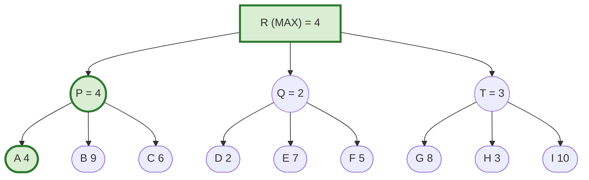
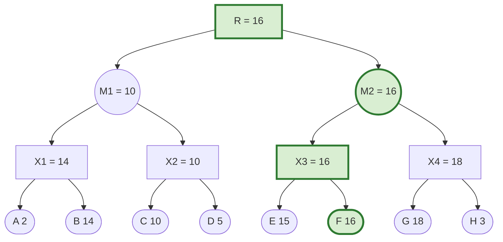

# Week 7 — Game Playing

**Course:** BSCS3003 AI: Search Methods for Problem Solving · **Week 7** · Game theory · Game trees · Minimax · Alpha-Beta · SSS\*

> **The one question of this week.** Until now the world sat still while we searched. Now an **opponent** moves after every move we make, and tries to make things worse for us. _How do we choose a move that is best even when the other side plays perfectly — and how do we avoid looking at most of the game tree while doing it?_

**Contents**

1. Game theory in one page
2. Board games and game trees
3. Strategies — what a "solution" means in a game
4. Limited lookahead: k-ply search and evaluation functions
5. Algorithm Minimax
6. Algorithm Alpha-Beta
7. Algorithm SSS\*
8. One tree, every algorithm — outcome comparison
9. Complexity — results and derivations
10. Merits and demerits
11. Exam traps and speed tricks
12. Difficult solved examples (exam pattern)
13. One-page revision sheet

---

## 1. Game theory in one page

Game theory models situations where several **rational** players each choose actions, and each player's payoff depends on what the **others** choose.

| Classification | Types |
|---|---|
| By total payoff | **zero-sum** (one's gain is the other's loss — board games), positive-sum (cooperation pays), negative-sum (most players lose) |
| By players | two-player, multi-player, team games (team games are often zero-sum between teams) |
| By information | complete/perfect information (chess) vs incomplete (cards) |
| By chance | deterministic vs stochastic (dice) |

**Nash equilibrium:** an outcome where **no player can improve its payoff by changing its own decision alone**.

**Prisoner's Dilemma** (payoffs = minus years in prison, row player A, column player B):

| A \ B | Cooperate (stay silent) | Defect (betray) |
|---|---|---|
| **Cooperate** | −1, −1 | −3, 0 |
| **Defect** | 0, −3 | −2, −2 |

Whatever B does, A does better by defecting (0 > −1, and −2 > −3); the same holds for B. So **(Defect, Defect)** is the Nash equilibrium — even though (Cooperate, Cooperate) would be better for both. Rational individual choices can produce an outcome nobody wanted.

**This course focuses on:** two-person, zero-sum, complete-information, deterministic **board games** (chess, checkers, tic-tac-toe, Go).

---

## 2. Board games and game trees

- A **game tree** is a layered tree seen from **MAX**'s point of view. MAX moves at the root; MAX and MIN alternate by level. One level = one **ply** (a half-move).
- A **game** is one path from the root to a leaf. Leaves are labelled with the outcome for MAX: Win / Draw / Loss, or a number (bigger is better for MAX).
- **Minimax backup rule:** a MAX node takes the **maximum** of its children's values, a MIN node the **minimum**. With both players perfect, the backed-up value at the root is the **value of the game**.
- Convention used in diagrams here (and in the course figures): **MAX nodes are squares, MIN nodes are circles**.

Size: tic-tac-toe has at most 9! ≈ 3.6 × 10⁵ move sequences; chess has a branching factor of about 35 and games of about 80 plies, so roughly 35⁸⁰ ≈ 10¹²³ paths. **Complexity of a game = size of its game tree**, and most game trees are far too big to search completely.

---

## 3. Strategies — what a "solution" means in a game

A path is not a solution, because MAX does not control MIN's replies. A **strategy for MAX** is a **subtree** that says what MAX will do in every situation MIN can lead it to:

```text
ConstructStrategy(MAX)
  traverse the tree from the root
  at a MAX level: choose ONE branch          -- MAX decides
  at a MIN level: choose ALL branches        -- MAX must be ready for every reply
  return the subtree constructed
```

The **value of a strategy** is the **minimum** leaf value in it (MIN will steer to the worst leaf for MAX). The **best strategy** has the largest such minimum — exactly the minimax value.

**Counting strategies** (complete binary tree, k plies, MAX at the root): inside one strategy, MAX nodes appear at depths 0, 2, 4, … and each MIN node keeps both children, so a strategy contains 1 + 2 + 4 + … = 2^⌈k/2⌉ − 1 MAX decision nodes, each with 2 choices:

**number of MAX strategies = 2^(2^⌈k/2⌉ − 1)** → k = 2: 2 · k = 3: 8 · k = 4: 8 · k = 6: 128 (verified by enumeration).

---

## 4. Limited lookahead: k-ply search and evaluation functions

Since the full tree cannot be searched, the program looks **k plies ahead**, scores the positions at that **horizon** with a static **evaluation function**, backs the scores up with minimax, plays the best move, waits for MIN's reply, and repeats:

```text
GamePlay(MAX)
  while game not over
      k-ply search from the current position     -- minimax / alpha-beta / SSS* to depth k
      make the chosen move
      get MIN's move
```

**Evaluation function e(N)** — a heuristic in the range [−Large, +Large] estimating how good the board is for MAX. Tic-tac-toe example: **e(N) = (rows, columns, diagonals still open for MAX) − (those still open for MIN)**.

Example: X (MAX) in the centre, O (MIN) in a corner.

```text
 O | . | .
 . | X | .
 . | . | .
```

Lines still free of O (open for MAX): the 8 lines minus the 3 through O's corner (row 1, column 1, main diagonal) = 5. Lines free of X (open for MIN): the 8 lines minus the 4 through the centre = 4. **e = 5 − 4 = +1.**

**Horizon effect.** Because the search stops at a fixed depth, a disaster just beyond the horizon is invisible. The program may also make delaying moves that merely **push an unavoidable loss beyond the horizon**, so the position looks fine at depth k although it is lost. (Remedies: search "noisy" positions deeper — quiescence search — and secondary search on the chosen line.)

---

## 5. Algorithm Minimax

### 5.1 Algorithm

```text
Minimax(N)
 1  if N is a terminal (horizon) node then return eval(N)
 2  if N is a MAX node
 3      value ← −∞
 4      for each child C of N:  value ← max(value, Minimax(C))
 5  else                                   -- MIN node
 6      value ← +∞
 7      for each child C of N:  value ← min(value, Minimax(C))
 8  return value
```

A depth-first traversal that evaluates **every** leaf.

### 5.2 Simple solved example (2-ply, b = 3)

Root R (MAX); MIN children P, Q, T; leaves A–I.



P = min(4, 9, 6) = 4 · Q = min(2, 7, 5) = 2 · T = min(8, 3, 10) = 3 · **R = max(4, 2, 3) = 4**, best move R → P. Minimax evaluates all **9** leaves.

---

## 6. Algorithm Alpha-Beta

### 6.1 The idea in simple words

You do not need the exact value of a move once you know it is **worse than something you already have**.

- At a **MAX** node keep **α** = the best value MAX is already guaranteed. It is a **lower bound** and can only go **up**.
- At a **MIN** node keep **β** = the best value MIN is already guaranteed. It is an **upper bound** and can only go **down**.
- As soon as **α ≥ β** at a node, its remaining children cannot change the decision above it → **prune** them.

Two kinds of cut-off (course naming):

| Cut | Happens at | Caused by | Meaning |
|---|---|---|---|
| **α-cut** | a **MIN** node | the α of a MAX ancestor | "MIN can already hold MAX to ≤ α; MAX will never come here" |
| **β-cut** | a **MAX** node | the β of a MIN ancestor | "MAX can already get ≥ β; MIN will never allow this" |

### 6.2 Algorithm (course version)

```text
AlphaBeta(N, α, β)                        -- initial call: AlphaBeta(root, −∞, +∞)
 1  if N is a terminal node then return eval(N)
 2  if N is a MAX node
 3      for each child C of N
 4          α ← max(α, AlphaBeta(C, α, β))
 5          if α ≥ β then return β           -- β-cut: remaining children pruned
 6      return α
 7  else                                    -- MIN node
 8      for each child C of N
 9          β ← min(β, AlphaBeta(C, α, β))
10          if α ≥ β then return α           -- α-cut: remaining children pruned
11      return β
```

Notes: α and β are passed **down**; values come **up**. The cut test is **α ≥ β** (with equality). When a subtree is entered with a narrower window (α, β), the value returned is exact only if it lies strictly inside the window; otherwise it is just a bound ("fail high" returns β, "fail low" returns α).

### 6.3 Simple solved example — same 2-ply tree

| Step | Node (α, β on entry) | Event | Result |
|---|---|---|---|
| 1 | R (−∞, +∞) → P (−∞, +∞) | A 4 → β = 4; B 9, C 6 do not lower it | P returns 4 |
| 2 | R | α = 4 | |
| 3 | Q (4, +∞) | D 2 → β = 2 ≤ α = 4 → **α-cut**, prune **E, F** | Q returns 4 (bound) |
| 4 | T (4, +∞) | G 8 → β = 8; H 3 → β = 3 ≤ 4 → **α-cut**, prune **I** | T returns 4 (bound) |
| 5 | R | α = 4 | **value 4**, move to P |

Leaves evaluated: A B C D G H (**6 of 9**). Pruned: E, F, I. Two α-cuts, no β-cuts.

### 6.4 Solved example — 3-ply binary tree (used again for SSS\*)

R (MAX) → M1, M2 (MIN) → X1…X4 (MAX) → leaves A–H with values A 2, B 14, C 10, D 5, E 15, F 16, G 18, H 3.



| Step | Node (α, β) | Event |
|---|---|---|
| 1 | X1 (−∞, +∞) | A 2 → α 2; B 14 → α 14 → returns 14 |
| 2 | M1 | β = 14 |
| 3 | X2 (−∞, 14) | C 10 → α 10; D 5 → no change → returns 10 |
| 4 | M1 | β = 10 → returns 10; at R, α = 10 |
| 5 | X3 (10, +∞) | E 15 → α 15; F 16 → α 16 → returns 16 |
| 6 | M2 | β = 16 |
| 7 | X4 (10, 16) | G 18 → α 18 ≥ β 16 → **β-cut**, prune **H**, return 16 |
| 8 | M2 returns 16; R: α = 16 | **value 16**, best move R → M2 |

Leaves evaluated: **7** (A B C D E F G); one β-cut (H).

### 6.5 Move ordering decides everything

Same leaves, different child order (verified by trying all 128 orderings):

| Ordering | Leaves evaluated |
|---|---|
| as drawn | 7 |
| **best** (swap M1 and M2 at the root: strongest move first) | **5** (E F G A B) |
| worst | 8 (no pruning at all) |

**Best case formula** (perfect ordering, uniform b, depth d — Knuth and Moore):

**leaves = b^⌈d/2⌉ + b^⌊d/2⌋ − 1**. For b = 2, d = 3: 4 + 2 − 1 = **5** ✓.

Derivation sketch: with perfect ordering, to **prove** a value you need (i) a MAX strategy — at MAX nodes one child, at MIN nodes all children — and (ii) a MIN strategy — the reverse. One has b^⌈d/2⌉ leaves, the other b^⌊d/2⌋, and they share exactly one leaf (the principal variation). So alpha-beta can search **about twice as deep** as minimax in the same time: O(b^(d/2)) instead of O(b^d).

---

## 7. Algorithm SSS\*

### 7.1 The idea in simple words

Alpha-beta still searches depth-first, left to right. **SSS\*** (Stockman) is **best-first** — it is "A\* in the space of strategies":

- A **solution** is a **strategy** for MAX. A **partial strategy** stands for a **cluster** of complete strategies.
- Each cluster carries **h** = an **upper bound** on the value of every strategy in it (start with +∞).
- Always refine the cluster with the **highest h**. When the best cluster is fully refined (the root becomes SOLVED), its h is the minimax value.

**Initial clusters** (covering all strategies): start at the root; at a **MAX** level choose **all** children; at a **MIN** level choose **one** child (the leftmost); continue to the horizon. Each MAX choice made later splits a cluster; MIN's other replies are checked later.

### 7.2 Algorithm (course version)

OPEN holds triples (node, status, h); status is **LIVE** (not yet examined) or **SOLVED** (its value is known as h). OPEN is a priority queue on **h, highest first**; ties are broken in depth-first (leftmost-first) order unless the question says otherwise.

```text
SSS*(root)
 1  OPEN ← [ (root, LIVE, +∞) ]
 2  loop
 3      (N, status, h) ← pop the element with the highest h
 4      if N = root and status = SOLVED then return h
 5      if status = LIVE
 6          if N is terminal:   add (N, SOLVED, min(h, eval(N)))          -- case 1
 7          else if N is MAX:   add (C, LIVE, h) for EVERY child C         -- case 2
 8          else (N is MIN):    add (first child of N, LIVE, h)            -- case 3
 9      if status = SOLVED
10          P ← parent(N)
11          if N is a MAX node (so P is MIN)
12              if N is P's last child: add (P, SOLVED, h)                 -- case 4
13              else: add (next child of P, LIVE, h)                       -- case 5
14          else (N is a MIN node, so P is MAX)
15              add (P, SOLVED, h)                                         -- case 6
16              remove ALL successors of P from OPEN                       -- pruning step
```

Leaves count as MAX or MIN nodes by their depth (MAX at even depth, root depth 0).

**Why the rules are right.** Case 5: a MIN node must see **all** its children (MAX's strategy must survive every reply), so after one child is solved, the next is opened with the same bound h. Case 6: a MAX node needs only **one** child — the first child to be solved at the top of OPEN is the best one, because every other entry has h no greater; so the other branches of P are discarded.

### 7.3 Solved example — SSS\* on the 3-ply tree of Section 6.4

| # | Popped | Action | OPEN after (h, highest first) |
|---|---|---|---|
| 1 | (R, L, ∞) | MAX: all children | M1 ∞ · M2 ∞ |
| 2 | (M1, L, ∞) | MIN: first child | X1 ∞ · M2 ∞ |
| 3 | (X1, L, ∞) | MAX: all children | A ∞ · B ∞ · M2 ∞ |
| 4 | (A, L, ∞) | leaf → SOLVED min(∞, 2) | B ∞ · M2 ∞ · A 2s |
| 5 | (B, L, ∞) | leaf → SOLVED 14 | M2 ∞ · B 14s · A 2s |
| 6 | (M2, L, ∞) | MIN: first child | X3 ∞ · B 14s · A 2s |
| 7 | (X3, L, ∞) | MAX: all children | E ∞ · F ∞ · B 14s · A 2s |
| 8 | (E, L, ∞) | leaf → SOLVED 15 | F ∞ · E 15s · B 14s · A 2s |
| 9 | (F, L, ∞) | leaf → SOLVED 16 | F 16s · E 15s · B 14s · A 2s |
| 10 | (F, S, 16) | F is MIN-level → X3 SOLVED 16; **prune E (SOLVED)** | X3 16s · B 14s · A 2s |
| 11 | (X3, S, 16) | X3 is MAX, not last child of M2 → next child X4 LIVE 16 | X4 16 · B 14s · A 2s |
| 12 | (X4, L, 16) | MAX: all children | G 16 · H 16 · B 14s · A 2s |
| 13 | (G, L, 16) | leaf → SOLVED min(16, 18) = 16 | G 16s · H 16 · B 14s · A 2s |
| 14 | (G, S, 16) | X4 SOLVED 16; **prune H (LIVE)** | X4 16s · B 14s · A 2s |
| 15 | (X4, S, 16) | last child of M2 → M2 SOLVED 16 | M2 16s · B 14s · A 2s |
| 16 | (M2, S, 16) | R SOLVED 16; **prune B, A (SOLVED)** | R 16s |
| 17 | (R, S, 16) | **return 16** | |

Answers in exam format:

- Minimax value **16**.
- Leaves evaluated (given SOLVED status): **A, B, E, F, G** — 5 leaves (alpha-beta needed 7).
- SOLVED leaves removed by the pruning step: **A, B, E** (ascending order).
- Leaves that never entered OPEN: **C, D**. (H entered as LIVE and was pruned unevaluated.)

### 7.4 Properties

- Returns the **minimax value**.
- **Never evaluates a leaf that alpha-beta (same order) would skip**, and often evaluates fewer (Stockman's result) — 5 vs 7 above.
- Memory: OPEN can hold an exponential number of entries (≈ b^⌈d/2⌉), unlike alpha-beta's O(b·d).
- Overhead: maintaining a sorted OPEN and deleting all successors of a node is expensive, which is why alpha-beta remains popular in practice.
- Starting with h = some bound H instead of +∞ makes SSS\* return **min(minimax value, H)** — useful as a test "is the value ≥ H?" (Problem P5).

---

## 8. One tree, every algorithm — outcome comparison

3-ply binary tree of Section 6.4 (value 16).

| Algorithm | Leaves evaluated | Memory | Notes |
|---|---|---|---|
| Minimax | 8 | O(b·d) | evaluates everything |
| Alpha-Beta, order as drawn | 7 | O(b·d) | one β-cut (H) |
| Alpha-Beta, best order | 5 | O(b·d) | b^⌈d/2⌉ + b^⌊d/2⌋ − 1 |
| Alpha-Beta, worst order | 8 | O(b·d) | no cuts |
| SSS\* (order as drawn) | 5 | OPEN up to 4 entries here; exponential in general | never more than alpha-beta |

---

## 9. Complexity — results and derivations

**Minimax.** Visits every node of a tree with branching b and depth d: 1 + b + … + b^d = O(b^d) time; depth-first → O(b·d) space (O(d) if children are generated one at a time).

**Alpha-Beta.** Worst case (bad ordering): O(b^d), same as minimax. Best case: b^⌈d/2⌉ + b^⌊d/2⌋ − 1 leaves = O(b^(d/2)) — the **effective branching factor drops from b to √b**. Random ordering: about O(b^(3d/4)). Space O(b·d).

**SSS\*.** Time never worse (in leaves) than alpha-beta with the same ordering; space O(b^⌈d/2⌉) for OPEN.

**k-ply binary tree with leaves 0, 1, 2, … (left to right), MAX at the root.** The right subtree of any node holds larger values, so MAX always goes right and MIN always goes left. Reading the path as bits (right = 1, left = 0), the chosen leaf index is 1010…:

- k even: 1010…10 = 2(4^(k/2) − 1)/3 = **2(2^k − 1)/3**.
- k odd: 1010…01 = **(2^(k+1) − 1)/3**.
(Checked by computer for k = 1…8: 1, 2, 5, 10, 21, 42, 85, 170.)

---

## 10. Merits and demerits

| Algorithm | Merits | Demerits |
|---|---|---|
| Minimax | simple, exact for the given depth | evaluates every leaf |
| Alpha-Beta | same value as minimax; huge pruning with good ordering; linear memory | depth-first: quality depends on move ordering |
| SSS\* | best-first; evaluates no more leaves than alpha-beta, often fewer | exponential OPEN; costly queue operations |
| k-ply + eval | makes play possible at all | horizon effect; eval quality limits play |

---

## 11. Exam traps and speed tricks

1. **α lives at MAX nodes, β at MIN nodes.** α only rises, β only falls. Initial call (−∞, +∞) unless the question gives a window.
2. **α-cut happens at a MIN node; β-cut happens at a MAX node** (course naming). Count cuts by where the pruning happens.
3. Cut test is **α ≥ β** — equality cuts too.
4. With a **given window** (α, β) the returned value may be only a bound; the question may ask for the leaves explored, not the exact value.
5. "Pruned leaves" = leaves never evaluated, including whole pruned subtrees (all their leaves).
6. **SSS\*: pop the highest h**; break ties as the question says (usually depth-first / leftmost first).
7. SSS\* MAX node: push **all** children. MIN node: push **first** child. SOLVED MAX-level node: next sibling (or parent SOLVED if last). SOLVED MIN-level node: parent SOLVED + **delete all of the parent's successors**.
8. Distinguish **pruned from OPEN** (entered OPEN, then deleted) from **never entered OPEN**.
9. The minimax value is the same for minimax, alpha-beta (root window −∞, +∞) and SSS\* (initial h = +∞).
10. Best-case leaves: **b^⌈d/2⌉ + b^⌊d/2⌋ − 1** — compute it before tracing to sanity-check your count.
11. Nash equilibrium of the Prisoner's Dilemma: **both defect**.
12. Horizon effect: write "fixed-depth search cannot see beyond depth k; threats just past the horizon are missed or pushed beyond it by delaying moves".

---

## 12. Difficult solved examples (exam pattern)

### P1 — 4-ply tree: alpha-beta cuts and SSS\* in one go

R (MAX) → M1, M2 (MIN) → x1…x4 (MAX) → m1…m8 (MIN) → leaves A–P. Leaf values, left to right:

A 2 · B 18 · C 19 · D 21 · E 17 · F 22 · G 40 · H 13 · I 15 · J 34 · K 33 · L 24 · M 39 · N 38 · O 28 · P 25.

**Backed-up values.** m1…m8 = 2, 19, 17, 13, 15, 24, 38, 25 · x1…x4 = 19, 17, 24, 38 · M1 = 17, M2 = 24 · **R = 24**.

**Alpha-beta (−∞, +∞):**

- Left half M1 is searched completely (A–H all evaluated; no cut is possible because the bounds never cross); M1 returns 17, so at R: α = 17.
- x3 (17, ∞): m5 sees I 15 → β = 15 ≤ α 17 → **α-cut at m5, prune J**. m6: K 33, L 24 → 24. x3 = 24 → M2: β = 24.
- x4 (17, 24): m7 is entered with (17, 24): M 39 and N 38 cannot lower β below 24 → m7 returns 24 → x4: α = 24 ≥ β = 24 → **β-cut at x4, prune m8 (O, P)**.
- Leaves evaluated: **A B C D E F G H I K L M N (13)**; pruned **J, O, P**; cuts: **1 α-cut, 1 β-cut**.

**SSS\* (h = +∞, ties leftmost):** value **24**.

- Leaves given SOLVED status: **A, C, I, K, L, M, N** (7).
- SOLVED leaves removed by pruning: **A, C, I** (ascending).
- Leaves never entering OPEN: **B, D, E, F, G, H, J, O, P**.
- Key events: I solves at 15 but K/L solve m6 at 24 → x3 solved at 24 and I is pruned; x4 is opened with h = 24, m7 solves at 24 (M, N give min(24, 39) and min(24, 38)), so m8 is pruned while LIVE; finally M2 solves at 24 and A, C are pruned.

Lesson: SSS\* used 7 leaf evaluations where alpha-beta used 13 — best-first pays off when the best move is not the leftmost one.

### P2 — Alpha-beta inside a given window (end-term pattern)

Subtree root N (MAX) with MIN children P1 (A 70, B 65), P2 (C 90, D 85), P3 (E 50, F 95). Process N with **α = 60, β = 80**. Which leaves are explored?

- P1 (60, 80): A 70 → β 70; B 65 → β 65 → returns 65 → at N α = 65.
- P2 (65, 80): C 90 → β = min(80, 90) = 80; D 85 → 80 → returns 80 → at N α = 80 ≥ β = 80 → **β-cut at N**, P3 (E, F) pruned.
- Explored leaves **A, B, C, D**; returned value **80** = β, i.e. "fail high" — the true subtree value is 85, but all the window can say is "≥ 80".

### P3 — Choose leaf values to maximise pruning (Quiz pattern)

Subtree: MAX node N with MIN children P1 (A, B) and P2 (C, D). Leaves take distinct values from {1, 2, 3, 4}. N is entered with **α = 2, β = 4**. Which assignments prune the most leaves?

Reasoning: a MIN child is cut after its first leaf when that leaf ≤ α = 2. Only two values (1, 2) are ≤ 2, so put them first in each MIN node: A, C ∈ {1, 2}; B, D ∈ {3, 4}.

All optimal assignments (A, B, C, D): **(1,3,2,4), (1,4,2,3), (2,3,1,4), (2,4,1,3)** — 2 leaves pruned (**B, D**), **2 α-cuts, 0 β-cuts**, minimax value of the subtree **2**. (Verified over all 24 assignments.)

### P4 — Minimax value of a numbered k-ply tree (end-term pattern)

Binary k-ply tree, MAX at the root, leaves numbered 0, 1, 2, … from the left. Answer: **k even → 2((2^k) − 1)/3**; **k odd → (2^(k+1) − 1)/3** (derivation in Section 9). Check: k = 3 → 5 (path right, left, right → leaf 101₂ = 5).

### P5 — SSS\* started with a finite bound

Tree of Section 6.4, but SSS\* starts with **(R, LIVE, 15)**.

- Every leaf is solved at min(15, eval): A 2, B 14, E 15.
- E (15) ties with the LIVE leaf F (15); E is leftmost → X3 is SOLVED at 15 and **F is pruned before it is evaluated**.
- X4 opens with h 15; G solves at min(15, 18) = 15 → X4 SOLVED 15, H pruned (LIVE).
- M2 SOLVED 15 → R SOLVED **15**; A and B pruned.
- Leaves evaluated **A, B, E, G**; never queued **C, D**; returned value **15 = min(16, 15)**. Reading: "the true value is at least 15".

### P6 — Strategies

How many strategies does MAX have in a complete binary 4-ply tree? MAX decision nodes in one strategy: 1 (root) + 2 (both MIN replies lead to MAX nodes at depth 2) = 3; each has 2 choices → **2³ = 8**. For 6 plies: 1 + 2 + 4 = 7 nodes → **2⁷ = 128**.

### P7 — Short answer: the horizon effect (≤ 100 words)

_A k-ply search evaluates positions only down to the fixed depth k (the horizon). Anything that happens beyond it is invisible. So the program can walk into a loss that appears just after the horizon, or it can make delaying moves (for example pointless checks) that push an inevitable loss beyond the horizon, so that the backed-up evaluation looks good although the position is lost. Remedies include searching unstable (noisy) positions deeper — quiescence search — and secondary search along the chosen line._

### P8 — Concept MSQ set (mark all true)

1. _Alpha-beta returns_ — the same root value as minimax ✓; every leaf in the worst move ordering ✓; fewer leaf evaluations with better move ordering ✓; an exact value for every interior node ✗.
2. _An α-cut_ — occurs at a MIN node ✓; prunes the remaining children of that MIN node ✓; occurs when β ≤ α ✓.
3. _SSS\*_ — is best-first in the space of strategies ✓; keeps h as an upper bound on cluster value ✓; uses linear memory ✗; evaluates no leaf that alpha-beta (same order) skips ✓.
4. _Prisoner's Dilemma_ — (Defect, Defect) is the Nash equilibrium ✓; it is the best joint outcome ✗.
5. _Best-case alpha-beta for b = 3, d = 4_ — leaves = 3² + 3² − 1 = **17** ✓ (minimax: 81).

---

## 13. One-page revision sheet

**Game tree.** MAX/MIN alternate; ply = half-move; backup max at MAX, min at MIN. Strategy: MAX picks one child, MIN keeps all; value = min leaf in it; #strategies (binary, k plies) = 2^(2^⌈k/2⌉ − 1).

**Minimax.** Evaluates every leaf: O(b^d) time, O(b·d) space.

**Alpha-beta.** α (MAX, lower bound, rises), β (MIN, upper bound, falls); cut when α ≥ β; MAX returns β on cut (β-cut), MIN returns α on cut (α-cut). Best case b^⌈d/2⌉ + b^⌊d/2⌋ − 1 leaves.

**SSS\*.** OPEN of (node, LIVE/SOLVED, h), pop highest h. LIVE: leaf → SOLVED min(h, e); MAX → all children; MIN → first child. SOLVED: MAX-level → next sibling or parent SOLVED; MIN-level → parent SOLVED and delete all its successors. Returns min(value, initial h).

**Numbers from these notes.** 2-ply example value 4 (6/9 leaves with α-β). 3-ply example value 16: minimax 8, α-β 7, best order 5, SSS\* 5. 4-ply example value 24: α-β 13, SSS\* 7.

**Bridge to Week 8.** Games plan against an adversary; Week 8 plans for a goal in a world that changes only through our own actions — automated planning with STRIPS operators.
