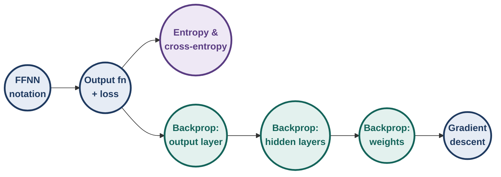
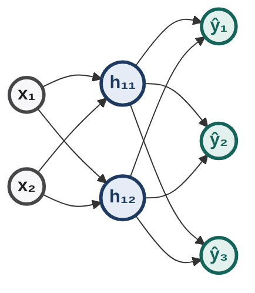
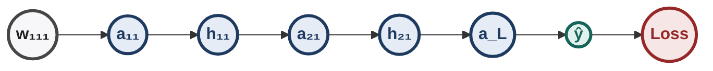
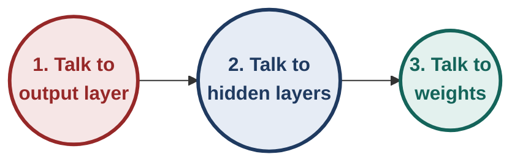
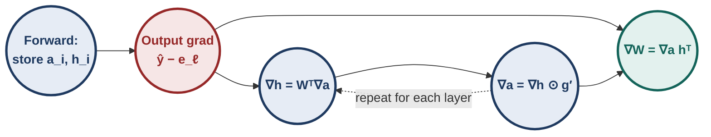
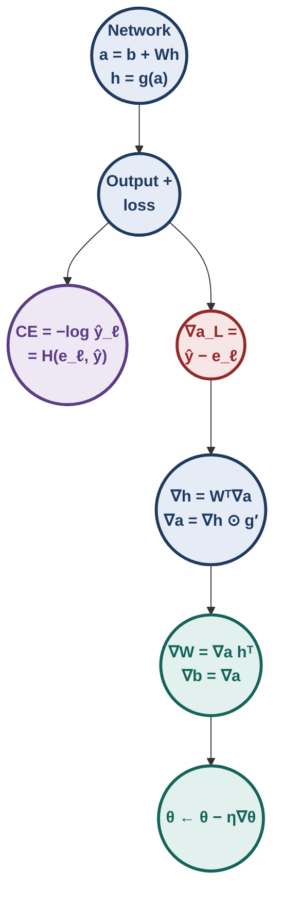

# Deep Learning : Illustrated Notes for Week 3


## Contents

- **Week 3 — Feedforward networks, output functions & losses, backpropagation** ✓
  - 3.0 Week-3 map
  - 3.1 Feedforward neural networks
  - 3.2 Learning the parameters (intuition)
  - 3.3 Output functions and loss functions
  - 3.4 Information content, entropy and cross-entropy
  - 3.5 Backpropagation: the intuition
  - 3.6 Gradient w.r.t. the output units
  - 3.7 Gradient w.r.t. the hidden units
  - 3.8 Gradient w.r.t. the parameters
  - 3.9 The algorithm and its cost
  - 3.10 Full hand run
  - 3.11 Symmetry, vanishing gradients, common slips
  - 3.12 Week-3 exam toolkit & practice set

---


## 3.0 Week-3 map

**[Intuition]** Week 2 trained **one** sigmoid neuron with gradient descent and showed that **networks** of them can approximate anything. Week 3 answers the obvious next question: *how do we train a whole network?*

The answer has three parts:

1. Write the network precisely (layers, shapes, notation).
2. Choose an output function and a loss that match the task.
3. Compute the gradient of the loss with respect to **every** weight efficiently: **backpropagation**.



> [!TIP]
> **Three everyday pictures for the whole week.**
> - **A network is an assembly line.** Raw material (the inputs) passes through stations (layers); each station mixes and reshapes it.
> - **The loss is a grader.** At the end of the line the grader compares the product with the target and announces one number: how wrong we were.
> - **Backpropagation is the blame report.** The grader's number travels *backwards* up the line, and every station learns "how much of this mistake was mine?" so it can adjust its own knobs.

<div class="fig" role="img" aria-label="Animation: forward pass then backward pass through the network">
<svg viewBox="0 0 700 195" width="700" style="font-family:var(--font)" aria-hidden="true">
<line x1="50" y1="48" x2="652" y2="48" style="stroke:var(--blue-ink);stroke-width:2.5;stroke-linecap:round"/><polygon points="660,48 652,52.4 652,43.6" style="fill:var(--blue-ink)"/>
<line x1="660" y1="152" x2="58" y2="152" style="stroke:var(--red-ink);stroke-width:2.5;stroke-linecap:round"/><polygon points="50,152 58,147.6 58,156.4" style="fill:var(--red-ink)"/>
<line x1="75" y1="48" x2="75" y2="76" style="stroke:var(--blue-ink);stroke-width:1.5;stroke-linecap:round;stroke-dasharray:3 4"/>
<line x1="75" y1="124" x2="75" y2="152" style="stroke:var(--red-ink);stroke-width:1.5;stroke-linecap:round;stroke-dasharray:3 4"/>
<line x1="212" y1="48" x2="212" y2="76" style="stroke:var(--blue-ink);stroke-width:1.5;stroke-linecap:round;stroke-dasharray:3 4"/>
<line x1="212" y1="124" x2="212" y2="152" style="stroke:var(--red-ink);stroke-width:1.5;stroke-linecap:round;stroke-dasharray:3 4"/>
<line x1="350" y1="48" x2="350" y2="76" style="stroke:var(--blue-ink);stroke-width:1.5;stroke-linecap:round;stroke-dasharray:3 4"/>
<line x1="350" y1="124" x2="350" y2="152" style="stroke:var(--red-ink);stroke-width:1.5;stroke-linecap:round;stroke-dasharray:3 4"/>
<line x1="488" y1="48" x2="488" y2="76" style="stroke:var(--blue-ink);stroke-width:1.5;stroke-linecap:round;stroke-dasharray:3 4"/>
<line x1="488" y1="124" x2="488" y2="152" style="stroke:var(--red-ink);stroke-width:1.5;stroke-linecap:round;stroke-dasharray:3 4"/>
<line x1="625" y1="48" x2="625" y2="76" style="stroke:var(--blue-ink);stroke-width:1.5;stroke-linecap:round;stroke-dasharray:3 4"/>
<line x1="625" y1="124" x2="625" y2="152" style="stroke:var(--red-ink);stroke-width:1.5;stroke-linecap:round;stroke-dasharray:3 4"/>
<rect x="17" y="76" width="116" height="48" rx="10" style="fill:var(--panel);stroke:var(--line-strong);stroke-width:2"/>
<text x="75" y="97" text-anchor="middle" style="fill:var(--fg);font-size:13px;font-weight:700">Input x</text>
<text x="75" y="113" text-anchor="middle" style="fill:var(--muted);font-size:10.5px;font-weight:400">the data</text>
<rect x="17" y="76" width="116" height="48" rx="10" opacity="0" style="fill:none;stroke:var(--blue-ink);stroke-width:3"><animate attributeName="opacity" values="0;0;1;1;0;0" keyTimes="0;0.0571;0.0714;0.1429;0.1571;1" dur="7.0s" repeatCount="indefinite"/></rect>
<rect x="17" y="76" width="116" height="48" rx="10" opacity="0" style="fill:none;stroke:var(--red-ink);stroke-width:3"><animate attributeName="opacity" values="0;0;1;1;0;0" keyTimes="0;0.8;0.8143;0.8857;0.9;1" dur="7.0s" repeatCount="indefinite"/></rect>
<rect x="154" y="76" width="116" height="48" rx="10" style="fill:var(--panel);stroke:var(--line-strong);stroke-width:2"/>
<text x="212" y="97" text-anchor="middle" style="fill:var(--fg);font-size:13px;font-weight:700">Layer 1</text>
<text x="212" y="113" text-anchor="middle" style="fill:var(--muted);font-size:10.5px;font-weight:400">g(W₁x + b₁)</text>
<rect x="154" y="76" width="116" height="48" rx="10" opacity="0" style="fill:none;stroke:var(--blue-ink);stroke-width:3"><animate attributeName="opacity" values="0;0;1;1;0;0" keyTimes="0;0.1357;0.15;0.2214;0.2357;1" dur="7.0s" repeatCount="indefinite"/></rect>
<rect x="154" y="76" width="116" height="48" rx="10" opacity="0" style="fill:none;stroke:var(--red-ink);stroke-width:3"><animate attributeName="opacity" values="0;0;1;1;0;0" keyTimes="0;0.7214;0.7357;0.8071;0.8214;1" dur="7.0s" repeatCount="indefinite"/></rect>
<rect x="292" y="76" width="116" height="48" rx="10" style="fill:var(--panel);stroke:var(--line-strong);stroke-width:2"/>
<text x="350" y="97" text-anchor="middle" style="fill:var(--fg);font-size:13px;font-weight:700">Layer 2</text>
<text x="350" y="113" text-anchor="middle" style="fill:var(--muted);font-size:10.5px;font-weight:400">g(W₂h₁ + b₂)</text>
<rect x="292" y="76" width="116" height="48" rx="10" opacity="0" style="fill:none;stroke:var(--blue-ink);stroke-width:3"><animate attributeName="opacity" values="0;0;1;1;0;0" keyTimes="0;0.2143;0.2286;0.3;0.3143;1" dur="7.0s" repeatCount="indefinite"/></rect>
<rect x="292" y="76" width="116" height="48" rx="10" opacity="0" style="fill:none;stroke:var(--red-ink);stroke-width:3"><animate attributeName="opacity" values="0;0;1;1;0;0" keyTimes="0;0.6429;0.6571;0.7286;0.7429;1" dur="7.0s" repeatCount="indefinite"/></rect>
<rect x="430" y="76" width="116" height="48" rx="10" style="fill:var(--panel);stroke:var(--line-strong);stroke-width:2"/>
<text x="488" y="97" text-anchor="middle" style="fill:var(--fg);font-size:13px;font-weight:700">Output ŷ</text>
<text x="488" y="113" text-anchor="middle" style="fill:var(--muted);font-size:10.5px;font-weight:400">O(a_L)</text>
<rect x="430" y="76" width="116" height="48" rx="10" opacity="0" style="fill:none;stroke:var(--blue-ink);stroke-width:3"><animate attributeName="opacity" values="0;0;1;1;0;0" keyTimes="0;0.2929;0.3071;0.3786;0.3929;1" dur="7.0s" repeatCount="indefinite"/></rect>
<rect x="430" y="76" width="116" height="48" rx="10" opacity="0" style="fill:none;stroke:var(--red-ink);stroke-width:3"><animate attributeName="opacity" values="0;0;1;1;0;0" keyTimes="0;0.5643;0.5786;0.65;0.6643;1" dur="7.0s" repeatCount="indefinite"/></rect>
<rect x="567" y="76" width="116" height="48" rx="10" style="fill:var(--panel);stroke:var(--line-strong);stroke-width:2"/>
<text x="625" y="97" text-anchor="middle" style="fill:var(--fg);font-size:13px;font-weight:700">Loss ℒ</text>
<text x="625" y="113" text-anchor="middle" style="fill:var(--muted);font-size:10.5px;font-weight:400">ℒ(ŷ, y)</text>
<rect x="567" y="76" width="116" height="48" rx="10" opacity="0" style="fill:none;stroke:var(--blue-ink);stroke-width:3"><animate attributeName="opacity" values="0;0;1;1;0;0" keyTimes="0;0.3714;0.3857;0.4571;0.4714;1" dur="7.0s" repeatCount="indefinite"/></rect>
<rect x="567" y="76" width="116" height="48" rx="10" opacity="0" style="fill:none;stroke:var(--red-ink);stroke-width:3"><animate attributeName="opacity" values="0;0;1;1;0;0" keyTimes="0;0.4857;0.5;0.5714;0.5857;1" dur="7.0s" repeatCount="indefinite"/></rect>
<circle r="6" opacity="0" style="fill:var(--blue-ink)"><animateMotion dur="7.0s" repeatCount="indefinite" calcMode="linear" keyPoints="0;0;1;1" keyTimes="0;0.0571;0.3714;1" path="M50,48 L660,48"/><animate attributeName="opacity" values="0;0;1;1;0;0" keyTimes="0;0.0571;0.06;0.3714;0.3743;1" dur="7.0s" repeatCount="indefinite"/></circle>
<circle r="6" opacity="0" style="fill:var(--red-ink)"><animateMotion dur="7.0s" repeatCount="indefinite" calcMode="linear" keyPoints="0;0;1;1" keyTimes="0;0.4857;0.8;1" path="M660,152 L50,152"/><animate attributeName="opacity" values="0;0;1;1;0;0" keyTimes="0;0.4857;0.4886;0.8;0.8029;1" dur="7.0s" repeatCount="indefinite"/></circle>
<g><text x="355" y="30" text-anchor="middle" style="fill:var(--blue-ink);font-size:13px;font-weight:700">forward pass: predict</text><animate attributeName="opacity" values="0;0;1;1;0;0" keyTimes="0;0.0429;0.0857;0.4429;0.4857;1" dur="7.0s" repeatCount="indefinite"/></g>
<g><text x="355" y="180" text-anchor="middle" style="fill:var(--red-ink);font-size:13px;font-weight:700">backward pass: assign blame</text><animate attributeName="opacity" values="0;0;1;1;0;0" keyTimes="0;0.4714;0.5143;0.8857;0.9286;1" dur="7.0s" repeatCount="indefinite"/></g>
</svg>
<p class="fig-cap">Blue dot: the prediction flows forward through every station and ends in a loss. Red dot: the blame flows backward along the same path, so every station learns how to adjust.</p>
</div>

**How to read this week (build up from the simple to the full picture).** Every section stands on the one before it: (1) a single neuron per layer, with real numbers (§3.1.0); (2) the same recipe repeated, as vectors and matrices (§3.1.1 onward); (3) a score for "how wrong" (§3.3 and §3.4); (4) the chain rule on the tiny network (§3.5); (5) the same chain rule on the full network (§3.6 to §3.9); (6) a complete numeric run and a real training loop (§3.10). If a later formula feels heavy, drop back one step and redo it with the tiny network.

---

## 3.1 Feedforward neural networks

### 3.1.0 Start tiny: one neuron per layer

Before any matrix appears, run the smallest network there is: **1 input → 1 hidden neuron → 1 output**. Every symbol of this week shows up with a real number, so nothing later will look abstract. We reuse this network in §3.5.2 (backward) and §3.10.1 (training).

| Symbol | Meaning | Value |
|---|---|---|
| $x$ | input | 2 |
| $w_1,\ b_1$ | hidden weight, bias | 0.5, 0 |
| $w_2,\ b_2$ | output weight, bias | 2, −1 |
| $g$ | hidden activation | sigmoid |
| output | linear: $\hat y=a_2$ | |
| $y$ | target | 1 |
| $\mathcal L$ | loss | $\tfrac12(\hat y-y)^2$ |

**The forward pass, one line at a time:**

| Line | In words | Calculation | Result |
|---|---|---|---|
| 1 | scale the input, then shift | $a_1=b_1+w_1x=0+0.5\times2$ | $a_1=1.0$ |
| 2 | squash it into (0, 1) | $h=\sigma(1.0)=\dfrac{1}{1+e^{-1}}=\dfrac{1}{1.3679}$ | $h=0.7311$ |
| 3 | scale and shift again | $a_2=b_2+w_2h=-1+2\times0.7311$ | $a_2=\hat y=0.4621$ |
| 4 | grade the answer | $\mathcal L=\tfrac12(0.4621-1)^2=\tfrac12(0.2893)$ | $\mathcal L=0.1447$ |

<div class="fig" role="img" aria-label="Pipeline of the one-neuron-per-layer network with numeric values">
<svg viewBox="0 0 660 215" width="660" style="font-family:var(--font)" aria-hidden="true">
<line x1="101" y1="112" x2="161" y2="112" style="stroke:var(--fg);stroke-width:2;stroke-linecap:round"/><polygon points="169,112 161,116.4 161,107.6" style="fill:var(--fg)"/>
<circle cx="135" cy="66" r="10" style="fill:var(--blue);stroke:var(--blue-ink);stroke-width:1.5"/>
<text x="135" y="70" text-anchor="middle" style="fill:var(--blue-ink);font-size:11px;font-weight:700">1</text>
<text x="135" y="96" text-anchor="middle" style="fill:var(--fg-2);font-size:10.5px;font-weight:400">b₁ + w₁·x</text>
<text x="135" y="134" text-anchor="middle" style="fill:var(--muted);font-size:10px;font-weight:400">0 + 0.5×2</text>
<line x1="231" y1="112" x2="291" y2="112" style="stroke:var(--fg);stroke-width:2;stroke-linecap:round"/><polygon points="299,112 291,116.4 291,107.6" style="fill:var(--fg)"/>
<circle cx="265" cy="66" r="10" style="fill:var(--blue);stroke:var(--blue-ink);stroke-width:1.5"/>
<text x="265" y="70" text-anchor="middle" style="fill:var(--blue-ink);font-size:11px;font-weight:700">2</text>
<text x="265" y="96" text-anchor="middle" style="fill:var(--fg-2);font-size:10.5px;font-weight:400">σ(a₁)</text>
<text x="265" y="134" text-anchor="middle" style="fill:var(--muted);font-size:10px;font-weight:400">σ(1.0)</text>
<line x1="361" y1="112" x2="421" y2="112" style="stroke:var(--fg);stroke-width:2;stroke-linecap:round"/><polygon points="429,112 421,116.4 421,107.6" style="fill:var(--fg)"/>
<circle cx="395" cy="66" r="10" style="fill:var(--blue);stroke:var(--blue-ink);stroke-width:1.5"/>
<text x="395" y="70" text-anchor="middle" style="fill:var(--blue-ink);font-size:11px;font-weight:700">3</text>
<text x="395" y="96" text-anchor="middle" style="fill:var(--fg-2);font-size:10.5px;font-weight:400">b₂ + w₂·h</text>
<text x="395" y="134" text-anchor="middle" style="fill:var(--muted);font-size:10px;font-weight:400">−1 + 2×0.7311</text>
<line x1="491" y1="112" x2="551" y2="112" style="stroke:var(--fg);stroke-width:2;stroke-linecap:round"/><polygon points="559,112 551,116.4 551,107.6" style="fill:var(--fg)"/>
<circle cx="525" cy="66" r="10" style="fill:var(--blue);stroke:var(--blue-ink);stroke-width:1.5"/>
<text x="525" y="70" text-anchor="middle" style="fill:var(--blue-ink);font-size:11px;font-weight:700">4</text>
<text x="525" y="96" text-anchor="middle" style="fill:var(--fg-2);font-size:10.5px;font-weight:400">½(ŷ − y)²</text>
<text x="525" y="134" text-anchor="middle" style="fill:var(--muted);font-size:10px;font-weight:400">½(0.4621 − 1)²</text>
<circle cx="70" cy="112" r="30" style="fill:var(--panel);stroke:var(--blue-ink);stroke-width:2.5"/>
<text x="70" y="117" text-anchor="middle" style="fill:var(--fg);font-size:13px;font-weight:700">2</text>
<text x="70" y="164" text-anchor="middle" style="fill:var(--muted);font-size:11px;font-weight:400">input</text>
<circle cx="200" cy="112" r="30" style="fill:var(--panel);stroke:var(--line-strong);stroke-width:2.5"/>
<text x="200" y="117" text-anchor="middle" style="fill:var(--fg);font-size:13px;font-weight:700">1.0</text>
<text x="200" y="164" text-anchor="middle" style="fill:var(--muted);font-size:11px;font-weight:400">weighted sum</text>
<circle cx="330" cy="112" r="30" style="fill:var(--panel);stroke:var(--line-strong);stroke-width:2.5"/>
<text x="330" y="117" text-anchor="middle" style="fill:var(--fg);font-size:13px;font-weight:700">0.7311</text>
<text x="330" y="164" text-anchor="middle" style="fill:var(--muted);font-size:11px;font-weight:400">squashed</text>
<circle cx="460" cy="112" r="30" style="fill:var(--panel);stroke:var(--green-ink);stroke-width:2.5"/>
<text x="460" y="117" text-anchor="middle" style="fill:var(--fg);font-size:13px;font-weight:700">0.4621</text>
<text x="460" y="164" text-anchor="middle" style="fill:var(--muted);font-size:11px;font-weight:400">linear output</text>
<circle cx="590" cy="112" r="30" style="fill:var(--red);stroke:var(--red-ink);stroke-width:2.5"/>
<text x="590" y="117" text-anchor="middle" style="fill:var(--fg);font-size:13px;font-weight:700">0.1447</text>
<text x="590" y="164" text-anchor="middle" style="fill:var(--muted);font-size:11px;font-weight:400">loss</text>
<text x="590" y="196" text-anchor="middle" style="fill:var(--red-ink);font-size:11px;font-weight:600">target y = 1</text>
<text x="70" y="28" text-anchor="middle" style="fill:var(--fg);font-size:13px;font-weight:700">x</text>
<text x="200" y="28" text-anchor="middle" style="fill:var(--fg);font-size:13px;font-weight:700">a₁</text>
<text x="330" y="28" text-anchor="middle" style="fill:var(--fg);font-size:13px;font-weight:700">h</text>
<text x="460" y="28" text-anchor="middle" style="fill:var(--fg);font-size:13px;font-weight:700">a₂ = ŷ</text>
<text x="590" y="28" text-anchor="middle" style="fill:var(--fg);font-size:13px;font-weight:700">ℒ</text>
<circle r="6" opacity="0" style="fill:var(--blue-ink)"><animateMotion dur="5.5s" repeatCount="indefinite" calcMode="linear" keyPoints="0;0;1;1" keyTimes="0;0.0909;0.8182;1" path="M70,112 L590,112"/><animate attributeName="opacity" values="0;0;1;1;0;0" keyTimes="0;0.0909;0.0945;0.8182;0.8218;1" dur="5.5s" repeatCount="indefinite"/></circle>
</svg>
<p class="fig-cap">The tiny network, one arrow per line of the table: ① scale and shift, ② squash, ③ scale and shift again (this is already ŷ), ④ grade. The blue dot replays the journey of the number 2.</p>
</div>

**[Intuition]** Read the network as a sentence: *scale, shift, squash, scale, shift, grade.* The prediction 0.46 is too low (the target is 1) and the grade 0.1447 says by how much. Learning means changing $w_1,b_1,w_2,b_2$ until that number shrinks.

**[Intuition]** *A deep network is the same two lines repeated.* Define the output of layer $i$ in terms of the layer below it:

$$\mathbf h_i=g(\mathbf b_i+W_i\,\mathbf h_{i-1}),\qquad \mathbf h_0=\mathbf x.$$

To get $\mathbf h_3$ you need $\mathbf h_2$, which needs $\mathbf h_1$, which needs the input. As a recursive function, with the data itself as the base case:

```text
FORWARD(i):                      # output of layer i
    if i == 0:  return x         # base case: the data
    h_below = FORWARD(i - 1)     # first ask the layer below
    return g( b_i + W_i · h_below )
```

The backward pass of §3.9 is the mirror image: values travel up this stack, blame travels down it.

<details>
<summary><b>Try it yourself</b>: change the input to x = 3 and rerun the four lines</summary>

$a_1=0+0.5\times3=1.5$; $h=\sigma(1.5)=0.8176$; $a_2=\hat y=-1+2\times0.8176=0.6351$; $\mathcal L=\tfrac12(0.6351-1)^2=0.0666$. A bigger input gave a bigger $h$ and a prediction closer to the target.

</details>

### 3.1.1 Structure

- **Input layer:** $\mathbf x\in\mathbb R^n$ (just the data, no computation).
- **Hidden layers:** $L-1$ of them, each made of neurons.
- **Output layer:** layer $L$, produces $\hat{\mathbf y}$.

Every neuron does **two** things, and the notation names both:

| Step | Formula | Name |
|---|---|---|
| aggregate | $\mathbf a_i=\mathbf b_i+W_i\mathbf h_{i-1}$ | **pre-activation** of layer $i$ |
| activate | $\mathbf h_i=g(\mathbf a_i)$ | **activation** of layer $i$ |
| output | $\hat{\mathbf y}=O(\mathbf a_L)$ | $O$ = output function |

with $\mathbf h_0=\mathbf x$. $g$ is applied element-wise (sigmoid, tanh, …).



*A 2 → 2 → 3 network: $W_1$ is $2\times2$, $W_2$ is $3\times2$.*

### 3.1.2 Shapes (check these before any computation)

$$W_i\in\mathbb R^{\,n_i\times n_{i-1}}\qquad(\text{rows} = \text{this layer},\ \text{columns} = \text{previous layer}),\qquad \mathbf b_i\in\mathbb R^{n_i}.$$

- Row $j$ of $W_i$ = all incoming weights of neuron $j$ in layer $i$.
- $W_{i,jk}$ = weight **from** unit $k$ (layer $i-1$) **to** unit $j$ (layer $i$).

**[!]** Some questions use the transposed convention ($\mathbf h^\top W$). Read the definition given in the question before multiplying.

### 3.1.3 Counting parameters

Each layer has $n_i\cdot n_{i-1}$ weights and $n_i$ biases:

$$\#\theta=\sum_{i=1}^{L}n_i\,(n_{i-1}+1).$$

**[Ex]** Product classifier $50\to64\to32\to10$:

| Layer | Computation | Parameters |
|---|---|---|
| 1 | $64\times(50+1)$ | 3,264 |
| 2 | $32\times(64+1)$ | 2,080 |
| 3 | $10\times(32+1)$ | 330 |
| **Total** | | **5,674** |

**[Ex]** MNIST-style $784\to128\to10$: $128(785)+10(129)=100{,}480+1{,}290=101{,}770$.

**Shortcut:** "(fan-in + 1) × fan-out", layer by layer. Activations and softmax have **no** parameters.

### 3.1.4 [Ex] A full forward pass

Network of §3.1.1. Input $\mathbf x=[1,2]^\top$, true class $\ell=2$.

$$W_1=\begin{bmatrix}1&0\\-1&1\end{bmatrix},\ \mathbf b_1=\begin{bmatrix}0\\-1\end{bmatrix},\qquad W_2=\begin{bmatrix}2&0\\0&2\\-1&-1\end{bmatrix},\ \mathbf b_2=\mathbf 0.$$

**Step 1 — hidden pre-activation.**
$\mathbf a_1=W_1\mathbf x+\mathbf b_1=[1+0,\ -1+2-1]^\top=[1,\ 0]^\top$.

**Step 2 — hidden activation.**
$\mathbf h_1=[\sigma(1),\sigma(0)]^\top=[0.7311,\ 0.5]^\top$.

**Step 3 — output pre-activation.**
$\mathbf a_2=W_2\mathbf h_1=[1.4621,\ 1.0000,\ -1.2311]^\top$.

**Step 4 — softmax.**
$e^{a}=[4.3150,\ 2.7183,\ 0.2920]$, sum $=7.3253$.
$\hat{\mathbf y}=[0.5891,\ 0.3711,\ 0.0399]^\top$.

**Step 5 — loss.**
$\mathcal L=-\ln\hat y_2=-\ln0.3711=\mathbf{0.991}$.

✓ Probabilities sum to 1. The largest pre-activation (class 1) gets the largest probability, but the true class is 2, so the loss is moderate.

<div class="fig" role="img" aria-label="Animation: a forward pass through a 2-2-3 network with numeric values">
<svg viewBox="0 0 700 355" width="700" style="font-family:var(--font)" aria-hidden="true">
<line x1="105" y1="125" x2="350" y2="125" style="stroke:var(--blue-ink);stroke-width:2.5999999999999996;stroke-linecap:round"/>
<line x1="105" y1="225" x2="350" y2="125" style="stroke:var(--line-strong);stroke-width:1.2;stroke-linecap:round;stroke-dasharray:4 5"/>
<line x1="105" y1="125" x2="350" y2="225" style="stroke:var(--red-ink);stroke-width:2.5999999999999996;stroke-linecap:round"/>
<line x1="105" y1="225" x2="350" y2="225" style="stroke:var(--blue-ink);stroke-width:2.5999999999999996;stroke-linecap:round"/>
<line x1="350" y1="125" x2="595" y2="75" style="stroke:var(--blue-ink);stroke-width:3.8;stroke-linecap:round"/>
<line x1="350" y1="225" x2="595" y2="75" style="stroke:var(--line-strong);stroke-width:1.2;stroke-linecap:round;stroke-dasharray:4 5"/>
<line x1="350" y1="125" x2="595" y2="175" style="stroke:var(--line-strong);stroke-width:1.2;stroke-linecap:round;stroke-dasharray:4 5"/>
<line x1="350" y1="225" x2="595" y2="175" style="stroke:var(--blue-ink);stroke-width:3.8;stroke-linecap:round"/>
<line x1="350" y1="125" x2="595" y2="275" style="stroke:var(--red-ink);stroke-width:2.5999999999999996;stroke-linecap:round"/>
<line x1="350" y1="225" x2="595" y2="275" style="stroke:var(--red-ink);stroke-width:2.5999999999999996;stroke-linecap:round"/>
<circle r="5" opacity="0" style="fill:var(--blue-ink)"><animateMotion dur="9.0s" repeatCount="indefinite" calcMode="linear" keyPoints="0;0;1;1" keyTimes="0;0.0667;0.2;1" path="M105,125 L350,125"/><animate attributeName="opacity" values="0;0;1;1;0;0" keyTimes="0;0.0667;0.0689;0.2;0.2022;1" dur="9.0s" repeatCount="indefinite"/></circle>
<circle r="5" opacity="0" style="fill:var(--red-ink)"><animateMotion dur="9.0s" repeatCount="indefinite" calcMode="linear" keyPoints="0;0;1;1" keyTimes="0;0.0667;0.2;1" path="M105,125 L350,225"/><animate attributeName="opacity" values="0;0;1;1;0;0" keyTimes="0;0.0667;0.0689;0.2;0.2022;1" dur="9.0s" repeatCount="indefinite"/></circle>
<circle r="5" opacity="0" style="fill:var(--blue-ink)"><animateMotion dur="9.0s" repeatCount="indefinite" calcMode="linear" keyPoints="0;0;1;1" keyTimes="0;0.0667;0.2;1" path="M105,225 L350,225"/><animate attributeName="opacity" values="0;0;1;1;0;0" keyTimes="0;0.0667;0.0689;0.2;0.2022;1" dur="9.0s" repeatCount="indefinite"/></circle>
<circle r="5" opacity="0" style="fill:var(--blue-ink)"><animateMotion dur="9.0s" repeatCount="indefinite" calcMode="linear" keyPoints="0;0;1;1" keyTimes="0;0.3111;0.4444;1" path="M350,125 L595,75"/><animate attributeName="opacity" values="0;0;1;1;0;0" keyTimes="0;0.3111;0.3133;0.4444;0.4467;1" dur="9.0s" repeatCount="indefinite"/></circle>
<circle r="5" opacity="0" style="fill:var(--blue-ink)"><animateMotion dur="9.0s" repeatCount="indefinite" calcMode="linear" keyPoints="0;0;1;1" keyTimes="0;0.3111;0.4444;1" path="M350,225 L595,175"/><animate attributeName="opacity" values="0;0;1;1;0;0" keyTimes="0;0.3111;0.3133;0.4444;0.4467;1" dur="9.0s" repeatCount="indefinite"/></circle>
<circle r="5" opacity="0" style="fill:var(--red-ink)"><animateMotion dur="9.0s" repeatCount="indefinite" calcMode="linear" keyPoints="0;0;1;1" keyTimes="0;0.3111;0.4444;1" path="M350,125 L595,275"/><animate attributeName="opacity" values="0;0;1;1;0;0" keyTimes="0;0.3111;0.3133;0.4444;0.4467;1" dur="9.0s" repeatCount="indefinite"/></circle>
<circle r="5" opacity="0" style="fill:var(--red-ink)"><animateMotion dur="9.0s" repeatCount="indefinite" calcMode="linear" keyPoints="0;0;1;1" keyTimes="0;0.3111;0.4444;1" path="M350,225 L595,275"/><animate attributeName="opacity" values="0;0;1;1;0;0" keyTimes="0;0.3111;0.3133;0.4444;0.4467;1" dur="9.0s" repeatCount="indefinite"/></circle>
<text x="105" y="28" text-anchor="middle" style="fill:var(--fg-2);font-size:12px;font-weight:600">input x</text>
<text x="350" y="28" text-anchor="middle" style="fill:var(--fg-2);font-size:12px;font-weight:600">hidden h = σ(W₁x + b₁)</text>
<text x="595" y="28" text-anchor="middle" style="fill:var(--fg-2);font-size:12px;font-weight:600">output ŷ = softmax(W₂h)</text>
<circle cx="105" cy="125" r="30" style="fill:var(--panel);stroke:var(--blue-ink);stroke-width:2.5"/>
<text x="105" y="121" text-anchor="middle" style="fill:var(--muted);font-size:11px;font-weight:400">x₁</text>
<text x="105" y="138" text-anchor="middle" style="fill:var(--fg);font-size:13px;font-weight:700">1</text>
<circle cx="105" cy="225" r="30" style="fill:var(--panel);stroke:var(--blue-ink);stroke-width:2.5"/>
<text x="105" y="221" text-anchor="middle" style="fill:var(--muted);font-size:11px;font-weight:400">x₂</text>
<text x="105" y="238" text-anchor="middle" style="fill:var(--fg);font-size:13px;font-weight:700">2</text>
<circle cx="350" cy="125" r="30" style="fill:var(--panel);stroke:var(--line-strong);stroke-width:2.5"/>
<text x="350" y="121" text-anchor="middle" style="fill:var(--muted);font-size:11px;font-weight:400">h₁</text>
<g><text x="350" y="138" text-anchor="middle" style="fill:var(--fg);font-size:13px;font-weight:700">0.7311</text><text x="350" y="173" text-anchor="middle" style="fill:var(--muted);font-size:10.5px;font-weight:400">a = 1</text><animate attributeName="opacity" values="0;0;1;1;0;0" keyTimes="0;0.2;0.2333;0.9333;0.9667;1" dur="9.0s" repeatCount="indefinite"/></g>
<circle cx="350" cy="225" r="30" style="fill:var(--panel);stroke:var(--line-strong);stroke-width:2.5"/>
<text x="350" y="221" text-anchor="middle" style="fill:var(--muted);font-size:11px;font-weight:400">h₂</text>
<g><text x="350" y="238" text-anchor="middle" style="fill:var(--fg);font-size:13px;font-weight:700">0.5</text><text x="350" y="273" text-anchor="middle" style="fill:var(--muted);font-size:10.5px;font-weight:400">a = 0</text><animate attributeName="opacity" values="0;0;1;1;0;0" keyTimes="0;0.2;0.2333;0.9333;0.9667;1" dur="9.0s" repeatCount="indefinite"/></g>
<circle cx="595" cy="75" r="30" style="fill:var(--panel);stroke:var(--line-strong);stroke-width:2.5"/>
<text x="595" y="71" text-anchor="middle" style="fill:var(--muted);font-size:11px;font-weight:400">ŷ₁</text>
<g><text x="595" y="88" text-anchor="middle" style="fill:var(--fg);font-size:13px;font-weight:700">0.5891</text><text x="595" y="123" text-anchor="middle" style="fill:var(--muted);font-size:10.5px;font-weight:400">a = 1.462</text><animate attributeName="opacity" values="0;0;1;1;0;0" keyTimes="0;0.4444;0.4778;0.9333;0.9667;1" dur="9.0s" repeatCount="indefinite"/></g>
<circle cx="595" cy="175" r="30" style="fill:var(--green);stroke:var(--green-ink);stroke-width:2.5"/>
<text x="595" y="171" text-anchor="middle" style="fill:var(--muted);font-size:11px;font-weight:400">ŷ₂</text>
<g><text x="595" y="188" text-anchor="middle" style="fill:var(--fg);font-size:13px;font-weight:700">0.3711</text><text x="595" y="223" text-anchor="middle" style="fill:var(--muted);font-size:10.5px;font-weight:400">a = 1.000</text><animate attributeName="opacity" values="0;0;1;1;0;0" keyTimes="0;0.4444;0.4778;0.9333;0.9667;1" dur="9.0s" repeatCount="indefinite"/></g>
<circle cx="595" cy="275" r="30" style="fill:var(--panel);stroke:var(--line-strong);stroke-width:2.5"/>
<text x="595" y="271" text-anchor="middle" style="fill:var(--muted);font-size:11px;font-weight:400">ŷ₃</text>
<g><text x="595" y="288" text-anchor="middle" style="fill:var(--fg);font-size:13px;font-weight:700">0.0399</text><text x="595" y="323" text-anchor="middle" style="fill:var(--muted);font-size:10.5px;font-weight:400">a = −1.231</text><animate attributeName="opacity" values="0;0;1;1;0;0" keyTimes="0;0.4444;0.4778;0.9333;0.9667;1" dur="9.0s" repeatCount="indefinite"/></g>
<g><text x="629" y="179" text-anchor="start" style="fill:var(--green-ink);font-size:11px;font-weight:700">ℓ = 2</text><animate attributeName="opacity" values="0;0;1;1;0;0" keyTimes="0;0.5333;0.5667;0.9333;0.9667;1" dur="9.0s" repeatCount="indefinite"/></g>
<g><text x="350" y="338" text-anchor="middle" style="fill:var(--fg);font-size:14px;font-weight:700">loss ℒ = −ln ŷ₂ = −ln 0.3711 = 0.991</text><animate attributeName="opacity" values="0;0;1;1;0;0" keyTimes="0;0.5778;0.6111;0.9333;0.9667;1" dur="9.0s" repeatCount="indefinite"/></g>
</svg>
<p class="fig-cap">The network of §3.1.4 with real numbers. Edge colour: blue = positive weight, red = negative, grey dashed = zero weight; thicker = larger. W₁ = [[1, 0], [−1, 1]], W₂ = [[2, 0], [0, 2], [−1, −1]]. Values appear as the pulses arrive.</p>
</div>

**Read the picture, then re-read the five steps.** The first wave of pulses is Steps 1 and 2 (hidden pre-activation, then the squash); the second wave is Step 3 (output pre-activation); the three numbers on the right are Step 4 (softmax); and the line under the picture is Step 5 (the loss).

**[Ex]** *Quiz 1: house price at initialisation.* Inputs $(8,3000)$, 3 sigmoid hidden units, linear output; $W_1=0$, $W_2=[100,100,100]$, biases 0.

$\mathbf a_1=0$ for **any** input, so $\mathbf h_1=[\tfrac12,\tfrac12,\tfrac12]$ and $\hat y=100\cdot\tfrac32=\mathbf{150}$.

**[!]** Don't multiply by 3000: zero first-layer weights make the network ignore its input.

### 3.1.5 Without non-linearity, depth is useless

If every $g$ is the identity:

$\mathbf h_2=W_2(W_1\mathbf x+\mathbf b_1)+\mathbf b_2=(W_2W_1)\mathbf x+(W_2\mathbf b_1+\mathbf b_2)$.

By induction the whole network is $O(W'\mathbf x+\mathbf b')$ with $W'=W_L\cdots W_1$.

| Claim about an identity-activation network | Verdict |
|---|---|
| Equivalent to one-layer softmax regression | ✓ |
| Can learn non-linear boundaries because softmax is non-linear | ✗ (class boundaries $a_i=a_j$ are hyperplanes) |
| Fails to train because gradients can't flow | ✗ (they flow fine) |
| More layers add representational power | ✗ (still one affine map) |

<div class="fig" role="img" aria-label="Plot: identity-activation network is a straight line, tanh network can bend">
<svg viewBox="0 0 700 240" width="700" style="font-family:var(--font)" aria-hidden="true">
<text x="175" y="24" text-anchor="middle" style="fill:var(--fg);font-size:13px;font-weight:700">identity activations, any depth</text>
<text x="525" y="24" text-anchor="middle" style="fill:var(--fg);font-size:13px;font-weight:700">one tanh hidden layer</text>
<line x1="45" y1="190" x2="305" y2="190" style="stroke:var(--line);stroke-width:1;stroke-linecap:round"/><line x1="45" y1="140" x2="305" y2="140" style="stroke:var(--line);stroke-width:1;stroke-linecap:round"/><line x1="45" y1="90" x2="305" y2="90" style="stroke:var(--line);stroke-width:1;stroke-linecap:round"/><line x1="45" y1="40" x2="305" y2="40" style="stroke:var(--line);stroke-width:1;stroke-linecap:round"/><line x1="45" y1="40" x2="45" y2="190" style="stroke:var(--line);stroke-width:1;stroke-linecap:round"/><line x1="175" y1="40" x2="175" y2="190" style="stroke:var(--line);stroke-width:1;stroke-linecap:round"/><line x1="305" y1="40" x2="305" y2="190" style="stroke:var(--line);stroke-width:1;stroke-linecap:round"/><line x1="45" y1="140" x2="305" y2="140" style="stroke:var(--line-strong);stroke-width:1.5;stroke-linecap:round"/><line x1="175" y1="40" x2="175" y2="190" style="stroke:var(--line-strong);stroke-width:1.5;stroke-linecap:round"/><line x1="45" y1="190" x2="305" y2="190" style="stroke:var(--line-strong);stroke-width:1.5;stroke-linecap:round"/><line x1="45" y1="40" x2="45" y2="190" style="stroke:var(--line-strong);stroke-width:1.5;stroke-linecap:round"/><text x="45" y="205" text-anchor="middle" style="fill:var(--muted);font-size:11px;font-weight:400">-3</text><text x="175" y="205" text-anchor="middle" style="fill:var(--muted);font-size:11px;font-weight:400">0</text><text x="305" y="205" text-anchor="middle" style="fill:var(--muted);font-size:11px;font-weight:400">3</text><text x="38" y="194" text-anchor="end" style="fill:var(--muted);font-size:11px;font-weight:400">-1</text><text x="38" y="144" text-anchor="end" style="fill:var(--muted);font-size:11px;font-weight:400">0</text><text x="38" y="94" text-anchor="end" style="fill:var(--muted);font-size:11px;font-weight:400">1</text><text x="38" y="44" text-anchor="end" style="fill:var(--muted);font-size:11px;font-weight:400">2</text>
<line x1="395" y1="190" x2="655" y2="190" style="stroke:var(--line);stroke-width:1;stroke-linecap:round"/><line x1="395" y1="140" x2="655" y2="140" style="stroke:var(--line);stroke-width:1;stroke-linecap:round"/><line x1="395" y1="90" x2="655" y2="90" style="stroke:var(--line);stroke-width:1;stroke-linecap:round"/><line x1="395" y1="40" x2="655" y2="40" style="stroke:var(--line);stroke-width:1;stroke-linecap:round"/><line x1="395" y1="40" x2="395" y2="190" style="stroke:var(--line);stroke-width:1;stroke-linecap:round"/><line x1="525" y1="40" x2="525" y2="190" style="stroke:var(--line);stroke-width:1;stroke-linecap:round"/><line x1="655" y1="40" x2="655" y2="190" style="stroke:var(--line);stroke-width:1;stroke-linecap:round"/><line x1="395" y1="140" x2="655" y2="140" style="stroke:var(--line-strong);stroke-width:1.5;stroke-linecap:round"/><line x1="525" y1="40" x2="525" y2="190" style="stroke:var(--line-strong);stroke-width:1.5;stroke-linecap:round"/><line x1="395" y1="190" x2="655" y2="190" style="stroke:var(--line-strong);stroke-width:1.5;stroke-linecap:round"/><line x1="395" y1="40" x2="395" y2="190" style="stroke:var(--line-strong);stroke-width:1.5;stroke-linecap:round"/><text x="395" y="205" text-anchor="middle" style="fill:var(--muted);font-size:11px;font-weight:400">-3</text><text x="525" y="205" text-anchor="middle" style="fill:var(--muted);font-size:11px;font-weight:400">0</text><text x="655" y="205" text-anchor="middle" style="fill:var(--muted);font-size:11px;font-weight:400">3</text><text x="388" y="194" text-anchor="end" style="fill:var(--muted);font-size:11px;font-weight:400">-1</text><text x="388" y="144" text-anchor="end" style="fill:var(--muted);font-size:11px;font-weight:400">0</text><text x="388" y="94" text-anchor="end" style="fill:var(--muted);font-size:11px;font-weight:400">1</text><text x="388" y="44" text-anchor="end" style="fill:var(--muted);font-size:11px;font-weight:400">2</text>
<polyline points="45,180 48.3,178.5 51.6,177 54.9,175.4 58.2,173.9 61.5,172.4 64.7,170.9 68,169.4 71.3,167.8 74.6,166.3 77.9,164.8 81.2,163.3 84.5,161.8 87.8,160.3 91.1,158.7 94.4,157.2 97.7,155.7 100.9,154.2 104.2,152.7 107.5,151.1 110.8,149.6 114.1,148.1 117.4,146.6 120.7,145.1 124,143.5 127.3,142 130.6,140.5 133.9,139 137.2,137.5 140.4,135.9 143.7,134.4 147,132.9 150.3,131.4 153.6,129.9 156.9,128.4 160.2,126.8 163.5,125.3 166.8,123.8 170.1,122.3 173.4,120.8 176.6,119.2 179.9,117.7 183.2,116.2 186.5,114.7 189.8,113.2 193.1,111.6 196.4,110.1 199.7,108.6 203,107.1 206.3,105.6 209.6,104.1 212.8,102.5 216.1,101 219.4,99.5 222.7,98 226,96.5 229.3,94.9 232.6,93.4 235.9,91.9 239.2,90.4 242.5,88.9 245.8,87.3 249.1,85.8 252.3,84.3 255.6,82.8 258.9,81.3 262.2,79.7 265.5,78.2 268.8,76.7 272.1,75.2 275.4,73.7 278.7,72.2 282,70.6 285.3,69.1 288.5,67.6 291.8,66.1 295.1,64.6 298.4,63 301.7,61.5 305,60" fill="none" style="stroke:var(--red-ink);stroke-width:3;stroke-linejoin:round;stroke-linecap:round"/>
<polyline points="395,140 398.3,140 401.6,140 404.9,140 408.2,140 411.5,140 414.7,140 418,140 421.3,139.9 424.6,139.9 427.9,139.9 431.2,139.9 434.5,139.8 437.8,139.8 441.1,139.7 444.4,139.6 447.7,139.4 450.9,139.2 454.2,139 457.5,138.6 460.8,138.1 464.1,137.4 467.4,136.6 470.7,135.4 474,133.9 477.3,131.9 480.6,129.3 483.9,126.1 487.2,122.1 490.4,117.2 493.7,111.6 497,105.2 500.3,98.3 503.6,91.2 506.9,84.3 510.2,78 513.5,72.6 516.8,68.4 520.1,65.5 523.4,64 526.6,64 529.9,65.5 533.2,68.4 536.5,72.6 539.8,78 543.1,84.3 546.4,91.2 549.7,98.3 553,105.2 556.3,111.6 559.6,117.2 562.8,122.1 566.1,126.1 569.4,129.3 572.7,131.9 576,133.9 579.3,135.4 582.6,136.6 585.9,137.4 589.2,138.1 592.5,138.6 595.8,139 599.1,139.2 602.3,139.4 605.6,139.6 608.9,139.7 612.2,139.8 615.5,139.8 618.8,139.9 622.1,139.9 625.4,139.9 628.7,139.9 632,140 635.3,140 638.5,140 641.8,140 645.1,140 648.4,140 651.7,140 655,140" fill="none" style="stroke:var(--green-ink);stroke-width:3;stroke-linejoin:round;stroke-linecap:round"/>
<text x="175" y="222" text-anchor="middle" style="fill:var(--fg-2);font-size:11.5px;font-weight:400">h₂ = W₂W₁x + const → still one straight line</text>
<text x="525" y="222" text-anchor="middle" style="fill:var(--fg-2);font-size:11.5px;font-weight:400">two bent S-curves added → a bump (a real shape)</text>
</svg>
<p class="fig-cap">Left: stacking linear layers just multiplies the matrices, so the result is a single line no matter how deep. Right: the squashing activation bends the function, and adding bent pieces lets the network draw curves.</p>
</div>

**[Intuition]** The activation is the *only* thing in the network that bends. Remove it and ten layers collapse into one matrix, $W'=W_L\cdots W_1$, which can only draw straight lines (flat boundaries). Keep it, and each hidden unit contributes one bent piece while the output adds the pieces up. This is Week 2's representation-power story seen from the side.

---

## 3.2 Learning the parameters (intuition)

Nothing new in principle: collect all weights and biases into $\theta=\{W_1,\dots,W_L,\mathbf b_1,\dots,\mathbf b_L\}$ and run gradient descent:

$$\theta\leftarrow\theta-\eta\,\nabla_\theta\mathcal L(\theta).$$

The **only** new difficulty: $\nabla_\theta\mathcal L$ has thousands or millions of entries, and a weight deep inside affects the loss only *through* every later layer.

- **Naive:** perturb each weight separately and re-run the network. Cost ≈ (number of weights) × (one forward pass). Too slow.
- **Backpropagation:** compute all derivatives in **one backward pass**, about the cost of a forward pass.

**A picture with numbers.** Take the product classifier $50\to64\to32\to10$ of §3.1.3. It has **5,674** parameters.

| Method | Work for one full gradient | Why |
|---|---|---|
| perturb each weight and re-run the network | about 5,675 forward passes | one forward pass per parameter, plus the base run |
| backpropagation | about 2 to 3 forward passes' worth | one forward pass, one backward pass of the same cost |

That is a speed-up of more than a thousand times on a *small* network. Without backprop, training deep networks would be impossible.

**[Intuition]** Picture a company with 5,674 employees and one customer complaint. The naive manager phones every employee and asks "if you had done your job slightly differently, would the complaint have changed?" (5,674 calls). Backpropagation is the complaint travelling *down the org chart once*: each manager tells the people below how much of the problem they owned.

Before backprop we must fix what $\mathcal L$ is, which depends on the output.

---

## 3.3 Output functions and loss functions

### 3.3.1 Choose them together, from the task

| Task | Output function $O$ | Loss | Output gradient $\nabla_{\mathbf a_L}\mathcal L$ |
|---|---|---|---|
| Regression (real $y$) | linear: $\hat{\mathbf y}=\mathbf a_L$ | squared error $\tfrac12\lVert\hat{\mathbf y}-\mathbf y\rVert^2$ | $\hat{\mathbf y}-\mathbf y$ |
| Multi-class ($k$ classes) | softmax | cross-entropy $-\log\hat y_\ell$ | $\hat{\mathbf y}-\mathbf e_\ell$ |
| Binary | sigmoid | binary cross-entropy | $\hat y-y$ |

**[Intuition]** All three end in the same tidy form, *prediction − target*. These are "matched" pairs, which is why they are the standard choices.

### 3.3.2 Softmax, from first principles

We need $k$ outputs that are **positive** and **sum to 1**.

- Positivity: exponentiate, $e^{a_j}>0$.
- Sum to 1: divide by the total.

$$\hat y_j=\frac{e^{a_{L,j}}}{\sum_{i=1}^k e^{a_{L,i}}}.$$

| Property | Why |
|---|---|
| $0<\hat y_j<1$, $\sum_j\hat y_j=1$ | construction |
| order preserving | larger $a_j$ ⇒ larger $\hat y_j$ |
| **shift invariant:** $\text{softmax}(\mathbf a+c)=\text{softmax}(\mathbf a)$ | the factor $e^{c}$ cancels |
| exaggerates gaps | $[2,1,0]\to[0.665,\ 0.245,\ 0.090]$ |

**[Intuition]** *Softmax is a pie-slicer.* Scores can be any numbers, even negative. Exponentiating makes every score positive (a pie slice must have positive size), and dividing by the total makes the slices add up to exactly one whole pie. A bigger score gets a bigger slice, and the exponent exaggerates the gap, so the winner takes most of the pie.

**Line by line** for the logits $[2,1,0]$:

| Step | Class 1 | Class 2 | Class 3 | Total |
|---|---|---|---|---|
| raw score $a$ | 2 | 1 | 0 | |
| exponentiate $e^{a}$ | 7.389 | 2.718 | 1.000 | **11.107** |
| divide by the total | 0.665 | 0.245 | 0.090 | **1.000** |

<div class="fig" role="img" aria-label="Softmax bars and probability curve">
<svg viewBox="0 0 700 245" width="700" style="font-family:var(--font)" aria-hidden="true">
<text x="95" y="28" text-anchor="middle" style="fill:var(--fg-2);font-size:12px;font-weight:600">raw scores (logits)</text>
<text x="335" y="28" text-anchor="middle" style="fill:var(--fg-2);font-size:12px;font-weight:600">probabilities</text>
<text x="550" y="28" text-anchor="middle" style="fill:var(--fg-2);font-size:12px;font-weight:600">class 1 probability vs its logit</text>
<line x1="30" y1="205" x2="170" y2="205" style="stroke:var(--line-strong);stroke-width:1.5;stroke-linecap:round"/>
<line x1="262" y1="205" x2="408" y2="205" style="stroke:var(--line-strong);stroke-width:1.5;stroke-linecap:round"/>
<rect x="42" y="95" width="34" height="110" rx="3" style="fill:var(--blue-ink)"><animate attributeName="height" values="0;0;110;110;0" keyTimes="0;0.0375;0.1375;0.925;1" dur="8.0s" repeatCount="indefinite"/><animate attributeName="y" values="205;205;95;95;205" keyTimes="0;0.0375;0.1375;0.925;1" dur="8.0s" repeatCount="indefinite"/></rect>
<text x="59" y="89" text-anchor="middle" style="fill:var(--fg);font-size:12px;font-weight:700">2</text>
<text x="59" y="221" text-anchor="middle" style="fill:var(--muted);font-size:11px;font-weight:400">c1</text>
<rect x="276" y="105.2" width="34" height="99.8" rx="3" style="fill:var(--blue-ink)"><animate attributeName="height" values="0;0;99.8;99.8;0" keyTimes="0;0.275;0.375;0.925;1" dur="8.0s" repeatCount="indefinite"/><animate attributeName="y" values="205;205;105.2;105.2;205" keyTimes="0;0.275;0.375;0.925;1" dur="8.0s" repeatCount="indefinite"/></rect>
<g><text x="293" y="99.2" text-anchor="middle" style="fill:var(--fg);font-size:11.5px;font-weight:700">0.665</text><animate attributeName="opacity" values="0;0;1;1;0;0" keyTimes="0;0.375;0.4125;0.925;0.9625;1" dur="8.0s" repeatCount="indefinite"/></g>
<text x="293" y="221" text-anchor="middle" style="fill:var(--muted);font-size:11px;font-weight:400">c1</text>
<rect x="88" y="150" width="34" height="55" rx="3" style="fill:var(--green-ink)"><animate attributeName="height" values="0;0;55;55;0" keyTimes="0;0.0375;0.1375;0.925;1" dur="8.0s" repeatCount="indefinite"/><animate attributeName="y" values="205;205;150;150;205" keyTimes="0;0.0375;0.1375;0.925;1" dur="8.0s" repeatCount="indefinite"/></rect>
<text x="105" y="144" text-anchor="middle" style="fill:var(--fg);font-size:12px;font-weight:700">1</text>
<text x="105" y="221" text-anchor="middle" style="fill:var(--muted);font-size:11px;font-weight:400">c2</text>
<rect x="322" y="168.3" width="34" height="36.7" rx="3" style="fill:var(--green-ink)"><animate attributeName="height" values="0;0;36.7;36.7;0" keyTimes="0;0.275;0.375;0.925;1" dur="8.0s" repeatCount="indefinite"/><animate attributeName="y" values="205;205;168.3;168.3;205" keyTimes="0;0.275;0.375;0.925;1" dur="8.0s" repeatCount="indefinite"/></rect>
<g><text x="339" y="162.3" text-anchor="middle" style="fill:var(--fg);font-size:11.5px;font-weight:700">0.245</text><animate attributeName="opacity" values="0;0;1;1;0;0" keyTimes="0;0.375;0.4125;0.925;0.9625;1" dur="8.0s" repeatCount="indefinite"/></g>
<text x="339" y="221" text-anchor="middle" style="fill:var(--muted);font-size:11px;font-weight:400">c2</text>
<line x1="134" y1="205" x2="168" y2="205" style="stroke:var(--yellow-ink);stroke-width:3;stroke-linecap:round"/>
<text x="151" y="199" text-anchor="middle" style="fill:var(--fg);font-size:12px;font-weight:700">0</text>
<text x="151" y="221" text-anchor="middle" style="fill:var(--muted);font-size:11px;font-weight:400">c3</text>
<rect x="368" y="191.5" width="34" height="13.5" rx="3" style="fill:var(--yellow-ink)"><animate attributeName="height" values="0;0;13.5;13.5;0" keyTimes="0;0.275;0.375;0.925;1" dur="8.0s" repeatCount="indefinite"/><animate attributeName="y" values="205;205;191.5;191.5;205" keyTimes="0;0.275;0.375;0.925;1" dur="8.0s" repeatCount="indefinite"/></rect>
<g><text x="385" y="185.5" text-anchor="middle" style="fill:var(--fg);font-size:11.5px;font-weight:700">0.090</text><animate attributeName="opacity" values="0;0;1;1;0;0" keyTimes="0;0.375;0.4125;0.925;0.9625;1" dur="8.0s" repeatCount="indefinite"/></g>
<text x="385" y="221" text-anchor="middle" style="fill:var(--muted);font-size:11px;font-weight:400">c3</text>
<line x1="184" y1="150" x2="242" y2="150" style="stroke:var(--fg-2);stroke-width:2;stroke-linecap:round"/><polygon points="250,150 242,154.4 242,145.6" style="fill:var(--fg-2)"/>
<text x="217" y="140" text-anchor="middle" style="fill:var(--fg-2);font-size:11px;font-weight:600">e^a ÷ Σ</text>
<text x="217" y="168" text-anchor="middle" style="fill:var(--muted);font-size:10px;font-weight:400">exp, then share</text>
<line x1="470" y1="200" x2="670" y2="200" style="stroke:var(--line);stroke-width:1;stroke-linecap:round"/><line x1="470" y1="125" x2="670" y2="125" style="stroke:var(--line);stroke-width:1;stroke-linecap:round"/><line x1="470" y1="50" x2="670" y2="50" style="stroke:var(--line);stroke-width:1;stroke-linecap:round"/><line x1="470" y1="50" x2="470" y2="200" style="stroke:var(--line);stroke-width:1;stroke-linecap:round"/><line x1="550" y1="50" x2="550" y2="200" style="stroke:var(--line);stroke-width:1;stroke-linecap:round"/><line x1="610" y1="50" x2="610" y2="200" style="stroke:var(--line);stroke-width:1;stroke-linecap:round"/><line x1="670" y1="50" x2="670" y2="200" style="stroke:var(--line);stroke-width:1;stroke-linecap:round"/><line x1="550" y1="50" x2="550" y2="200" style="stroke:var(--line-strong);stroke-width:1.5;stroke-linecap:round"/><line x1="470" y1="200" x2="670" y2="200" style="stroke:var(--line-strong);stroke-width:1.5;stroke-linecap:round"/><line x1="470" y1="50" x2="470" y2="200" style="stroke:var(--line-strong);stroke-width:1.5;stroke-linecap:round"/><text x="470" y="215" text-anchor="middle" style="fill:var(--muted);font-size:11px;font-weight:400">-4</text><text x="550" y="215" text-anchor="middle" style="fill:var(--muted);font-size:11px;font-weight:400">0</text><text x="610" y="215" text-anchor="middle" style="fill:var(--muted);font-size:11px;font-weight:400">3</text><text x="670" y="215" text-anchor="middle" style="fill:var(--muted);font-size:11px;font-weight:400">6</text><text x="463" y="204" text-anchor="end" style="fill:var(--muted);font-size:11px;font-weight:400">0</text><text x="463" y="129" text-anchor="end" style="fill:var(--muted);font-size:11px;font-weight:400">0.5</text><text x="463" y="54" text-anchor="end" style="fill:var(--muted);font-size:11px;font-weight:400">1</text>
<polyline points="470,198.6 472.5,198.5 475.1,198.3 477.6,198 480.1,197.8 482.7,197.5 485.2,197.1 487.7,196.7 490.3,196.3 492.8,195.8 495.3,195.3 497.8,194.7 500.4,194 502.9,193.2 505.4,192.3 508,191.4 510.5,190.3 513,189 515.6,187.7 518.1,186.2 520.6,184.5 523.2,182.7 525.7,180.6 528.2,178.4 530.8,175.9 533.3,173.3 535.8,170.4 538.4,167.3 540.9,163.9 543.4,160.3 545.9,156.5 548.5,152.5 551,148.3 553.5,143.9 556.1,139.4 558.6,134.8 561.1,130.1 563.7,125.4 566.2,120.6 568.7,115.9 571.3,111.3 573.8,106.7 576.3,102.4 578.9,98.1 581.4,94.1 583.9,90.3 586.5,86.6 589,83.2 591.5,80.1 594.1,77.2 596.6,74.5 599.1,72 601.6,69.7 604.2,67.6 606.7,65.8 609.2,64.1 611.8,62.5 614.3,61.1 616.8,59.9 619.4,58.8 621.9,57.8 624.4,56.9 627,56.1 629.5,55.4 632,54.8 634.6,54.3 637.1,53.8 639.6,53.3 642.2,52.9 644.7,52.6 647.2,52.3 649.7,52 652.3,51.8 654.8,51.6 657.3,51.4 659.9,51.2 662.4,51.1 664.9,51 667.5,50.8 670,50.7" fill="none" style="stroke:var(--blue-ink);stroke-width:3;stroke-linejoin:round;stroke-linecap:round"/>
<line x1="563.9" y1="125" x2="563.9" y2="200" style="stroke:var(--muted);stroke-width:1;stroke-linecap:round;stroke-dasharray:3 3"/>
<circle cx="563.9" cy="125" r="5" style="fill:var(--blue-ink);stroke:var(--blue-ink);stroke-width:1"/>
<line x1="590" y1="82" x2="590" y2="200" style="stroke:var(--muted);stroke-width:1;stroke-linecap:round;stroke-dasharray:3 3"/>
<circle cx="590" cy="82" r="5" style="fill:var(--blue-ink);stroke:var(--blue-ink);stroke-width:1"/>
<text x="557.9" y="115" text-anchor="end" style="fill:var(--fg-2);font-size:10.5px;font-weight:600">a = ln 2 → 0.5</text>
<text x="598" y="98" text-anchor="start" style="fill:var(--fg-2);font-size:10.5px;font-weight:600">a = 2 → 0.665</text>
<text x="570" y="232" text-anchor="middle" style="fill:var(--muted);font-size:10.5px;font-weight:400">other two logits fixed at 0</text>
</svg>
<p class="fig-cap">Softmax turns any scores into a probability pie: exponentiate (everything becomes positive), then divide by the total (everything adds to 1). The curve shows why the "invert softmax" example needs a = ln 2: that is exactly where class 1 reaches 50 %.</p>
</div>

<details>
<summary><b>Try it yourself</b>: softmax of [3, 3, 0]</summary>

$e^{3}=20.09$, $e^{3}=20.09$, $e^{0}=1$; total $41.17$; probabilities $[0.488,\ 0.488,\ 0.024]$. Two equal top scores share the pie equally and the low score nearly vanishes.

</details>

**[Ex]** *Quiz 1: invert softmax.* Logits $[a_1,0,0]$; want $\hat y_1=0.5$.

$\frac{e^{a_1}}{e^{a_1}+2}=\tfrac12\Rightarrow e^{a_1}=2\Rightarrow a_1=\ln2=\mathbf{0.69}$.

General pattern: other $k-1$ logits equal to 0 and target $p$ ⇒ $e^{a_1}=\frac{p(k-1)}{1-p}$.

### 3.3.3 Squared error for regression

$\mathcal L=\tfrac12\sum_j(\hat y_j-y_j)^2$ with a **linear** output.

**[Ex]** $\hat{\mathbf y}=[2,1]$, $\mathbf y=[1.5,1]$: $\mathcal L=\tfrac12(0.25+0)=0.125$, and $\nabla_{\mathbf a_L}\mathcal L=[0.5,\ 0]$.

---

## 3.4 Information content, entropy and cross-entropy

Why is $-\log\hat y_\ell$ the right loss for classification? Information theory answers it in four steps.

### 3.4.1 Information content

An event with probability $p$ carries **information** $I=-\log p$.

- Certain event ($p=1$): $I=0$, no surprise.
- Rare event ($p\to0$): $I\to\infty$, large surprise.
- Independent events: probabilities multiply, so information adds (that is why we use a log).

| Event | Probability | Information $-\log_2p$ | Feels like |
|---|---|---|---|
| "the sun rose today" | ≈ 1 | ≈ 0 bits | no news |
| a fair coin lands heads | $\tfrac12$ | 1 bit | a little news |
| a fair die shows 6 | $\tfrac16$ | 2.58 bits | some news |
| a 1-in-1,024 event | $\tfrac1{1024}$ | 10 bits | big news |

**[Intuition]** Information is *surprise*. A model that gave the true answer a tiny probability is "surprised" by the data, and the loss will be large. That is the whole idea behind cross-entropy loss.

### 3.4.2 Entropy

The **average** information (surprise) of a distribution $\mathbf p$:

$$H(\mathbf p)=-\sum_i p_i\log p_i.$$

**[Ex]** $\mathbf p=[0.5,\ 0.25,\ 0.25]$ in bits ($\log_2$):
$H=0.5(1)+0.25(2)+0.25(2)=\mathbf{1.5}$ bits.

Uniform distributions have the largest entropy; a one-hot distribution has entropy 0.

### 3.4.3 Cross-entropy

The average surprise when events come from the **true** $\mathbf p$ but we use the **model's** $\mathbf q$ to measure surprise:

$$H(\mathbf p,\mathbf q)=-\sum_i p_i\log q_i.$$

**[Ex]** Same $\mathbf p$, model $\mathbf q=[0.25,\ 0.5,\ 0.25]$:
$H(\mathbf p,\mathbf q)=0.5(2)+0.25(1)+0.25(2)=\mathbf{1.75}$ bits.

### 3.4.4 KL divergence links them

$$\text{KL}(\mathbf p\Vert\mathbf q)=H(\mathbf p,\mathbf q)-H(\mathbf p)\ \ge0,\quad =0\iff\mathbf q=\mathbf p.$$

**[Ex]** Above: $1.75-1.5=0.25$ bits wasted by using the wrong model.

<div class="fig" role="img" aria-label="Bars comparing a true distribution p with a model q and their entropy numbers">
<svg viewBox="0 0 660 232" width="660" style="font-family:var(--font)" aria-hidden="true">
<text x="170" y="24" text-anchor="middle" style="fill:var(--fg-2);font-size:12px;font-weight:600">true distribution p vs model q</text>
<line x1="40" y1="175" x2="310" y2="175" style="stroke:var(--line-strong);stroke-width:1.5;stroke-linecap:round"/>
<rect x="62" y="75" width="30" height="100" rx="3" style="fill:var(--blue);stroke:var(--blue-ink);stroke-width:2"/>
<rect x="96" y="125" width="30" height="50" rx="3" style="fill:var(--yellow);stroke:var(--yellow-ink);stroke-width:2"/>
<text x="77" y="69" text-anchor="middle" style="fill:var(--blue-ink);font-size:11px;font-weight:700">0.5</text>
<text x="111" y="119" text-anchor="middle" style="fill:var(--yellow-ink);font-size:11px;font-weight:700">0.25</text>
<text x="94" y="191" text-anchor="middle" style="fill:var(--muted);font-size:12px;font-weight:400">A</text>
<rect x="152" y="125" width="30" height="50" rx="3" style="fill:var(--blue);stroke:var(--blue-ink);stroke-width:2"/>
<rect x="186" y="75" width="30" height="100" rx="3" style="fill:var(--yellow);stroke:var(--yellow-ink);stroke-width:2"/>
<text x="167" y="119" text-anchor="middle" style="fill:var(--blue-ink);font-size:11px;font-weight:700">0.25</text>
<text x="201" y="69" text-anchor="middle" style="fill:var(--yellow-ink);font-size:11px;font-weight:700">0.5</text>
<text x="184" y="191" text-anchor="middle" style="fill:var(--muted);font-size:12px;font-weight:400">B</text>
<rect x="242" y="125" width="30" height="50" rx="3" style="fill:var(--blue);stroke:var(--blue-ink);stroke-width:2"/>
<rect x="276" y="125" width="30" height="50" rx="3" style="fill:var(--yellow);stroke:var(--yellow-ink);stroke-width:2"/>
<text x="257" y="119" text-anchor="middle" style="fill:var(--blue-ink);font-size:11px;font-weight:700">0.25</text>
<text x="291" y="119" text-anchor="middle" style="fill:var(--yellow-ink);font-size:11px;font-weight:700">0.25</text>
<text x="274" y="191" text-anchor="middle" style="fill:var(--muted);font-size:12px;font-weight:400">C</text>
<rect x="60" y="205" width="12" height="12" rx="2" style="fill:var(--blue);stroke:var(--blue-ink);stroke-width:1.5"/>
<text x="78" y="215" text-anchor="start" style="fill:var(--fg-2);font-size:11px;font-weight:400">p (truth)</text>
<rect x="150" y="205" width="12" height="12" rx="2" style="fill:var(--yellow);stroke:var(--yellow-ink);stroke-width:1.5"/>
<text x="168" y="215" text-anchor="start" style="fill:var(--fg-2);font-size:11px;font-weight:400">q (model)</text>
<text x="350" y="52" text-anchor="start" style="fill:var(--blue-ink);font-size:12.5px;font-weight:700">entropy  H(p) = Σ p·log₂(1/p)</text>
<text x="350" y="74" text-anchor="start" style="fill:var(--fg);font-size:12px;font-weight:400">0.5×1 + 0.25×2 + 0.25×2 = 1.5 bits</text>
<text x="350" y="112" text-anchor="start" style="fill:var(--yellow-ink);font-size:12.5px;font-weight:700">cross-entropy  H(p,q) = Σ p·log₂(1/q)</text>
<text x="350" y="134" text-anchor="start" style="fill:var(--fg);font-size:12px;font-weight:400">0.5×2 + 0.25×1 + 0.25×2 = 1.75 bits</text>
<line x1="350" y1="152" x2="640" y2="152" style="stroke:var(--line-strong);stroke-width:1;stroke-linecap:round"/>
<text x="350" y="176" text-anchor="start" style="fill:var(--red-ink);font-size:12.5px;font-weight:700">wasted by trusting q:  KL = 1.75 − 1.5 = 0.25 bits</text>
</svg>
<p class="fig-cap">The model q puts too little weight on A (the most likely outcome), so it is more surprised than necessary: that extra surprise, 0.25 bits per observation, is the KL divergence. Training pushes q onto p until it vanishes.</p>
</div>

**[Intuition]** $H(\mathbf p)$ is fixed by the data, so **minimising cross-entropy = minimising KL = pulling the model's distribution onto the true one.**

### 3.4.5 With a one-hot target, cross-entropy collapses

True label $\ell$ ⇒ $\mathbf p=\mathbf e_\ell$, so only one term survives:

$$H(\mathbf e_\ell,\hat{\mathbf y})=-\log\hat y_\ell.$$

That is exactly the classification loss of §3.3. Minimising it also **maximises the likelihood** of the correct class.

| $\hat y_\ell$ | 0.99 | 0.5 | 0.1 | 0.01 |
|---|---|---|---|---|
| $-\ln\hat y_\ell$ | 0.01 | 0.69 | 2.30 | 4.61 |

Confident mistakes are punished heavily.

<div class="fig" role="img" aria-label="Plot of the cross-entropy loss against the predicted probability">
<svg viewBox="0 0 500 290" width="500" style="font-family:var(--font)" aria-hidden="true">
<line x1="70" y1="250" x2="470" y2="250" style="stroke:var(--line);stroke-width:1;stroke-linecap:round"/><line x1="70" y1="206" x2="470" y2="206" style="stroke:var(--line);stroke-width:1;stroke-linecap:round"/><line x1="70" y1="162" x2="470" y2="162" style="stroke:var(--line);stroke-width:1;stroke-linecap:round"/><line x1="70" y1="118" x2="470" y2="118" style="stroke:var(--line);stroke-width:1;stroke-linecap:round"/><line x1="70" y1="74" x2="470" y2="74" style="stroke:var(--line);stroke-width:1;stroke-linecap:round"/><line x1="70" y1="30" x2="470" y2="30" style="stroke:var(--line);stroke-width:1;stroke-linecap:round"/><line x1="70" y1="30" x2="70" y2="250" style="stroke:var(--line);stroke-width:1;stroke-linecap:round"/><line x1="170" y1="30" x2="170" y2="250" style="stroke:var(--line);stroke-width:1;stroke-linecap:round"/><line x1="270" y1="30" x2="270" y2="250" style="stroke:var(--line);stroke-width:1;stroke-linecap:round"/><line x1="370" y1="30" x2="370" y2="250" style="stroke:var(--line);stroke-width:1;stroke-linecap:round"/><line x1="470" y1="30" x2="470" y2="250" style="stroke:var(--line);stroke-width:1;stroke-linecap:round"/><line x1="70" y1="250" x2="470" y2="250" style="stroke:var(--line-strong);stroke-width:1.5;stroke-linecap:round"/><line x1="70" y1="30" x2="70" y2="250" style="stroke:var(--line-strong);stroke-width:1.5;stroke-linecap:round"/><text x="70" y="265" text-anchor="middle" style="fill:var(--muted);font-size:11px;font-weight:400">0</text><text x="170" y="265" text-anchor="middle" style="fill:var(--muted);font-size:11px;font-weight:400">0.25</text><text x="270" y="265" text-anchor="middle" style="fill:var(--muted);font-size:11px;font-weight:400">0.5</text><text x="370" y="265" text-anchor="middle" style="fill:var(--muted);font-size:11px;font-weight:400">0.75</text><text x="470" y="265" text-anchor="middle" style="fill:var(--muted);font-size:11px;font-weight:400">1</text><text x="63" y="254" text-anchor="end" style="fill:var(--muted);font-size:11px;font-weight:400">0</text><text x="63" y="210" text-anchor="end" style="fill:var(--muted);font-size:11px;font-weight:400">1</text><text x="63" y="166" text-anchor="end" style="fill:var(--muted);font-size:11px;font-weight:400">2</text><text x="63" y="122" text-anchor="end" style="fill:var(--muted);font-size:11px;font-weight:400">3</text><text x="63" y="78" text-anchor="end" style="fill:var(--muted);font-size:11px;font-weight:400">4</text><text x="63" y="34" text-anchor="end" style="fill:var(--muted);font-size:11px;font-weight:400">5</text>
<polyline points="72.7,29.8 72.8,32.1 73.1,36.5 73.5,41.9 74,47.6 74.6,53.5 75.3,59.4 76,65 76.8,70.4 77.6,75.6 78.5,80.6 79.5,85.3 80.5,89.7 81.5,94 82.7,98.1 83.8,101.9 85,105.6 86.3,109.2 87.6,112.6 88.9,115.8 90.3,118.9 91.8,121.9 93.2,124.8 94.8,127.6 96.3,130.3 97.9,132.9 99.6,135.4 101.2,137.8 102.9,140.1 104.7,142.4 106.5,144.6 108.3,146.8 110.1,148.8 112,150.9 114,152.8 115.9,154.8 117.9,156.6 119.9,158.4 122,160.2 124.1,162 126.2,163.7 128.4,165.3 130.6,166.9 132.8,168.5 135,170.1 137.3,171.6 139.6,173.1 142,174.5 144.3,176 146.8,177.4 149.2,178.7 151.6,180.1 154.1,181.4 156.7,182.7 159.2,184 161.8,185.2 164.4,186.5 167,187.7 169.7,188.9 172.4,190 175.1,191.2 177.8,192.3 180.6,193.4 183.4,194.5 186.2,195.6 189.1,196.7 192,197.7 194.9,198.8 197.8,199.8 200.8,200.8 203.7,201.8 206.8,202.8 209.8,203.7 212.8,204.7 215.9,205.6 219,206.6 222.2,207.5 225.3,208.4 228.5,209.3 231.7,210.2 235,211 238.2,211.9 241.5,212.7 244.8,213.6 248.1,214.4 251.5,215.2 254.9,216 258.3,216.8 261.7,217.6 265.1,218.4 268.6,219.2 272.1,220 275.6,220.7 279.2,221.5 282.7,222.2 286.3,223 289.9,223.7 293.6,224.4 297.2,225.1 300.9,225.8 304.6,226.5 308.3,227.2 312.1,227.9 315.8,228.6 319.6,229.3 323.4,229.9 327.3,230.6 331.1,231.2 335,231.9 338.9,232.5 342.8,233.2 346.7,233.8 350.7,234.4 354.7,235 358.7,235.7 362.7,236.3 366.8,236.9 370.8,237.5 374.9,238.1 379,238.6 383.2,239.2 387.3,239.8 391.5,240.4 395.7,241 399.9,241.5 404.1,242.1 408.4,242.6 412.6,243.2 416.9,243.7 421.2,244.3 425.6,244.8 429.9,245.4 434.3,245.9 438.7,246.4 443.1,246.9 447.5,247.5 452,248 456.5,248.5 461,249 465.5,249.5 470,250" fill="none" style="stroke:var(--red-ink);stroke-width:3;stroke-linejoin:round;stroke-linecap:round"/>
<rect x="70" y="30" width="40" height="220" rx="0" style="fill:var(--red);stroke:none;stroke-width:0;fill-opacity:0.35"/>
<circle cx="466" cy="249.6" r="5.5" style="fill:var(--panel);stroke:var(--red-ink);stroke-width:2.5"/>
<text x="462" y="237.6" text-anchor="end" style="fill:var(--fg);font-size:11.5px;font-weight:700">0.01</text>
<circle cx="270" cy="219.5" r="5.5" style="fill:var(--panel);stroke:var(--red-ink);stroke-width:2.5"/>
<text x="282" y="209.5" text-anchor="start" style="fill:var(--fg);font-size:11.5px;font-weight:700">0.69</text>
<circle cx="110" cy="148.7" r="5.5" style="fill:var(--panel);stroke:var(--red-ink);stroke-width:2.5"/>
<text x="122" y="142.7" text-anchor="start" style="fill:var(--fg);font-size:11.5px;font-weight:700">2.30</text>
<circle cx="74" cy="47.4" r="5.5" style="fill:var(--panel);stroke:var(--red-ink);stroke-width:2.5"/>
<text x="86" y="51.4" text-anchor="start" style="fill:var(--fg);font-size:11.5px;font-weight:700">4.61</text>
<text x="270" y="276" text-anchor="middle" style="fill:var(--fg-2);font-size:12px;font-weight:400">predicted probability of the true class  ŷ_ℓ</text>
<text x="22" y="140" text-anchor="middle" style="fill:var(--fg-2);font-size:12px;font-weight:600" transform="rotate(-90 22 140)">loss</text>
<text x="118" y="47.6" text-anchor="start" style="fill:var(--red-ink);font-size:10.5px;font-weight:600">confidently wrong zone</text>
<circle r="6" style="fill:var(--fg)"><animateMotion dur="6.0s" repeatCount="indefinite" calcMode="linear" keyPoints="0;1;1" keyTimes="0;.85;1" path="M72.7,29.8 L72.8,32.1 L73.1,36.5 L73.5,41.9 L74,47.6 L74.6,53.5 L75.3,59.4 L76,65 L76.8,70.4 L77.6,75.6 L78.5,80.6 L79.5,85.3 L80.5,89.7 L81.5,94 L82.7,98.1 L83.8,101.9 L85,105.6 L86.3,109.2 L87.6,112.6 L88.9,115.8 L90.3,118.9 L91.8,121.9 L93.2,124.8 L94.8,127.6 L96.3,130.3 L97.9,132.9 L99.6,135.4 L101.2,137.8 L102.9,140.1 L104.7,142.4 L106.5,144.6 L108.3,146.8 L110.1,148.8 L112,150.9 L114,152.8 L115.9,154.8 L117.9,156.6 L119.9,158.4 L122,160.2 L124.1,162 L126.2,163.7 L128.4,165.3 L130.6,166.9 L132.8,168.5 L135,170.1 L137.3,171.6 L139.6,173.1 L142,174.5 L144.3,176 L146.8,177.4 L149.2,178.7 L151.6,180.1 L154.1,181.4 L156.7,182.7 L159.2,184 L161.8,185.2 L164.4,186.5 L167,187.7 L169.7,188.9 L172.4,190 L175.1,191.2 L177.8,192.3 L180.6,193.4 L183.4,194.5 L186.2,195.6 L189.1,196.7 L192,197.7 L194.9,198.8 L197.8,199.8 L200.8,200.8 L203.7,201.8 L206.8,202.8 L209.8,203.7 L212.8,204.7 L215.9,205.6 L219,206.6 L222.2,207.5 L225.3,208.4 L228.5,209.3 L231.7,210.2 L235,211 L238.2,211.9 L241.5,212.7 L244.8,213.6 L248.1,214.4 L251.5,215.2 L254.9,216 L258.3,216.8 L261.7,217.6 L265.1,218.4 L268.6,219.2 L272.1,220 L275.6,220.7 L279.2,221.5 L282.7,222.2 L286.3,223 L289.9,223.7 L293.6,224.4 L297.2,225.1 L300.9,225.8 L304.6,226.5 L308.3,227.2 L312.1,227.9 L315.8,228.6 L319.6,229.3 L323.4,229.9 L327.3,230.6 L331.1,231.2 L335,231.9 L338.9,232.5 L342.8,233.2 L346.7,233.8 L350.7,234.4 L354.7,235 L358.7,235.7 L362.7,236.3 L366.8,236.9 L370.8,237.5 L374.9,238.1 L379,238.6 L383.2,239.2 L387.3,239.8 L391.5,240.4 L395.7,241 L399.9,241.5 L404.1,242.1 L408.4,242.6 L412.6,243.2 L416.9,243.7 L421.2,244.3 L425.6,244.8 L429.9,245.4 L434.3,245.9 L438.7,246.4 L443.1,246.9 L447.5,247.5 L452,248 L456.5,248.5 L461,249 L465.5,249.5 L470,250"/></circle>
</svg>
<p class="fig-cap">Loss = −ln ŷ_ℓ. Slide along the curve with the dot: near 1 the loss is almost flat (a right answer costs nothing), near 0 it shoots up (a confident mistake is punished very hard). The shaded strip is the confidently-wrong zone.</p>
</div>

**Read the curve left to right.** On the right it is nearly flat: when the model already gives the true class 0.99, the loss is 0.01 and there is almost nothing left to learn. On the left it climbs steeply: a model that gave the true class only 0.01 pays 4.61, and the slope there is huge (the derivative of $-\ln p$ is $-1/p=-100$), so the gradient demands a big correction. The loss is gentle with good answers and harsh with confident mistakes, which is exactly how a good teacher behaves.

### 3.4.6 [!] Why not squared error with softmax?

Take a **confidently wrong** prediction: logits $[5,0,0]$, true class 2, so $\hat{\mathbf y}=[0.987,\ 0.007,\ 0.007]$.

| Loss | Gradient on true class's logit |
|---|---|
| cross-entropy | $\hat y_2-1=-0.993$ |
| squared error $\tfrac12\lVert\hat{\mathbf y}-\mathbf e_\ell\rVert^2$ | $-0.013$ |

Squared error passes through the softmax's flat region and gives a gradient about **76× weaker** exactly when the model is most wrong. Cross-entropy cancels that flatness.

<div class="fig" role="img" aria-label="Plot comparing gradient sizes of cross-entropy and squared error">
<svg viewBox="0 0 520 290" width="520" style="font-family:var(--font)" aria-hidden="true">
<line x1="70" y1="240" x2="490" y2="240" style="stroke:var(--line);stroke-width:1;stroke-linecap:round"/><line x1="70" y1="192.3" x2="490" y2="192.3" style="stroke:var(--line);stroke-width:1;stroke-linecap:round"/><line x1="70" y1="144.5" x2="490" y2="144.5" style="stroke:var(--line);stroke-width:1;stroke-linecap:round"/><line x1="70" y1="96.8" x2="490" y2="96.8" style="stroke:var(--line);stroke-width:1;stroke-linecap:round"/><line x1="70" y1="49.1" x2="490" y2="49.1" style="stroke:var(--line);stroke-width:1;stroke-linecap:round"/><line x1="70" y1="30" x2="70" y2="240" style="stroke:var(--line);stroke-width:1;stroke-linecap:round"/><line x1="175" y1="30" x2="175" y2="240" style="stroke:var(--line);stroke-width:1;stroke-linecap:round"/><line x1="280" y1="30" x2="280" y2="240" style="stroke:var(--line);stroke-width:1;stroke-linecap:round"/><line x1="385" y1="30" x2="385" y2="240" style="stroke:var(--line);stroke-width:1;stroke-linecap:round"/><line x1="490" y1="30" x2="490" y2="240" style="stroke:var(--line);stroke-width:1;stroke-linecap:round"/><line x1="70" y1="240" x2="490" y2="240" style="stroke:var(--line-strong);stroke-width:1.5;stroke-linecap:round"/><line x1="70" y1="30" x2="70" y2="240" style="stroke:var(--line-strong);stroke-width:1.5;stroke-linecap:round"/><text x="70" y="255" text-anchor="middle" style="fill:var(--muted);font-size:11px;font-weight:400">0</text><text x="175" y="255" text-anchor="middle" style="fill:var(--muted);font-size:11px;font-weight:400">2</text><text x="280" y="255" text-anchor="middle" style="fill:var(--muted);font-size:11px;font-weight:400">4</text><text x="385" y="255" text-anchor="middle" style="fill:var(--muted);font-size:11px;font-weight:400">6</text><text x="490" y="255" text-anchor="middle" style="fill:var(--muted);font-size:11px;font-weight:400">8</text><text x="63" y="244" text-anchor="end" style="fill:var(--muted);font-size:11px;font-weight:400">0</text><text x="63" y="196.3" text-anchor="end" style="fill:var(--muted);font-size:11px;font-weight:400">0.25</text><text x="63" y="148.5" text-anchor="end" style="fill:var(--muted);font-size:11px;font-weight:400">0.5</text><text x="63" y="100.8" text-anchor="end" style="fill:var(--muted);font-size:11px;font-weight:400">0.75</text><text x="63" y="53.1" text-anchor="end" style="fill:var(--muted);font-size:11px;font-weight:400">1</text>
<polyline points="70,112.7 74.7,110.8 79.4,108.8 84.2,106.8 88.9,104.7 93.6,102.6 98.3,100.5 103,98.3 107.8,96.2 112.5,94.1 117.2,91.9 121.9,89.8 126.6,87.7 131.3,85.7 136.1,83.7 140.8,81.7 145.5,79.8 150.2,78 154.9,76.2 159.7,74.5 164.4,72.8 169.1,71.3 173.8,69.8 178.5,68.4 183.3,67 188,65.7 192.7,64.5 197.4,63.4 202.1,62.4 206.9,61.4 211.6,60.4 216.3,59.6 221,58.8 225.7,58 230.4,57.3 235.2,56.7 239.9,56.1 244.6,55.5 249.3,55 254,54.5 258.8,54.1 263.5,53.7 268.2,53.3 272.9,52.9 277.6,52.6 282.4,52.3 287.1,52.1 291.8,51.8 296.5,51.6 301.2,51.4 306,51.2 310.7,51 315.4,50.8 320.1,50.7 324.8,50.6 329.6,50.4 334.3,50.3 339,50.2 343.7,50.1 348.4,50 353.1,50 357.9,49.9 362.6,49.8 367.3,49.7 372,49.7 376.7,49.6 381.5,49.6 386.2,49.6 390.9,49.5 395.6,49.5 400.3,49.4 405.1,49.4 409.8,49.4 414.5,49.4 419.2,49.3 423.9,49.3 428.7,49.3 433.4,49.3 438.1,49.3 442.8,49.2 447.5,49.2 452.2,49.2 457,49.2 461.7,49.2 466.4,49.2 471.1,49.2 475.8,49.2 480.6,49.2 485.3,49.2 490,49.2" fill="none" style="stroke:var(--green-ink);stroke-width:3;stroke-linejoin:round;stroke-linecap:round"/>
<polyline points="70,197.6 74.7,197.6 79.4,197.6 84.2,197.6 88.9,197.7 93.6,197.7 98.3,197.9 103,198.1 107.8,198.3 112.5,198.6 117.2,199.1 121.9,199.6 126.6,200.1 131.3,200.8 136.1,201.6 140.8,202.5 145.5,203.4 150.2,204.5 154.9,205.6 159.7,206.8 164.4,208 169.1,209.3 173.8,210.6 178.5,211.9 183.3,213.3 188,214.6 192.7,216 197.4,217.3 202.1,218.6 206.9,219.9 211.6,221.1 216.3,222.3 221,223.5 225.7,224.6 230.4,225.6 235.2,226.6 239.9,227.5 244.6,228.4 249.3,229.3 254,230.1 258.8,230.8 263.5,231.5 268.2,232.2 272.9,232.8 277.6,233.3 282.4,233.9 287.1,234.3 291.8,234.8 296.5,235.2 301.2,235.6 306,236 310.7,236.3 315.4,236.6 320.1,236.9 324.8,237.1 329.6,237.4 334.3,237.6 339,237.8 343.7,238 348.4,238.1 353.1,238.3 357.9,238.4 362.6,238.6 367.3,238.7 372,238.8 376.7,238.9 381.5,239 386.2,239.1 390.9,239.2 395.6,239.2 400.3,239.3 405.1,239.4 409.8,239.4 414.5,239.5 419.2,239.5 423.9,239.6 428.7,239.6 433.4,239.6 438.1,239.7 442.8,239.7 447.5,239.7 452.2,239.7 457,239.8 461.7,239.8 466.4,239.8 471.1,239.8 475.8,239.8 480.6,239.8 485.3,239.9 490,239.9" fill="none" style="stroke:var(--red-ink);stroke-width:3;stroke-linejoin:round;stroke-linecap:round"/>
<line x1="332.5" y1="240" x2="332.5" y2="49.1" style="stroke:var(--muted);stroke-width:1.2;stroke-linecap:round;stroke-dasharray:4 4"/>
<circle cx="332.5" cy="50.4" r="5" style="fill:var(--green-ink);stroke:var(--green-ink);stroke-width:1"/>
<circle cx="332.5" cy="237.5" r="5" style="fill:var(--red-ink);stroke:var(--red-ink);stroke-width:1"/>
<text x="340.5" y="42.4" text-anchor="start" style="fill:var(--green-ink);font-size:11.5px;font-weight:700">cross-entropy 0.993</text>
<text x="340.5" y="215.5" text-anchor="start" style="fill:var(--red-ink);font-size:11.5px;font-weight:700">squared error 0.013</text>
<text x="342.5" y="148.5" text-anchor="start" style="fill:var(--fg-2);font-size:11.5px;font-weight:700">≈ 76× weaker</text>
<text x="280" y="276" text-anchor="middle" style="fill:var(--fg-2);font-size:12px;font-weight:400">how confidently wrong:  wrong-class logit s  (others 0)</text>
<text x="22" y="135" text-anchor="middle" style="fill:var(--fg-2);font-size:12px;font-weight:600" transform="rotate(-90 22 135)">size of gradient</text>
<line x1="100" y1="121.6" x2="124" y2="121.6" style="stroke:var(--green-ink);stroke-width:3;stroke-linecap:round"/>
<text x="130" y="125.6" text-anchor="start" style="fill:var(--fg-2);font-size:11.5px;font-weight:400">cross-entropy + softmax</text>
<line x1="100" y1="148.4" x2="124" y2="148.4" style="stroke:var(--red-ink);stroke-width:3;stroke-linecap:round"/>
<text x="130" y="152.4" text-anchor="start" style="fill:var(--fg-2);font-size:11.5px;font-weight:400">squared error + softmax</text>
</svg>
<p class="fig-cap">Gradient on the true class's logit when the model is confidently wrong (true class 2, logits [s, 0, 0]). Cross-entropy keeps shouting at full volume; squared error fades to a whisper because the softmax is flat there.</p>
</div>

**Why this happens, in words.** The softmax output is nearly flat when one logit dominates: wiggling any logit hardly changes $\hat{\mathbf y}$. Squared error measures the error *after* the softmax, so it inherits that flatness and its gradient is multiplied by a tiny slope. Cross-entropy contains a $\log$ that exactly cancels the exponential inside softmax, so its gradient stays $\hat{\mathbf y}-\mathbf e_\ell$ however flat the middle is.

**Binary case:** $\mathcal L=-[y\log\hat y+(1-y)\log(1-\hat y)]$. E.g. $y=1$, $\hat y=0.8$: $\mathcal L=0.223$.

---

## 3.5 Backpropagation: the intuition

### 3.5.0 The idea from zero: wiggles multiply

Backpropagation sounds frightening, but it is built from five small ideas, each resting on the one before.

| Rung | Idea | One-line picture |
|---|---|---|
| 1 | a **function** turns a number into a number | $y=(3x+1)^2$ |
| 2 | functions can be **chained**: the output of one feeds the next | $x\to u=3x+1\to y=u^2$ |
| 3 | a **derivative** answers "if the input wiggles a little, how much does the output wiggle?" | $\dfrac{du}{dx}=3$: a wiggle in $x$ becomes a wiggle 3 times as big in $u$ |
| 4 | **chain rule:** along a chain the wiggles **multiply** | $\dfrac{dy}{dx}=\dfrac{dy}{du}\cdot\dfrac{du}{dx}$ |
| 5 | **backprop** is the chain rule applied from the loss backwards, saving every partial product so none is computed twice | the rest of this week |

**Line by line at $x=1$:**

| Line | What we compute | Calculation | Result |
|---|---|---|---|
| 1 | inner value | $u=3x+1=3(1)+1$ | $u=4$ |
| 2 | output | $y=u^2=4^2$ | $y=16$ |
| 3 | inner wiggle | $du/dx=3$ | $3$ |
| 4 | outer wiggle at $u=4$ | $dy/du=2u=2(4)$ | $8$ |
| 5 | multiply the wiggles | $dy/dx=8\times3$ | $\mathbf{24}$ |

*Check by actually wiggling:* $x=1.001\Rightarrow u=4.003\Rightarrow y=16.024$, so the output moved by $0.024=24\times0.001$. ✓

**Now the same idea on a network.**

A weight early in the network affects the loss only through a **chain** of later quantities. The chain rule multiplies local derivatives along that chain.



$$\frac{\partial\mathcal L}{\partial w_{111}}=\frac{\partial\mathcal L}{\partial\hat y}\cdot\frac{\partial\hat y}{\partial a_L}\cdot\frac{\partial a_L}{\partial h_{21}}\cdot\frac{\partial h_{21}}{\partial a_{21}}\cdot\frac{\partial a_{21}}{\partial h_{11}}\cdot\frac{\partial h_{11}}{\partial a_{11}}\cdot\frac{\partial a_{11}}{\partial w_{111}}.$$

**Two rules cover everything:**

1. **Along one path, multiply** the local derivatives.
2. **Across several paths, add** the contributions:
$$\frac{\partial\mathcal L}{\partial z}=\sum_m\frac{\partial\mathcal L}{\partial q_m}\frac{\partial q_m}{\partial z}.$$

**Key efficiency idea.** Every weight in layer $i$ shares the same tail of the chain (from $\mathbf a_i$ to the loss). Compute that tail **once**, store it, and reuse it. This is dynamic programming on the network graph.

**The course's three-step plan:**



### 3.5.1 [Ex] Warm-up: a two-neuron chain

$x\to h=\sigma(w_1x)\to\hat y=\sigma(w_2h)$, $\mathcal L=\tfrac12(\hat y-y)^2$.
Values: $x=2$, $w_1=0$, $w_2=2$, $y=1$.

**Forward.** $a_1=0$, $h=0.5$; $a_2=1$, $\hat y=\sigma(1)=0.7311$.

**Backward, step by step.**

| Quantity | Formula | Value |
|---|---|---|
| $\delta_2=\partial\mathcal L/\partial a_2$ | $(\hat y-y)\,\hat y(1-\hat y)$ | $(-0.2689)(0.1966)=-0.05288$ |
| $\partial\mathcal L/\partial w_2$ | $\delta_2\cdot h$ | $-0.02644$ |
| $\partial\mathcal L/\partial h$ | $\delta_2\cdot w_2$ | $-0.1058$ |
| $\delta_1=\partial\mathcal L/\partial a_1$ | $\partial\mathcal L/\partial h\cdot h(1-h)$ | $-0.1058\times0.25=-0.02644$ |
| $\partial\mathcal L/\partial w_1$ | $\delta_1\cdot x$ | $\mathbf{-0.05288}$ |

**[Intuition]** Each layer backwards multiplies the signal by *(weight) × (activation slope ≤ ¼)*. With many layers these factors compound. That is the seed of the vanishing-gradient problem (§3.11.2).

<div class="fig" role="img" aria-label="Animation: forward values and backward gradients on a two-neuron chain">
<svg viewBox="0 0 720 278" width="720" style="font-family:var(--font)" aria-hidden="true">
<line x1="97" y1="108" x2="151" y2="108" style="stroke:var(--blue-ink);stroke-width:2;stroke-linecap:round"/><polygon points="159,108 151,112.4 151,103.6" style="fill:var(--blue-ink)"/>
<text x="128" y="96" text-anchor="middle" style="fill:var(--fg-2);font-size:10.5px;font-weight:400">×w₁ = 0</text>
<line x1="213" y1="108" x2="267" y2="108" style="stroke:var(--blue-ink);stroke-width:2;stroke-linecap:round"/><polygon points="275,108 267,112.4 267,103.6" style="fill:var(--blue-ink)"/>
<text x="244" y="96" text-anchor="middle" style="fill:var(--fg-2);font-size:10.5px;font-weight:400">σ</text>
<line x1="329" y1="108" x2="383" y2="108" style="stroke:var(--blue-ink);stroke-width:2;stroke-linecap:round"/><polygon points="391,108 383,112.4 383,103.6" style="fill:var(--blue-ink)"/>
<text x="360" y="96" text-anchor="middle" style="fill:var(--fg-2);font-size:10.5px;font-weight:400">×w₂ = 2</text>
<line x1="445" y1="108" x2="499" y2="108" style="stroke:var(--blue-ink);stroke-width:2;stroke-linecap:round"/><polygon points="507,108 499,112.4 499,103.6" style="fill:var(--blue-ink)"/>
<text x="476" y="96" text-anchor="middle" style="fill:var(--fg-2);font-size:10.5px;font-weight:400">σ</text>
<line x1="561" y1="108" x2="615" y2="108" style="stroke:var(--blue-ink);stroke-width:2;stroke-linecap:round"/><polygon points="623,108 615,112.4 615,103.6" style="fill:var(--blue-ink)"/>
<text x="592" y="96" text-anchor="middle" style="fill:var(--fg-2);font-size:10.5px;font-weight:400">½(ŷ−1)²</text>
<line x1="650" y1="150" x2="70" y2="150" style="stroke:var(--red-ink);stroke-width:2.5;stroke-linecap:round"/>
<line x1="70" y1="135" x2="70" y2="150" style="stroke:var(--red-ink);stroke-width:1.3;stroke-linecap:round;stroke-dasharray:3 3"/>
<line x1="186" y1="135" x2="186" y2="150" style="stroke:var(--red-ink);stroke-width:1.3;stroke-linecap:round;stroke-dasharray:3 3"/>
<line x1="302" y1="135" x2="302" y2="150" style="stroke:var(--red-ink);stroke-width:1.3;stroke-linecap:round;stroke-dasharray:3 3"/>
<line x1="418" y1="135" x2="418" y2="150" style="stroke:var(--red-ink);stroke-width:1.3;stroke-linecap:round;stroke-dasharray:3 3"/>
<line x1="534" y1="135" x2="534" y2="150" style="stroke:var(--red-ink);stroke-width:1.3;stroke-linecap:round;stroke-dasharray:3 3"/>
<line x1="650" y1="135" x2="650" y2="150" style="stroke:var(--red-ink);stroke-width:1.3;stroke-linecap:round;stroke-dasharray:3 3"/>
<line x1="110" y1="150" x2="72" y2="150" style="stroke:var(--red-ink);stroke-width:2.5;stroke-linecap:round"/><polygon points="64,150 72,145.6 72,154.4" style="fill:var(--red-ink)"/>
<circle cx="70" cy="108" r="26" style="fill:var(--panel);stroke:var(--blue-ink);stroke-width:2.5"/>
<text x="70" y="40" text-anchor="middle" style="fill:var(--fg);font-size:13px;font-weight:700">x</text>
<text x="70" y="113" text-anchor="middle" style="fill:var(--fg);font-size:12.5px;font-weight:700">2</text>
<circle cx="186" cy="108" r="26" style="fill:var(--panel);stroke:var(--line-strong);stroke-width:2.5"/>
<text x="186" y="40" text-anchor="middle" style="fill:var(--fg);font-size:13px;font-weight:700">a₁</text>
<g><text x="186" y="113" text-anchor="middle" style="fill:var(--fg);font-size:12.5px;font-weight:700">0</text><animate attributeName="opacity" values="0;0;1;1;0;0" keyTimes="0;0.0917;0.1167;0.9417;0.9667;1" dur="12.0s" repeatCount="indefinite"/></g>
<circle cx="302" cy="108" r="26" style="fill:var(--panel);stroke:var(--line-strong);stroke-width:2.5"/>
<text x="302" y="40" text-anchor="middle" style="fill:var(--fg);font-size:13px;font-weight:700">h</text>
<g><text x="302" y="113" text-anchor="middle" style="fill:var(--fg);font-size:12.5px;font-weight:700">0.5</text><animate attributeName="opacity" values="0;0;1;1;0;0" keyTimes="0;0.1417;0.1667;0.9417;0.9667;1" dur="12.0s" repeatCount="indefinite"/></g>
<circle cx="418" cy="108" r="26" style="fill:var(--panel);stroke:var(--line-strong);stroke-width:2.5"/>
<text x="418" y="40" text-anchor="middle" style="fill:var(--fg);font-size:13px;font-weight:700">a₂</text>
<g><text x="418" y="113" text-anchor="middle" style="fill:var(--fg);font-size:12.5px;font-weight:700">1</text><animate attributeName="opacity" values="0;0;1;1;0;0" keyTimes="0;0.1917;0.2167;0.9417;0.9667;1" dur="12.0s" repeatCount="indefinite"/></g>
<circle cx="534" cy="108" r="26" style="fill:var(--panel);stroke:var(--line-strong);stroke-width:2.5"/>
<text x="534" y="40" text-anchor="middle" style="fill:var(--fg);font-size:13px;font-weight:700">ŷ</text>
<g><text x="534" y="113" text-anchor="middle" style="fill:var(--fg);font-size:12.5px;font-weight:700">0.7311</text><animate attributeName="opacity" values="0;0;1;1;0;0" keyTimes="0;0.2417;0.2667;0.9417;0.9667;1" dur="12.0s" repeatCount="indefinite"/></g>
<circle cx="650" cy="108" r="26" style="fill:var(--red);stroke:var(--red-ink);stroke-width:2.5"/>
<text x="650" y="40" text-anchor="middle" style="fill:var(--fg);font-size:13px;font-weight:700">ℒ</text>
<g><text x="650" y="113" text-anchor="middle" style="fill:var(--fg);font-size:12.5px;font-weight:700">0.0362</text><animate attributeName="opacity" values="0;0;1;1;0;0" keyTimes="0;0.2917;0.3167;0.9417;0.9667;1" dur="12.0s" repeatCount="indefinite"/></g>
<text x="40" y="74" text-anchor="start" style="fill:var(--blue-ink);font-size:11px;font-weight:700">forward</text>
<g><text x="650" y="172" text-anchor="middle" style="fill:var(--muted);font-size:10px;font-weight:400">∂ℒ/∂ℒ</text><text x="650" y="189" text-anchor="middle" style="fill:var(--red-ink);font-size:13px;font-weight:700">1</text><animate attributeName="opacity" values="0;0;1;1;0;0" keyTimes="0;0.4167;0.4417;0.9417;0.9667;1" dur="12.0s" repeatCount="indefinite"/></g>
<g><text x="534" y="172" text-anchor="middle" style="fill:var(--muted);font-size:10px;font-weight:400">∂ℒ/∂ŷ</text><text x="534" y="189" text-anchor="middle" style="fill:var(--red-ink);font-size:13px;font-weight:700">−0.2689</text><animate attributeName="opacity" values="0;0;1;1;0;0" keyTimes="0;0.4667;0.4917;0.9417;0.9667;1" dur="12.0s" repeatCount="indefinite"/></g>
<g><text x="418" y="172" text-anchor="middle" style="fill:var(--muted);font-size:10px;font-weight:400">δ₂ = ∂ℒ/∂a₂</text><text x="418" y="189" text-anchor="middle" style="fill:var(--red-ink);font-size:13px;font-weight:700">−0.0529</text><animate attributeName="opacity" values="0;0;1;1;0;0" keyTimes="0;0.5167;0.5417;0.9417;0.9667;1" dur="12.0s" repeatCount="indefinite"/></g>
<g><text x="302" y="172" text-anchor="middle" style="fill:var(--muted);font-size:10px;font-weight:400">∂ℒ/∂h</text><text x="302" y="189" text-anchor="middle" style="fill:var(--red-ink);font-size:13px;font-weight:700">−0.1058</text><animate attributeName="opacity" values="0;0;1;1;0;0" keyTimes="0;0.5667;0.5917;0.9417;0.9667;1" dur="12.0s" repeatCount="indefinite"/></g>
<g><text x="186" y="172" text-anchor="middle" style="fill:var(--muted);font-size:10px;font-weight:400">δ₁ = ∂ℒ/∂a₁</text><text x="186" y="189" text-anchor="middle" style="fill:var(--red-ink);font-size:13px;font-weight:700">−0.0264</text><animate attributeName="opacity" values="0;0;1;1;0;0" keyTimes="0;0.6167;0.6417;0.9417;0.9667;1" dur="12.0s" repeatCount="indefinite"/></g>
<g><rect x="302" y="214" width="116" height="46" rx="8" style="fill:var(--yellow);stroke:var(--yellow-ink);stroke-width:1.5"/><text x="360" y="232" text-anchor="middle" style="fill:var(--fg-2);font-size:10.5px;font-weight:400">∂ℒ/∂w₂ = δ₂·h</text><text x="360" y="250" text-anchor="middle" style="fill:var(--yellow-ink);font-size:13px;font-weight:700">−0.0264</text><animate attributeName="opacity" values="0;0;1;1;0;0" keyTimes="0;0.5417;0.5667;0.9417;0.9667;1" dur="12.0s" repeatCount="indefinite"/></g>
<g><rect x="70" y="214" width="116" height="46" rx="8" style="fill:var(--yellow);stroke:var(--yellow-ink);stroke-width:1.5"/><text x="128" y="232" text-anchor="middle" style="fill:var(--fg-2);font-size:10.5px;font-weight:400">∂ℒ/∂w₁ = δ₁·x</text><text x="128" y="250" text-anchor="middle" style="fill:var(--yellow-ink);font-size:13px;font-weight:700">−0.0529</text><animate attributeName="opacity" values="0;0;1;1;0;0" keyTimes="0;0.6417;0.6667;0.9417;0.9667;1" dur="12.0s" repeatCount="indefinite"/></g>
<text x="40" y="208" text-anchor="start" style="fill:var(--red-ink);font-size:11px;font-weight:700">backward</text>
<circle r="6" opacity="0" style="fill:var(--blue-ink)"><animateMotion dur="12.0s" repeatCount="indefinite" calcMode="linear" keyPoints="0;0;1;1" keyTimes="0;0.0417;0.2917;1" path="M70,108 L650,108"/><animate attributeName="opacity" values="0;0;1;1;0;0" keyTimes="0;0.0417;0.0433;0.2917;0.2933;1" dur="12.0s" repeatCount="indefinite"/></circle>
<circle r="6" opacity="0" style="fill:var(--red-ink)"><animateMotion dur="12.0s" repeatCount="indefinite" calcMode="linear" keyPoints="0;0;1;1" keyTimes="0;0.4167;0.6667;1" path="M650,150 L70,150"/><animate attributeName="opacity" values="0;0;1;1;0;0" keyTimes="0;0.4167;0.4183;0.6667;0.6683;1" dur="12.0s" repeatCount="indefinite"/></circle>
</svg>
<p class="fig-cap">The two-neuron chain of §3.5.1 (x = 2, w₁ = 0, w₂ = 2, y = 1). Blue pulse: numbers flow forward. Red pulse: blame flows backward, each value being the previous one times one local slope or weight. The yellow boxes are the final gradients we want.</p>
</div>

**How to read the animation.** Forward (blue): the numbers 2, 0, 0.5, 1, 0.7311, 0.0362 are computed left to right, exactly as in the first half of the table. Backward (red): we start at the loss with "1" (the loss changes one-for-one with itself), then multiply by one local slope or weight per step. The two yellow boxes are the gradients of the weights. Notice that the box for $w_2$ reuses $\delta_2$ and the box for $w_1$ reuses $\delta_1$: nothing is recomputed.

**Check by wiggling** (the same trick as in §3.5.0): nudge $w_1$ from $0$ to $0.001$. Then $a_1=0.002$, $h=0.5005$, $a_2=1.001$, $\hat y=0.73126$ and $\mathcal L=0.03611$ instead of $0.03616$. The loss moved by $-0.000053=-0.0529\times0.001$, matching $\partial\mathcal L/\partial w_1$. ✓

### 3.5.2 The tiny network of §3.1.0, backward, line by line

Same network as §3.1.0 ($x=2$, $w_1=0.5$, $b_1=0$, $w_2=2$, $b_2=-1$, linear output, $y=1$). The forward pass gave $a_1=1.0$, $h=0.7311$, $\hat y=0.4621$, $\mathcal L=0.1447$. Now run the blame backwards:

| Line | Question | Calculation | Result |
|---|---|---|---|
| 1 | how does $\mathcal L$ change with $\hat y$? | $\hat y-y=0.4621-1$ | $\delta_2=-0.5379$ |
| 2 | blame on $w_2$ | $\delta_2\cdot h=-0.5379\times0.7311$ | $\partial\mathcal L/\partial w_2=-0.3932$ |
| 3 | blame on $b_2$ | $\delta_2\cdot1$ | $\partial\mathcal L/\partial b_2=-0.5379$ |
| 4 | blame passed down to $h$ | $\delta_2\cdot w_2=-0.5379\times2$ | $\partial\mathcal L/\partial h=-1.0758$ |
| 5 | scale by the slope of the squash | $h(1-h)=0.7311\times0.2689=0.1966$, so $-1.0758\times0.1966$ | $\delta_1=-0.2115$ |
| 6 | blame on $w_1$ | $\delta_1\cdot x=-0.2115\times2$ | $\partial\mathcal L/\partial w_1=-0.4230$ |
| 7 | blame on $b_1$ | $\delta_1\cdot1$ | $\partial\mathcal L/\partial b_1=-0.2115$ |

*Check by wiggling:* $\dfrac{\mathcal L(w_1=0.501)-\mathcal L(w_1=0.499)}{0.002}=-0.4230$, matching line 6. ✓

**Read the signs.** Every gradient is negative: raising any of these four numbers would *lower* the loss. Gradient descent subtracts the gradient, so each parameter moves *up*, which is right because the prediction (0.46) has to rise towards the target (1). With $\eta=0.1$ the new values are $w_1=0.5423$, $b_1=0.0212$, $w_2=2.0393$, $b_2=-0.9462$. Re-running the forward pass with them gives $\hat y=0.586$ and $\mathcal L=0.0857$, down from $0.1447$.

<details>
<summary><b>Try it yourself</b>: what if the target were y = 0.2 instead of 1?</summary>

Line 1 becomes $\delta_2=0.4621-0.2=+0.2621$. Now the prediction is *too high*, every gradient flips sign, and gradient descent moves the parameters *down*. The sign of $\hat y-y$ decides the direction of everything that follows.

</details>

---

## 3.6 Gradient with respect to the output units

Softmax output, cross-entropy loss $\mathcal L=-\log\hat y_\ell$.

**Step 1.** $\dfrac{\partial\mathcal L}{\partial\hat y_\ell}=-\dfrac{1}{\hat y_\ell}$ (only the true class appears in the loss).

**Step 2.** $\hat y_\ell$ depends on **every** logit through the denominator:

$$\frac{\partial\hat y_\ell}{\partial a_{L,i}}=\begin{cases}\hat y_\ell(1-\hat y_\ell)&i=\ell\\[2pt]-\hat y_\ell\,\hat y_i&i\ne\ell\end{cases}\quad=\ \hat y_\ell\big(\mathbb 1[i=\ell]-\hat y_i\big).$$

**Step 3.** Multiply:

$$\frac{\partial\mathcal L}{\partial a_{L,i}}=-\frac{1}{\hat y_\ell}\cdot\hat y_\ell\big(\mathbb 1[i=\ell]-\hat y_i\big)=\hat y_i-\mathbb 1[i=\ell].$$

$$\boxed{\nabla_{\mathbf a_L}\mathcal L=\hat{\mathbf y}-\mathbf e_\ell}$$

**Reading the result:**

- True class: $\hat y_\ell-1\le0$, so GD **raises** its score.
- Every wrong class: $\hat y_i\ge0$, so GD **lowers** its score, in proportion to the probability it stole.
- The entries always **sum to 0**.

**[Ex]** *Quiz 1.* $\hat y_\ell=0.99$ ⇒ $\partial\mathcal L/\partial a_{L,\ell}=-0.01$. A nearly correct prediction gets a nearly zero push.

**[Ex]** $\hat{\mathbf y}=[0.2,\ 0.7,\ 0.1]$, true class 3 ⇒ $\nabla_{\mathbf a_L}\mathcal L=[0.2,\ 0.7,\ -0.9]$.

<div class="fig" role="img" aria-label="Bar charts of the softmax and cross-entropy output gradient">
<svg viewBox="0 0 700 285" width="700" style="font-family:var(--font)" aria-hidden="true">
<text x="115" y="24" text-anchor="middle" style="fill:var(--fg-2);font-size:12px;font-weight:600">ŷ  (model)</text><line x1="30" y1="140" x2="200" y2="140" style="stroke:var(--line-strong);stroke-width:1.5;stroke-linecap:round"/><rect x="45" y="123" width="34" height="17" rx="3" style="fill:var(--blue-ink)"><animate attributeName="height" values="0;0;17;17;0" keyTimes="0;0.0375;0.1375;0.925;1" dur="8.0s" repeatCount="indefinite"/><animate attributeName="y" values="140;140;123;123;140" keyTimes="0;0.0375;0.1375;0.925;1" dur="8.0s" repeatCount="indefinite"/></rect><text x="62" y="117" text-anchor="middle" style="fill:var(--fg);font-size:12px;font-weight:700">0.2</text><text x="62" y="252" text-anchor="middle" style="fill:var(--muted);font-size:10.5px;font-weight:400">class 1</text><rect x="95" y="80.5" width="34" height="59.5" rx="3" style="fill:var(--blue-ink)"><animate attributeName="height" values="0;0;59.5;59.5;0" keyTimes="0;0.0375;0.1375;0.925;1" dur="8.0s" repeatCount="indefinite"/><animate attributeName="y" values="140;140;80.5;80.5;140" keyTimes="0;0.0375;0.1375;0.925;1" dur="8.0s" repeatCount="indefinite"/></rect><text x="112" y="74.5" text-anchor="middle" style="fill:var(--fg);font-size:12px;font-weight:700">0.7</text><text x="112" y="252" text-anchor="middle" style="fill:var(--muted);font-size:10.5px;font-weight:400">class 2</text><rect x="145" y="131.5" width="34" height="8.5" rx="3" style="fill:var(--blue-ink)"><animate attributeName="height" values="0;0;8.5;8.5;0" keyTimes="0;0.0375;0.1375;0.925;1" dur="8.0s" repeatCount="indefinite"/><animate attributeName="y" values="140;140;131.5;131.5;140" keyTimes="0;0.0375;0.1375;0.925;1" dur="8.0s" repeatCount="indefinite"/></rect><text x="162" y="125.5" text-anchor="middle" style="fill:var(--fg);font-size:12px;font-weight:700">0.1</text><text x="162" y="252" text-anchor="middle" style="fill:var(--muted);font-size:10.5px;font-weight:400">class 3</text>
<text x="345" y="24" text-anchor="middle" style="fill:var(--fg-2);font-size:12px;font-weight:600">e_ℓ  (true class = 3)</text><line x1="260" y1="140" x2="430" y2="140" style="stroke:var(--line-strong);stroke-width:1.5;stroke-linecap:round"/><text x="292" y="134" text-anchor="middle" style="fill:var(--fg);font-size:12px;font-weight:700">0</text><text x="292" y="252" text-anchor="middle" style="fill:var(--muted);font-size:10.5px;font-weight:400">class 1</text><text x="342" y="134" text-anchor="middle" style="fill:var(--fg);font-size:12px;font-weight:700">0</text><text x="342" y="252" text-anchor="middle" style="fill:var(--muted);font-size:10.5px;font-weight:400">class 2</text><rect x="375" y="55" width="34" height="85" rx="3" style="fill:var(--green-ink)"><animate attributeName="height" values="0;0;85;85;0" keyTimes="0;0.225;0.325;0.925;1" dur="8.0s" repeatCount="indefinite"/><animate attributeName="y" values="140;140;55;55;140" keyTimes="0;0.225;0.325;0.925;1" dur="8.0s" repeatCount="indefinite"/></rect><text x="392" y="49" text-anchor="middle" style="fill:var(--fg);font-size:12px;font-weight:700">1</text><text x="392" y="252" text-anchor="middle" style="fill:var(--muted);font-size:10.5px;font-weight:400">class 3</text>
<text x="575" y="24" text-anchor="middle" style="fill:var(--fg-2);font-size:12px;font-weight:600">∇ = ŷ − e_ℓ</text><line x1="490" y1="140" x2="660" y2="140" style="stroke:var(--line-strong);stroke-width:1.5;stroke-linecap:round"/><rect x="505" y="123" width="34" height="17" rx="3" style="fill:var(--red-ink)"><animate attributeName="height" values="0;0;17;17;0" keyTimes="0;0.425;0.525;0.925;1" dur="8.0s" repeatCount="indefinite"/><animate attributeName="y" values="140;140;123;123;140" keyTimes="0;0.425;0.525;0.925;1" dur="8.0s" repeatCount="indefinite"/></rect><text x="522" y="117" text-anchor="middle" style="fill:var(--fg);font-size:12px;font-weight:700">0.2</text><text x="522" y="252" text-anchor="middle" style="fill:var(--muted);font-size:10.5px;font-weight:400">class 1</text><rect x="555" y="80.5" width="34" height="59.5" rx="3" style="fill:var(--red-ink)"><animate attributeName="height" values="0;0;59.5;59.5;0" keyTimes="0;0.425;0.525;0.925;1" dur="8.0s" repeatCount="indefinite"/><animate attributeName="y" values="140;140;80.5;80.5;140" keyTimes="0;0.425;0.525;0.925;1" dur="8.0s" repeatCount="indefinite"/></rect><text x="572" y="74.5" text-anchor="middle" style="fill:var(--fg);font-size:12px;font-weight:700">0.7</text><text x="572" y="252" text-anchor="middle" style="fill:var(--muted);font-size:10.5px;font-weight:400">class 2</text><rect x="605" y="140" width="34" height="76.5" rx="3" style="fill:var(--green-ink)"><animate attributeName="height" values="0;0;76.5;76.5;0" keyTimes="0;0.425;0.525;0.925;1" dur="8.0s" repeatCount="indefinite"/></rect><text x="622" y="231.5" text-anchor="middle" style="fill:var(--fg);font-size:12px;font-weight:700">−0.9</text><text x="622" y="252" text-anchor="middle" style="fill:var(--muted);font-size:10.5px;font-weight:400">class 3</text>
<text x="230" y="145" text-anchor="middle" style="fill:var(--fg-2);font-size:26px;font-weight:700">−</text>
<text x="460" y="145" text-anchor="middle" style="fill:var(--fg-2);font-size:26px;font-weight:700">=</text>
<g><text x="350" y="272" text-anchor="middle" style="fill:var(--fg-2);font-size:11.5px;font-weight:400">red bars: gradient descent lowers that score   ·   green bar: it raises that score</text><animate attributeName="opacity" values="0;0;1;1;0;0" keyTimes="0;0.525;0.5625;0.925;0.9625;1" dur="8.0s" repeatCount="indefinite"/></g>
</svg>
<p class="fig-cap">Output gradient for ŷ = [0.2, 0.7, 0.1] with true class 3: ∇ = [0.2, 0.7, −0.9]. Every wrong class is pushed down by the probability it stole; the true class is pulled up by exactly the probability it is missing. The three numbers always sum to 0.</p>
</div>

**Another full example, line by line.** Logits $\mathbf a=[1,\ 2,\ 0]$, true class 3.

| Step | Class 1 | Class 2 | Class 3 | Note |
|---|---|---|---|---|
| exponentiate $e^{a}$ | 2.718 | 7.389 | 1.000 | total 11.107 |
| softmax $\hat{\mathbf y}$ | 0.2447 | 0.6652 | 0.0900 | sums to 1 |
| one-hot target $\mathbf e_3$ | 0 | 0 | 1 | |
| **gradient** $\hat{\mathbf y}-\mathbf e_3$ | **0.2447** | **0.6652** | **−0.9100** | sums to 0 ✓ |

The loss is $-\ln0.0900=2.4076$. *Check by wiggling:* raising $a_1$ from 1 to 1.001 changes the loss from $2.40761$ to $2.40785$, a slope of $0.24$, which is $\hat y_1$. ✓

<details>
<summary><b>Try it yourself</b>: same logits, but the true class is 1</summary>

Only the target changes: $\mathbf e_1=[1,0,0]$, so the gradient is $[0.2447-1,\ 0.6652,\ 0.0900]=[-0.7553,\ 0.6652,\ 0.0900]$. The true class is now pulled up hard, and the stolen probability is taken from the other two.

</details>

---

## 3.7 Gradient with respect to the hidden units

### 3.7.1 Hidden activations

Unit $j$ of layer $i$ feeds **every** unit $m$ of layer $i+1$ through $a_{i+1,m}=b_{i+1,m}+\sum_jW_{i+1,mj}h_{i,j}$. Sum over these paths:

$$\frac{\partial\mathcal L}{\partial h_{i,j}}=\sum_m\frac{\partial\mathcal L}{\partial a_{i+1,m}}\,W_{i+1,mj}\quad\Longrightarrow\quad\boxed{\nabla_{\mathbf h_i}\mathcal L=W_{i+1}^\top\,\nabla_{\mathbf a_{i+1}}\mathcal L}$$

✓ Shape check: $(n_i\times n_{i+1})(n_{i+1}\times1)=n_i\times1$.

### 3.7.2 Hidden pre-activations

$h_{i,j}=g(a_{i,j})$ depends only on its own $a_{i,j}$:

$$\boxed{\nabla_{\mathbf a_i}\mathcal L=\nabla_{\mathbf h_i}\mathcal L\odot g'(\mathbf a_i)}\qquad(\odot=\text{element-wise product}).$$

**[Intuition]** Errors flow **backwards** through the same weights the signal used going forwards (transposed), and each unit scales the error by its own local slope.

---

## 3.8 Gradient with respect to the parameters

Since $a_{i,j}=b_{i,j}+\sum_kW_{i,jk}h_{i-1,k}$: $\dfrac{\partial a_{i,j}}{\partial W_{i,jk}}=h_{i-1,k}$ and $\dfrac{\partial a_{i,j}}{\partial b_{i,j}}=1$.

$$\boxed{\nabla_{W_i}\mathcal L=\nabla_{\mathbf a_i}\mathcal L\;\mathbf h_{i-1}^\top\qquad\nabla_{\mathbf b_i}\mathcal L=\nabla_{\mathbf a_i}\mathcal L}$$

✓ Shape: $(n_i\times1)(1\times n_{i-1})=n_i\times n_{i-1}$, the shape of $W_i$.

**In words:** gradient of a weight = (error at its **destination**) × (activation at its **source**).

---

## 3.9 The algorithm (pseudocode) and its cost

```text
FORWARD
  h0 = x
  for i = 1 .. L-1:   a_i = b_i + W_i h_{i-1};   h_i = g(a_i)
  a_L = b_L + W_L h_{L-1};   ŷ = O(a_L)

BACKWARD
  grad_a = ŷ − e_ℓ                         # softmax + CE (or ŷ − y for linear + MSE)
  for k = L down to 1:
      grad_W_k = grad_a · h_{k-1}ᵀ
      grad_b_k = grad_a
      if k > 1:
          grad_h = W_kᵀ · grad_a
          grad_a = grad_h ⊙ g'(a_{k-1})
```



**The same algorithm as a recursion.** The backward pass has the same shape as the forward recursion of §3.1.0, but it starts at the top and hands the blame *down*:

```text
BACKWARD(k, grad_a):               # grad_a = blame at the pre-activation of layer k
    grad_W_k = grad_a · h_{k-1}ᵀ
    grad_b_k = grad_a
    if k == 1:  return             # base case: reached the first layer
    grad_h = W_kᵀ · grad_a         # pass the blame one layer down
    BACKWARD(k - 1, grad_h ⊙ g'(a_{k-1}))

call:  BACKWARD(L, ŷ − e_ℓ)
```

Each call does its own small job and delegates the rest to the layer below, which is why the algorithm is so short.

**Cost.** Each backward step is one matrix–vector product and one outer product: $O(n_kn_{k-1})$. The total is the same order as the forward pass, $O(\#\theta)$ per example, instead of $O(\#\theta^2)$ for perturbing weights one by one.

**Memory.** All forward $\mathbf a_i,\mathbf h_i$ must be kept until the backward pass uses them.

### 3.9.1 Derivatives of the activation functions

| $g(z)$ | $g'(z)$ | Derivation | Max slope |
|---|---|---|---|
| sigmoid $\sigma(z)$ | $\sigma(z)(1-\sigma(z))$ | §2.1.4 | $\tfrac14$ at 0 |
| tanh | $1-\tanh^2z$ | $\tanh=\frac{e^z-e^{-z}}{e^z+e^{-z}}$; quotient rule gives $\frac{(e^z+e^{-z})^2-(e^z-e^{-z})^2}{(e^z+e^{-z})^2}$ | 1 at 0 |
| linear $z$ | 1 | — | 1 |

**[Ex]** $\tanh(0.5)=0.4621$ ⇒ $\tanh'(0.5)=1-0.2135=0.786$. For sigmoids, compute $g'$ from the **stored output**: $g'(\mathbf a)=\mathbf h\odot(1-\mathbf h)$.

<div class="fig" role="img" aria-label="Plots of sigmoid and tanh with their derivatives">
<svg viewBox="0 0 700 270" width="700" style="font-family:var(--font)" aria-hidden="true">
<text x="185" y="26" text-anchor="middle" style="fill:var(--fg);font-size:13px;font-weight:700">sigmoid and its slope</text>
<text x="525" y="26" text-anchor="middle" style="fill:var(--fg);font-size:13px;font-weight:700">tanh and its slope</text>
<line x1="50" y1="200" x2="320" y2="200" style="stroke:var(--line);stroke-width:1;stroke-linecap:round"/><line x1="50" y1="163.1" x2="320" y2="163.1" style="stroke:var(--line);stroke-width:1;stroke-linecap:round"/><line x1="50" y1="126.2" x2="320" y2="126.2" style="stroke:var(--line);stroke-width:1;stroke-linecap:round"/><line x1="50" y1="52.4" x2="320" y2="52.4" style="stroke:var(--line);stroke-width:1;stroke-linecap:round"/><line x1="50" y1="45" x2="50" y2="200" style="stroke:var(--line);stroke-width:1;stroke-linecap:round"/><line x1="117.5" y1="45" x2="117.5" y2="200" style="stroke:var(--line);stroke-width:1;stroke-linecap:round"/><line x1="185" y1="45" x2="185" y2="200" style="stroke:var(--line);stroke-width:1;stroke-linecap:round"/><line x1="252.5" y1="45" x2="252.5" y2="200" style="stroke:var(--line);stroke-width:1;stroke-linecap:round"/><line x1="320" y1="45" x2="320" y2="200" style="stroke:var(--line);stroke-width:1;stroke-linecap:round"/><line x1="185" y1="45" x2="185" y2="200" style="stroke:var(--line-strong);stroke-width:1.5;stroke-linecap:round"/><line x1="50" y1="200" x2="320" y2="200" style="stroke:var(--line-strong);stroke-width:1.5;stroke-linecap:round"/><line x1="50" y1="45" x2="50" y2="200" style="stroke:var(--line-strong);stroke-width:1.5;stroke-linecap:round"/><text x="50" y="215" text-anchor="middle" style="fill:var(--muted);font-size:11px;font-weight:400">-6</text><text x="117.5" y="215" text-anchor="middle" style="fill:var(--muted);font-size:11px;font-weight:400">-3</text><text x="185" y="215" text-anchor="middle" style="fill:var(--muted);font-size:11px;font-weight:400">0</text><text x="252.5" y="215" text-anchor="middle" style="fill:var(--muted);font-size:11px;font-weight:400">3</text><text x="320" y="215" text-anchor="middle" style="fill:var(--muted);font-size:11px;font-weight:400">6</text><text x="43" y="204" text-anchor="end" style="fill:var(--muted);font-size:11px;font-weight:400">0</text><text x="43" y="167.1" text-anchor="end" style="fill:var(--muted);font-size:11px;font-weight:400">0.25</text><text x="43" y="130.2" text-anchor="end" style="fill:var(--muted);font-size:11px;font-weight:400">0.5</text><text x="43" y="56.4" text-anchor="end" style="fill:var(--muted);font-size:11px;font-weight:400">1</text>
<polyline points="50,199.6 52.7,199.6 55.5,199.5 58.2,199.5 60.9,199.4 63.6,199.3 66.4,199.2 69.1,199.2 71.8,199 74.5,198.9 77.3,198.8 80,198.6 82.7,198.4 85.5,198.3 88.2,198 90.9,197.8 93.6,197.5 96.4,197.2 99.1,196.8 101.8,196.4 104.5,196 107.3,195.5 110,194.9 112.7,194.3 115.5,193.6 118.2,192.8 120.9,191.9 123.6,190.9 126.4,189.9 129.1,188.6 131.8,187.3 134.5,185.8 137.3,184.2 140,182.4 142.7,180.4 145.5,178.3 148.2,175.9 150.9,173.4 153.6,170.7 156.4,167.7 159.1,164.5 161.8,161.2 164.5,157.6 167.3,153.9 170,149.9 172.7,145.8 175.5,141.6 178.2,137.3 180.9,132.9 183.6,128.4 186.4,124 189.1,119.5 191.8,115.1 194.5,110.8 197.3,106.5 200,102.5 202.7,98.5 205.5,94.8 208.2,91.2 210.9,87.8 213.6,84.7 216.4,81.7 219.1,79 221.8,76.4 224.5,74.1 227.3,71.9 230,70 232.7,68.2 235.5,66.6 238.2,65.1 240.9,63.7 243.6,62.5 246.4,61.4 249.1,60.5 251.8,59.6 254.5,58.8 257.3,58.1 260,57.5 262.7,56.9 265.5,56.4 268.2,56 270.9,55.6 273.6,55.2 276.4,54.9 279.1,54.6 281.8,54.4 284.5,54.1 287.3,53.9 290,53.8 292.7,53.6 295.5,53.5 298.2,53.3 300.9,53.2 303.6,53.1 306.4,53 309.1,53 311.8,52.9 314.5,52.8 317.3,52.8 320,52.7" fill="none" style="stroke:var(--blue-ink);stroke-width:3;stroke-linejoin:round;stroke-linecap:round"/>
<polyline points="50,199.6 52.7,199.6 55.5,199.5 58.2,199.5 60.9,199.4 63.6,199.3 66.4,199.3 69.1,199.2 71.8,199 74.5,198.9 77.3,198.8 80,198.6 82.7,198.5 85.5,198.3 88.2,198.1 90.9,197.8 93.6,197.5 96.4,197.2 99.1,196.9 101.8,196.5 104.5,196.1 107.3,195.6 110,195.1 112.7,194.5 115.5,193.9 118.2,193.1 120.9,192.4 123.6,191.5 126.4,190.5 129.1,189.5 131.8,188.4 134.5,187.2 137.3,185.9 140,184.5 142.7,183 145.5,181.5 148.2,179.9 150.9,178.2 153.6,176.5 156.4,174.8 159.1,173.1 161.8,171.4 164.5,169.8 167.3,168.3 170,166.9 172.7,165.7 175.5,164.7 178.2,163.9 180.9,163.4 183.6,163.1 186.4,163.1 189.1,163.4 191.8,163.9 194.5,164.7 197.3,165.7 200,166.9 202.7,168.3 205.5,169.8 208.2,171.4 210.9,173.1 213.6,174.8 216.4,176.5 219.1,178.2 221.8,179.9 224.5,181.5 227.3,183 230,184.5 232.7,185.9 235.5,187.2 238.2,188.4 240.9,189.5 243.6,190.5 246.4,191.5 249.1,192.4 251.8,193.1 254.5,193.9 257.3,194.5 260,195.1 262.7,195.6 265.5,196.1 268.2,196.5 270.9,196.9 273.6,197.2 276.4,197.5 279.1,197.8 281.8,198.1 284.5,198.3 287.3,198.5 290,198.6 292.7,198.8 295.5,198.9 298.2,199 300.9,199.2 303.6,199.3 306.4,199.3 309.1,199.4 311.8,199.5 314.5,199.5 317.3,199.6 320,199.6" fill="none" style="stroke:var(--red-ink);stroke-width:3;stroke-linejoin:round;stroke-linecap:round"/>
<line x1="390" y1="193" x2="660" y2="193" style="stroke:var(--line);stroke-width:1;stroke-linecap:round"/><line x1="390" y1="122.5" x2="660" y2="122.5" style="stroke:var(--line);stroke-width:1;stroke-linecap:round"/><line x1="390" y1="52" x2="660" y2="52" style="stroke:var(--line);stroke-width:1;stroke-linecap:round"/><line x1="390" y1="45" x2="390" y2="200" style="stroke:var(--line);stroke-width:1;stroke-linecap:round"/><line x1="457.5" y1="45" x2="457.5" y2="200" style="stroke:var(--line);stroke-width:1;stroke-linecap:round"/><line x1="525" y1="45" x2="525" y2="200" style="stroke:var(--line);stroke-width:1;stroke-linecap:round"/><line x1="592.5" y1="45" x2="592.5" y2="200" style="stroke:var(--line);stroke-width:1;stroke-linecap:round"/><line x1="660" y1="45" x2="660" y2="200" style="stroke:var(--line);stroke-width:1;stroke-linecap:round"/><line x1="390" y1="122.5" x2="660" y2="122.5" style="stroke:var(--line-strong);stroke-width:1.5;stroke-linecap:round"/><line x1="525" y1="45" x2="525" y2="200" style="stroke:var(--line-strong);stroke-width:1.5;stroke-linecap:round"/><line x1="390" y1="200" x2="660" y2="200" style="stroke:var(--line-strong);stroke-width:1.5;stroke-linecap:round"/><line x1="390" y1="45" x2="390" y2="200" style="stroke:var(--line-strong);stroke-width:1.5;stroke-linecap:round"/><text x="390" y="215" text-anchor="middle" style="fill:var(--muted);font-size:11px;font-weight:400">-4</text><text x="457.5" y="215" text-anchor="middle" style="fill:var(--muted);font-size:11px;font-weight:400">-2</text><text x="525" y="215" text-anchor="middle" style="fill:var(--muted);font-size:11px;font-weight:400">0</text><text x="592.5" y="215" text-anchor="middle" style="fill:var(--muted);font-size:11px;font-weight:400">2</text><text x="660" y="215" text-anchor="middle" style="fill:var(--muted);font-size:11px;font-weight:400">4</text><text x="383" y="197" text-anchor="end" style="fill:var(--muted);font-size:11px;font-weight:400">-1</text><text x="383" y="126.5" text-anchor="end" style="fill:var(--muted);font-size:11px;font-weight:400">0</text><text x="383" y="56" text-anchor="end" style="fill:var(--muted);font-size:11px;font-weight:400">1</text>
<polyline points="390,192.9 392.7,192.9 395.5,192.9 398.2,192.9 400.9,192.9 403.6,192.8 406.4,192.8 409.1,192.8 411.8,192.8 414.5,192.8 417.3,192.7 420,192.7 422.7,192.6 425.5,192.6 428.2,192.5 430.9,192.4 433.6,192.3 436.4,192.2 439.1,192.1 441.8,191.9 444.5,191.8 447.3,191.6 450,191.3 452.7,191 455.5,190.7 458.2,190.3 460.9,189.9 463.6,189.3 466.4,188.7 469.1,188 471.8,187.2 474.5,186.2 477.3,185.1 480,183.8 482.7,182.3 485.5,180.6 488.2,178.7 490.9,176.5 493.6,174 496.4,171.1 499.1,168 501.8,164.5 504.5,160.6 507.3,156.4 510,151.9 512.7,147 515.5,141.9 518.2,136.5 520.9,131 523.6,125.3 526.4,119.7 529.1,114 531.8,108.5 534.5,103.1 537.3,98 540,93.1 542.7,88.6 545.5,84.4 548.2,80.5 550.9,77 553.6,73.9 556.4,71 559.1,68.5 561.8,66.3 564.5,64.4 567.3,62.7 570,61.2 572.7,59.9 575.5,58.8 578.2,57.8 580.9,57 583.6,56.3 586.4,55.7 589.1,55.1 591.8,54.7 594.5,54.3 597.3,54 600,53.7 602.7,53.4 605.5,53.2 608.2,53.1 610.9,52.9 613.6,52.8 616.4,52.7 619.1,52.6 621.8,52.5 624.5,52.4 627.3,52.4 630,52.3 632.7,52.3 635.5,52.2 638.2,52.2 640.9,52.2 643.6,52.2 646.4,52.2 649.1,52.1 651.8,52.1 654.5,52.1 657.3,52.1 660,52.1" fill="none" style="stroke:var(--blue-ink);stroke-width:3;stroke-linejoin:round;stroke-linecap:round"/>
<polyline points="390,122.4 392.7,122.4 395.5,122.4 398.2,122.3 400.9,122.3 403.6,122.3 406.4,122.3 409.1,122.2 411.8,122.2 414.5,122.1 417.3,122 420,121.9 422.7,121.8 425.5,121.7 428.2,121.6 430.9,121.4 433.6,121.3 436.4,121 439.1,120.8 441.8,120.5 444.5,120.1 447.3,119.7 450,119.3 452.7,118.7 455.5,118.1 458.2,117.3 460.9,116.5 463.6,115.5 466.4,114.3 469.1,112.9 471.8,111.4 474.5,109.7 477.3,107.6 480,105.4 482.7,102.8 485.5,100 488.2,96.8 490.9,93.4 493.6,89.6 496.4,85.6 499.1,81.4 501.8,77.1 504.5,72.7 507.3,68.4 510,64.3 512.7,60.6 515.5,57.4 518.2,54.8 520.9,53.1 523.6,52.2 526.4,52.2 529.1,53.1 531.8,54.8 534.5,57.4 537.3,60.6 540,64.3 542.7,68.4 545.5,72.7 548.2,77.1 550.9,81.4 553.6,85.6 556.4,89.6 559.1,93.4 561.8,96.8 564.5,100 567.3,102.8 570,105.4 572.7,107.6 575.5,109.7 578.2,111.4 580.9,112.9 583.6,114.3 586.4,115.5 589.1,116.5 591.8,117.3 594.5,118.1 597.3,118.7 600,119.3 602.7,119.7 605.5,120.1 608.2,120.5 610.9,120.8 613.6,121 616.4,121.3 619.1,121.4 621.8,121.6 624.5,121.7 627.3,121.8 630,121.9 632.7,122 635.5,122.1 638.2,122.2 640.9,122.2 643.6,122.3 646.4,122.3 649.1,122.3 651.8,122.3 654.5,122.4 657.3,122.4 660,122.4" fill="none" style="stroke:var(--red-ink);stroke-width:3;stroke-linejoin:round;stroke-linecap:round"/>
<circle cx="185" cy="163.1" r="5" style="fill:var(--red-ink);stroke:var(--red-ink);stroke-width:1"/>
<text x="194" y="157.1" text-anchor="start" style="fill:var(--red-ink);font-size:11.5px;font-weight:700">max slope ¼</text>
<circle cx="525" cy="52" r="5" style="fill:var(--red-ink);stroke:var(--red-ink);stroke-width:1"/>
<text x="396.8" y="57.7" text-anchor="start" style="fill:var(--red-ink);font-size:11.5px;font-weight:700">max slope 1 (at z = 0)</text>
<line x1="70" y1="232" x2="94" y2="232" style="stroke:var(--blue-ink);stroke-width:3;stroke-linecap:round"/>
<text x="100" y="236" text-anchor="start" style="fill:var(--fg-2);font-size:11.5px;font-weight:400">g(z)</text>
<line x1="150" y1="232" x2="174" y2="232" style="stroke:var(--red-ink);stroke-width:3;stroke-linecap:round"/>
<text x="180" y="236" text-anchor="start" style="fill:var(--fg-2);font-size:11.5px;font-weight:400">g′(z) = slope</text>
<text x="185" y="252" text-anchor="middle" style="fill:var(--fg-2);font-size:11.5px;font-weight:400">σ′ = σ(1 − σ) ≤ 0.25</text>
<text x="525" y="252" text-anchor="middle" style="fill:var(--fg-2);font-size:11.5px;font-weight:400">tanh′ = 1 − tanh² ≤ 1</text>
</svg>
<p class="fig-cap">The red curve is the slope g′(z) that every backward step multiplies by. Sigmoid's slope never exceeds ¼ and dies out for large |z| (saturation); tanh's slope reaches 1 at the centre but also dies out at the ends.</p>
</div>

**[Intuition]** The slope $g'$ is the *volume knob* of the backward pass: every layer multiplies the blame by it. A knob stuck near 0 (a saturated unit) mutes the signal, and a knob that can never exceed ¼ (sigmoid) turns it down at every layer. That is where §3.11.2 comes from.

---

## 3.10 Full hand run: backprop through the §3.1.4 network

Stored from the forward pass: $\mathbf x=[1,2]$, $\mathbf h_1=[0.7311,\ 0.5]$, $\hat{\mathbf y}=[0.5891,\ 0.3711,\ 0.0399]$, $\ell=2$.

**Step 1 — output layer.**
$\nabla_{\mathbf a_2}\mathcal L=\hat{\mathbf y}-\mathbf e_2=[0.5891,\ -0.6289,\ 0.0399]$.

**Step 2 — output weights** (destination error × source activation):

$$\nabla_{W_2}\mathcal L=\begin{bmatrix}0.5891\\-0.6289\\0.0399\end{bmatrix}[0.7311\ \ 0.5]=\begin{bmatrix}0.4306&0.2945\\-0.4598&-0.3145\\0.0291&0.0199\end{bmatrix},\qquad\nabla_{\mathbf b_2}\mathcal L=\nabla_{\mathbf a_2}\mathcal L.$$

**Step 3 — hidden activations.**

$$\nabla_{\mathbf h_1}\mathcal L=W_2^\top\nabla_{\mathbf a_2}\mathcal L=\begin{bmatrix}2&0&-1\\0&2&-1\end{bmatrix}\begin{bmatrix}0.5891\\-0.6289\\0.0399\end{bmatrix}=\begin{bmatrix}1.1383\\-1.2977\end{bmatrix}.$$

**Step 4 — hidden pre-activations.**
Slopes $\mathbf h_1\odot(1-\mathbf h_1)=[0.1966,\ 0.25]$, so $\nabla_{\mathbf a_1}\mathcal L=[0.2238,\ -0.3244]$.

**Step 5 — first-layer weights.**

$$\nabla_{W_1}\mathcal L=\begin{bmatrix}0.2238\\-0.3244\end{bmatrix}[1\ \ 2]=\begin{bmatrix}0.2238&0.4476\\-0.3244&-0.6489\end{bmatrix},\qquad\nabla_{\mathbf b_1}\mathcal L=[0.2238,\ -0.3244].$$

**Checks.**

- ✓ $\nabla_{\mathbf a_2}\mathcal L$ sums to 0.
- ✓ *Finite difference:* nudging $W_{1,11}$ by $\pm10^{-6}$ and re-running gives slope $0.22380$.
- ✓ *One GD step* ($\eta=0.5$) raises the true-class probability from $0.371$ to $0.777$ and drops the loss from $0.991$ to $\mathbf{0.252}$.

<div class="fig" role="img" aria-label="Bar chart of class probabilities before and after one gradient descent step">
<svg viewBox="0 0 560 240" width="560" style="font-family:var(--font)" aria-hidden="true">
<text x="145" y="24" text-anchor="middle" style="fill:var(--fg);font-size:13px;font-weight:700">before the step</text>
<text x="425" y="24" text-anchor="middle" style="fill:var(--fg);font-size:13px;font-weight:700">after one step (η = 0.5)</text>
<line x1="40" y1="185" x2="250" y2="185" style="stroke:var(--line-strong);stroke-width:1.5;stroke-linecap:round"/>
<line x1="310" y1="185" x2="520" y2="185" style="stroke:var(--line-strong);stroke-width:1.5;stroke-linecap:round"/>
<rect x="62" y="96.6" width="42" height="88.4" rx="3" style="fill:var(--blue-ink);stroke:var(--blue-ink);stroke-width:2"/>
<text x="83" y="89.6" text-anchor="middle" style="fill:var(--fg);font-size:12px;font-weight:700">0.589</text>
<text x="83" y="201" text-anchor="middle" style="fill:var(--muted);font-size:12px;font-weight:400">ŷ₁</text>
<rect x="332" y="155.6" width="42" height="29.4" rx="3" style="fill:var(--blue-ink)"><animate attributeName="height" values="0;0;29.4;29.4;0" keyTimes="0;0.1429;0.2714;0.9143;1" dur="7.0s" repeatCount="indefinite"/><animate attributeName="y" values="185;185;155.6;155.6;185" keyTimes="0;0.1429;0.2714;0.9143;1" dur="7.0s" repeatCount="indefinite"/></rect>
<g><text x="353" y="148.6" text-anchor="middle" style="fill:var(--fg);font-size:12px;font-weight:700">0.196</text><animate attributeName="opacity" values="0;0;1;1;0;0" keyTimes="0;0.2571;0.3;0.9143;0.9571;1" dur="7.0s" repeatCount="indefinite"/></g>
<text x="353" y="201" text-anchor="middle" style="fill:var(--muted);font-size:12px;font-weight:400">ŷ₁</text>
<rect x="124" y="129.3" width="42" height="55.7" rx="3" style="fill:var(--green-ink);stroke:var(--green-ink);stroke-width:2"/>
<text x="145" y="122.3" text-anchor="middle" style="fill:var(--fg);font-size:12px;font-weight:700">0.371</text>
<text x="145" y="201" text-anchor="middle" style="fill:var(--muted);font-size:12px;font-weight:400">ŷ₂</text>
<rect x="394" y="68.5" width="42" height="116.5" rx="3" style="fill:var(--green-ink)"><animate attributeName="height" values="0;0;116.5;116.5;0" keyTimes="0;0.1429;0.2714;0.9143;1" dur="7.0s" repeatCount="indefinite"/><animate attributeName="y" values="185;185;68.5;68.5;185" keyTimes="0;0.1429;0.2714;0.9143;1" dur="7.0s" repeatCount="indefinite"/></rect>
<g><text x="415" y="61.5" text-anchor="middle" style="fill:var(--fg);font-size:12px;font-weight:700">0.777</text><animate attributeName="opacity" values="0;0;1;1;0;0" keyTimes="0;0.2571;0.3;0.9143;0.9571;1" dur="7.0s" repeatCount="indefinite"/></g>
<text x="415" y="201" text-anchor="middle" style="fill:var(--muted);font-size:12px;font-weight:400">ŷ₂</text>
<rect x="186" y="179" width="42" height="6" rx="3" style="fill:var(--blue-ink);stroke:var(--blue-ink);stroke-width:2"/>
<text x="207" y="172" text-anchor="middle" style="fill:var(--fg);font-size:12px;font-weight:700">0.040</text>
<text x="207" y="201" text-anchor="middle" style="fill:var(--muted);font-size:12px;font-weight:400">ŷ₃</text>
<rect x="456" y="180.9" width="42" height="4.1" rx="3" style="fill:var(--blue-ink)"><animate attributeName="height" values="0;0;4.1;4.1;0" keyTimes="0;0.1429;0.2714;0.9143;1" dur="7.0s" repeatCount="indefinite"/><animate attributeName="y" values="185;185;180.9;180.9;185" keyTimes="0;0.1429;0.2714;0.9143;1" dur="7.0s" repeatCount="indefinite"/></rect>
<g><text x="477" y="173.9" text-anchor="middle" style="fill:var(--fg);font-size:12px;font-weight:700">0.027</text><animate attributeName="opacity" values="0;0;1;1;0;0" keyTimes="0;0.2571;0.3;0.9143;0.9571;1" dur="7.0s" repeatCount="indefinite"/></g>
<text x="477" y="201" text-anchor="middle" style="fill:var(--muted);font-size:12px;font-weight:400">ŷ₃</text>
<line x1="255" y1="120" x2="297" y2="120" style="stroke:var(--fg-2);stroke-width:2.5;stroke-linecap:round"/><polygon points="305,120 297,124.4 297,115.6" style="fill:var(--fg-2)"/>
<text x="280" y="108" text-anchor="middle" style="fill:var(--fg-2);font-size:10.5px;font-weight:600">θ ← θ − η∇</text>
<text x="145" y="220" text-anchor="middle" style="fill:var(--red-ink);font-size:13px;font-weight:700">loss 0.991</text>
<g><text x="425" y="220" text-anchor="middle" style="fill:var(--green-ink);font-size:13px;font-weight:700">loss 0.252</text><animate attributeName="opacity" values="0;0;1;1;0;0" keyTimes="0;0.2571;0.3;0.9143;0.9571;1" dur="7.0s" repeatCount="indefinite"/></g>
</svg>
<p class="fig-cap">One gradient-descent step on the §3.10 network. The true class (green, class 2) climbs from 0.371 to 0.777 and the loss falls from 0.991 to 0.252: every weight and every bias moved a little against its own gradient.</p>
</div>

All parameters moved, not just the weights: $W_1,\mathbf b_1,W_2,\mathbf b_2$ each took one step against their own gradient.

**[Intuition]**

- Hidden unit 2 gets a **negative** error: increasing it helps, because it feeds the true class with weight $+2$.
- Row 2 of $\nabla_{W_1}$ is twice as big in column 2 as in column 1, because $x_2=2x_1$. **Larger inputs get larger updates.**

### 3.10.1 Train it for real: the tiny network over 20 steps

Everything so far computed **one** gradient. Training is nothing more than repeating *forward → backward → update* many times. Below is the tiny network of §3.1.0 as code you can run (plain Python, no libraries), then what it prints.

```python
import math
sigma = lambda z: 1 / (1 + math.exp(-z))

x, y = 2.0, 1.0                       # one training example
w1, b1, w2, b2 = 0.5, 0.0, 2.0, -1.0  # starting parameters
eta = 0.1                             # learning rate

for step in range(21):
    # forward
    a1 = b1 + w1 * x;  h = sigma(a1)
    a2 = b2 + w2 * h;  y_hat = a2
    loss = 0.5 * (y_hat - y) ** 2
    # backward
    d2 = y_hat - y                    # delta at the output
    g_w2, g_b2 = d2 * h, d2
    d1 = d2 * w2 * h * (1 - h)        # delta at the hidden unit
    g_w1, g_b1 = d1 * x, d1
    # update (subtract the gradient)
    w1 -= eta * g_w1;  b1 -= eta * g_b1
    w2 -= eta * g_w2;  b2 -= eta * g_b2
```

| step | $w_1$ | $b_1$ | $w_2$ | $b_2$ | $\hat y$ | loss |
|---|---|---|---|---|---|---|
| 0 | 0.5000 | 0.0000 | 2.0000 | −1.0000 | 0.4621 | 0.14466 |
| 1 | 0.5423 | 0.0212 | 2.0393 | −0.9462 | 0.5860 | 0.08570 |
| 2 | 0.5738 | 0.0369 | 2.0704 | −0.9048 | 0.6807 | 0.05098 |
| 3 | 0.5976 | 0.0488 | 2.0949 | −0.8729 | 0.7533 | 0.03044 |
| 5 | 0.6292 | 0.0646 | 2.1290 | −0.8291 | 0.8521 | 0.01094 |
| 10 | 0.6623 | 0.0812 | 2.1667 | −0.7817 | 0.9584 | 0.00087 |
| 20 | 0.6740 | 0.0870 | 2.1805 | −0.7645 | 0.9967 | 0.00001 |

<div class="fig" role="img" aria-label="Animation: prediction and loss over twenty training steps">
<svg viewBox="0 0 700 240" width="700" style="font-family:var(--font)" aria-hidden="true">
<text x="190" y="24" text-anchor="middle" style="fill:var(--fg);font-size:13px;font-weight:700">prediction ŷ climbs to the target</text>
<text x="530" y="24" text-anchor="middle" style="fill:var(--fg);font-size:13px;font-weight:700">loss falls toward 0</text>
<line x1="55" y1="190" x2="325" y2="190" style="stroke:var(--line);stroke-width:1;stroke-linecap:round"/><line x1="55" y1="147.1" x2="325" y2="147.1" style="stroke:var(--line);stroke-width:1;stroke-linecap:round"/><line x1="55" y1="104.3" x2="325" y2="104.3" style="stroke:var(--line);stroke-width:1;stroke-linecap:round"/><line x1="55" y1="61.4" x2="325" y2="61.4" style="stroke:var(--line);stroke-width:1;stroke-linecap:round"/><line x1="55" y1="40" x2="55" y2="190" style="stroke:var(--line);stroke-width:1;stroke-linecap:round"/><line x1="122.5" y1="40" x2="122.5" y2="190" style="stroke:var(--line);stroke-width:1;stroke-linecap:round"/><line x1="190" y1="40" x2="190" y2="190" style="stroke:var(--line);stroke-width:1;stroke-linecap:round"/><line x1="257.5" y1="40" x2="257.5" y2="190" style="stroke:var(--line);stroke-width:1;stroke-linecap:round"/><line x1="325" y1="40" x2="325" y2="190" style="stroke:var(--line);stroke-width:1;stroke-linecap:round"/><line x1="55" y1="190" x2="325" y2="190" style="stroke:var(--line-strong);stroke-width:1.5;stroke-linecap:round"/><line x1="55" y1="40" x2="55" y2="190" style="stroke:var(--line-strong);stroke-width:1.5;stroke-linecap:round"/><text x="55" y="205" text-anchor="middle" style="fill:var(--muted);font-size:11px;font-weight:400">0</text><text x="122.5" y="205" text-anchor="middle" style="fill:var(--muted);font-size:11px;font-weight:400">5</text><text x="190" y="205" text-anchor="middle" style="fill:var(--muted);font-size:11px;font-weight:400">10</text><text x="257.5" y="205" text-anchor="middle" style="fill:var(--muted);font-size:11px;font-weight:400">15</text><text x="325" y="205" text-anchor="middle" style="fill:var(--muted);font-size:11px;font-weight:400">20</text><text x="48" y="194" text-anchor="end" style="fill:var(--muted);font-size:11px;font-weight:400">0.4</text><text x="48" y="151.1" text-anchor="end" style="fill:var(--muted);font-size:11px;font-weight:400">0.6</text><text x="48" y="108.3" text-anchor="end" style="fill:var(--muted);font-size:11px;font-weight:400">0.8</text><text x="48" y="65.4" text-anchor="end" style="fill:var(--muted);font-size:11px;font-weight:400">1</text>
<line x1="395" y1="190" x2="665" y2="190" style="stroke:var(--line);stroke-width:1;stroke-linecap:round"/><line x1="395" y1="143.1" x2="665" y2="143.1" style="stroke:var(--line);stroke-width:1;stroke-linecap:round"/><line x1="395" y1="96.2" x2="665" y2="96.2" style="stroke:var(--line);stroke-width:1;stroke-linecap:round"/><line x1="395" y1="49.4" x2="665" y2="49.4" style="stroke:var(--line);stroke-width:1;stroke-linecap:round"/><line x1="395" y1="40" x2="395" y2="190" style="stroke:var(--line);stroke-width:1;stroke-linecap:round"/><line x1="462.5" y1="40" x2="462.5" y2="190" style="stroke:var(--line);stroke-width:1;stroke-linecap:round"/><line x1="530" y1="40" x2="530" y2="190" style="stroke:var(--line);stroke-width:1;stroke-linecap:round"/><line x1="597.5" y1="40" x2="597.5" y2="190" style="stroke:var(--line);stroke-width:1;stroke-linecap:round"/><line x1="665" y1="40" x2="665" y2="190" style="stroke:var(--line);stroke-width:1;stroke-linecap:round"/><line x1="395" y1="190" x2="665" y2="190" style="stroke:var(--line-strong);stroke-width:1.5;stroke-linecap:round"/><line x1="395" y1="40" x2="395" y2="190" style="stroke:var(--line-strong);stroke-width:1.5;stroke-linecap:round"/><text x="395" y="205" text-anchor="middle" style="fill:var(--muted);font-size:11px;font-weight:400">0</text><text x="462.5" y="205" text-anchor="middle" style="fill:var(--muted);font-size:11px;font-weight:400">5</text><text x="530" y="205" text-anchor="middle" style="fill:var(--muted);font-size:11px;font-weight:400">10</text><text x="597.5" y="205" text-anchor="middle" style="fill:var(--muted);font-size:11px;font-weight:400">15</text><text x="665" y="205" text-anchor="middle" style="fill:var(--muted);font-size:11px;font-weight:400">20</text><text x="388" y="194" text-anchor="end" style="fill:var(--muted);font-size:11px;font-weight:400">0</text><text x="388" y="147.1" text-anchor="end" style="fill:var(--muted);font-size:11px;font-weight:400">0.05</text><text x="388" y="100.2" text-anchor="end" style="fill:var(--muted);font-size:11px;font-weight:400">0.1</text><text x="388" y="53.4" text-anchor="end" style="fill:var(--muted);font-size:11px;font-weight:400">0.15</text>
<line x1="55" y1="61.4" x2="325" y2="61.4" style="stroke:var(--green-ink);stroke-width:1.5;stroke-linecap:round;stroke-dasharray:5 4"/>
<text x="323" y="55.4" text-anchor="end" style="fill:var(--green-ink);font-size:10.5px;font-weight:600">target y = 1</text>
<polyline points="55,176.7 68.5,150.1 82,129.9 95.5,114.3 109,102.3 122.5,93.1 136,86 149.5,80.5 163,76.2 176.5,72.9 190,70.3 203.5,68.4 217,66.8 230.5,65.6 244,64.7 257.5,64 271,63.4 284.5,63 298,62.6 311.5,62.4 325,62.1" fill="none" style="stroke:var(--blue-ink);stroke-width:3;stroke-linejoin:round;stroke-linecap:round"/>
<polyline points="395,54.4 408.5,109.7 422,142.2 435.5,161.5 449,172.9 462.5,179.7 476,183.8 489.5,186.3 503,187.8 516.5,188.7 530,189.2 543.5,189.5 557,189.7 570.5,189.8 584,189.9 597.5,189.9 611,190 624.5,190 638,190 651.5,190 665,190" fill="none" style="stroke:var(--red-ink);stroke-width:3;stroke-linejoin:round;stroke-linecap:round"/>
<circle cx="55" cy="176.7" r="5" style="fill:var(--panel);stroke:var(--blue-ink);stroke-width:2.5"/>
<circle cx="325" cy="62.1" r="5" style="fill:var(--panel);stroke:var(--blue-ink);stroke-width:2.5"/>
<circle cx="395" cy="54.4" r="5" style="fill:var(--panel);stroke:var(--red-ink);stroke-width:2.5"/>
<circle cx="665" cy="190" r="5" style="fill:var(--panel);stroke:var(--red-ink);stroke-width:2.5"/>
<text x="63" y="180.7" text-anchor="start" style="fill:var(--fg);font-size:11px;font-weight:700">0.462</text>
<text x="403" y="58.4" text-anchor="start" style="fill:var(--fg);font-size:11px;font-weight:700">0.145</text>
<text x="661" y="180" text-anchor="end" style="fill:var(--fg);font-size:11px;font-weight:700">≈ 0</text>
<circle r="6" style="fill:var(--fg)"><animateMotion dur="9.0s" repeatCount="indefinite" calcMode="linear" keyPoints="0;1;1" keyTimes="0;.8;1" path="M55,176.7 L68.5,150.1 L82,129.9 L95.5,114.3 L109,102.3 L122.5,93.1 L136,86 L149.5,80.5 L163,76.2 L176.5,72.9 L190,70.3 L203.5,68.4 L217,66.8 L230.5,65.6 L244,64.7 L257.5,64 L271,63.4 L284.5,63 L298,62.6 L311.5,62.4 L325,62.1"/></circle>
<circle r="6" style="fill:var(--fg)"><animateMotion dur="9.0s" repeatCount="indefinite" calcMode="linear" keyPoints="0;1;1" keyTimes="0;.8;1" path="M395,54.4 L408.5,109.7 L422,142.2 L435.5,161.5 L449,172.9 L462.5,179.7 L476,183.8 L489.5,186.3 L503,187.8 L516.5,188.7 L530,189.2 L543.5,189.5 L557,189.7 L570.5,189.8 L584,189.9 L597.5,189.9 L611,190 L624.5,190 L638,190 L651.5,190 L665,190"/></circle>
<text x="190" y="224" text-anchor="middle" style="fill:var(--fg-2);font-size:11.5px;font-weight:400">training step</text>
<text x="530" y="224" text-anchor="middle" style="fill:var(--fg-2);font-size:11.5px;font-weight:400">training step</text>
</svg>
<p class="fig-cap">Gradient descent on the tiny network (η = 0.1, 20 steps, the exact run tabulated in §3.10.1). The dot replays the training run: early steps change the answer a lot, later steps barely move it because the gradient itself shrinks as the error shrinks.</p>
</div>

**Read the run.** The loss falls from 0.145 to almost 0, and the steps get smaller as it goes. That is not a bug: the gradient is proportional to the error ($\hat y-y$), so when the prediction is near the target there is little blame left to hand out. Early steps are big, late steps are tiny.

**The learning rate is the size of each step.** Same network, same start, different $\eta$. Each entry is the loss after that many steps.

| $\eta$ | start | after 1 | after 2 | after 3 | after 5 | after 10 | verdict |
|---|---|---|---|---|---|---|---|
| 0.01 | 0.1447 | 0.1381 | 0.1318 | 0.1258 | 0.1146 | 0.0908 | too small: crawls |
| 0.1 | 0.1447 | 0.0857 | 0.0510 | 0.0304 | 0.0109 | 0.0009 | good |
| 0.5 | 0.1447 | 0.0028 | < 0.0001 | < 0.0001 | < 0.0001 | < 0.0001 | fast |
| 1.0 | 0.1447 | 0.2178 | 0.2537 | 0.2824 | 0.2608 | 0.1617 | overshoots: the loss goes *up* first |
| 3.0 | 0.1447 | 3.77 | 85.4 | 467.6 | 7,481 | 7.7 × 10⁶ | diverges |

<details>
<summary><b>Try it yourself</b>: why does a big η make the loss go up?</summary>

Each step moves the parameters by $\eta$ times the gradient, and the gradient is only accurate *close* to where we stand. A big step can jump past the bottom of the valley to the far side, where the loss is higher. With a moderately large step ($\eta=1$) we wobble from side to side before settling; with a huge step ($\eta=3$) every jump lands higher up the other wall and the loss explodes.

</details>


---

## 3.11 Three consequences of backprop you must know

### 3.11.1 Symmetry: never initialise all weights equal

If all units in a layer start with identical incoming **and** outgoing weights:

- they compute identical outputs (same $\mathbf a$, same $\mathbf h$);
- they receive identical error signals ($\sum_mW_{i+1,mj}\delta_m$ is the same for every $j$);
- so they receive identical, generally **non-zero**, updates, and stay identical forever.

The layer behaves like **one** neuron.

**[Ex]** *Quiz 1 (multi-select).*

| Statement | Verdict |
|---|---|
| After one GD step the neurons differ | ✗ |
| For any input, all $n$ neurons give the same output | ✓ |
| Their gradients are always zero | ✗ (equal, not zero) |
| The layer is functionally one neuron | ✓ |

Random initialisation **breaks the symmetry**.

<div class="fig" role="img" aria-label="Diagram contrasting identical and random initial weights in two hidden units">
<svg viewBox="0 0 640 250" width="640" style="font-family:var(--font)" aria-hidden="true">
<text x="140" y="24" text-anchor="middle" style="fill:var(--fg);font-size:13px;font-weight:700">all weights equal</text><line x1="30" y1="130" x2="140" y2="80" style="stroke:var(--blue-ink);stroke-width:2.5;stroke-linecap:round"/><line x1="140" y1="80" x2="250" y2="130" style="stroke:var(--green-ink);stroke-width:2.5;stroke-linecap:round"/><line x1="30" y1="130" x2="140" y2="180" style="stroke:var(--blue-ink);stroke-width:2.5;stroke-linecap:round"/><line x1="140" y1="180" x2="250" y2="130" style="stroke:var(--green-ink);stroke-width:2.5;stroke-linecap:round"/><circle cx="30" cy="130" r="20" style="fill:var(--panel);stroke:var(--blue-ink);stroke-width:2.5"/><text x="30" y="135" text-anchor="middle" style="fill:var(--fg);font-size:13px;font-weight:700">x</text><circle cx="140" cy="80" r="24" style="fill:var(--blue);stroke:var(--line-strong);stroke-width:2.5"/><text x="140" y="85" text-anchor="middle" style="fill:var(--fg);font-size:13px;font-weight:700">h₁</text><circle cx="140" cy="180" r="24" style="fill:var(--blue);stroke:var(--line-strong);stroke-width:2.5"/><text x="140" y="185" text-anchor="middle" style="fill:var(--fg);font-size:13px;font-weight:700">h₂</text><circle cx="250" cy="130" r="20" style="fill:var(--green);stroke:var(--green-ink);stroke-width:2.5"/><text x="250" y="135" text-anchor="middle" style="fill:var(--fg);font-size:13px;font-weight:700">ŷ</text><text x="80" y="98" text-anchor="middle" style="fill:var(--blue-ink);font-size:11px;font-weight:700">w = 0.5</text><text x="80" y="176" text-anchor="middle" style="fill:var(--blue-ink);font-size:11px;font-weight:700">w = 0.5</text><text x="202" y="98" text-anchor="middle" style="fill:var(--green-ink);font-size:11px;font-weight:700">w = 0.5</text><text x="202" y="176" text-anchor="middle" style="fill:var(--green-ink);font-size:11px;font-weight:700">w = 0.5</text>
<text x="480" y="24" text-anchor="middle" style="fill:var(--fg);font-size:13px;font-weight:700">random weights</text><line x1="370" y1="130" x2="480" y2="80" style="stroke:var(--blue-ink);stroke-width:2.5;stroke-linecap:round"/><line x1="480" y1="80" x2="590" y2="130" style="stroke:var(--green-ink);stroke-width:2.5;stroke-linecap:round"/><line x1="370" y1="130" x2="480" y2="180" style="stroke:var(--blue-ink);stroke-width:2.5;stroke-linecap:round"/><line x1="480" y1="180" x2="590" y2="130" style="stroke:var(--green-ink);stroke-width:2.5;stroke-linecap:round"/><circle cx="370" cy="130" r="20" style="fill:var(--panel);stroke:var(--blue-ink);stroke-width:2.5"/><text x="370" y="135" text-anchor="middle" style="fill:var(--fg);font-size:13px;font-weight:700">x</text><circle cx="480" cy="80" r="24" style="fill:var(--blue);stroke:var(--line-strong);stroke-width:2.5"/><text x="480" y="85" text-anchor="middle" style="fill:var(--fg);font-size:13px;font-weight:700">h₁</text><circle cx="480" cy="180" r="24" style="fill:var(--yellow);stroke:var(--line-strong);stroke-width:2.5"/><text x="480" y="185" text-anchor="middle" style="fill:var(--fg);font-size:13px;font-weight:700">h₂</text><circle cx="590" cy="130" r="20" style="fill:var(--green);stroke:var(--green-ink);stroke-width:2.5"/><text x="590" y="135" text-anchor="middle" style="fill:var(--fg);font-size:13px;font-weight:700">ŷ</text><text x="420" y="98" text-anchor="middle" style="fill:var(--blue-ink);font-size:11px;font-weight:700">w = 0.9</text><text x="420" y="176" text-anchor="middle" style="fill:var(--blue-ink);font-size:11px;font-weight:700">w = −0.3</text><text x="542" y="98" text-anchor="middle" style="fill:var(--green-ink);font-size:11px;font-weight:700">w = 0.5</text><text x="542" y="176" text-anchor="middle" style="fill:var(--green-ink);font-size:11px;font-weight:700">w = 0.8</text>
<line x1="340" y1="40" x2="340" y2="235" style="stroke:var(--line);stroke-width:1.5;stroke-linecap:round;stroke-dasharray:4 4"/>
<text x="140" y="232" text-anchor="middle" style="fill:var(--red-ink);font-size:11.5px;font-weight:700">same a, same h, same gradient → twins forever</text>
<text x="480" y="232" text-anchor="middle" style="fill:var(--green-ink);font-size:11.5px;font-weight:700">different a, h, gradients → they specialise</text>
</svg>
<p class="fig-cap">Why we never start with all weights equal: two hidden units with identical weights compute the same value, receive the same error signal, and are updated identically, so they remain copies of each other. Random initial weights break the tie.</p>
</div>

### 3.11.2 Vanishing and exploding gradients

In a chain, each backward hop multiplies by $w\cdot\sigma'(a)$ with $\sigma'\le\tfrac14$:

| Situation | Effect over $k$ layers |
|---|---|
| $\lvert w\rvert\le1$ | factor $\le4^{-k}$; 10 layers ⇒ below $10^{-6}$: **vanishing** |
| large $\lvert w\rvert$, units not saturated | product can grow geometrically: **exploding** |

<div class="fig" role="img" aria-label="Animated bars showing the gradient shrinking by a factor of four per layer">
<svg viewBox="0 0 660 258" width="660" style="font-family:var(--font)" aria-hidden="true">
<line x1="54" y1="205" x2="622" y2="205" style="stroke:var(--line-strong);stroke-width:1.5;stroke-linecap:round"/>
<text x="330" y="24" text-anchor="middle" style="fill:var(--fg-2);font-size:12.5px;font-weight:600">size of the gradient signal after k backward hops through sigmoids</text>
<rect x="62" y="55" width="46" height="150" rx="3" style="fill:var(--red-ink)"><animate attributeName="height" values="0;0;150;150;0" keyTimes="0;0.0333;0.0889;0.9333;1" dur="9.0s" repeatCount="indefinite"/><animate attributeName="y" values="205;205;55;55;205" keyTimes="0;0.0333;0.0889;0.9333;1" dur="9.0s" repeatCount="indefinite"/></rect>
<g><text x="85" y="49" text-anchor="middle" style="fill:var(--fg);font-size:10.5px;font-weight:700">1</text><animate attributeName="opacity" values="0;0;1;1;0;0" keyTimes="0;0.0889;0.1222;0.9333;0.9667;1" dur="9.0s" repeatCount="indefinite"/></g>
<text x="85" y="221" text-anchor="middle" style="fill:var(--muted);font-size:11px;font-weight:400">k=0</text>
<rect x="118" y="69.6" width="46" height="135.4" rx="3" style="fill:var(--red-ink)"><animate attributeName="height" values="0;0;135.4;135.4;0" keyTimes="0;0.0722;0.1278;0.9333;1" dur="9.0s" repeatCount="indefinite"/><animate attributeName="y" values="205;205;69.6;69.6;205" keyTimes="0;0.0722;0.1278;0.9333;1" dur="9.0s" repeatCount="indefinite"/></rect>
<g><text x="141" y="63.6" text-anchor="middle" style="fill:var(--fg);font-size:10.5px;font-weight:700">0.25</text><animate attributeName="opacity" values="0;0;1;1;0;0" keyTimes="0;0.1278;0.1611;0.9333;0.9667;1" dur="9.0s" repeatCount="indefinite"/></g>
<text x="141" y="221" text-anchor="middle" style="fill:var(--muted);font-size:11px;font-weight:400">k=1</text>
<rect x="174" y="84.1" width="46" height="120.9" rx="3" style="fill:var(--red-ink)"><animate attributeName="height" values="0;0;120.9;120.9;0" keyTimes="0;0.1111;0.1667;0.9333;1" dur="9.0s" repeatCount="indefinite"/><animate attributeName="y" values="205;205;84.1;84.1;205" keyTimes="0;0.1111;0.1667;0.9333;1" dur="9.0s" repeatCount="indefinite"/></rect>
<g><text x="197" y="78.1" text-anchor="middle" style="fill:var(--fg);font-size:10.5px;font-weight:700">0.0625</text><animate attributeName="opacity" values="0;0;1;1;0;0" keyTimes="0;0.1667;0.2;0.9333;0.9667;1" dur="9.0s" repeatCount="indefinite"/></g>
<text x="197" y="221" text-anchor="middle" style="fill:var(--muted);font-size:11px;font-weight:400">k=2</text>
<rect x="230" y="98.7" width="46" height="106.3" rx="3" style="fill:var(--red-ink)"><animate attributeName="height" values="0;0;106.3;106.3;0" keyTimes="0;0.15;0.2056;0.9333;1" dur="9.0s" repeatCount="indefinite"/><animate attributeName="y" values="205;205;98.7;98.7;205" keyTimes="0;0.15;0.2056;0.9333;1" dur="9.0s" repeatCount="indefinite"/></rect>
<g><text x="253" y="92.7" text-anchor="middle" style="fill:var(--fg);font-size:10.5px;font-weight:700">0.0156</text><animate attributeName="opacity" values="0;0;1;1;0;0" keyTimes="0;0.2056;0.2389;0.9333;0.9667;1" dur="9.0s" repeatCount="indefinite"/></g>
<text x="253" y="221" text-anchor="middle" style="fill:var(--muted);font-size:11px;font-weight:400">k=3</text>
<rect x="286" y="113.3" width="46" height="91.7" rx="3" style="fill:var(--red-ink)"><animate attributeName="height" values="0;0;91.7;91.7;0" keyTimes="0;0.1889;0.2444;0.9333;1" dur="9.0s" repeatCount="indefinite"/><animate attributeName="y" values="205;205;113.3;113.3;205" keyTimes="0;0.1889;0.2444;0.9333;1" dur="9.0s" repeatCount="indefinite"/></rect>
<g><text x="309" y="107.3" text-anchor="middle" style="fill:var(--fg);font-size:10.5px;font-weight:700">0.0039</text><animate attributeName="opacity" values="0;0;1;1;0;0" keyTimes="0;0.2444;0.2778;0.9333;0.9667;1" dur="9.0s" repeatCount="indefinite"/></g>
<text x="309" y="221" text-anchor="middle" style="fill:var(--muted);font-size:11px;font-weight:400">k=4</text>
<rect x="342" y="127.8" width="46" height="77.2" rx="3" style="fill:var(--red-ink)"><animate attributeName="height" values="0;0;77.2;77.2;0" keyTimes="0;0.2278;0.2833;0.9333;1" dur="9.0s" repeatCount="indefinite"/><animate attributeName="y" values="205;205;127.8;127.8;205" keyTimes="0;0.2278;0.2833;0.9333;1" dur="9.0s" repeatCount="indefinite"/></rect>
<g><text x="365" y="121.8" text-anchor="middle" style="fill:var(--fg);font-size:10.5px;font-weight:700">9.8e-4</text><animate attributeName="opacity" values="0;0;1;1;0;0" keyTimes="0;0.2833;0.3167;0.9333;0.9667;1" dur="9.0s" repeatCount="indefinite"/></g>
<text x="365" y="221" text-anchor="middle" style="fill:var(--muted);font-size:11px;font-weight:400">k=5</text>
<rect x="398" y="142.4" width="46" height="62.6" rx="3" style="fill:var(--red-ink)"><animate attributeName="height" values="0;0;62.6;62.6;0" keyTimes="0;0.2667;0.3222;0.9333;1" dur="9.0s" repeatCount="indefinite"/><animate attributeName="y" values="205;205;142.4;142.4;205" keyTimes="0;0.2667;0.3222;0.9333;1" dur="9.0s" repeatCount="indefinite"/></rect>
<g><text x="421" y="136.4" text-anchor="middle" style="fill:var(--fg);font-size:10px;font-weight:700">2.4e-4</text><animate attributeName="opacity" values="0;0;1;1;0;0" keyTimes="0;0.3222;0.3556;0.9333;0.9667;1" dur="9.0s" repeatCount="indefinite"/></g>
<text x="421" y="221" text-anchor="middle" style="fill:var(--muted);font-size:11px;font-weight:400">k=6</text>
<rect x="454" y="157" width="46" height="48" rx="3" style="fill:var(--red-ink)"><animate attributeName="height" values="0;0;48;48;0" keyTimes="0;0.3056;0.3611;0.9333;1" dur="9.0s" repeatCount="indefinite"/><animate attributeName="y" values="205;205;157;157;205" keyTimes="0;0.3056;0.3611;0.9333;1" dur="9.0s" repeatCount="indefinite"/></rect>
<g><text x="477" y="151" text-anchor="middle" style="fill:var(--fg);font-size:10px;font-weight:700">6.1e-5</text><animate attributeName="opacity" values="0;0;1;1;0;0" keyTimes="0;0.3611;0.3944;0.9333;0.9667;1" dur="9.0s" repeatCount="indefinite"/></g>
<text x="477" y="221" text-anchor="middle" style="fill:var(--muted);font-size:11px;font-weight:400">k=7</text>
<rect x="510" y="171.5" width="46" height="33.5" rx="3" style="fill:var(--red-ink)"><animate attributeName="height" values="0;0;33.5;33.5;0" keyTimes="0;0.3444;0.4;0.9333;1" dur="9.0s" repeatCount="indefinite"/><animate attributeName="y" values="205;205;171.5;171.5;205" keyTimes="0;0.3444;0.4;0.9333;1" dur="9.0s" repeatCount="indefinite"/></rect>
<g><text x="533" y="165.5" text-anchor="middle" style="fill:var(--fg);font-size:10px;font-weight:700">1.5e-5</text><animate attributeName="opacity" values="0;0;1;1;0;0" keyTimes="0;0.4;0.4333;0.9333;0.9667;1" dur="9.0s" repeatCount="indefinite"/></g>
<text x="533" y="221" text-anchor="middle" style="fill:var(--muted);font-size:11px;font-weight:400">k=8</text>
<rect x="566" y="186.1" width="46" height="18.9" rx="3" style="fill:var(--red-ink)"><animate attributeName="height" values="0;0;18.9;18.9;0" keyTimes="0;0.3833;0.4389;0.9333;1" dur="9.0s" repeatCount="indefinite"/><animate attributeName="y" values="205;205;186.1;186.1;205" keyTimes="0;0.3833;0.4389;0.9333;1" dur="9.0s" repeatCount="indefinite"/></rect>
<g><text x="589" y="180.1" text-anchor="middle" style="fill:var(--fg);font-size:10px;font-weight:700">3.8e-6</text><animate attributeName="opacity" values="0;0;1;1;0;0" keyTimes="0;0.4389;0.4722;0.9333;0.9667;1" dur="9.0s" repeatCount="indefinite"/></g>
<text x="589" y="221" text-anchor="middle" style="fill:var(--muted);font-size:11px;font-weight:400">k=9</text>
<text x="62" y="244" text-anchor="start" style="fill:var(--fg-2);font-size:11.5px;font-weight:400">← near the output</text>
<text x="612" y="244" text-anchor="end" style="fill:var(--fg-2);font-size:11.5px;font-weight:400">deeper layers →</text>
<text x="450" y="56" text-anchor="middle" style="fill:var(--red-ink);font-size:11.5px;font-weight:700">log scale: each hop multiplies by at most ¼</text>
<text x="450" y="74" text-anchor="middle" style="fill:var(--fg-2);font-size:11.5px;font-weight:400">9 hops: 3.8 × 10⁻⁶ (almost nothing reaches layer 1)</text>
</svg>
<p class="fig-cap">The telephone game: a message whispered through ten people, each repeating it at no more than a quarter of the volume, is inaudible by the end. Early layers of a deep sigmoid network are in the same position, so they learn very slowly.</p>
</div>

**[Intuition]** *The telephone game.* Whisper a message down a line of ten people, each passing it on at a quarter of the volume or less: by the end nobody can hear it. In a deep sigmoid network the "message" is the error signal and the "people" are the layers. The last layer hears it loud and clear; the first layer hears almost nothing, so its weights barely change and it learns very slowly.

<details>
<summary><b>Try it yourself</b>: after how many hops is the signal below 0.001, even in the best case?</summary>

The best case is the largest slope, $\tfrac14$ per hop, with weight 1. We need $4^{-k}<10^{-3}$, that is $4^{k}>1000$, so $k\ge5$ ($4^5=1024$, signal $9.8\times10^{-4}$). Five layers deep and the gradient is already a thousand times smaller.

</details>

**[Ex]** *End-term (multi-select), sigmoid + cross-entropy.*

| Statement | Verdict |
|---|---|
| Each layer's gradient depends on the gradient from the layer above | ✓ |
| $\sigma'\le0.25$, so repeated products can shrink gradients toward 0 | ✓ |
| A very large gradient can cause huge updates and unstable training | ✓ |
| Small gradients always make the loss decrease | ✗ (small steps can stall on plateaus) |

### 3.11.3 Common slips in backprop

| Slip | Fix |
|---|---|
| using $W_{i+1}$ instead of $W_{i+1}^\top$ | always run the shape check |
| forgetting $\odot g'(\mathbf a_i)$ at hidden layers | every hidden layer needs it |
| multiplying $\hat{\mathbf y}-\mathbf e_\ell$ by a softmax derivative again | the softmax is already inside it |
| using $\sigma'(\mathbf h)$ instead of $\mathbf h(1-\mathbf h)$ | the slope is a function of $\mathbf a$, expressed through $\mathbf h$ |
| adding the gradient | descent **subtracts** |

---

## 3.12 Week-3 exam toolkit & practice set

**Diagram — Week 3 at a glance**



### 3.12.1 Recognition rules

| See | Think |
|---|---|
| "count parameters" | $\sum n_i(n_{i-1}+1)$ |
| first-layer weights all 0 | hidden output independent of input; sigmoid gives ½ |
| softmax with the other logits equal | solve $\frac{e^a}{e^a+(k-1)e^c}=p$ |
| identity / linear hidden activations | collapses to one affine map |
| real-valued target | linear output + squared error |
| class label | softmax + cross-entropy |
| $\partial\mathcal L/\partial a_{L,\ell}$ (softmax + CE) | $\hat y_\ell-1$; other classes $\hat y_i$ |
| gradient of one weight | destination error × source activation |
| identical weights | symmetric forever, functionally one neuron |
| deep sigmoid net, early layers learn slowly | vanishing gradient ($\sigma'\le\tfrac14$) |
| entropy / cross-entropy / KL numbers | $H=-\sum p\log p$, $H(p,q)=-\sum p\log q$, KL $=H(p,q)-H(p)$ |

### 3.12.2 Formula sheet

| Formula | Meaning |
|---|---|
| $\mathbf a_i=\mathbf b_i+W_i\mathbf h_{i-1}$, $\mathbf h_i=g(\mathbf a_i)$, $\hat{\mathbf y}=O(\mathbf a_L)$ | forward pass |
| $\hat y_j=e^{a_j}/\sum_ie^{a_i}$ | softmax |
| $\mathcal L=-\log\hat y_\ell$ | cross-entropy (one-hot) |
| $\nabla_{\mathbf a_L}\mathcal L=\hat{\mathbf y}-\mathbf e_\ell$ (or $\hat{\mathbf y}-\mathbf y$) | output gradient |
| $\nabla_{\mathbf h_i}=W_{i+1}^\top\nabla_{\mathbf a_{i+1}}$, $\nabla_{\mathbf a_i}=\nabla_{\mathbf h_i}\odot g'(\mathbf a_i)$ | hidden gradients |
| $\nabla_{W_i}=\nabla_{\mathbf a_i}\mathbf h_{i-1}^\top$, $\nabla_{\mathbf b_i}=\nabla_{\mathbf a_i}$ | parameter gradients |
| $\sigma'=\sigma(1-\sigma)$, $\tanh'=1-\tanh^2$ | activation slopes |

### 3.12.3 Practice set

1. Count the parameters of $10\to20\to20\to3$.
2. Softmax of $[1,1,1,1]$? Of $[101,101,101,101]$?
3. $\hat{\mathbf y}=[0.1,\ 0.6,\ 0.3]$, true class 2. Cross-entropy loss and $\nabla_{\mathbf a_L}\mathcal L$?
4. In the §3.10 network, what is $\partial\mathcal L/\partial W_{2,21}$?
5. A 5-layer chain has every $w=1$ and every pre-activation 0. By what factor is the error multiplied over 4 backward hops through sigmoids?
6. Entropy (bits) of $[0.25,0.25,0.25,0.25]$? Cross-entropy of a one-hot target $[0,1,0,0]$ against $\hat{\mathbf y}=[0.25,0.25,0.25,0.25]$ (natural log)?
7. Derive $\nabla_{\mathbf a_L}\mathcal L$ for sigmoid output with binary cross-entropy.
8. True/False: "A network with 10 hidden layers of identity activations and softmax output can learn XOR."
9. Hidden layer of 4 sigmoid units; incoming weights identical, outgoing weights random. Do the units become different after one step?
10. Creative: you see training loss stuck at $\ln k$ for a $k$-class problem from the very first epoch. What has probably happened?

### 3.12.4 Answers

1. $20(11)+20(21)+3(21)=220+420+63=703$.
2. Both $[0.25,0.25,0.25,0.25]$ (shift invariance).
3. $\mathcal L=-\ln0.6=0.511$; gradient $[0.1,\ -0.4,\ 0.3]$.
4. $-0.6289\times0.7311=-0.4598$.
5. $(1\cdot\tfrac14)^4=\tfrac1{256}$.
6. $2$ bits; $-\ln0.25=1.386=\ln4$.
7. $\hat y-y$.
8. False: it collapses to a linear (softmax-regression) model.
9. Yes: their error signals $\sum_mW_{i+1,mj}\delta_m$ differ because the outgoing weights differ.
10. The output is uniform ($\hat y_i=1/k$ ⇒ $\mathcal L=\ln k$) and not changing. Typical causes: all-zero or identical initialisation, dead or saturated units, or a learning rate of 0 or extremely small.

### 3.12.5 Worked solutions, line by line

**Q3.** $\hat{\mathbf y}=[0.1,\ 0.6,\ 0.3]$, true class 2.

| Line | Calculation | Result |
|---|---|---|
| 1 | probability of the true class | $\hat y_2=0.6$ |
| 2 | loss $=-\ln\hat y_2$ | $-\ln0.6=0.511$ |
| 3 | gradient $=\hat{\mathbf y}-\mathbf e_2$, with $\mathbf e_2=[0,1,0]$ | $[0.1-0,\ 0.6-1,\ 0.3-0]=[0.1,\ -0.4,\ 0.3]$ |
| 4 | sanity check: the entries sum to 0 | $0.1-0.4+0.3=0$ ✓ |

**Q5.** Every $w=1$ and every pre-activation 0, so each backward hop multiplies by $w\cdot\sigma'(0)=1\times\tfrac14$.

| Hop | 1 | 2 | 3 | 4 |
|---|---|---|---|---|
| factor so far | $\tfrac14$ | $\tfrac1{16}$ | $\tfrac1{64}$ | $\tfrac1{256}$ |

Four hops give $\tfrac1{256}\approx0.0039$.

**Q6.** Uniform over 4 outcomes: $H=4\times\tfrac14\times\log_24=2$ bits. For the one-hot target the cross-entropy collapses to $-\ln\hat y_2=-\ln0.25=1.386=\ln4$ (in nats).
