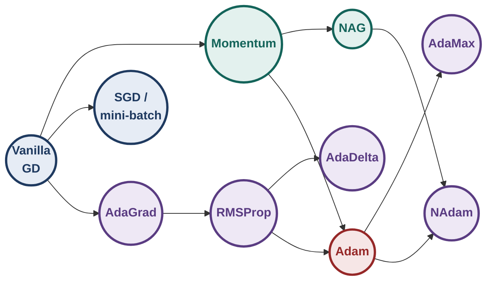
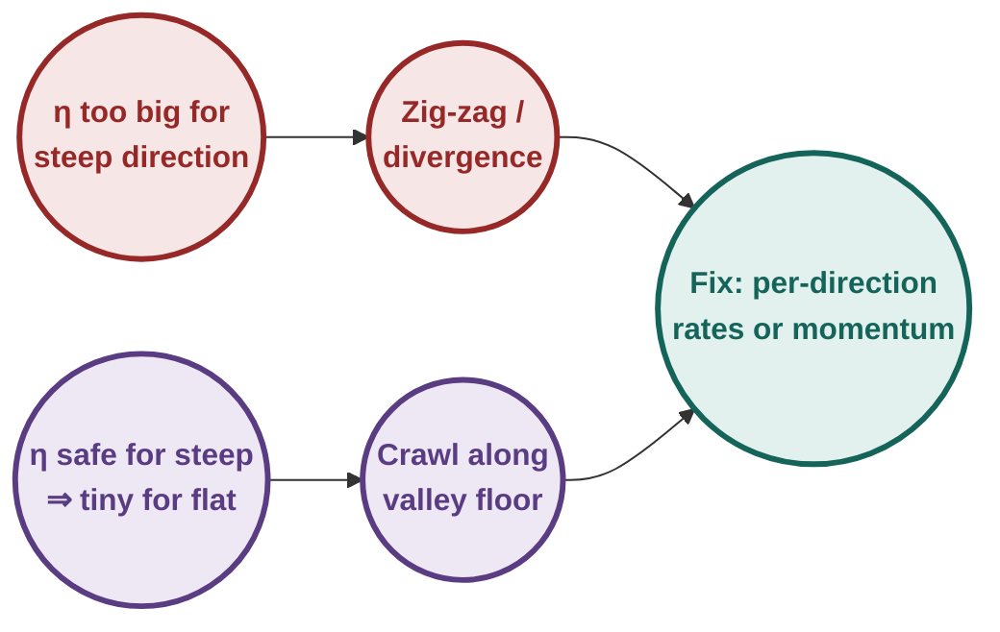
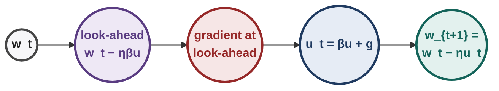
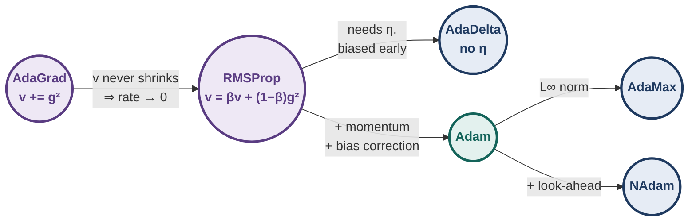
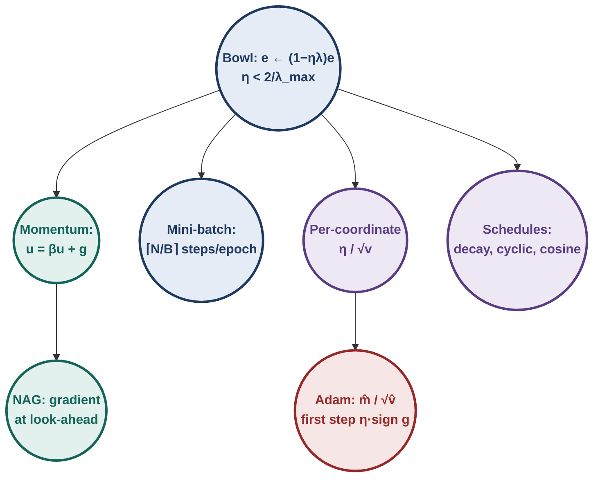

# Deep Learning : Illustrated Notes for Week 4

## Contents

- **Week 4 — GD variants, momentum, NAG, SGD, adaptive methods, schedules** ✓
  - 4.0 Week-4 map
  - 4.1 GD on a quadratic: exact analysis
  - 4.2 Momentum-based GD
  - 4.3 Nesterov accelerated gradient
  - 4.4 Stochastic and mini-batch GD
  - 4.5 Adaptive learning rates (AdaGrad, RMSProp, AdaDelta, Adam, AdaMax, NAdam)
  - 4.6 Learning-rate schedules
  - 4.7 Comparison of all optimisers
  - 4.8 Week-4 exam toolkit & practice set

---


## 4.0 Week-4 map

**[Intuition]** Backprop (Week 3) tells us the gradient. Week 4 is about **what to do with it**. Plain gradient descent has three weaknesses, and each family of methods fixes one:

| Weakness of plain GD | Fix |
|---|---|
| crawls on gentle slopes and plateaus | **momentum**, **NAG** (use gradient history) |
| one exact gradient needs the whole dataset | **stochastic / mini-batch GD** |
| one learning rate for all directions | **adaptive** methods (AdaGrad, RMSProp, AdaDelta, Adam, …) and **schedules** |



> [!TIP]
> **Everyday pictures for the whole week.**
> - **Gradient descent is a hiker in thick fog**, feeling the slope under their boots and stepping downhill.
> - **Momentum is a heavy ball**: it keeps rolling the way it was already going, so it speeds up on long slopes (and can roll past the bottom).
> - **NAG is the ball peeking ahead** before it commits, so it brakes earlier.
> - **SGD and mini-batches are asking a few locals for directions** instead of surveying the whole country: cheaper, a little noisy.
> - **Adaptive methods are different shoes for different terrain**: small careful steps on cliffs, big strides on flat ground.
> - **Schedules are a walking plan**: stride out at the start, slow down near the goal.

**How to read this week.** Each section answers one weakness of plain GD, in this order: how GD behaves on a bowl (§4.1), fixes that use gradient history (§4.2 and §4.3), the data (§4.4), per-parameter rates (§4.5) and rates that change over time (§4.6). §4.7 puts every method on the same problem. Each method comes with an animated plot, a line-by-line example and a "try it yourself". Whenever a formula looks heavy, rerun it on the one-dimensional bowl $\mathcal L=w^2$ first.

---

## 4.1 Gradient descent on a quadratic: an exact analysis

### 4.1.1 One dimension

Near any minimum $w^*$ a smooth loss looks like a bowl: $\mathcal L(w)\approx\tfrac\lambda2(w-w^*)^2$, where $\lambda$ is the **curvature**. Then $\mathcal L'(w)=\lambda(w-w^*)$, and for the error $e_t=w_t-w^*$:

$$e_{t+1}=e_t-\eta\lambda e_t=(1-\eta\lambda)\,e_t\quad\Longrightarrow\quad e_t=(1-\eta\lambda)^t e_0.$$

Everything depends on the **iteration factor** $r=1-\eta\lambda$:

| Range of $\eta$ | $r$ | Behaviour |
|---|---|---|
| $0<\eta<1/\lambda$ | $0<r<1$ | monotone convergence |
| $\eta=1/\lambda$ | $0$ | exact minimum in one step |
| $1/\lambda<\eta<2/\lambda$ | $-1<r<0$ | oscillating convergence |
| $\eta=2/\lambda$ | $-1$ | bounces forever |
| $\eta>2/\lambda$ | $r<-1$ | oscillating **divergence** |

**Rule:** GD on a bowl of curvature $\lambda$ converges iff $0<\eta<2/\lambda$. For $\mathcal L=cw^2$, $\lambda=2c$.

**Line by line.** Take the simplest bowl, $\mathcal L=w^2$ (so $\lambda=2$), start at $w_0=1$ and run four steps for five learning rates. Every step just multiplies the error by $r=1-2\eta$:

| $\eta$ | $r=1-2\eta$ | $w_1$ | $w_2$ | $w_3$ | $w_4$ | Behaviour |
|---|---|---|---|---|---|---|
| 0.1 | 0.8 | 0.8 | 0.64 | 0.512 | 0.410 | monotone convergence |
| 0.5 | 0 | 0 | 0 | 0 | 0 | exact in one step ($\eta=1/\lambda$) |
| 0.75 | −0.5 | −0.5 | 0.25 | −0.125 | 0.0625 | oscillating convergence |
| 1.0 | −1 | −1 | 1 | −1 | 1 | bounces forever |
| 1.1 | −1.2 | −1.2 | 1.44 | −1.728 | 2.074 | oscillating divergence |

<div class="fig" role="img" aria-label="Five small plots of the gradient descent error for increasing learning rates">
<svg viewBox="0 0 700 228" width="700" style="font-family:var(--font)" aria-hidden="true">
<text x="99" y="24" text-anchor="middle" style="fill:var(--fg);font-size:13px;font-weight:700">η = 0.1</text>
<text x="99" y="40" text-anchor="middle" style="fill:var(--muted);font-size:11.5px;font-weight:400">r = 0.8</text>
<line x1="40" y1="163.4" x2="158" y2="163.4" style="stroke:var(--line);stroke-width:1;stroke-linecap:round"/><line x1="40" y1="116" x2="158" y2="116" style="stroke:var(--line);stroke-width:1;stroke-linecap:round"/><line x1="40" y1="68.6" x2="158" y2="68.6" style="stroke:var(--line);stroke-width:1;stroke-linecap:round"/><line x1="40" y1="56" x2="40" y2="176" style="stroke:var(--line);stroke-width:1;stroke-linecap:round"/><line x1="158" y1="56" x2="158" y2="176" style="stroke:var(--line);stroke-width:1;stroke-linecap:round"/><line x1="40" y1="116" x2="158" y2="116" style="stroke:var(--line-strong);stroke-width:1.5;stroke-linecap:round"/><line x1="40" y1="176" x2="158" y2="176" style="stroke:var(--line-strong);stroke-width:1.5;stroke-linecap:round"/><line x1="40" y1="56" x2="40" y2="176" style="stroke:var(--line-strong);stroke-width:1.5;stroke-linecap:round"/><text x="40" y="191" text-anchor="middle" style="fill:var(--muted);font-size:11px;font-weight:400">0</text><text x="158" y="191" text-anchor="middle" style="fill:var(--muted);font-size:11px;font-weight:400">7</text><text x="33" y="167.4" text-anchor="end" style="fill:var(--muted);font-size:11px;font-weight:400">-3</text><text x="33" y="120" text-anchor="end" style="fill:var(--muted);font-size:11px;font-weight:400">0</text><text x="33" y="72.6" text-anchor="end" style="fill:var(--muted);font-size:11px;font-weight:400">3</text>
<polyline points="40,100.2 56.9,103.4 73.7,105.9 90.6,107.9 107.4,109.5 124.3,110.8 141.1,111.9 158,112.7" fill="none" style="stroke:var(--green-ink);stroke-width:2.5;stroke-linejoin:round"/>
<circle cx="40" cy="100.2" r="3.2" style="fill:var(--green-ink);stroke:var(--green-ink);stroke-width:1"/>
<circle cx="56.9" cy="103.4" r="3.2" style="fill:var(--green-ink);stroke:var(--green-ink);stroke-width:1"/>
<circle cx="73.7" cy="105.9" r="3.2" style="fill:var(--green-ink);stroke:var(--green-ink);stroke-width:1"/>
<circle cx="90.6" cy="107.9" r="3.2" style="fill:var(--green-ink);stroke:var(--green-ink);stroke-width:1"/>
<circle cx="107.4" cy="109.5" r="3.2" style="fill:var(--green-ink);stroke:var(--green-ink);stroke-width:1"/>
<circle cx="124.3" cy="110.8" r="3.2" style="fill:var(--green-ink);stroke:var(--green-ink);stroke-width:1"/>
<circle cx="141.1" cy="111.9" r="3.2" style="fill:var(--green-ink);stroke:var(--green-ink);stroke-width:1"/>
<circle cx="158" cy="112.7" r="3.2" style="fill:var(--green-ink);stroke:var(--green-ink);stroke-width:1"/>
<circle r="5" style="fill:var(--fg)"><animateMotion dur="7.0s" repeatCount="indefinite" calcMode="linear" keyPoints="0;1;1" keyTimes="0;0.8;1" path="M40,100.2 L56.9,103.4 L73.7,105.9 L90.6,107.9 L107.4,109.5 L124.3,110.8 L141.1,111.9 L158,112.7"/></circle>
<text x="99" y="198" text-anchor="middle" style="fill:var(--green-ink);font-size:11px;font-weight:700">monotone</text>
<text x="99" y="214" text-anchor="middle" style="fill:var(--muted);font-size:10px;font-weight:400">time t →</text>
<text x="233" y="24" text-anchor="middle" style="fill:var(--fg);font-size:13px;font-weight:700">η = 0.5</text>
<text x="233" y="40" text-anchor="middle" style="fill:var(--muted);font-size:11.5px;font-weight:400">r = 0</text>
<line x1="174" y1="163.4" x2="292" y2="163.4" style="stroke:var(--line);stroke-width:1;stroke-linecap:round"/><line x1="174" y1="116" x2="292" y2="116" style="stroke:var(--line);stroke-width:1;stroke-linecap:round"/><line x1="174" y1="68.6" x2="292" y2="68.6" style="stroke:var(--line);stroke-width:1;stroke-linecap:round"/><line x1="174" y1="56" x2="174" y2="176" style="stroke:var(--line);stroke-width:1;stroke-linecap:round"/><line x1="292" y1="56" x2="292" y2="176" style="stroke:var(--line);stroke-width:1;stroke-linecap:round"/><line x1="174" y1="116" x2="292" y2="116" style="stroke:var(--line-strong);stroke-width:1.5;stroke-linecap:round"/><line x1="174" y1="176" x2="292" y2="176" style="stroke:var(--line-strong);stroke-width:1.5;stroke-linecap:round"/><line x1="174" y1="56" x2="174" y2="176" style="stroke:var(--line-strong);stroke-width:1.5;stroke-linecap:round"/><text x="174" y="191" text-anchor="middle" style="fill:var(--muted);font-size:11px;font-weight:400">0</text><text x="292" y="191" text-anchor="middle" style="fill:var(--muted);font-size:11px;font-weight:400">7</text><text x="167" y="167.4" text-anchor="end" style="fill:var(--muted);font-size:11px;font-weight:400">-3</text><text x="167" y="120" text-anchor="end" style="fill:var(--muted);font-size:11px;font-weight:400">0</text><text x="167" y="72.6" text-anchor="end" style="fill:var(--muted);font-size:11px;font-weight:400">3</text>
<polyline points="174,100.2 190.9,116 207.7,116 224.6,116 241.4,116 258.3,116 275.1,116 292,116" fill="none" style="stroke:var(--green-ink);stroke-width:2.5;stroke-linejoin:round"/>
<circle cx="174" cy="100.2" r="3.2" style="fill:var(--green-ink);stroke:var(--green-ink);stroke-width:1"/>
<circle cx="190.9" cy="116" r="3.2" style="fill:var(--green-ink);stroke:var(--green-ink);stroke-width:1"/>
<circle cx="207.7" cy="116" r="3.2" style="fill:var(--green-ink);stroke:var(--green-ink);stroke-width:1"/>
<circle cx="224.6" cy="116" r="3.2" style="fill:var(--green-ink);stroke:var(--green-ink);stroke-width:1"/>
<circle cx="241.4" cy="116" r="3.2" style="fill:var(--green-ink);stroke:var(--green-ink);stroke-width:1"/>
<circle cx="258.3" cy="116" r="3.2" style="fill:var(--green-ink);stroke:var(--green-ink);stroke-width:1"/>
<circle cx="275.1" cy="116" r="3.2" style="fill:var(--green-ink);stroke:var(--green-ink);stroke-width:1"/>
<circle cx="292" cy="116" r="3.2" style="fill:var(--green-ink);stroke:var(--green-ink);stroke-width:1"/>
<circle r="5" style="fill:var(--fg)"><animateMotion dur="7.0s" repeatCount="indefinite" calcMode="linear" keyPoints="0;1;1" keyTimes="0;0.8;1" path="M174,100.2 L190.9,116 L207.7,116 L224.6,116 L241.4,116 L258.3,116 L275.1,116 L292,116"/></circle>
<text x="233" y="198" text-anchor="middle" style="fill:var(--green-ink);font-size:11px;font-weight:700">exact in 1 step</text>
<text x="233" y="214" text-anchor="middle" style="fill:var(--muted);font-size:10px;font-weight:400">time t →</text>
<text x="367" y="24" text-anchor="middle" style="fill:var(--fg);font-size:13px;font-weight:700">η = 0.75</text>
<text x="367" y="40" text-anchor="middle" style="fill:var(--muted);font-size:11.5px;font-weight:400">r = -0.5</text>
<line x1="308" y1="163.4" x2="426" y2="163.4" style="stroke:var(--line);stroke-width:1;stroke-linecap:round"/><line x1="308" y1="116" x2="426" y2="116" style="stroke:var(--line);stroke-width:1;stroke-linecap:round"/><line x1="308" y1="68.6" x2="426" y2="68.6" style="stroke:var(--line);stroke-width:1;stroke-linecap:round"/><line x1="308" y1="56" x2="308" y2="176" style="stroke:var(--line);stroke-width:1;stroke-linecap:round"/><line x1="426" y1="56" x2="426" y2="176" style="stroke:var(--line);stroke-width:1;stroke-linecap:round"/><line x1="308" y1="116" x2="426" y2="116" style="stroke:var(--line-strong);stroke-width:1.5;stroke-linecap:round"/><line x1="308" y1="176" x2="426" y2="176" style="stroke:var(--line-strong);stroke-width:1.5;stroke-linecap:round"/><line x1="308" y1="56" x2="308" y2="176" style="stroke:var(--line-strong);stroke-width:1.5;stroke-linecap:round"/><text x="308" y="191" text-anchor="middle" style="fill:var(--muted);font-size:11px;font-weight:400">0</text><text x="426" y="191" text-anchor="middle" style="fill:var(--muted);font-size:11px;font-weight:400">7</text><text x="301" y="167.4" text-anchor="end" style="fill:var(--muted);font-size:11px;font-weight:400">-3</text><text x="301" y="120" text-anchor="end" style="fill:var(--muted);font-size:11px;font-weight:400">0</text><text x="301" y="72.6" text-anchor="end" style="fill:var(--muted);font-size:11px;font-weight:400">3</text>
<polyline points="308,100.2 324.9,123.9 341.7,112.1 358.6,118 375.4,115 392.3,116.5 409.1,115.8 426,116.1" fill="none" style="stroke:var(--green-ink);stroke-width:2.5;stroke-linejoin:round"/>
<circle cx="308" cy="100.2" r="3.2" style="fill:var(--green-ink);stroke:var(--green-ink);stroke-width:1"/>
<circle cx="324.9" cy="123.9" r="3.2" style="fill:var(--green-ink);stroke:var(--green-ink);stroke-width:1"/>
<circle cx="341.7" cy="112.1" r="3.2" style="fill:var(--green-ink);stroke:var(--green-ink);stroke-width:1"/>
<circle cx="358.6" cy="118" r="3.2" style="fill:var(--green-ink);stroke:var(--green-ink);stroke-width:1"/>
<circle cx="375.4" cy="115" r="3.2" style="fill:var(--green-ink);stroke:var(--green-ink);stroke-width:1"/>
<circle cx="392.3" cy="116.5" r="3.2" style="fill:var(--green-ink);stroke:var(--green-ink);stroke-width:1"/>
<circle cx="409.1" cy="115.8" r="3.2" style="fill:var(--green-ink);stroke:var(--green-ink);stroke-width:1"/>
<circle cx="426" cy="116.1" r="3.2" style="fill:var(--green-ink);stroke:var(--green-ink);stroke-width:1"/>
<circle r="5" style="fill:var(--fg)"><animateMotion dur="7.0s" repeatCount="indefinite" calcMode="linear" keyPoints="0;1;1" keyTimes="0;0.8;1" path="M308,100.2 L324.9,123.9 L341.7,112.1 L358.6,118 L375.4,115 L392.3,116.5 L409.1,115.8 L426,116.1"/></circle>
<text x="367" y="198" text-anchor="middle" style="fill:var(--green-ink);font-size:11px;font-weight:700">zig-zag, shrinks</text>
<text x="367" y="214" text-anchor="middle" style="fill:var(--muted);font-size:10px;font-weight:400">time t →</text>
<text x="501" y="24" text-anchor="middle" style="fill:var(--fg);font-size:13px;font-weight:700">η = 1</text>
<text x="501" y="40" text-anchor="middle" style="fill:var(--muted);font-size:11.5px;font-weight:400">r = -1</text>
<line x1="442" y1="163.4" x2="560" y2="163.4" style="stroke:var(--line);stroke-width:1;stroke-linecap:round"/><line x1="442" y1="116" x2="560" y2="116" style="stroke:var(--line);stroke-width:1;stroke-linecap:round"/><line x1="442" y1="68.6" x2="560" y2="68.6" style="stroke:var(--line);stroke-width:1;stroke-linecap:round"/><line x1="442" y1="56" x2="442" y2="176" style="stroke:var(--line);stroke-width:1;stroke-linecap:round"/><line x1="560" y1="56" x2="560" y2="176" style="stroke:var(--line);stroke-width:1;stroke-linecap:round"/><line x1="442" y1="116" x2="560" y2="116" style="stroke:var(--line-strong);stroke-width:1.5;stroke-linecap:round"/><line x1="442" y1="176" x2="560" y2="176" style="stroke:var(--line-strong);stroke-width:1.5;stroke-linecap:round"/><line x1="442" y1="56" x2="442" y2="176" style="stroke:var(--line-strong);stroke-width:1.5;stroke-linecap:round"/><text x="442" y="191" text-anchor="middle" style="fill:var(--muted);font-size:11px;font-weight:400">0</text><text x="560" y="191" text-anchor="middle" style="fill:var(--muted);font-size:11px;font-weight:400">7</text><text x="435" y="167.4" text-anchor="end" style="fill:var(--muted);font-size:11px;font-weight:400">-3</text><text x="435" y="120" text-anchor="end" style="fill:var(--muted);font-size:11px;font-weight:400">0</text><text x="435" y="72.6" text-anchor="end" style="fill:var(--muted);font-size:11px;font-weight:400">3</text>
<polyline points="442,100.2 458.9,131.8 475.7,100.2 492.6,131.8 509.4,100.2 526.3,131.8 543.1,100.2 560,131.8" fill="none" style="stroke:var(--yellow-ink);stroke-width:2.5;stroke-linejoin:round"/>
<circle cx="442" cy="100.2" r="3.2" style="fill:var(--yellow-ink);stroke:var(--yellow-ink);stroke-width:1"/>
<circle cx="458.9" cy="131.8" r="3.2" style="fill:var(--yellow-ink);stroke:var(--yellow-ink);stroke-width:1"/>
<circle cx="475.7" cy="100.2" r="3.2" style="fill:var(--yellow-ink);stroke:var(--yellow-ink);stroke-width:1"/>
<circle cx="492.6" cy="131.8" r="3.2" style="fill:var(--yellow-ink);stroke:var(--yellow-ink);stroke-width:1"/>
<circle cx="509.4" cy="100.2" r="3.2" style="fill:var(--yellow-ink);stroke:var(--yellow-ink);stroke-width:1"/>
<circle cx="526.3" cy="131.8" r="3.2" style="fill:var(--yellow-ink);stroke:var(--yellow-ink);stroke-width:1"/>
<circle cx="543.1" cy="100.2" r="3.2" style="fill:var(--yellow-ink);stroke:var(--yellow-ink);stroke-width:1"/>
<circle cx="560" cy="131.8" r="3.2" style="fill:var(--yellow-ink);stroke:var(--yellow-ink);stroke-width:1"/>
<circle r="5" style="fill:var(--fg)"><animateMotion dur="7.0s" repeatCount="indefinite" calcMode="linear" keyPoints="0;1;1" keyTimes="0;0.8;1" path="M442,100.2 L458.9,131.8 L475.7,100.2 L492.6,131.8 L509.4,100.2 L526.3,131.8 L543.1,100.2 L560,131.8"/></circle>
<text x="501" y="198" text-anchor="middle" style="fill:var(--yellow-ink);font-size:11px;font-weight:700">bounces forever</text>
<text x="501" y="214" text-anchor="middle" style="fill:var(--muted);font-size:10px;font-weight:400">time t →</text>
<text x="635" y="24" text-anchor="middle" style="fill:var(--fg);font-size:13px;font-weight:700">η = 1.1</text>
<text x="635" y="40" text-anchor="middle" style="fill:var(--muted);font-size:11.5px;font-weight:400">r = -1.2</text>
<line x1="576" y1="163.4" x2="694" y2="163.4" style="stroke:var(--line);stroke-width:1;stroke-linecap:round"/><line x1="576" y1="116" x2="694" y2="116" style="stroke:var(--line);stroke-width:1;stroke-linecap:round"/><line x1="576" y1="68.6" x2="694" y2="68.6" style="stroke:var(--line);stroke-width:1;stroke-linecap:round"/><line x1="576" y1="56" x2="576" y2="176" style="stroke:var(--line);stroke-width:1;stroke-linecap:round"/><line x1="694" y1="56" x2="694" y2="176" style="stroke:var(--line);stroke-width:1;stroke-linecap:round"/><line x1="576" y1="116" x2="694" y2="116" style="stroke:var(--line-strong);stroke-width:1.5;stroke-linecap:round"/><line x1="576" y1="176" x2="694" y2="176" style="stroke:var(--line-strong);stroke-width:1.5;stroke-linecap:round"/><line x1="576" y1="56" x2="576" y2="176" style="stroke:var(--line-strong);stroke-width:1.5;stroke-linecap:round"/><text x="576" y="191" text-anchor="middle" style="fill:var(--muted);font-size:11px;font-weight:400">0</text><text x="694" y="191" text-anchor="middle" style="fill:var(--muted);font-size:11px;font-weight:400">7</text><text x="569" y="167.4" text-anchor="end" style="fill:var(--muted);font-size:11px;font-weight:400">-3</text><text x="569" y="120" text-anchor="end" style="fill:var(--muted);font-size:11px;font-weight:400">0</text><text x="569" y="72.6" text-anchor="end" style="fill:var(--muted);font-size:11px;font-weight:400">3</text>
<polyline points="576,100.2 592.9,134.9 609.7,93.3 626.6,143.3 643.4,83.3 660.3,155.3 677.1,68.9 694,172.6" fill="none" style="stroke:var(--red-ink);stroke-width:2.5;stroke-linejoin:round"/>
<circle cx="576" cy="100.2" r="3.2" style="fill:var(--red-ink);stroke:var(--red-ink);stroke-width:1"/>
<circle cx="592.9" cy="134.9" r="3.2" style="fill:var(--red-ink);stroke:var(--red-ink);stroke-width:1"/>
<circle cx="609.7" cy="93.3" r="3.2" style="fill:var(--red-ink);stroke:var(--red-ink);stroke-width:1"/>
<circle cx="626.6" cy="143.3" r="3.2" style="fill:var(--red-ink);stroke:var(--red-ink);stroke-width:1"/>
<circle cx="643.4" cy="83.3" r="3.2" style="fill:var(--red-ink);stroke:var(--red-ink);stroke-width:1"/>
<circle cx="660.3" cy="155.3" r="3.2" style="fill:var(--red-ink);stroke:var(--red-ink);stroke-width:1"/>
<circle cx="677.1" cy="68.9" r="3.2" style="fill:var(--red-ink);stroke:var(--red-ink);stroke-width:1"/>
<circle cx="694" cy="172.6" r="3.2" style="fill:var(--red-ink);stroke:var(--red-ink);stroke-width:1"/>
<circle r="5" style="fill:var(--fg)"><animateMotion dur="7.0s" repeatCount="indefinite" calcMode="linear" keyPoints="0;1;1" keyTimes="0;0.8;1" path="M576,100.2 L592.9,134.9 L609.7,93.3 L626.6,143.3 L643.4,83.3 L660.3,155.3 L677.1,68.9 L694,172.6"/></circle>
<text x="635" y="198" text-anchor="middle" style="fill:var(--red-ink);font-size:11px;font-weight:700">zig-zag, grows</text>
<text x="635" y="214" text-anchor="middle" style="fill:var(--muted);font-size:10px;font-weight:400">time t →</text>
</svg>
<p class="fig-cap">The error after t steps is rᵗ·e₀ with r = 1 − ηλ (here L = w², λ = 2, so r = 1 − 2η). The sign of r decides whether the error zig-zags; its size decides whether it shrinks. Only |r| < 1, i.e. 0 < η < 2/λ = 1, converges.</p>
</div>

<details>
<summary><b>Try it yourself</b>: which η finds the minimum of L = 5w² in exactly one step?</summary>

The curvature is $\lambda=2c=10$, and the one-step rate is $\eta=1/\lambda=0.1$. Check: $w_1=w_0-\eta\cdot10w_0=w_0(1-1)=0$.

</details>

### 4.1.2 Several dimensions: ill-conditioning

For $\mathcal L=\tfrac12\sum_i\lambda_i w_i^2$, each coordinate has its own factor $1-\eta\lambda_i$.

- One $\eta$ must satisfy $\eta<2/\lambda_{\max}$ (the **steepest** direction).
- Then the **flattest** direction crawls with factor $1-\eta\lambda_{\min}\approx1$.
- Result: **zig-zag** across the steep walls while inching along the valley floor.

**[Ex]** *End-term.* $f(x,y)=\tfrac12(25x^2+y^2)$ from $(1,1)$, $\eta=0.1$.

- $\nabla f=(25x,\ y)=(25,1)$.
- $x_1=1-2.5=-1.5$, $y_1=1-0.1=0.9$, so $x_1+y_1=\mathbf{-0.6}$.
- Factors: $r_x=1-0.1(25)=-1.5$ (**diverges**: $1,-1.5,2.25,-3.375,\dots$); $r_y=0.9$ (converges).
- Largest safe rate: $\eta<2/25=0.08$. Even at $\eta=0.07$, $y$ still shrinks only by 0.93 per step.

**Line by line** for the end-term function, once with a rate that is too big and once with a safe one. Each coordinate has its own factor, $r_x=1-25\eta$ and $r_y=1-\eta$:

| step $t$ | $\eta=0.1$: $x_t$ | $y_t$ | $\eta=0.07$: $x_t$ | $y_t$ |
|---|---|---|---|---|
| 0 | 1 | 1 | 1 | 1 |
| 1 | −1.5 | 0.9 | −0.75 | 0.93 |
| 2 | 2.25 | 0.81 | 0.5625 | 0.865 |
| 3 | −3.375 | 0.729 | −0.4219 | 0.804 |
| 4 | 5.063 | 0.656 | 0.3164 | 0.748 |

With $\eta=0.1$ the factors are $r_x=-1.5$ (growing) and $r_y=0.9$; with $\eta=0.07$ they are $r_x=-0.75$ and $r_y=0.93$.

<div class="fig" role="img" aria-label="Contour plot of an elongated bowl with the gradient descent zig-zag path, and x and y over time">
<svg viewBox="0 0 700 290" width="700" style="font-family:var(--font)" aria-hidden="true">
<text x="185" y="28" text-anchor="middle" style="fill:var(--fg);font-size:12.5px;font-weight:700">η = 0.07 (safe): path on f = ½(25x² + y²)</text>
<line x1="50" y1="227.8" x2="320" y2="227.8" style="stroke:var(--line);stroke-width:1;stroke-linecap:round"/><line x1="50" y1="153.7" x2="320" y2="153.7" style="stroke:var(--line);stroke-width:1;stroke-linecap:round"/><line x1="50" y1="79.6" x2="320" y2="79.6" style="stroke:var(--line);stroke-width:1;stroke-linecap:round"/><line x1="62.3" y1="50" x2="62.3" y2="250" style="stroke:var(--line);stroke-width:1;stroke-linecap:round"/><line x1="185" y1="50" x2="185" y2="250" style="stroke:var(--line);stroke-width:1;stroke-linecap:round"/><line x1="307.7" y1="50" x2="307.7" y2="250" style="stroke:var(--line);stroke-width:1;stroke-linecap:round"/><line x1="50" y1="250" x2="320" y2="250" style="stroke:var(--line-strong);stroke-width:1.5;stroke-linecap:round"/><line x1="50" y1="50" x2="50" y2="250" style="stroke:var(--line-strong);stroke-width:1.5;stroke-linecap:round"/><text x="62.3" y="265" text-anchor="middle" style="fill:var(--muted);font-size:11px;font-weight:400">-1</text><text x="185" y="265" text-anchor="middle" style="fill:var(--muted);font-size:11px;font-weight:400">0</text><text x="307.7" y="265" text-anchor="middle" style="fill:var(--muted);font-size:11px;font-weight:400">1</text><text x="43" y="231.8" text-anchor="end" style="fill:var(--muted);font-size:11px;font-weight:400">0</text><text x="43" y="157.7" text-anchor="end" style="fill:var(--muted);font-size:11px;font-weight:400">0.5</text><text x="43" y="83.6" text-anchor="end" style="fill:var(--muted);font-size:11px;font-weight:400">1</text>
<polygon points="189.9,227.8 189.9,224.6 189.8,221.5 189.7,218.5 189.5,215.5 189.2,212.7 188.9,210.1 188.6,207.7 188.2,205.5 187.8,203.5 187.4,201.9 186.9,200.5 186.4,199.4 185.9,198.7 185.4,198.2 184.9,198.2 184.3,198.4 183.8,199 183.3,199.9 182.9,201.1 182.4,202.7 182,204.5 181.6,206.5 181.2,208.9 180.9,211.4 180.6,214.1 180.4,217 180.3,220 180.2,223.1 180.1,226.2 180.1,229.4 180.2,232.5 180.3,235.6 180.4,238.6 180.6,241.4 180.9,244.2 181.2,246.7 181.6,249 182,251.1 182.4,252.9 182.9,254.4 183.3,255.7 183.8,256.6 184.3,257.1 184.9,257.4 185.4,257.3 185.9,256.9 186.4,256.1 186.9,255.1 187.4,253.7 187.8,252 188.2,250.1 188.6,247.9 188.9,245.4 189.2,242.8 189.5,240 189.7,237.1 189.8,234 189.9,230.9 189.9,227.8" fill="none" style="stroke:var(--line-strong);stroke-width:1.2"/>
<polygon points="196,227.8 195.9,220.7 195.7,213.8 195.4,207 195,200.4 194.5,194.1 193.8,188.3 193.1,182.8 192.2,177.9 191.3,173.6 190.3,169.8 189.3,166.7 188.2,164.3 187,162.7 185.9,161.7 184.7,161.5 183.5,162.1 182.4,163.4 181.3,165.5 180.2,168.2 179.2,171.6 178.2,175.7 177.3,180.3 176.5,185.5 175.9,191.2 175.3,197.2 174.8,203.7 174.4,210.3 174.2,217.2 174,224.3 174,231.3 174.2,238.3 174.4,245.2 174.8,251.9 175.3,258.3 175.9,264.4 176.5,270.1 177.3,275.2 178.2,279.9 179.2,283.9 180.2,287.4 181.3,290.1 182.4,292.1 183.5,293.4 184.7,294 185.9,293.8 187,292.9 188.2,291.2 189.3,288.8 190.3,285.7 191.3,282 192.2,277.6 193.1,272.7 193.8,267.3 194.5,261.4 195,255.2 195.4,248.6 195.7,241.8 195.9,234.8 196,227.8" fill="none" style="stroke:var(--line-strong);stroke-width:1.2"/>
<polygon points="204,227.8 203.9,215.6 203.6,203.5 203.1,191.7 202.3,180.4 201.4,169.5 200.3,159.3 199,149.9 197.5,141.4 195.9,133.9 194.2,127.4 192.4,122.1 190.5,117.9 188.5,115 186.5,113.4 184.5,113.1 182.5,114 180.5,116.3 178.6,119.8 176.7,124.6 174.9,130.5 173.3,137.5 171.7,145.6 170.4,154.5 169.2,164.3 168.1,174.9 167.3,186 166.7,197.6 166.2,209.5 166,221.7 166,233.9 166.2,246 166.7,258 167.3,269.6 168.1,280.7 169.2,291.2 170.4,301 171.7,310 173.3,318 174.9,325.1 176.7,331 178.6,335.7 180.5,339.3 182.5,341.5 184.5,342.5 186.5,342.2 188.5,340.5 190.5,337.6 192.4,333.5 194.2,328.2 195.9,321.7 197.5,314.1 199,305.6 200.3,296.2 201.4,286 202.3,275.2 203.1,263.8 203.6,252 203.9,240 204,227.8" fill="none" style="stroke:var(--line-strong);stroke-width:1.2"/>
<polygon points="216,227.8 215.9,207.9 215.3,188.2 214.5,168.9 213.3,150.3 211.7,132.6 209.9,116 207.8,100.7 205.4,86.8 202.8,74.4 200,63.9 197.1,55.1 194,48.4 190.8,43.6 187.5,41 184.2,40.4 180.9,42 177.6,45.7 174.5,51.5 171.4,59.3 168.5,68.9 165.8,80.4 163.3,93.5 161.1,108.2 159.1,124.2 157.4,141.4 156.1,159.5 155,178.5 154.3,198 154,217.8 154,237.8 154.3,257.6 155,277.1 156.1,296 157.4,314.2 159.1,331.4 161.1,347.4 163.3,362 165.8,375.2 168.5,386.6 171.4,396.3 174.5,404.1 177.6,409.8 180.9,413.5 184.2,415.1 187.5,414.6 190.8,411.9 194,407.2 197.1,400.4 200,391.7 202.8,381.1 205.4,368.8 207.8,354.9 209.9,339.5 211.7,322.9 213.3,305.2 214.5,286.6 215.3,267.4 215.9,247.7 216,227.8" fill="none" style="stroke:var(--line-strong);stroke-width:1.2"/>
<polyline points="307.7,79.6 93,90 254,99.6 133.2,108.6 223.8,117 155.9,124.7 206.8,131.9 168.6,138.6 197.3,144.9 175.8,150.7 191.9,156.1 179.8,161.1 188.9,165.8 182.1,170.1 187.2,174.1" fill="none" style="stroke:var(--red-ink);stroke-width:2;stroke-linejoin:round"/>
<circle cx="307.7" cy="79.6" r="2.8" style="fill:var(--red-ink);stroke:var(--red-ink);stroke-width:1"/>
<circle cx="93" cy="90" r="2.8" style="fill:var(--red-ink);stroke:var(--red-ink);stroke-width:1"/>
<circle cx="254" cy="99.6" r="2.8" style="fill:var(--red-ink);stroke:var(--red-ink);stroke-width:1"/>
<circle cx="133.2" cy="108.6" r="2.8" style="fill:var(--red-ink);stroke:var(--red-ink);stroke-width:1"/>
<circle cx="223.8" cy="117" r="2.8" style="fill:var(--red-ink);stroke:var(--red-ink);stroke-width:1"/>
<circle cx="155.9" cy="124.7" r="2.8" style="fill:var(--red-ink);stroke:var(--red-ink);stroke-width:1"/>
<circle cx="206.8" cy="131.9" r="2.8" style="fill:var(--red-ink);stroke:var(--red-ink);stroke-width:1"/>
<circle cx="168.6" cy="138.6" r="2.8" style="fill:var(--red-ink);stroke:var(--red-ink);stroke-width:1"/>
<circle cx="197.3" cy="144.9" r="2.8" style="fill:var(--red-ink);stroke:var(--red-ink);stroke-width:1"/>
<circle cx="175.8" cy="150.7" r="2.8" style="fill:var(--red-ink);stroke:var(--red-ink);stroke-width:1"/>
<circle cx="191.9" cy="156.1" r="2.8" style="fill:var(--red-ink);stroke:var(--red-ink);stroke-width:1"/>
<circle cx="179.8" cy="161.1" r="2.8" style="fill:var(--red-ink);stroke:var(--red-ink);stroke-width:1"/>
<circle cx="188.9" cy="165.8" r="2.8" style="fill:var(--red-ink);stroke:var(--red-ink);stroke-width:1"/>
<circle cx="182.1" cy="170.1" r="2.8" style="fill:var(--red-ink);stroke:var(--red-ink);stroke-width:1"/>
<circle cx="187.2" cy="174.1" r="2.8" style="fill:var(--red-ink);stroke:var(--red-ink);stroke-width:1"/>
<circle r="5.5" style="fill:var(--fg)"><animateMotion dur="8.0s" repeatCount="indefinite" calcMode="linear" keyPoints="0;1;1" keyTimes="0;0.85;1" path="M307.7,79.6 L93,90 L254,99.6 L133.2,108.6 L223.8,117 L155.9,124.7 L206.8,131.9 L168.6,138.6 L197.3,144.9 L175.8,150.7 L191.9,156.1 L179.8,161.1 L188.9,165.8 L182.1,170.1 L187.2,174.1"/></circle>
<text x="303.7" y="69.6" text-anchor="end" style="fill:var(--fg-2);font-size:11px;font-weight:600">start (1, 1)</text>
<text x="195" y="205.6" text-anchor="start" style="fill:var(--green-ink);font-size:11px;font-weight:700">minimum</text>
<circle cx="185" cy="227.8" r="4.5" style="fill:var(--green-ink);stroke:var(--green-ink);stroke-width:1"/>
<text x="185" y="276" text-anchor="middle" style="fill:var(--fg-2);font-size:11px;font-weight:400">zig-zag across the steep walls (x), crawl along the floor (y)</text>
<text x="530" y="28" text-anchor="middle" style="fill:var(--fg);font-size:12.5px;font-weight:700">η = 0.1: x explodes, y crawls</text>
<line x1="405" y1="221.4" x2="655" y2="221.4" style="stroke:var(--line);stroke-width:1;stroke-linecap:round"/><line x1="405" y1="135.7" x2="655" y2="135.7" style="stroke:var(--line);stroke-width:1;stroke-linecap:round"/><line x1="405" y1="50" x2="655" y2="50" style="stroke:var(--line);stroke-width:1;stroke-linecap:round"/><line x1="405" y1="50" x2="405" y2="250" style="stroke:var(--line);stroke-width:1;stroke-linecap:round"/><line x1="455" y1="50" x2="455" y2="250" style="stroke:var(--line);stroke-width:1;stroke-linecap:round"/><line x1="505" y1="50" x2="505" y2="250" style="stroke:var(--line);stroke-width:1;stroke-linecap:round"/><line x1="555" y1="50" x2="555" y2="250" style="stroke:var(--line);stroke-width:1;stroke-linecap:round"/><line x1="605" y1="50" x2="605" y2="250" style="stroke:var(--line);stroke-width:1;stroke-linecap:round"/><line x1="655" y1="50" x2="655" y2="250" style="stroke:var(--line);stroke-width:1;stroke-linecap:round"/><line x1="405" y1="135.7" x2="655" y2="135.7" style="stroke:var(--line-strong);stroke-width:1.5;stroke-linecap:round"/><line x1="405" y1="250" x2="655" y2="250" style="stroke:var(--line-strong);stroke-width:1.5;stroke-linecap:round"/><line x1="405" y1="50" x2="405" y2="250" style="stroke:var(--line-strong);stroke-width:1.5;stroke-linecap:round"/><text x="405" y="265" text-anchor="middle" style="fill:var(--muted);font-size:11px;font-weight:400">0</text><text x="455" y="265" text-anchor="middle" style="fill:var(--muted);font-size:11px;font-weight:400">1</text><text x="505" y="265" text-anchor="middle" style="fill:var(--muted);font-size:11px;font-weight:400">2</text><text x="555" y="265" text-anchor="middle" style="fill:var(--muted);font-size:11px;font-weight:400">3</text><text x="605" y="265" text-anchor="middle" style="fill:var(--muted);font-size:11px;font-weight:400">4</text><text x="655" y="265" text-anchor="middle" style="fill:var(--muted);font-size:11px;font-weight:400">5</text><text x="398" y="225.4" text-anchor="end" style="fill:var(--muted);font-size:11px;font-weight:400">-6</text><text x="398" y="139.7" text-anchor="end" style="fill:var(--muted);font-size:11px;font-weight:400">0</text><text x="398" y="54" text-anchor="end" style="fill:var(--muted);font-size:11px;font-weight:400">6</text>
<polyline points="405,121.4 455,157.1 505,103.6 555,183.9 605,63.4 655,244.2" fill="none" style="stroke:var(--red-ink);stroke-width:2.6;stroke-linejoin:round"/>
<circle cx="405" cy="121.4" r="3.2" style="fill:var(--red-ink);stroke:var(--red-ink);stroke-width:1"/>
<circle cx="455" cy="157.1" r="3.2" style="fill:var(--red-ink);stroke:var(--red-ink);stroke-width:1"/>
<circle cx="505" cy="103.6" r="3.2" style="fill:var(--red-ink);stroke:var(--red-ink);stroke-width:1"/>
<circle cx="555" cy="183.9" r="3.2" style="fill:var(--red-ink);stroke:var(--red-ink);stroke-width:1"/>
<circle cx="605" cy="63.4" r="3.2" style="fill:var(--red-ink);stroke:var(--red-ink);stroke-width:1"/>
<circle cx="655" cy="244.2" r="3.2" style="fill:var(--red-ink);stroke:var(--red-ink);stroke-width:1"/>
<polyline points="405,121.4 455,122.9 505,124.1 555,125.3 605,126.3 655,127.3" fill="none" style="stroke:var(--blue-ink);stroke-width:2.6;stroke-linejoin:round"/>
<circle cx="405" cy="121.4" r="3.2" style="fill:var(--blue-ink);stroke:var(--blue-ink);stroke-width:1"/>
<circle cx="455" cy="122.9" r="3.2" style="fill:var(--blue-ink);stroke:var(--blue-ink);stroke-width:1"/>
<circle cx="505" cy="124.1" r="3.2" style="fill:var(--blue-ink);stroke:var(--blue-ink);stroke-width:1"/>
<circle cx="555" cy="125.3" r="3.2" style="fill:var(--blue-ink);stroke:var(--blue-ink);stroke-width:1"/>
<circle cx="605" cy="126.3" r="3.2" style="fill:var(--blue-ink);stroke:var(--blue-ink);stroke-width:1"/>
<circle cx="655" cy="127.3" r="3.2" style="fill:var(--blue-ink);stroke:var(--blue-ink);stroke-width:1"/>
<circle r="5" style="fill:var(--fg)"><animateMotion dur="8.0s" repeatCount="indefinite" calcMode="linear" keyPoints="0;1;1" keyTimes="0;0.85;1" path="M405,121.4 L455,157.1 L505,103.6 L555,183.9 L605,63.4 L655,244.2"/></circle>
<text x="649" y="236.1" text-anchor="end" style="fill:var(--red-ink);font-size:11px;font-weight:700">x: −7.6</text>
<text x="649" y="119.3" text-anchor="end" style="fill:var(--blue-ink);font-size:11px;font-weight:700">y: 0.59</text>
<text x="530" y="276" text-anchor="middle" style="fill:var(--fg-2);font-size:11px;font-weight:400">step t</text>
</svg>
<p class="fig-cap">Left: even with a safe rate the path bounces between the steep walls (x flips sign every step) while creeping towards the minimum along the shallow direction. Right: just above the safe limit (η = 0.1 > 2/25 = 0.08) the steep coordinate grows by 1.5× every step and the run blows up.</p>
</div>

**What the picture says.** The valley is steep across (x) and shallow along (y). A rate that is safe for x ($\eta<0.08$) is far too timid for y: after four steps y has only gone from 1 to 0.75, and even the safe rate makes x flip sign every step. This tug of war is the reason for everything that follows in this week.

<details>
<summary><b>Try it yourself</b>: can we fix the crawl by raising η just for y?</summary>

Not with one global learning rate: raising η to speed up y pushes the x factor $1-25\eta$ beyond $-1$ and x diverges. The cures are to add history (momentum, §4.2) or to give every coordinate its own rate (adaptive methods, §4.5).

</details>



---

## 4.2 Momentum-based gradient descent

### 4.2.1 Idea

A ball rolling downhill **accumulates velocity**; it does not crawl on gentle slopes. Momentum keeps a running history of gradients and moves along it.

$$\mathbf u_t=\beta\,\mathbf u_{t-1}+\nabla\mathbf w_t,\qquad \mathbf w_{t+1}=\mathbf w_t-\eta\,\mathbf u_t,\qquad \mathbf u_{-1}=\mathbf 0,\ 0\le\beta<1.$$

(Equivalent textbook form: $\text{update}_t=\gamma\,\text{update}_{t-1}+\eta\nabla\mathbf w_t$, $\mathbf w_{t+1}=\mathbf w_t-\text{update}_t$.)

**[Intuition]** *Push a heavy ball.* Plain GD has no inertia: each step looks only at the slope under its feet. Momentum remembers the last push: the new velocity is $\beta$ times the old velocity plus the new slope, and the ball moves by that velocity. With $\beta=0$ there is no memory and we are back to plain GD.

**Line by line**, the recursion with a constant gradient $g=1$ and $\beta=0.9$ (starting from $u_{-1}=0$):

| $t$ | calculation $u_t=\beta u_{t-1}+g$ | $u_t$ |
|---|---|---|
| 0 | $0.9\times0+1$ | 1 |
| 1 | $0.9\times1+1$ | 1.9 |
| 2 | $0.9\times1.9+1$ | 2.71 |
| 3 | $0.9\times2.71+1$ | 3.439 |
| 4 | $0.9\times3.439+1$ | 4.095 |

The velocity keeps growing towards $g/(1-\beta)=10$ (proved in the next section). Each step builds on the previous velocity, the same "ask the layer below" recursion as the forward pass of Week 3.

### 4.2.2 [Derivation] What $\mathbf u_t$ really is

Unroll the recursion:
$$\mathbf u_t=\nabla\mathbf w_t+\beta\nabla\mathbf w_{t-1}+\beta^2\nabla\mathbf w_{t-2}+\cdots=\sum_{\tau=0}^{t}\beta^{\,t-\tau}\nabla\mathbf w_\tau.$$

- An **exponentially weighted sum** of all past gradients; recent ones count most.
- **Constant gradient $\mathbf g$:** $\mathbf u_t\to\mathbf g/(1-\beta)$. With $\beta=0.9$ steps become **10× larger** on consistent slopes.
- **Alternating gradients** (zig-zag directions) partly cancel. Momentum is a **low-pass filter** on the gradient.

<div class="fig" role="img" aria-label="Bar chart of exponential weights and plot of momentum velocity for steady and alternating gradients">
<svg viewBox="0 0 700 252" width="700" style="font-family:var(--font)" aria-hidden="true">
<text x="185" y="28" text-anchor="middle" style="fill:var(--fg);font-size:12.5px;font-weight:700">weight of the gradient k steps ago (β = 0.9)</text>
<line x1="50" y1="205" x2="322" y2="205" style="stroke:var(--line-strong);stroke-width:1.5;stroke-linecap:round"/>
<rect x="56" y="55" width="22" height="150" rx="3" style="fill:var(--blue-ink);stroke:var(--blue-ink);stroke-width:1"/>
<text x="67" y="50" text-anchor="middle" style="fill:var(--fg);font-size:9.5px;font-weight:700">1.00</text>
<text x="67" y="219" text-anchor="middle" style="fill:var(--muted);font-size:10px;font-weight:400">0</text>
<rect x="83" y="70" width="22" height="135" rx="3" style="fill:var(--blue-ink);stroke:var(--blue-ink);stroke-width:1"/>
<text x="94" y="65" text-anchor="middle" style="fill:var(--fg);font-size:9.5px;font-weight:700">0.90</text>
<text x="94" y="219" text-anchor="middle" style="fill:var(--muted);font-size:10px;font-weight:400">1</text>
<rect x="110" y="83.5" width="22" height="121.5" rx="3" style="fill:var(--blue-ink);stroke:var(--blue-ink);stroke-width:1"/>
<text x="121" y="78.5" text-anchor="middle" style="fill:var(--fg);font-size:9.5px;font-weight:700">0.81</text>
<text x="121" y="219" text-anchor="middle" style="fill:var(--muted);font-size:10px;font-weight:400">2</text>
<rect x="137" y="95.6" width="22" height="109.4" rx="3" style="fill:var(--blue-ink);stroke:var(--blue-ink);stroke-width:1"/>
<text x="148" y="90.6" text-anchor="middle" style="fill:var(--fg);font-size:9.5px;font-weight:700">0.73</text>
<text x="148" y="219" text-anchor="middle" style="fill:var(--muted);font-size:10px;font-weight:400">3</text>
<rect x="164" y="106.6" width="22" height="98.4" rx="3" style="fill:var(--blue-ink);stroke:var(--blue-ink);stroke-width:1"/>
<text x="175" y="101.6" text-anchor="middle" style="fill:var(--fg);font-size:9.5px;font-weight:700">0.66</text>
<text x="175" y="219" text-anchor="middle" style="fill:var(--muted);font-size:10px;font-weight:400">4</text>
<rect x="191" y="116.4" width="22" height="88.6" rx="3" style="fill:var(--blue-ink);stroke:var(--blue-ink);stroke-width:1"/>
<text x="202" y="111.4" text-anchor="middle" style="fill:var(--fg);font-size:9.5px;font-weight:700">0.59</text>
<text x="202" y="219" text-anchor="middle" style="fill:var(--muted);font-size:10px;font-weight:400">5</text>
<rect x="218" y="125.3" width="22" height="79.7" rx="3" style="fill:var(--blue-ink);stroke:var(--blue-ink);stroke-width:1"/>
<text x="229" y="120.3" text-anchor="middle" style="fill:var(--fg);font-size:9.5px;font-weight:700">0.53</text>
<text x="229" y="219" text-anchor="middle" style="fill:var(--muted);font-size:10px;font-weight:400">6</text>
<rect x="245" y="133.3" width="22" height="71.7" rx="3" style="fill:var(--blue-ink);stroke:var(--blue-ink);stroke-width:1"/>
<text x="256" y="128.3" text-anchor="middle" style="fill:var(--fg);font-size:9.5px;font-weight:700">0.48</text>
<text x="256" y="219" text-anchor="middle" style="fill:var(--muted);font-size:10px;font-weight:400">7</text>
<rect x="272" y="140.4" width="22" height="64.6" rx="3" style="fill:var(--blue-ink);stroke:var(--blue-ink);stroke-width:1"/>
<text x="283" y="135.4" text-anchor="middle" style="fill:var(--fg);font-size:9.5px;font-weight:700">0.43</text>
<text x="283" y="219" text-anchor="middle" style="fill:var(--muted);font-size:10px;font-weight:400">8</text>
<rect x="299" y="146.9" width="22" height="58.1" rx="3" style="fill:var(--blue-ink);stroke:var(--blue-ink);stroke-width:1"/>
<text x="310" y="141.9" text-anchor="middle" style="fill:var(--fg);font-size:9.5px;font-weight:700">0.39</text>
<text x="310" y="219" text-anchor="middle" style="fill:var(--muted);font-size:10px;font-weight:400">9</text>
<text x="186" y="238" text-anchor="middle" style="fill:var(--fg-2);font-size:11px;font-weight:400">k = 0 is the newest gradient</text>
<text x="535" y="28" text-anchor="middle" style="fill:var(--fg);font-size:12.5px;font-weight:700">velocity u_t</text>
<line x1="410" y1="181.2" x2="660" y2="181.2" style="stroke:var(--line);stroke-width:1;stroke-linecap:round"/><line x1="410" y1="121.5" x2="660" y2="121.5" style="stroke:var(--line);stroke-width:1;stroke-linecap:round"/><line x1="410" y1="61.9" x2="660" y2="61.9" style="stroke:var(--line);stroke-width:1;stroke-linecap:round"/><line x1="410" y1="50" x2="410" y2="205" style="stroke:var(--line);stroke-width:1;stroke-linecap:round"/><line x1="493.3" y1="50" x2="493.3" y2="205" style="stroke:var(--line);stroke-width:1;stroke-linecap:round"/><line x1="576.7" y1="50" x2="576.7" y2="205" style="stroke:var(--line);stroke-width:1;stroke-linecap:round"/><line x1="660" y1="50" x2="660" y2="205" style="stroke:var(--line);stroke-width:1;stroke-linecap:round"/><line x1="410" y1="181.2" x2="660" y2="181.2" style="stroke:var(--line-strong);stroke-width:1.5;stroke-linecap:round"/><line x1="410" y1="205" x2="660" y2="205" style="stroke:var(--line-strong);stroke-width:1.5;stroke-linecap:round"/><line x1="410" y1="50" x2="410" y2="205" style="stroke:var(--line-strong);stroke-width:1.5;stroke-linecap:round"/><text x="410" y="220" text-anchor="middle" style="fill:var(--muted);font-size:11px;font-weight:400">0</text><text x="493.3" y="220" text-anchor="middle" style="fill:var(--muted);font-size:11px;font-weight:400">10</text><text x="576.7" y="220" text-anchor="middle" style="fill:var(--muted);font-size:11px;font-weight:400">20</text><text x="660" y="220" text-anchor="middle" style="fill:var(--muted);font-size:11px;font-weight:400">30</text><text x="403" y="185.2" text-anchor="end" style="fill:var(--muted);font-size:11px;font-weight:400">0</text><text x="403" y="125.5" text-anchor="end" style="fill:var(--muted);font-size:11px;font-weight:400">5</text><text x="403" y="65.9" text-anchor="end" style="fill:var(--muted);font-size:11px;font-weight:400">10</text>
<line x1="410" y1="61.9" x2="660" y2="61.9" style="stroke:var(--muted);stroke-width:1.2;stroke-linecap:round;stroke-dasharray:5 4"/>
<polyline points="410,169.2 418.3,158.5 426.7,148.8 435,140.2 443.3,132.3 451.7,125.3 460,119 468.3,113.2 476.7,108.1 485,103.5 493.3,99.3 501.7,95.6 510,92.2 518.3,89.2 526.7,86.5 535,84 543.3,81.8 551.7,79.8 560,78 568.3,76.4 576.7,75 585,73.7 593.3,72.5 601.7,71.4 610,70.5 618.3,69.6 626.7,68.9 635,68.2 643.3,67.5 651.7,67" fill="none" style="stroke:var(--green-ink);stroke-width:2.8"/>
<polyline points="410,169.2 418.3,182.3 426.7,170.3 435,183.3 443.3,171.2 451.7,184.1 460,171.9 468.3,184.7 476.7,172.4 485,185.2 493.3,172.9 501.7,185.7 510,173.3 518.3,186 526.7,173.6 535,186.3 543.3,173.8 551.7,186.5 560,174 568.3,186.7 576.7,174.2 585,186.8 593.3,174.3 601.7,186.9 610,174.4 618.3,187 626.7,174.5 635,187.1 643.3,174.6 651.7,187.2" fill="none" style="stroke:var(--red-ink);stroke-width:2.2"/>
<circle r="5" style="fill:var(--fg)"><animateMotion dur="8.0s" repeatCount="indefinite" calcMode="linear" keyPoints="0;1;1" keyTimes="0;0.8;1" path="M410,169.2 L418.3,158.5 L426.7,148.8 L435,140.2 L443.3,132.3 L451.7,125.3 L460,119 L468.3,113.2 L476.7,108.1 L485,103.5 L493.3,99.3 L501.7,95.6 L510,92.2 L518.3,89.2 L526.7,86.5 L535,84 L543.3,81.8 L551.7,79.8 L560,78 L568.3,76.4 L576.7,75 L585,73.7 L593.3,72.5 L601.7,71.4 L610,70.5 L618.3,69.6 L626.7,68.9 L635,68.2 L643.3,67.5 L651.7,67"/></circle>
<circle r="4.5" style="fill:var(--fg)"><animateMotion dur="8.0s" repeatCount="indefinite" calcMode="linear" keyPoints="0;1;1" keyTimes="0;0.8;1" path="M410,169.2 L418.3,182.3 L426.7,170.3 L435,183.3 L443.3,171.2 L451.7,184.1 L460,171.9 L468.3,184.7 L476.7,172.4 L485,185.2 L493.3,172.9 L501.7,185.7 L510,173.3 L518.3,186 L526.7,173.6 L535,186.3 L543.3,173.8 L551.7,186.5 L560,174 L568.3,186.7 L576.7,174.2 L585,186.8 L593.3,174.3 L601.7,186.9 L610,174.4 L618.3,187 L626.7,174.5 L635,187.1 L643.3,174.6 L651.7,187.2"/></circle>
<text x="656" y="54.9" text-anchor="end" style="fill:var(--muted);font-size:11px;font-weight:700">10 = 1/(1 − β)</text>
<text x="422.5" y="85.8" text-anchor="start" style="fill:var(--green-ink);font-size:11px;font-weight:700">steady g = 1: u → 10</text>
<text x="422.5" y="198.4" text-anchor="start" style="fill:var(--red-ink);font-size:11px;font-weight:700">alternating g: u stays near ±0.5</text>
<text x="535" y="238" text-anchor="middle" style="fill:var(--fg-2);font-size:11px;font-weight:400">step t</text>
</svg>
<p class="fig-cap">Momentum is a weighted memory: the newest gradient counts fully, older ones fade by a factor 0.9 per step (left). A consistent slope keeps adding up (u → 10g), but a zig-zag that alternates sign cancels itself out (right): momentum is a low-pass filter.</p>
</div>

<details>
<summary><b>Try it yourself</b>: constant gradient g = 2 and β = 0.5. What does the velocity approach?</summary>

$u\to g/(1-\beta)=2/0.5=4$. Check: $u_0=2$, $u_1=0.5\times2+2=3$, $u_2=3.5$, $u_3=3.75$, then 3.875, 3.94, and so on towards 4. With $\beta=0.9$ it would approach 20.

</details>

### 4.2.3 [Ex] Momentum overshoots

$\mathcal L=w^2$ (gradient $2w$), $w_0=1$, $\eta=0.1$, $\beta=0.9$.

| $t$ | $\nabla w_t$ | $u_t$ | $w_{t+1}$ (momentum) | $w_{t+1}$ (vanilla, $\times0.8$) |
|---|---|---|---|---|
| 0 | 2.000 | 2.000 | 0.800 | 0.800 |
| 1 | 1.600 | 3.400 | 0.460 | 0.640 |
| 2 | 0.920 | 3.980 | 0.062 | 0.512 |
| 3 | 0.124 | 3.706 | **−0.309** | 0.410 |

**[Intuition]** Momentum reaches the neighbourhood of 0 in 3 steps where vanilla GD is still at 0.51. But it arrives with large velocity and **overshoots**, then oscillates before settling: fast, with "U-turns".

**How to read one row** (here $t=1$, so $w_1=0.8$ and $u_0=2$): the gradient at the current point is $2w=1.6$; the new velocity is $u_1=0.9\times2+1.6=3.4$; the new position is $w_2=0.8-0.1\times3.4=0.46$. The velocity (3.4) is *larger* than the gradient (1.6): the history keeps pushing.

### 4.2.4 Why momentum oscillates (heavy-ball equation)

On $\tfrac\lambda2(w-w^*)^2$, eliminating $u$ gives
$$e_{t+1}=(1+\beta-\eta\lambda)\,e_t-\beta\,e_{t-1}.$$
Solutions behave like $r^t$ with $r^2-(1+\beta-\eta\lambda)r+\beta=0$. If the roots are complex, $\lvert r\rvert=\sqrt\beta$: a **damped oscillation decaying like $\sqrt\beta^{\,t}$**. Larger $\beta$ means longer ringing.

**[Ex]** *Quiz 1: match curves to $\beta$.* $\mathcal L=(w-5)^2$, $w_0=-5$, $\eta=0.04$, so $\eta\lambda=0.08$.

| $\beta$ | roots | $\lvert r\rvert$ | Curve |
|---|---|---|---|
| 0 | 0.92 | 0.92 | **S**: smooth, monotone |
| 0.5 | 0.774, 0.646 (real) | 0.774 | **T**: fastest, no oscillation |
| 0.9 | complex | 0.949 | **U**: damped oscillation |
| 0.99 | complex | 0.995 | **V**: oscillates 140+ steps |

**Fast exam reasoning:** $\beta=0$ is plain GD ⇒ no oscillation; more momentum ⇒ more overshoot and longer ringing.

<div class="fig" role="img" aria-label="Plot of four momentum settings approaching a minimum">
<svg viewBox="0 0 640 300" width="640" style="font-family:var(--font)" aria-hidden="true">
<line x1="55" y1="240.5" x2="555" y2="240.5" style="stroke:var(--line);stroke-width:1;stroke-linecap:round"/><line x1="55" y1="192.7" x2="555" y2="192.7" style="stroke:var(--line);stroke-width:1;stroke-linecap:round"/><line x1="55" y1="145" x2="555" y2="145" style="stroke:var(--line);stroke-width:1;stroke-linecap:round"/><line x1="55" y1="97.3" x2="555" y2="97.3" style="stroke:var(--line);stroke-width:1;stroke-linecap:round"/><line x1="55" y1="49.5" x2="555" y2="49.5" style="stroke:var(--line);stroke-width:1;stroke-linecap:round"/><line x1="55" y1="40" x2="55" y2="250" style="stroke:var(--line);stroke-width:1;stroke-linecap:round"/><line x1="180" y1="40" x2="180" y2="250" style="stroke:var(--line);stroke-width:1;stroke-linecap:round"/><line x1="305" y1="40" x2="305" y2="250" style="stroke:var(--line);stroke-width:1;stroke-linecap:round"/><line x1="430" y1="40" x2="430" y2="250" style="stroke:var(--line);stroke-width:1;stroke-linecap:round"/><line x1="555" y1="40" x2="555" y2="250" style="stroke:var(--line);stroke-width:1;stroke-linecap:round"/><line x1="55" y1="192.7" x2="555" y2="192.7" style="stroke:var(--line-strong);stroke-width:1.5;stroke-linecap:round"/><line x1="55" y1="250" x2="555" y2="250" style="stroke:var(--line-strong);stroke-width:1.5;stroke-linecap:round"/><line x1="55" y1="40" x2="55" y2="250" style="stroke:var(--line-strong);stroke-width:1.5;stroke-linecap:round"/><text x="55" y="265" text-anchor="middle" style="fill:var(--muted);font-size:11px;font-weight:400">0</text><text x="180" y="265" text-anchor="middle" style="fill:var(--muted);font-size:11px;font-weight:400">40</text><text x="305" y="265" text-anchor="middle" style="fill:var(--muted);font-size:11px;font-weight:400">80</text><text x="430" y="265" text-anchor="middle" style="fill:var(--muted);font-size:11px;font-weight:400">120</text><text x="555" y="265" text-anchor="middle" style="fill:var(--muted);font-size:11px;font-weight:400">160</text><text x="48" y="244.5" text-anchor="end" style="fill:var(--muted);font-size:11px;font-weight:400">-5</text><text x="48" y="196.7" text-anchor="end" style="fill:var(--muted);font-size:11px;font-weight:400">0</text><text x="48" y="149" text-anchor="end" style="fill:var(--muted);font-size:11px;font-weight:400">5</text><text x="48" y="101.3" text-anchor="end" style="fill:var(--muted);font-size:11px;font-weight:400">10</text><text x="48" y="53.5" text-anchor="end" style="fill:var(--muted);font-size:11px;font-weight:400">15</text>
<line x1="55" y1="145" x2="555" y2="145" style="stroke:var(--muted);stroke-width:1.4;stroke-linecap:round;stroke-dasharray:6 5"/>
<text x="561" y="149" text-anchor="start" style="fill:var(--muted);font-size:11px;font-weight:700">w* = 5</text>
<polyline points="55,240.5 58.1,232.8 61.2,225.8 64.4,219.3 67.5,213.4 70.6,207.9 73.8,202.9 76.9,198.2 80,194 83.1,190.1 86.2,186.5 89.4,183.1 92.5,180.1 95.6,177.3 98.8,174.7 101.9,172.3 105,170.1 108.1,168.1 111.2,166.3 114.4,164.6 117.5,163 120.6,161.6 123.8,160.2 126.9,159 130,157.9 133.1,156.9 136.2,155.9 139.4,155 142.5,154.2 145.6,153.5 148.8,152.8 151.9,152.2 155,151.6 158.1,151.1 161.2,150.6 164.4,150.2 167.5,149.7 170.6,149.4 173.8,149 176.9,148.7 180,148.4 183.1,148.1 186.2,147.9 189.4,147.6 192.5,147.4 195.6,147.2 198.8,147.1 201.9,146.9 205,146.7 208.1,146.6 211.2,146.5 214.4,146.4 217.5,146.2 220.6,146.1 223.8,146.1 226.9,146 230,145.9 233.1,145.8 236.2,145.8 239.4,145.7 242.5,145.6 245.6,145.6 248.8,145.5 251.9,145.5 255,145.5 258.1,145.4 261.2,145.4 264.4,145.4 267.5,145.3 270.6,145.3 273.8,145.3 276.9,145.3 280,145.2 283.1,145.2 286.2,145.2 289.4,145.2 292.5,145.2 295.6,145.2 298.8,145.1 301.9,145.1 305,145.1 308.1,145.1 311.2,145.1 314.4,145.1 317.5,145.1 320.6,145.1 323.8,145.1 326.9,145.1 330,145.1 333.1,145.1 336.2,145.1 339.4,145 342.5,145 345.6,145 348.8,145 351.9,145 355,145 358.1,145 361.2,145 364.4,145 367.5,145 370.6,145 373.8,145 376.9,145 380,145 383.1,145 386.2,145 389.4,145 392.5,145 395.6,145 398.8,145 401.9,145 405,145 408.1,145 411.2,145 414.4,145 417.5,145 420.6,145 423.8,145 426.9,145 430,145 433.1,145 436.2,145 439.4,145 442.5,145 445.6,145 448.8,145 451.9,145 455,145 458.1,145 461.2,145 464.4,145 467.5,145 470.6,145 473.8,145 476.9,145 480,145 483.1,145 486.2,145 489.4,145 492.5,145 495.6,145 498.8,145 501.9,145 505,145 508.1,145 511.2,145 514.4,145 517.5,145 520.6,145 523.8,145 526.9,145 530,145 533.1,145 536.2,145 539.4,145 542.5,145 545.6,145 548.8,145 551.9,145 555,145" fill="none" style="stroke:var(--muted);stroke-width:2.6;stroke-linejoin:round;stroke-linecap:round"/>
<polyline points="55,240.5 58.1,232.8 61.2,222 64.4,210.4 67.5,199.4 70.6,189.5 73.8,181 76.9,173.9 80,168 83.1,163.2 86.2,159.4 89.4,156.3 92.5,153.9 95.6,151.9 98.8,150.4 101.9,149.2 105,148.3 108.1,147.6 111.2,147 114.4,146.5 117.5,146.2 120.6,145.9 123.8,145.7 126.9,145.6 130,145.4 133.1,145.3 136.2,145.3 139.4,145.2 142.5,145.2 145.6,145.1 148.8,145.1 151.9,145.1 155,145.1 158.1,145 161.2,145 164.4,145 167.5,145 170.6,145 173.8,145 176.9,145 180,145 183.1,145 186.2,145 189.4,145 192.5,145 195.6,145 198.8,145 201.9,145 205,145 208.1,145 211.2,145 214.4,145 217.5,145 220.6,145 223.8,145 226.9,145 230,145 233.1,145 236.2,145 239.4,145 242.5,145 245.6,145 248.8,145 251.9,145 255,145 258.1,145 261.2,145 264.4,145 267.5,145 270.6,145 273.8,145 276.9,145 280,145 283.1,145 286.2,145 289.4,145 292.5,145 295.6,145 298.8,145 301.9,145 305,145 308.1,145 311.2,145 314.4,145 317.5,145 320.6,145 323.8,145 326.9,145 330,145 333.1,145 336.2,145 339.4,145 342.5,145 345.6,145 348.8,145 351.9,145 355,145 358.1,145 361.2,145 364.4,145 367.5,145 370.6,145 373.8,145 376.9,145 380,145 383.1,145 386.2,145 389.4,145 392.5,145 395.6,145 398.8,145 401.9,145 405,145 408.1,145 411.2,145 414.4,145 417.5,145 420.6,145 423.8,145 426.9,145 430,145 433.1,145 436.2,145 439.4,145 442.5,145 445.6,145 448.8,145 451.9,145 455,145 458.1,145 461.2,145 464.4,145 467.5,145 470.6,145 473.8,145 476.9,145 480,145 483.1,145 486.2,145 489.4,145 492.5,145 495.6,145 498.8,145 501.9,145 505,145 508.1,145 511.2,145 514.4,145 517.5,145 520.6,145 523.8,145 526.9,145 530,145 533.1,145 536.2,145 539.4,145 542.5,145 545.6,145 548.8,145 551.9,145 555,145" fill="none" style="stroke:var(--green-ink);stroke-width:2.6;stroke-linejoin:round;stroke-linecap:round"/>
<polyline points="55,240.5 58.1,232.8 61.2,218.9 64.4,200.5 67.5,179.5 70.6,157.8 73.8,137.3 76.9,119.4 80,105.4 83.1,95.9 86.2,91.3 89.4,91.5 92.5,95.9 95.6,103.9 98.8,114.3 101.9,126.1 105,138.3 108.1,149.7 111.2,159.7 114.4,167.5 117.5,172.7 120.6,175.2 123.8,175 126.9,172.4 130,167.9 133.1,162 136.2,155.4 139.4,148.5 142.5,142.1 145.6,136.6 148.8,132.3 151.9,129.4 155,128.1 158.1,128.2 161.2,129.7 164.4,132.3 167.5,135.6 170.6,139.3 173.8,143.1 176.9,146.7 180,149.8 183.1,152.2 186.2,153.8 189.4,154.5 192.5,154.4 195.6,153.5 198.8,152.1 201.9,150.2 205,148.1 208.1,146 211.2,144 214.4,142.2 217.5,140.9 220.6,140 223.8,139.6 226.9,139.7 230,140.2 233.1,141.1 236.2,142.1 239.4,143.3 242.5,144.5 245.6,145.6 248.8,146.6 251.9,147.3 255,147.8 258.1,148 261.2,148 264.4,147.7 267.5,147.2 270.6,146.6 273.8,145.9 276.9,145.3 280,144.6 283.1,144.1 286.2,143.7 289.4,143.4 292.5,143.3 295.6,143.3 298.8,143.5 301.9,143.8 305,144.1 308.1,144.5 311.2,144.9 314.4,145.2 317.5,145.5 320.6,145.7 323.8,145.9 326.9,145.9 330,145.9 333.1,145.8 336.2,145.7 339.4,145.5 342.5,145.3 345.6,145.1 348.8,144.9 351.9,144.7 355,144.6 358.1,144.5 361.2,144.5 364.4,144.5 367.5,144.5 370.6,144.6 373.8,144.7 376.9,144.8 380,145 383.1,145.1 386.2,145.2 389.4,145.2 392.5,145.3 395.6,145.3 398.8,145.3 401.9,145.3 405,145.2 408.1,145.1 411.2,145.1 414.4,145 417.5,145 420.6,144.9 423.8,144.9 426.9,144.8 430,144.8 433.1,144.8 436.2,144.9 439.4,144.9 442.5,144.9 445.6,145 448.8,145 451.9,145 455,145.1 458.1,145.1 461.2,145.1 464.4,145.1 467.5,145.1 470.6,145.1 473.8,145.1 476.9,145 480,145 483.1,145 486.2,145 489.4,145 492.5,145 495.6,144.9 498.8,144.9 501.9,144.9 505,145 508.1,145 511.2,145 514.4,145 517.5,145 520.6,145 523.8,145 526.9,145 530,145 533.1,145 536.2,145 539.4,145 542.5,145 545.6,145 548.8,145 551.9,145 555,145" fill="none" style="stroke:var(--blue-ink);stroke-width:2.6;stroke-linejoin:round;stroke-linecap:round"/>
<polyline points="55,240.5 58.1,232.8 61.2,218.2 64.4,197.9 67.5,173.6 70.6,147.2 73.8,120.9 76.9,96.8 80,76.8 83.1,62.5 86.2,54.9 89.4,54.5 92.5,61.5 95.6,75 98.8,94 101.9,116.9 105,141.8 108.1,166.7 111.2,189.6 114.4,208.8 117.5,222.6 120.6,230.1 123.8,230.7 126.9,224.5 130,211.9 133.1,194.1 136.2,172.6 139.4,149.1 142.5,125.5 145.6,103.7 148.8,85.4 151.9,72 155,64.7 158.1,63.8 161.2,69.4 164.4,81.1 167.5,97.7 170.6,117.9 173.8,140.1 176.9,162.5 180,183.3 183.1,200.7 186.2,213.6 189.4,220.8 192.5,221.9 195.6,216.8 198.8,206.1 201.9,190.5 205,171.5 208.1,150.5 211.2,129.3 214.4,109.6 217.5,92.9 220.6,80.5 223.8,73.5 226.9,72.2 230,76.7 233.1,86.7 236.2,101.2 239.4,119.1 242.5,138.9 245.6,159 248.8,177.7 251.9,193.7 255,205.6 258.1,212.5 261.2,214 264.4,209.9 267.5,200.7 270.6,187.1 273.8,170.3 276.9,151.6 280,132.6 283.1,114.8 286.2,99.5 289.4,88.1 292.5,81.3 295.6,79.7 298.8,83.3 301.9,91.9 305,104.5 308.1,120.3 311.2,137.9 314.4,155.9 317.5,172.9 320.6,187.4 323.8,198.4 326.9,205.1 330,206.8 333.1,203.6 336.2,195.7 339.4,183.9 342.5,169 345.6,152.4 348.8,135.4 351.9,119.3 355,105.4 358.1,94.8 361.2,88.4 364.4,86.5 367.5,89.3 370.6,96.6 373.8,107.7 376.9,121.6 380,137.3 383.1,153.4 386.2,168.7 389.4,182 392.5,192.1 395.6,198.4 398.8,200.3 401.9,197.9 405,191.2 408.1,180.8 411.2,167.7 414.4,153 417.5,137.7 420.6,123.2 423.8,110.5 426.9,100.8 430,94.7 433.1,92.6 436.2,94.8 439.4,101 442.5,110.6 445.6,122.9 448.8,136.8 451.9,151.3 455,165.1 458.1,177.1 461.2,186.5 464.4,192.4 467.5,194.5 470.6,192.7 473.8,187 476.9,178 480,166.5 483.1,153.3 486.2,139.7 489.4,126.6 492.5,115.1 495.6,106.1 498.8,100.3 501.9,98.1 505,99.8 508.1,105 511.2,113.4 514.4,124.2 517.5,136.6 520.6,149.5 523.8,161.9 526.9,172.9 530,181.5 533.1,187.1 536.2,189.3 539.4,187.9 542.5,183.1 545.6,175.3 548.8,165.2 551.9,153.5 555,141.3" fill="none" style="stroke:var(--red-ink);stroke-width:2.6;stroke-linejoin:round;stroke-linecap:round"/>
<circle cx="134" cy="174.9" r="9" style="fill:var(--panel);stroke:var(--muted);stroke-width:2"/>
<text x="134" y="179.4" text-anchor="middle" style="fill:var(--muted);font-size:12px;font-weight:700">S</text>
<circle cx="58.8" cy="179" r="9" style="fill:var(--panel);stroke:var(--green-ink);stroke-width:2"/>
<text x="58.8" y="183.5" text-anchor="middle" style="fill:var(--green-ink);font-size:12px;font-weight:700">T</text>
<circle cx="107.4" cy="85.5" r="9" style="fill:var(--panel);stroke:var(--blue-ink);stroke-width:2"/>
<text x="107.4" y="90" text-anchor="middle" style="fill:var(--blue-ink);font-size:12px;font-weight:700">U</text>
<circle cx="86.2" cy="39.9" r="9" style="fill:var(--panel);stroke:var(--red-ink);stroke-width:2"/>
<text x="86.2" y="44.4" text-anchor="middle" style="fill:var(--red-ink);font-size:12px;font-weight:700">V</text>
<line x1="70" y1="288" x2="92" y2="288" style="stroke:var(--muted);stroke-width:3;stroke-linecap:round"/><text x="98" y="292" text-anchor="start" style="fill:var(--fg-2);font-size:11.5px;font-weight:400">S: β = 0</text><line x1="200" y1="288" x2="222" y2="288" style="stroke:var(--green-ink);stroke-width:3;stroke-linecap:round"/><text x="228" y="292" text-anchor="start" style="fill:var(--fg-2);font-size:11.5px;font-weight:400">T: β = 0.5</text><line x1="330" y1="288" x2="352" y2="288" style="stroke:var(--blue-ink);stroke-width:3;stroke-linecap:round"/><text x="358" y="292" text-anchor="start" style="fill:var(--fg-2);font-size:11.5px;font-weight:400">U: β = 0.9</text><line x1="460" y1="288" x2="482" y2="288" style="stroke:var(--red-ink);stroke-width:3;stroke-linecap:round"/><text x="488" y="292" text-anchor="start" style="fill:var(--fg-2);font-size:11.5px;font-weight:400">V: β = 0.99</text>
<text x="305" y="274" text-anchor="middle" style="fill:var(--fg-2);font-size:11px;font-weight:400">step t</text>
</svg>
<p class="fig-cap">L = (w − 5)², w₀ = −5, η = 0.04. S (β = 0) is plain GD: smooth but slow. T (β = 0.5) is the fastest and never overshoots. U (β = 0.9) rings with a slowly shrinking swing, and V (β = 0.99) is still ringing after 140 steps. More momentum means longer ringing.</p>
</div>

**What happens as β changes?** The roots $r$ of $r^2-(1+\beta-\eta\lambda)r+\beta=0$ are real exactly when $(1+\beta-\eta\lambda)^2\ge4\beta$, which for $\eta\lambda=0.08$ means $\beta\le0.514$ (practice question 9). Real roots give a smooth approach with no overshoot; complex roots give ringing that decays like $\sqrt\beta$ per step. So raising $\beta$ first speeds things up and then slows them down again:

<div class="fig" role="img" aria-label="Two plots of momentum settling time and overshoot as the momentum coefficient varies">
<svg viewBox="0 0 700 260" width="700" style="font-family:var(--font)" aria-hidden="true">
<text x="190" y="28" text-anchor="middle" style="fill:var(--fg);font-size:12.5px;font-weight:700">steps to settle vs β</text>
<text x="525" y="28" text-anchor="middle" style="fill:var(--fg);font-size:12.5px;font-weight:700">overshoot past the minimum vs β</text>
<line x1="55" y1="220" x2="325" y2="220" style="stroke:var(--line);stroke-width:1;stroke-linecap:round"/><line x1="55" y1="146.1" x2="325" y2="146.1" style="stroke:var(--line);stroke-width:1;stroke-linecap:round"/><line x1="55" y1="72.2" x2="325" y2="72.2" style="stroke:var(--line);stroke-width:1;stroke-linecap:round"/><line x1="55" y1="50" x2="55" y2="220" style="stroke:var(--line);stroke-width:1;stroke-linecap:round"/><line x1="122.5" y1="50" x2="122.5" y2="220" style="stroke:var(--line);stroke-width:1;stroke-linecap:round"/><line x1="190" y1="50" x2="190" y2="220" style="stroke:var(--line);stroke-width:1;stroke-linecap:round"/><line x1="257.5" y1="50" x2="257.5" y2="220" style="stroke:var(--line);stroke-width:1;stroke-linecap:round"/><line x1="325" y1="50" x2="325" y2="220" style="stroke:var(--line);stroke-width:1;stroke-linecap:round"/><line x1="55" y1="220" x2="325" y2="220" style="stroke:var(--line-strong);stroke-width:1.5;stroke-linecap:round"/><line x1="55" y1="50" x2="55" y2="220" style="stroke:var(--line-strong);stroke-width:1.5;stroke-linecap:round"/><text x="55" y="235" text-anchor="middle" style="fill:var(--muted);font-size:11px;font-weight:400">0</text><text x="122.5" y="235" text-anchor="middle" style="fill:var(--muted);font-size:11px;font-weight:400">0.25</text><text x="190" y="235" text-anchor="middle" style="fill:var(--muted);font-size:11px;font-weight:400">0.5</text><text x="257.5" y="235" text-anchor="middle" style="fill:var(--muted);font-size:11px;font-weight:400">0.75</text><text x="325" y="235" text-anchor="middle" style="fill:var(--muted);font-size:11px;font-weight:400">1</text><text x="48" y="224" text-anchor="end" style="fill:var(--muted);font-size:11px;font-weight:400">10</text><text x="48" y="150.1" text-anchor="end" style="fill:var(--muted);font-size:11px;font-weight:400">100</text><text x="48" y="76.2" text-anchor="end" style="fill:var(--muted);font-size:11px;font-weight:400">1000</text>
<line x1="395" y1="220" x2="655" y2="220" style="stroke:var(--line);stroke-width:1;stroke-linecap:round"/><line x1="395" y1="135" x2="655" y2="135" style="stroke:var(--line);stroke-width:1;stroke-linecap:round"/><line x1="395" y1="50" x2="655" y2="50" style="stroke:var(--line);stroke-width:1;stroke-linecap:round"/><line x1="395" y1="50" x2="395" y2="220" style="stroke:var(--line);stroke-width:1;stroke-linecap:round"/><line x1="460" y1="50" x2="460" y2="220" style="stroke:var(--line);stroke-width:1;stroke-linecap:round"/><line x1="525" y1="50" x2="525" y2="220" style="stroke:var(--line);stroke-width:1;stroke-linecap:round"/><line x1="590" y1="50" x2="590" y2="220" style="stroke:var(--line);stroke-width:1;stroke-linecap:round"/><line x1="655" y1="50" x2="655" y2="220" style="stroke:var(--line);stroke-width:1;stroke-linecap:round"/><line x1="395" y1="220" x2="655" y2="220" style="stroke:var(--line-strong);stroke-width:1.5;stroke-linecap:round"/><line x1="395" y1="50" x2="395" y2="220" style="stroke:var(--line-strong);stroke-width:1.5;stroke-linecap:round"/><text x="395" y="235" text-anchor="middle" style="fill:var(--muted);font-size:11px;font-weight:400">0</text><text x="460" y="235" text-anchor="middle" style="fill:var(--muted);font-size:11px;font-weight:400">0.25</text><text x="525" y="235" text-anchor="middle" style="fill:var(--muted);font-size:11px;font-weight:400">0.5</text><text x="590" y="235" text-anchor="middle" style="fill:var(--muted);font-size:11px;font-weight:400">0.75</text><text x="655" y="235" text-anchor="middle" style="fill:var(--muted);font-size:11px;font-weight:400">1</text><text x="388" y="224" text-anchor="end" style="fill:var(--muted);font-size:11px;font-weight:400">0</text><text x="388" y="139" text-anchor="end" style="fill:var(--muted);font-size:11px;font-weight:400">5</text><text x="388" y="54" text-anchor="end" style="fill:var(--muted);font-size:11px;font-weight:400">10</text>
<polyline points="55,160.4 61.8,161.4 68.5,162.5 75.2,163 82,164.1 88.8,165.3 95.5,166.5 102.2,167.7 109,168.3 115.8,169.6 122.5,171 129.2,172.4 136,173.9 142.8,175.5 149.5,177.1 156.2,178.9 163,180.7 169.8,182.7 176.5,185.8 183.2,188.1 190,191.9 196.8,196.2 203.5,203 210.2,196.2 217,193.3 223.8,194.7 230.5,194.7 237.2,186.9 244,184.7 250.8,184.7 257.5,177.1 264.2,176.3 271,169.6 277.8,169 284.5,162.5 291.2,153.7 298,146.1 304.8,136.7 311.5,123.8 318.2,100.1 318.2,100.1 322.3,70.6" fill="none" style="stroke:var(--blue-ink);stroke-width:2.8;stroke-linejoin:round"/>
<polyline points="395,220 401.5,220 408,220 414.5,220 421,220 427.5,220 434,220 440.5,220 447,220 453.5,220 460,220 466.5,220 473,220 479.5,220 486,220 492.5,220 499,220 505.5,220 512,220 518.5,220 525,220 531.5,220 538,219.8 544.5,219 551,217.2 557.5,214.5 564,210.9 570.5,206.6 577,201.2 583.5,195.3 590,188.1 596.5,180.1 603,171.3 609.5,161.5 616,150.6 622.5,138.4 629,124.4 635.5,108.9 642,91.6 648.5,72.1 648.5,72.1 652.4,58.9" fill="none" style="stroke:var(--red-ink);stroke-width:2.8;stroke-linejoin:round"/>
<line x1="193.8" y1="50" x2="193.8" y2="220" style="stroke:var(--muted);stroke-width:1.3;stroke-linecap:round;stroke-dasharray:5 4"/>
<line x1="528.6" y1="50" x2="528.6" y2="220" style="stroke:var(--muted);stroke-width:1.3;stroke-linecap:round;stroke-dasharray:5 4"/>
<circle cx="203.5" cy="203" r="5.5" style="fill:var(--green-ink);stroke:var(--green-ink);stroke-width:1"/>
<text x="211.5" y="225" text-anchor="start" style="fill:var(--green-ink);font-size:11px;font-weight:700">fastest: β = 0.55 (17 steps)</text>
<text x="188.8" y="61.1" text-anchor="end" style="fill:var(--fg-2);font-size:10.5px;font-weight:700">β = 0.514: critical</text>
<text x="523.6" y="61.9" text-anchor="end" style="fill:var(--fg-2);font-size:10.5px;font-weight:700">β = 0.514</text>
<text x="522.6" y="201.3" text-anchor="end" style="fill:var(--red-ink);font-size:10.5px;font-weight:700">no overshoot below this</text>
<circle r="5" style="fill:var(--fg)"><animateMotion dur="9.0s" repeatCount="indefinite" calcMode="linear" keyPoints="0;1;1" keyTimes="0;0.85;1" path="M55,160.4 L61.8,161.4 L68.5,162.5 L75.2,163 L82,164.1 L88.8,165.3 L95.5,166.5 L102.2,167.7 L109,168.3 L115.8,169.6 L122.5,171 L129.2,172.4 L136,173.9 L142.8,175.5 L149.5,177.1 L156.2,178.9 L163,180.7 L169.8,182.7 L176.5,185.8 L183.2,188.1 L190,191.9 L196.8,196.2 L203.5,203 L210.2,196.2 L217,193.3 L223.8,194.7 L230.5,194.7 L237.2,186.9 L244,184.7 L250.8,184.7 L257.5,177.1 L264.2,176.3 L271,169.6 L277.8,169 L284.5,162.5 L291.2,153.7 L298,146.1 L304.8,136.7 L311.5,123.8 L318.2,100.1 L318.2,100.1 L322.3,70.6"/></circle>
<circle r="5" style="fill:var(--fg)"><animateMotion dur="9.0s" repeatCount="indefinite" calcMode="linear" keyPoints="0;1;1" keyTimes="0;0.85;1" path="M395,220 L401.5,220 L408,220 L414.5,220 L421,220 L427.5,220 L434,220 L440.5,220 L447,220 L453.5,220 L460,220 L466.5,220 L473,220 L479.5,220 L486,220 L492.5,220 L499,220 L505.5,220 L512,220 L518.5,220 L525,220 L531.5,220 L538,219.8 L544.5,219 L551,217.2 L557.5,214.5 L564,210.9 L570.5,206.6 L577,201.2 L583.5,195.3 L590,188.1 L596.5,180.1 L603,171.3 L609.5,161.5 L616,150.6 L622.5,138.4 L629,124.4 L635.5,108.9 L642,91.6 L648.5,72.1 L648.5,72.1 L652.4,58.9"/></circle>
<text x="190" y="246" text-anchor="middle" style="fill:var(--fg-2);font-size:11.5px;font-weight:400">momentum β</text>
<text x="525" y="246" text-anchor="middle" style="fill:var(--fg-2);font-size:11.5px;font-weight:400">momentum β</text>
</svg>
<p class="fig-cap">The same problem as the "match the curves" quiz (L = (w − 5)², η = 0.04), sweeping β from 0 to 0.99. More momentum helps only up to a point: settling time falls until β ≈ 0.55 (just beyond the critical value 0.514, where the roots become complex), then rises again as the overshoot and ringing grow. Past β = 0.9 it takes hundreds of steps.</p>
</div>

<details>
<summary><b>Try it yourself</b>: you are told "β = 0.7 on this problem". Smooth or ringing, and roughly how many steps?</summary>

$0.7>0.514$, so the roots are complex and the path rings (it overshoots by about 1.1). The sweep says it settles in about 30 steps: faster than $\beta=0$ (64 steps) but slower than $\beta\approx0.55$ (17 steps).

</details>

---

## 4.3 Nesterov Accelerated Gradient (NAG)

### 4.3.1 Idea: look before you leap

Momentum computes the gradient at the current point, **then** adds the large history step. By the time it notices the slope has reversed, it is already past the minimum. NAG takes the history step **tentatively**, measures the gradient **there**, and corrects:

$$\mathbf w_{\text{look}}=\mathbf w_t-\eta\beta\,\mathbf u_{t-1},\qquad \mathbf u_t=\beta\,\mathbf u_{t-1}+\nabla\mathcal L(\mathbf w_{\text{look}}),\qquad \mathbf w_{t+1}=\mathbf w_t-\eta\,\mathbf u_t.$$



<div class="fig" role="img" aria-label="Schematic of Nesterov look-ahead versus momentum on a parabola">
<svg viewBox="0 0 640 316" width="640" style="font-family:var(--font)" aria-hidden="true">
<line x1="50" y1="220" x2="590" y2="220" style="stroke:var(--line);stroke-width:1;stroke-linecap:round"/><line x1="50" y1="125" x2="590" y2="125" style="stroke:var(--line);stroke-width:1;stroke-linecap:round"/><line x1="50" y1="30" x2="590" y2="30" style="stroke:var(--line);stroke-width:1;stroke-linecap:round"/><line x1="80" y1="30" x2="80" y2="220" style="stroke:var(--line);stroke-width:1;stroke-linecap:round"/><line x1="200" y1="30" x2="200" y2="220" style="stroke:var(--line);stroke-width:1;stroke-linecap:round"/><line x1="320" y1="30" x2="320" y2="220" style="stroke:var(--line);stroke-width:1;stroke-linecap:round"/><line x1="440" y1="30" x2="440" y2="220" style="stroke:var(--line);stroke-width:1;stroke-linecap:round"/><line x1="560" y1="30" x2="560" y2="220" style="stroke:var(--line);stroke-width:1;stroke-linecap:round"/><line x1="50" y1="220" x2="590" y2="220" style="stroke:var(--line-strong);stroke-width:1.5;stroke-linecap:round"/><line x1="50" y1="30" x2="50" y2="220" style="stroke:var(--line-strong);stroke-width:1.5;stroke-linecap:round"/><text x="80" y="235" text-anchor="middle" style="fill:var(--muted);font-size:11px;font-weight:400">-0.4</text><text x="200" y="235" text-anchor="middle" style="fill:var(--muted);font-size:11px;font-weight:400">-0.2</text><text x="320" y="235" text-anchor="middle" style="fill:var(--muted);font-size:11px;font-weight:400">0</text><text x="440" y="235" text-anchor="middle" style="fill:var(--muted);font-size:11px;font-weight:400">0.2</text><text x="560" y="235" text-anchor="middle" style="fill:var(--muted);font-size:11px;font-weight:400">0.4</text><text x="43" y="224" text-anchor="end" style="fill:var(--muted);font-size:11px;font-weight:400">0</text><text x="43" y="129" text-anchor="end" style="fill:var(--muted);font-size:11px;font-weight:400">0.1</text><text x="43" y="34" text-anchor="end" style="fill:var(--muted);font-size:11px;font-weight:400">0.2</text>
<polyline points="56,36.1 61.9,44.3 67.9,52.2 73.8,60 79.7,67.7 85.7,75.1 91.6,82.3 97.5,89.4 103.5,96.3 109.4,103 115.3,109.5 121.3,115.8 127.2,121.9 133.1,127.8 139.1,133.6 145,139.2 150.9,144.6 156.9,149.8 162.8,154.8 168.7,159.6 174.7,164.3 180.6,168.7 186.5,173 192.4,177.1 198.4,181 204.3,184.7 210.2,188.2 216.2,191.6 222.1,194.7 228,197.7 234,200.5 239.9,203.1 245.8,205.5 251.8,207.7 257.7,209.8 263.6,211.6 269.6,213.3 275.5,214.8 281.4,216.1 287.4,217.2 293.3,218.1 299.2,218.9 305.2,219.4 311.1,219.8 317,220 323,220 328.9,219.8 334.8,219.4 340.8,218.9 346.7,218.1 352.6,217.2 358.6,216.1 364.5,214.8 370.4,213.3 376.4,211.6 382.3,209.8 388.2,207.7 394.2,205.5 400.1,203.1 406,200.5 412,197.7 417.9,194.7 423.8,191.6 429.8,188.2 435.7,184.7 441.6,181 447.6,177.1 453.5,173 459.4,168.7 465.3,164.3 471.3,159.6 477.2,154.8 483.1,149.8 489.1,144.6 495,139.2 500.9,133.6 506.9,127.8 512.8,121.9 518.7,115.8 524.7,109.5 530.6,103 536.5,96.3 542.5,89.4 548.4,82.3 554.3,75.1 560.3,67.7 566.2,60 572.1,52.2 578.1,44.3 584,36.1" fill="none" style="stroke:var(--line-strong);stroke-width:3;stroke-linejoin:round;stroke-linecap:round"/>
<line x1="375.8" y1="218.6" x2="477.8" y2="161.2" style="stroke:var(--red-ink);stroke-width:2.5;stroke-linecap:round"/>
<line x1="204.2" y1="191.5" x2="306.2" y2="226.4" style="stroke:var(--green-ink);stroke-width:2.5;stroke-linecap:round"/>
<line x1="426.8" y1="182.9" x2="426.8" y2="101.2" style="stroke:var(--muted);stroke-width:1.2;stroke-linecap:round;stroke-dasharray:3 3"/>
<line x1="255.2" y1="201.9" x2="255.2" y2="101.2" style="stroke:var(--muted);stroke-width:1.2;stroke-linecap:round;stroke-dasharray:3 3"/>
<circle cx="426.8" cy="189.9" r="7" style="fill:var(--red-ink);stroke:var(--red-ink);stroke-width:1"/>
<circle cx="255.2" cy="208.9" r="7" style="fill:var(--green-ink);stroke:var(--green-ink);stroke-width:1"/>
<line x1="423.8" y1="101.2" x2="266.2" y2="101.2" style="stroke:var(--fg-2);stroke-width:2.4;stroke-linecap:round"/><polygon points="258.2,101.2 266.2,96.8 266.2,105.7" style="fill:var(--fg-2)"/>
<text x="341" y="92.2" text-anchor="middle" style="fill:var(--fg-2);font-size:11.5px;font-weight:700">history step  ηβu = 0.286</text>
<text x="428.8" y="215.9" text-anchor="middle" style="fill:var(--red-ink);font-size:11.5px;font-weight:700">w_t</text>
<text x="253.2" y="234.9" text-anchor="middle" style="fill:var(--green-ink);font-size:11.5px;font-weight:700">look-ahead</text>
<circle cx="60" cy="250" r="6" style="fill:var(--red-ink);stroke:var(--red-ink);stroke-width:1"/>
<text x="72" y="254" text-anchor="start" style="fill:var(--fg-2);font-size:12px;font-weight:400">current w_t = 0.178:  slope here +0.356  →  "keep rolling"</text>
<circle cx="60" cy="272" r="6" style="fill:var(--green-ink);stroke:var(--green-ink);stroke-width:1"/>
<text x="72" y="276" text-anchor="start" style="fill:var(--fg-2);font-size:12px;font-weight:400">look-ahead w = −0.108:  slope there −0.217  →  "brake!"</text>
<text x="320" y="304" text-anchor="middle" style="fill:var(--fg);font-size:13px;font-weight:700">lands at  −0.144 (momentum)   vs   −0.087 (NAG)</text>
</svg>
<p class="fig-cap">Both methods start from the identical state (w = 0.178, previous velocity 3.181). Momentum reads the slope where it stands (+0.356) and keeps pushing. NAG first takes the history step, reads the slope there (−0.217, already uphill on the far side) and brakes.</p>
</div>

**Line by line from the shared state** ($w=0.178$, previous velocity $u_{t-1}=3.181$, $\eta=0.1$, $\beta=0.9$, $\mathcal L=w^2$):

| Step | Momentum | NAG |
|---|---|---|
| where is the gradient read? | at $w=0.178$ | at $w_{\text{look}}=0.178-0.09\times3.181=-0.108$ |
| gradient there ($2w$) | $+0.356$ | $-0.217$ |
| new velocity $u=\beta u_{t-1}+g$ | $0.9\times3.181+0.356=3.219$ | $0.9\times3.181-0.217=2.646$ |
| new position $w-\eta u$ | $0.178-0.322=-0.144$ | $0.178-0.265=-0.087$ |

NAG saw trouble ahead and trimmed the velocity by 0.57; momentum, blind to it, pushed further past the minimum.

<details>
<summary><b>Try it yourself</b>: what does NAG become if β = 0?</summary>

With $\beta=0$ the look-ahead step $\eta\beta\mathbf u_{t-1}$ is zero, so the look-ahead point *is* the current point, and NAG is exactly plain gradient descent (and so is momentum). Look-ahead only matters when there is history to look ahead with.

</details>

### 4.3.2 [Ex] NAG on the same bowl

$\mathcal L=w^2$, $w_0=1$, $\eta=0.1$, $\beta=0.9$:

| $t$ | $w_{\text{look}}=w_t-0.09u_{t-1}$ | gradient at look | $u_t$ | $w_{t+1}$ |
|---|---|---|---|---|
| 0 | 1.000 | 2.000 | 2.000 | 0.800 |
| 1 | 0.620 | 1.240 | 3.040 | 0.496 |
| 2 | 0.222 | 0.445 | 3.181 | 0.178 |
| 3 | −0.108 | −0.217 | 2.646 | **−0.087** |

**[Intuition]** At $t=3$ the look-ahead point is already past 0, so NAG sees a **negative** gradient and brakes ($u$ falls from 3.18 to 2.65). Overshoot: **−0.087** vs momentum's −0.309. Smaller U-turns, faster settling.

**[!]** The look-ahead uses $\eta\beta\mathbf u_{t-1}$, not $\eta\mathbf u_{t-1}$.

<div class="fig" role="img" aria-label="Animation: three balls rolling into a parabola and their positions over time">
<svg viewBox="0 0 700 266" width="700" style="font-family:var(--font)" aria-hidden="true">
<text x="165" y="28" text-anchor="middle" style="fill:var(--fg);font-size:12.5px;font-weight:700">balls on the bowl L = w²</text>
<line x1="40" y1="220" x2="290" y2="220" style="stroke:var(--line);stroke-width:1;stroke-linecap:round"/><line x1="40" y1="106.7" x2="290" y2="106.7" style="stroke:var(--line);stroke-width:1;stroke-linecap:round"/><line x1="60.8" y1="50" x2="60.8" y2="220" style="stroke:var(--line);stroke-width:1;stroke-linecap:round"/><line x1="165" y1="50" x2="165" y2="220" style="stroke:var(--line);stroke-width:1;stroke-linecap:round"/><line x1="269.2" y1="50" x2="269.2" y2="220" style="stroke:var(--line);stroke-width:1;stroke-linecap:round"/><line x1="40" y1="220" x2="290" y2="220" style="stroke:var(--line-strong);stroke-width:1.5;stroke-linecap:round"/><line x1="40" y1="50" x2="40" y2="220" style="stroke:var(--line-strong);stroke-width:1.5;stroke-linecap:round"/><text x="60.8" y="235" text-anchor="middle" style="fill:var(--muted);font-size:11px;font-weight:400">-1</text><text x="165" y="235" text-anchor="middle" style="fill:var(--muted);font-size:11px;font-weight:400">0</text><text x="269.2" y="235" text-anchor="middle" style="fill:var(--muted);font-size:11px;font-weight:400">1</text><text x="33" y="224" text-anchor="end" style="fill:var(--muted);font-size:11px;font-weight:400">0</text><text x="33" y="110.7" text-anchor="end" style="fill:var(--muted);font-size:11px;font-weight:400">1</text>
<polyline points="40,56.8 43.2,65 46.3,72.9 49.5,80.6 52.7,88.2 55.8,95.5 59,102.6 62.2,109.5 65.3,116.2 68.5,122.7 71.6,129 74.8,135 78,140.9 81.1,146.5 84.3,152 87.5,157.2 90.6,162.2 93.8,167 97,171.6 100.1,176 103.3,180.2 106.5,184.2 109.6,188 112.8,191.5 115.9,194.9 119.1,198 122.3,200.9 125.4,203.7 128.6,206.2 131.8,208.5 134.9,210.6 138.1,212.4 141.3,214.1 144.4,215.6 147.6,216.8 150.8,217.9 153.9,218.7 157.1,219.3 160.3,219.8 163.4,220 166.6,220 169.7,219.8 172.9,219.3 176.1,218.7 179.2,217.9 182.4,216.8 185.6,215.6 188.7,214.1 191.9,212.4 195.1,210.6 198.2,208.5 201.4,206.2 204.6,203.7 207.7,200.9 210.9,198 214.1,194.9 217.2,191.5 220.4,188 223.5,184.2 226.7,180.2 229.9,176 233,171.6 236.2,167 239.4,162.2 242.5,157.2 245.7,152 248.9,146.5 252,140.9 255.2,135 258.4,129 261.5,122.7 264.7,116.2 267.8,109.5 271,102.6 274.2,95.5 277.3,88.2 280.5,80.6 283.7,72.9 286.8,65 290,56.8" fill="none" style="stroke:var(--line-strong);stroke-width:2.5;stroke-linejoin:round;stroke-linecap:round"/>
<circle r="6" cx="269.2" cy="106.7" style="fill:var(--muted);stroke:var(--panel);stroke-width:1.5"><animate attributeName="cx" values="269.2;248.3;231.7;218.3;207.7;199.1;192.3;186.8;182.5;179;176.2;173.9;172.2;170.7;169.6;168.7;167.9;167.3;166.9;166.5;166.2;166;165.8;165.6;165.5;165.5" keyTimes="0;0.0375;0.075;0.1125;0.15;0.1875;0.225;0.2625;0.3;0.3375;0.375;0.4125;0.45;0.4875;0.525;0.5625;0.6;0.6375;0.675;0.7125;0.75;0.7875;0.825;0.8625;0.9;1" dur="10.0s" repeatCount="indefinite"/><animate attributeName="cy" values="106.7;147.5;173.6;190.3;201;207.8;212.2;215;216.8;218;218.7;219.2;219.5;219.7;219.8;219.9;219.9;219.9;220;220;220;220;220;220;220;220" keyTimes="0;0.0375;0.075;0.1125;0.15;0.1875;0.225;0.2625;0.3;0.3375;0.375;0.4125;0.45;0.4875;0.525;0.5625;0.6;0.6375;0.675;0.7125;0.75;0.7875;0.825;0.8625;0.9;1" dur="10.0s" repeatCount="indefinite"/></circle>
<circle r="7" cx="269.2" cy="106.7" style="fill:var(--blue-ink);stroke:var(--panel);stroke-width:1.5"><animate attributeName="cx" values="269.2;248.3;212.9;171.5;132.9;104.5;91.1;93.9;110.5;136.4;165.5;191.5;209.6;217;213.3;200.2;181.5;161.3;143.9;132.4;128.6;132.5;142.5;156;169.9;169.9" keyTimes="0;0.0375;0.075;0.1125;0.15;0.1875;0.225;0.2625;0.3;0.3375;0.375;0.4125;0.45;0.4875;0.525;0.5625;0.6;0.6375;0.675;0.7125;0.75;0.7875;0.825;0.8625;0.9;1" dur="10.0s" repeatCount="indefinite"/><animate attributeName="cy" values="106.7;147.5;196;219.6;209.2;181.8;163;167.2;189;211.5;220;212.7;199.2;191.8;195.7;207;217.2;219.9;215.3;208.9;206.2;209;214.7;219.1;219.7;219.7" keyTimes="0;0.0375;0.075;0.1125;0.15;0.1875;0.225;0.2625;0.3;0.3375;0.375;0.4125;0.45;0.4875;0.525;0.5625;0.6;0.6375;0.675;0.7125;0.75;0.7875;0.825;0.8625;0.9;1" dur="10.0s" repeatCount="indefinite"/></circle>
<circle r="6" cx="269.2" cy="106.7" style="fill:var(--green-ink);stroke:var(--panel);stroke-width:1.5"><animate attributeName="cx" values="269.2;248.3;216.7;183.5;156;137.9;130.4;131.8;139.5;150.2;160.8;169.3;174.5;176.4;175.5;172.7;169.2;165.8;163.2;161.7;161.3;161.7;162.7;163.8;164.9;164.9" keyTimes="0;0.0375;0.075;0.1125;0.15;0.1875;0.225;0.2625;0.3;0.3375;0.375;0.4125;0.45;0.4875;0.525;0.5625;0.6;0.6375;0.675;0.7125;0.75;0.7875;0.825;0.8625;0.9;1" dur="10.0s" repeatCount="indefinite"/><animate attributeName="cy" values="106.7;147.5;192.1;216.4;219.1;212.3;207.5;208.5;213.2;217.7;219.8;219.8;219;218.6;218.9;219.4;219.8;220;220;219.9;219.9;219.9;219.9;220;220;220" keyTimes="0;0.0375;0.075;0.1125;0.15;0.1875;0.225;0.2625;0.3;0.3375;0.375;0.4125;0.45;0.4875;0.525;0.5625;0.6;0.6375;0.675;0.7125;0.75;0.7875;0.825;0.8625;0.9;1" dur="10.0s" repeatCount="indefinite"/></circle>
<text x="515" y="28" text-anchor="middle" style="fill:var(--fg);font-size:12.5px;font-weight:700">position w_t over time</text>
<line x1="370" y1="211.3" x2="660" y2="211.3" style="stroke:var(--line);stroke-width:1;stroke-linecap:round"/><line x1="370" y1="141.5" x2="660" y2="141.5" style="stroke:var(--line);stroke-width:1;stroke-linecap:round"/><line x1="370" y1="71.8" x2="660" y2="71.8" style="stroke:var(--line);stroke-width:1;stroke-linecap:round"/><line x1="370" y1="50" x2="370" y2="220" style="stroke:var(--line);stroke-width:1;stroke-linecap:round"/><line x1="442.5" y1="50" x2="442.5" y2="220" style="stroke:var(--line);stroke-width:1;stroke-linecap:round"/><line x1="515" y1="50" x2="515" y2="220" style="stroke:var(--line);stroke-width:1;stroke-linecap:round"/><line x1="587.5" y1="50" x2="587.5" y2="220" style="stroke:var(--line);stroke-width:1;stroke-linecap:round"/><line x1="660" y1="50" x2="660" y2="220" style="stroke:var(--line);stroke-width:1;stroke-linecap:round"/><line x1="370" y1="141.5" x2="660" y2="141.5" style="stroke:var(--line-strong);stroke-width:1.5;stroke-linecap:round"/><line x1="370" y1="220" x2="660" y2="220" style="stroke:var(--line-strong);stroke-width:1.5;stroke-linecap:round"/><line x1="370" y1="50" x2="370" y2="220" style="stroke:var(--line-strong);stroke-width:1.5;stroke-linecap:round"/><text x="370" y="235" text-anchor="middle" style="fill:var(--muted);font-size:11px;font-weight:400">0</text><text x="442.5" y="235" text-anchor="middle" style="fill:var(--muted);font-size:11px;font-weight:400">6</text><text x="515" y="235" text-anchor="middle" style="fill:var(--muted);font-size:11px;font-weight:400">12</text><text x="587.5" y="235" text-anchor="middle" style="fill:var(--muted);font-size:11px;font-weight:400">18</text><text x="660" y="235" text-anchor="middle" style="fill:var(--muted);font-size:11px;font-weight:400">24</text><text x="363" y="215.3" text-anchor="end" style="fill:var(--muted);font-size:11px;font-weight:400">-0.8</text><text x="363" y="145.5" text-anchor="end" style="fill:var(--muted);font-size:11px;font-weight:400">0</text><text x="363" y="75.8" text-anchor="end" style="fill:var(--muted);font-size:11px;font-weight:400">0.8</text>
<line x1="370" y1="141.5" x2="660" y2="141.5" style="stroke:var(--line-strong);stroke-width:1.5;stroke-linecap:round"/>
<polyline points="370,54.4 382.1,71.8 394.2,85.7 406.2,96.9 418.3,105.8 430.4,113 442.5,118.7 454.6,123.3 466.7,126.9 478.8,129.8 490.8,132.2 502.9,134 515,135.5 527.1,136.7 539.2,137.7 551.2,138.5 563.3,139.1 575.4,139.6 587.5,140 599.6,140.3 611.7,140.5 623.8,140.7 635.8,140.9 647.9,141 660,141.1" fill="none" style="stroke:var(--muted);stroke-width:2.6;stroke-linejoin:round;stroke-linecap:round"/>
<polyline points="370,54.4 382.1,71.8 394.2,101.4 406.2,136.1 418.3,168.4 430.4,192.1 442.5,203.3 454.6,201.1 466.7,187.1 478.8,165.4 490.8,141.2 502.9,119.4 515,104.2 527.1,98 539.2,101.2 551.2,112.1 563.3,127.8 575.4,144.7 587.5,159.2 599.6,168.8 611.7,172 623.8,168.7 635.8,160.4 647.9,149.1 660,137.4" fill="none" style="stroke:var(--blue-ink);stroke-width:2.8;stroke-linejoin:round;stroke-linecap:round"/>
<polyline points="370,54.4 382.1,71.8 394.2,98.3 406.2,126 418.3,149.1 430.4,164.2 442.5,170.5 454.6,169.3 466.7,162.9 478.8,154 490.8,145.1 502.9,138 515,133.6 527.1,132 539.2,132.8 551.2,135.1 563.3,138 575.4,140.9 587.5,143 599.6,144.3 611.7,144.7 623.8,144.3 635.8,143.5 647.9,142.5 660,141.6" fill="none" style="stroke:var(--green-ink);stroke-width:2.8;stroke-linejoin:round;stroke-linecap:round"/>
<circle cx="442.5" cy="203.3" r="4" style="fill:var(--blue-ink);stroke:var(--blue-ink);stroke-width:1"/>
<text x="450.5" y="217.3" text-anchor="start" style="fill:var(--blue-ink);font-size:10.5px;font-weight:700">momentum dips to −0.71</text>
<circle cx="442.5" cy="170.5" r="4" style="fill:var(--green-ink);stroke:var(--green-ink);stroke-width:1"/>
<text x="469.1" y="174.5" text-anchor="start" style="fill:var(--green-ink);font-size:10.5px;font-weight:700">NAG dips to −0.33</text>
<line x1="200" y1="252" x2="222" y2="252" style="stroke:var(--muted);stroke-width:3;stroke-linecap:round"/><text x="228" y="256" text-anchor="start" style="fill:var(--fg-2);font-size:11.5px;font-weight:400">vanilla GD</text><line x1="330" y1="252" x2="352" y2="252" style="stroke:var(--blue-ink);stroke-width:3;stroke-linecap:round"/><text x="358" y="256" text-anchor="start" style="fill:var(--fg-2);font-size:11.5px;font-weight:400">momentum</text><line x1="460" y1="252" x2="482" y2="252" style="stroke:var(--green-ink);stroke-width:3;stroke-linecap:round"/><text x="488" y="256" text-anchor="start" style="fill:var(--fg-2);font-size:11.5px;font-weight:400">NAG</text>
<text x="515" y="244" text-anchor="middle" style="fill:var(--fg-2);font-size:11px;font-weight:400">step t</text>
</svg>
<p class="fig-cap">The same bowl (L = w², η = 0.1, β = 0.9). Vanilla GD (grey) slows as the slope flattens, momentum (blue) arrives fast but sails past the bottom and rings, and NAG (green) brakes earlier so its overshoot is less than half as deep.</p>
</div>

**Read the animation.** The grey ball (vanilla GD) never leaves the right side: its steps shrink with the slope. The blue ball (momentum) builds up speed, shoots past 0 to −0.71 and has to turn around again and again. The green ball (NAG) is already braking when it crosses 0 and only dips to −0.33. After 24 steps NAG is within 0.001 of the minimum, vanilla GD within 0.005, and momentum (still ringing) within 0.05: speed is not the same as settling.

---

## 4.4 Stochastic and mini-batch gradient descent

### 4.4.1 The cost problem

The true gradient is a sum over all $N$ examples: $\nabla\mathcal L=\sum_i\nabla\mathcal L_i$. One exact step = one full pass over the data.

| Method | Examples per update | Updates per epoch | Gradient quality |
|---|---|---|---|
| Batch (vanilla) GD | $N$ | 1 | exact |
| Mini-batch GD | $B$ | $\lceil N/B\rceil$ | noisy, variance $\propto1/B$ |
| Stochastic GD | 1 | $N$ | very noisy |

- **Epoch** = one pass over the entire data. **Step** = one parameter update.
- The mini-batch gradient is an **unbiased estimate** of the true gradient. If per-example gradients have variance $s^2$, the average of $B$ has variance $s^2/B$.

<div class="fig" role="img" aria-label="Bars showing how many updates one epoch takes for batch, mini-batch and stochastic gradient descent">
<svg viewBox="0 0 700 270" width="700" style="font-family:var(--font)" aria-hidden="true">
<text x="350" y="22" text-anchor="middle" style="fill:var(--fg);font-size:12.5px;font-weight:700">one epoch over N = 1000 examples</text>
<text x="30" y="64" text-anchor="start" style="fill:var(--fg);font-size:12px;font-weight:700">batch GD</text>
<text x="30" y="78" text-anchor="start" style="fill:var(--muted);font-size:11px;font-weight:400">1 update</text>
<rect x="130" y="50" width="540" height="34" rx="6" style="fill:var(--blue);stroke:var(--blue-ink);stroke-width:2"/>
<text x="400" y="72" text-anchor="middle" style="fill:var(--blue-ink);font-size:12px;font-weight:700">all 1000 examples → 1 exact gradient</text>
<text x="30" y="134" text-anchor="start" style="fill:var(--fg);font-size:12px;font-weight:700">mini-batch</text>
<text x="30" y="148" text-anchor="start" style="fill:var(--muted);font-size:11px;font-weight:400">B = 64: 16 updates</text>
<rect x="130" y="112" width="32.6" height="40" rx="5" style="fill:var(--green);stroke:var(--green-ink);stroke-width:2"/>
<text x="146.3" y="136" text-anchor="middle" style="fill:var(--fg);font-size:11px;font-weight:700">64</text>
<text x="146.3" y="106" text-anchor="middle" style="fill:var(--muted);font-size:10px;font-weight:400">1</text>
<rect x="129" y="111" width="34.6" height="42" rx="6" opacity="0" style="fill:none;stroke:var(--red-ink);stroke-width:3"><animate attributeName="opacity" values="0;0;1;1;0;0" keyTimes="0;0.05;0.0625;0.1063;0.1188;1" dur="8.0s" repeatCount="indefinite"/></rect>
<rect x="166.6" y="112" width="32.6" height="40" rx="5" style="fill:var(--green);stroke:var(--green-ink);stroke-width:2"/>
<text x="182.9" y="136" text-anchor="middle" style="fill:var(--fg);font-size:11px;font-weight:700">64</text>
<text x="182.9" y="106" text-anchor="middle" style="fill:var(--muted);font-size:10px;font-weight:400">2</text>
<rect x="165.6" y="111" width="34.6" height="42" rx="6" opacity="0" style="fill:none;stroke:var(--red-ink);stroke-width:3"><animate attributeName="opacity" values="0;0;1;1;0;0" keyTimes="0;0.1;0.1125;0.1562;0.1688;1" dur="8.0s" repeatCount="indefinite"/></rect>
<rect x="203.2" y="112" width="32.6" height="40" rx="5" style="fill:var(--green);stroke:var(--green-ink);stroke-width:2"/>
<text x="219.5" y="136" text-anchor="middle" style="fill:var(--fg);font-size:11px;font-weight:700">64</text>
<text x="219.5" y="106" text-anchor="middle" style="fill:var(--muted);font-size:10px;font-weight:400">3</text>
<rect x="202.2" y="111" width="34.6" height="42" rx="6" opacity="0" style="fill:none;stroke:var(--red-ink);stroke-width:3"><animate attributeName="opacity" values="0;0;1;1;0;0" keyTimes="0;0.15;0.1625;0.2063;0.2188;1" dur="8.0s" repeatCount="indefinite"/></rect>
<rect x="239.8" y="112" width="32.6" height="40" rx="5" style="fill:var(--green);stroke:var(--green-ink);stroke-width:2"/>
<text x="256.1" y="136" text-anchor="middle" style="fill:var(--fg);font-size:11px;font-weight:700">64</text>
<text x="256.1" y="106" text-anchor="middle" style="fill:var(--muted);font-size:10px;font-weight:400">4</text>
<rect x="238.8" y="111" width="34.6" height="42" rx="6" opacity="0" style="fill:none;stroke:var(--red-ink);stroke-width:3"><animate attributeName="opacity" values="0;0;1;1;0;0" keyTimes="0;0.2;0.2125;0.2563;0.2688;1" dur="8.0s" repeatCount="indefinite"/></rect>
<rect x="276.4" y="112" width="32.6" height="40" rx="5" style="fill:var(--green);stroke:var(--green-ink);stroke-width:2"/>
<text x="292.7" y="136" text-anchor="middle" style="fill:var(--fg);font-size:11px;font-weight:700">64</text>
<text x="292.7" y="106" text-anchor="middle" style="fill:var(--muted);font-size:10px;font-weight:400">5</text>
<rect x="275.4" y="111" width="34.6" height="42" rx="6" opacity="0" style="fill:none;stroke:var(--red-ink);stroke-width:3"><animate attributeName="opacity" values="0;0;1;1;0;0" keyTimes="0;0.25;0.2625;0.3063;0.3187;1" dur="8.0s" repeatCount="indefinite"/></rect>
<rect x="313" y="112" width="32.6" height="40" rx="5" style="fill:var(--green);stroke:var(--green-ink);stroke-width:2"/>
<text x="329.3" y="136" text-anchor="middle" style="fill:var(--fg);font-size:11px;font-weight:700">64</text>
<text x="329.3" y="106" text-anchor="middle" style="fill:var(--muted);font-size:10px;font-weight:400">6</text>
<rect x="312" y="111" width="34.6" height="42" rx="6" opacity="0" style="fill:none;stroke:var(--red-ink);stroke-width:3"><animate attributeName="opacity" values="0;0;1;1;0;0" keyTimes="0;0.3;0.3125;0.3563;0.3688;1" dur="8.0s" repeatCount="indefinite"/></rect>
<rect x="349.6" y="112" width="32.6" height="40" rx="5" style="fill:var(--green);stroke:var(--green-ink);stroke-width:2"/>
<text x="365.9" y="136" text-anchor="middle" style="fill:var(--fg);font-size:11px;font-weight:700">64</text>
<text x="365.9" y="106" text-anchor="middle" style="fill:var(--muted);font-size:10px;font-weight:400">7</text>
<rect x="348.6" y="111" width="34.6" height="42" rx="6" opacity="0" style="fill:none;stroke:var(--red-ink);stroke-width:3"><animate attributeName="opacity" values="0;0;1;1;0;0" keyTimes="0;0.35;0.3625;0.4063;0.4188;1" dur="8.0s" repeatCount="indefinite"/></rect>
<rect x="386.2" y="112" width="32.6" height="40" rx="5" style="fill:var(--green);stroke:var(--green-ink);stroke-width:2"/>
<text x="402.5" y="136" text-anchor="middle" style="fill:var(--fg);font-size:11px;font-weight:700">64</text>
<text x="402.5" y="106" text-anchor="middle" style="fill:var(--muted);font-size:10px;font-weight:400">8</text>
<rect x="385.2" y="111" width="34.6" height="42" rx="6" opacity="0" style="fill:none;stroke:var(--red-ink);stroke-width:3"><animate attributeName="opacity" values="0;0;1;1;0;0" keyTimes="0;0.4;0.4125;0.4563;0.4688;1" dur="8.0s" repeatCount="indefinite"/></rect>
<rect x="422.8" y="112" width="32.6" height="40" rx="5" style="fill:var(--green);stroke:var(--green-ink);stroke-width:2"/>
<text x="439.1" y="136" text-anchor="middle" style="fill:var(--fg);font-size:11px;font-weight:700">64</text>
<text x="439.1" y="106" text-anchor="middle" style="fill:var(--muted);font-size:10px;font-weight:400">9</text>
<rect x="421.8" y="111" width="34.6" height="42" rx="6" opacity="0" style="fill:none;stroke:var(--red-ink);stroke-width:3"><animate attributeName="opacity" values="0;0;1;1;0;0" keyTimes="0;0.45;0.4625;0.5062;0.5188;1" dur="8.0s" repeatCount="indefinite"/></rect>
<rect x="459.4" y="112" width="32.6" height="40" rx="5" style="fill:var(--green);stroke:var(--green-ink);stroke-width:2"/>
<text x="475.7" y="136" text-anchor="middle" style="fill:var(--fg);font-size:11px;font-weight:700">64</text>
<text x="475.7" y="106" text-anchor="middle" style="fill:var(--muted);font-size:10px;font-weight:400">10</text>
<rect x="458.4" y="111" width="34.6" height="42" rx="6" opacity="0" style="fill:none;stroke:var(--red-ink);stroke-width:3"><animate attributeName="opacity" values="0;0;1;1;0;0" keyTimes="0;0.5;0.5125;0.5563;0.5687;1" dur="8.0s" repeatCount="indefinite"/></rect>
<rect x="496" y="112" width="32.6" height="40" rx="5" style="fill:var(--green);stroke:var(--green-ink);stroke-width:2"/>
<text x="512.3" y="136" text-anchor="middle" style="fill:var(--fg);font-size:11px;font-weight:700">64</text>
<text x="512.3" y="106" text-anchor="middle" style="fill:var(--muted);font-size:10px;font-weight:400">11</text>
<rect x="495" y="111" width="34.6" height="42" rx="6" opacity="0" style="fill:none;stroke:var(--red-ink);stroke-width:3"><animate attributeName="opacity" values="0;0;1;1;0;0" keyTimes="0;0.55;0.5625;0.6063;0.6188;1" dur="8.0s" repeatCount="indefinite"/></rect>
<rect x="532.6" y="112" width="32.6" height="40" rx="5" style="fill:var(--green);stroke:var(--green-ink);stroke-width:2"/>
<text x="548.9" y="136" text-anchor="middle" style="fill:var(--fg);font-size:11px;font-weight:700">64</text>
<text x="548.9" y="106" text-anchor="middle" style="fill:var(--muted);font-size:10px;font-weight:400">12</text>
<rect x="531.6" y="111" width="34.6" height="42" rx="6" opacity="0" style="fill:none;stroke:var(--red-ink);stroke-width:3"><animate attributeName="opacity" values="0;0;1;1;0;0" keyTimes="0;0.6;0.6125;0.6563;0.6688;1" dur="8.0s" repeatCount="indefinite"/></rect>
<rect x="569.2" y="112" width="32.6" height="40" rx="5" style="fill:var(--green);stroke:var(--green-ink);stroke-width:2"/>
<text x="585.5" y="136" text-anchor="middle" style="fill:var(--fg);font-size:11px;font-weight:700">64</text>
<text x="585.5" y="106" text-anchor="middle" style="fill:var(--muted);font-size:10px;font-weight:400">13</text>
<rect x="568.2" y="111" width="34.6" height="42" rx="6" opacity="0" style="fill:none;stroke:var(--red-ink);stroke-width:3"><animate attributeName="opacity" values="0;0;1;1;0;0" keyTimes="0;0.65;0.6625;0.7063;0.7188;1" dur="8.0s" repeatCount="indefinite"/></rect>
<rect x="605.8" y="112" width="32.6" height="40" rx="5" style="fill:var(--green);stroke:var(--green-ink);stroke-width:2"/>
<text x="622.2" y="136" text-anchor="middle" style="fill:var(--fg);font-size:11px;font-weight:700">64</text>
<text x="622.2" y="106" text-anchor="middle" style="fill:var(--muted);font-size:10px;font-weight:400">14</text>
<rect x="604.8" y="111" width="34.6" height="42" rx="6" opacity="0" style="fill:none;stroke:var(--red-ink);stroke-width:3"><animate attributeName="opacity" values="0;0;1;1;0;0" keyTimes="0;0.7;0.7125;0.7563;0.7688;1" dur="8.0s" repeatCount="indefinite"/></rect>
<rect x="642.5" y="112" width="32.6" height="40" rx="5" style="fill:var(--green);stroke:var(--green-ink);stroke-width:2"/>
<text x="658.8" y="136" text-anchor="middle" style="fill:var(--fg);font-size:11px;font-weight:700">64</text>
<text x="658.8" y="106" text-anchor="middle" style="fill:var(--muted);font-size:10px;font-weight:400">15</text>
<rect x="641.5" y="111" width="34.6" height="42" rx="6" opacity="0" style="fill:none;stroke:var(--red-ink);stroke-width:3"><animate attributeName="opacity" values="0;0;1;1;0;0" keyTimes="0;0.75;0.7625;0.8063;0.8188;1" dur="8.0s" repeatCount="indefinite"/></rect>
<rect x="679.1" y="112" width="20.4" height="40" rx="5" style="fill:var(--yellow);stroke:var(--yellow-ink);stroke-width:2"/>
<text x="689.2" y="136" text-anchor="middle" style="fill:var(--fg);font-size:11px;font-weight:700">40</text>
<text x="689.2" y="106" text-anchor="middle" style="fill:var(--muted);font-size:10px;font-weight:400">16</text>
<rect x="678.1" y="111" width="22.4" height="42" rx="6" opacity="0" style="fill:none;stroke:var(--red-ink);stroke-width:3"><animate attributeName="opacity" values="0;0;1;1;0;0" keyTimes="0;0.8;0.8125;0.8563;0.8688;1" dur="8.0s" repeatCount="indefinite"/></rect>
<text x="30" y="204" text-anchor="start" style="fill:var(--fg);font-size:12px;font-weight:700">SGD</text>
<text x="30" y="218" text-anchor="start" style="fill:var(--muted);font-size:11px;font-weight:400">1000 updates</text>
<line x1="130" y1="206" x2="670" y2="206" style="stroke:var(--red-ink);stroke-width:30;stroke-dasharray:1.6 1.4;opacity:.6"/>
<rect x="225" y="194" width="350" height="24" rx="8" style="fill:var(--panel);stroke:var(--line-strong);stroke-width:1.5"/>
<text x="400" y="211" text-anchor="middle" style="fill:var(--fg);font-size:12px;font-weight:700">one update per example (a thousand thin slices)</text>
<text x="350" y="256" text-anchor="middle" style="fill:var(--fg);font-size:12.5px;font-weight:700">⌈1000 / 64⌉ = ⌈15.625⌉ = 16 updates:  15 full batches of 64 and a last batch of only 40</text>
</svg>
<p class="fig-cap">The ceiling in ⌈N/B⌉ is the short last batch: 15 × 64 = 960 examples leave 40 over, and those 40 still get their own update. The red frame sweeps the 16 updates of one epoch.</p>
</div>

**Why mini-batch gradients are unbiased, with numbers.** Suppose four examples have gradients $2,\ 4,\ 6,\ 8$, so the true (full-batch) gradient is their mean, $5$.

| Method | What it uses | Possible values | Average over all choices |
|---|---|---|---|
| batch | all 4 examples | 5 | 5 |
| SGD ($B=1$) | one example | 2, 4, 6, 8 | 5 |
| mini-batch ($B=2$) | one of the 6 pairs | 3, 4, 5, 5, 6, 7 | 5 |

Every method is right *on average*; they differ in how far a single draw can be from 5. One example can be off by 3, a pair by at most 2: bigger batches have a narrower spread.

### 4.4.2 [Ex] Counting updates

| Data | Answer |
|---|---|
| $N=100{,}000$, vanilla GD | **1** per epoch |
| same, $B=50$ | $100000/50=$ **2000** |
| $N=1000$, $B=64$ | $\lceil15.625\rceil=$ **16** (last batch has 40) |
| $N=50{,}000$, $B=128$, 3 epochs | $\lceil390.6\rceil\times3=$ **1173** |

**[!]** Never round down; SGD's count equals $N$.

### 4.4.3 Batch size trade-off

**[Ex]** *End-term:* batch 32 → 128, same data and $\eta$.

| Statement | Verdict |
|---|---|
| lower-variance gradient estimate, fewer updates per epoch | ✓ |
| higher variance | ✗ |
| updates per epoch increase 4× | ✗ (they decrease 4×) |
| guarantees a better minimum | ✗ |

**[Ex]** *Quiz 1 (multi-select).*

| Statement | Verdict |
|---|---|
| SGD ($B=1$) computes the true gradient each step | ✗ (one example only) |
| Mini-batch: one epoch = $\lceil N/B\rceil$ updates | ✓ |
| Momentum can overshoot a narrow valley | ✓ |
| Batch GD decreases the loss each step for small enough $\eta$ on a smooth loss | ✓ |

**[Intuition]** The noise of small batches is not all bad: it can shake parameters out of shallow minima and saddle regions. But a single stochastic step is **not** guaranteed to reduce the total loss. Momentum and NAG work with mini-batches unchanged, and their averaging also smooths the noise.

<div class="fig" role="img" aria-label="Bar chart of gradient noise versus batch size and simulated noisy descent paths">
<svg viewBox="0 0 700 282" width="700" style="font-family:var(--font)" aria-hidden="true">
<text x="160" y="28" text-anchor="middle" style="fill:var(--fg);font-size:12.5px;font-weight:700">gradient noise ∝ 1/√B</text>
<line x1="50" y1="220" x2="270" y2="220" style="stroke:var(--line-strong);stroke-width:1.5;stroke-linecap:round"/>
<rect x="62" y="70" width="30" height="150" rx="3" style="fill:var(--red-ink);stroke:var(--red-ink);stroke-width:1"/>
<text x="77" y="65" text-anchor="middle" style="fill:var(--fg);font-size:11px;font-weight:700">1</text>
<text x="77" y="236" text-anchor="middle" style="fill:var(--muted);font-size:10.5px;font-weight:400">B=1</text>
<rect x="103" y="145" width="30" height="75" rx="3" style="fill:var(--red-ink);stroke:var(--red-ink);stroke-width:1"/>
<text x="118" y="140" text-anchor="middle" style="fill:var(--fg);font-size:11px;font-weight:700">0.5</text>
<text x="118" y="236" text-anchor="middle" style="fill:var(--muted);font-size:10.5px;font-weight:400">B=4</text>
<rect x="144" y="182.5" width="30" height="37.5" rx="3" style="fill:var(--red-ink);stroke:var(--red-ink);stroke-width:1"/>
<text x="159" y="177.5" text-anchor="middle" style="fill:var(--fg);font-size:11px;font-weight:700">0.25</text>
<text x="159" y="236" text-anchor="middle" style="fill:var(--muted);font-size:10.5px;font-weight:400">B=16</text>
<rect x="185" y="201.2" width="30" height="18.8" rx="3" style="fill:var(--red-ink);stroke:var(--red-ink);stroke-width:1"/>
<text x="200" y="196.2" text-anchor="middle" style="fill:var(--fg);font-size:11px;font-weight:700">0.125</text>
<text x="200" y="236" text-anchor="middle" style="fill:var(--muted);font-size:10.5px;font-weight:400">B=64</text>
<rect x="226" y="210.6" width="30" height="9.4" rx="3" style="fill:var(--red-ink);stroke:var(--red-ink);stroke-width:1"/>
<text x="241" y="205.6" text-anchor="middle" style="fill:var(--fg);font-size:11px;font-weight:700">0.0625</text>
<text x="241" y="236" text-anchor="middle" style="fill:var(--muted);font-size:10.5px;font-weight:400">B=256</text>
<text x="505" y="28" text-anchor="middle" style="fill:var(--fg);font-size:12.5px;font-weight:700">simulated SGD runs, L = w², start w = 1</text>
<line x1="350" y1="186" x2="660" y2="186" style="stroke:var(--line);stroke-width:1;stroke-linecap:round"/><line x1="350" y1="129.3" x2="660" y2="129.3" style="stroke:var(--line);stroke-width:1;stroke-linecap:round"/><line x1="350" y1="72.7" x2="660" y2="72.7" style="stroke:var(--line);stroke-width:1;stroke-linecap:round"/><line x1="350" y1="50" x2="350" y2="220" style="stroke:var(--line);stroke-width:1;stroke-linecap:round"/><line x1="427.5" y1="50" x2="427.5" y2="220" style="stroke:var(--line);stroke-width:1;stroke-linecap:round"/><line x1="505" y1="50" x2="505" y2="220" style="stroke:var(--line);stroke-width:1;stroke-linecap:round"/><line x1="582.5" y1="50" x2="582.5" y2="220" style="stroke:var(--line);stroke-width:1;stroke-linecap:round"/><line x1="660" y1="50" x2="660" y2="220" style="stroke:var(--line);stroke-width:1;stroke-linecap:round"/><line x1="350" y1="129.3" x2="660" y2="129.3" style="stroke:var(--line-strong);stroke-width:1.5;stroke-linecap:round"/><line x1="350" y1="220" x2="660" y2="220" style="stroke:var(--line-strong);stroke-width:1.5;stroke-linecap:round"/><line x1="350" y1="50" x2="350" y2="220" style="stroke:var(--line-strong);stroke-width:1.5;stroke-linecap:round"/><text x="350" y="235" text-anchor="middle" style="fill:var(--muted);font-size:11px;font-weight:400">0</text><text x="427.5" y="235" text-anchor="middle" style="fill:var(--muted);font-size:11px;font-weight:400">10</text><text x="505" y="235" text-anchor="middle" style="fill:var(--muted);font-size:11px;font-weight:400">20</text><text x="582.5" y="235" text-anchor="middle" style="fill:var(--muted);font-size:11px;font-weight:400">30</text><text x="660" y="235" text-anchor="middle" style="fill:var(--muted);font-size:11px;font-weight:400">40</text><text x="343" y="190" text-anchor="end" style="fill:var(--muted);font-size:11px;font-weight:400">-1</text><text x="343" y="133.3" text-anchor="end" style="fill:var(--muted);font-size:11px;font-weight:400">0</text><text x="343" y="76.7" text-anchor="end" style="fill:var(--muted);font-size:11px;font-weight:400">1</text>
<polyline points="350,72.7 357.8,79.7 365.5,98.3 373.2,100.6 381,101 388.8,90.9 396.5,94.9 404.2,120.7 412,129.7 419.8,147.2 427.5,147.9 435.2,150.9 443,149.7 450.8,117.3 458.5,134.3 466.2,141.9 474,147.9 481.8,115.4 489.5,88.5 497.2,81.6 505,83.2 512.8,97.6 520.5,103.2 528.2,117.3 536,108.7 543.8,118.1 551.5,127.1 559.2,116.3 567,148.1 574.8,153.8 582.5,169.3 590.2,150.7 598,133.9 605.8,127.1 613.5,125.8 621.2,137.2 629,139.9 636.8,130.1 644.5,113.7 652.2,108 660,133" fill="none" style="stroke:var(--red-ink);stroke-width:2.2;stroke-linejoin:round;stroke-linecap:round"/>
<polyline points="350,72.7 357.8,82.9 365.5,94.4 373.2,100.4 381,104.8 388.8,105.8 396.5,109.6 404.2,118.3 412,122.3 419.8,128.1 427.5,129.4 435.2,131.1 443,131.5 450.8,124 458.5,128.7 466.2,131 474,132.8 481.8,124.9 489.5,118.4 497.2,116.8 505,117.3 512.8,121 520.5,122.5 528.2,126.1 536,124 543.8,126.4 551.5,128.6 559.2,126 567,133.9 574.8,135.4 582.5,139.3 590.2,134.6 598,130.4 605.8,128.8 613.5,128.4 621.2,131.3 629,132 636.8,129.5 644.5,125.4 652.2,124 660,130.2" fill="none" style="stroke:var(--yellow-ink);stroke-width:2.2;stroke-linejoin:round;stroke-linecap:round"/>
<polyline points="350,72.7 357.8,83.7 365.5,93.4 373.2,100.3 381,105.8 388.8,109.5 396.5,113.3 404.2,117.7 412,120.4 419.8,123.3 427.5,124.8 435.2,126.1 443,127 450.8,125.7 458.5,127.3 466.2,128.2 474,129 481.8,127.3 489.5,125.8 497.2,125.6 505,125.8 512.8,126.9 520.5,127.3 528.2,128.3 536,127.8 543.8,128.4 551.5,129 559.2,128.4 567,130.4 574.8,130.8 582.5,131.8 590.2,130.6 598,129.6 605.8,129.2 613.5,129.1 621.2,129.8 629,130 636.8,129.4 644.5,128.3 652.2,128 660,129.6" fill="none" style="stroke:var(--green-ink);stroke-width:2.2;stroke-linejoin:round;stroke-linecap:round"/>
<line x1="360" y1="270" x2="382" y2="270" style="stroke:var(--red-ink);stroke-width:3;stroke-linecap:round"/><text x="388" y="274" text-anchor="start" style="fill:var(--fg-2);font-size:11.5px;font-weight:400">B = 1</text><line x1="450" y1="270" x2="472" y2="270" style="stroke:var(--yellow-ink);stroke-width:3;stroke-linecap:round"/><text x="478" y="274" text-anchor="start" style="fill:var(--fg-2);font-size:11.5px;font-weight:400">B = 16</text><line x1="540" y1="270" x2="562" y2="270" style="stroke:var(--green-ink);stroke-width:3;stroke-linecap:round"/><text x="568" y="274" text-anchor="start" style="fill:var(--fg-2);font-size:11.5px;font-weight:400">B = 256</text>
<text x="505" y="250" text-anchor="middle" style="fill:var(--fg-2);font-size:11px;font-weight:400">step t</text>
</svg>
<p class="fig-cap">Left: averaging B per-example gradients divides the noise (standard deviation) by √B. Right: an illustrative simulation (true gradient 2w plus noise of size 3/√B, fixed random seed). Small batches keep jittering around the minimum; large batches settle.</p>
</div>

<details>
<summary><b>Try it yourself</b>: N = 2550 and B = 100. How many updates per epoch, and how big is the last batch?</summary>

$\lceil2550/100\rceil=\lceil25.5\rceil=26$ updates. Twenty-five full batches use 2500 examples, so the last batch has $2550-2500=50$.

</details>

### 4.4.4 Choosing $\eta$ in practice

- **Log-scale search:** try $10^{-4},10^{-3},10^{-2},10^{-1}$ for a few epochs; keep the fastest one that does not blow up; refine around it.
- **Line search:** at each step try several $\eta$ along $-\nabla\mathcal L$ and keep the best. More evaluations per step, but a safe, large move.

<div class="fig" role="img" aria-label="Plot of loss after twenty steps against the learning rate on a log scale">
<svg viewBox="0 0 640 290" width="640" style="font-family:var(--font)" aria-hidden="true">
<line x1="70" y1="240" x2="570" y2="240" style="stroke:var(--line);stroke-width:1;stroke-linecap:round"/><line x1="70" y1="206.7" x2="570" y2="206.7" style="stroke:var(--line);stroke-width:1;stroke-linecap:round"/><line x1="70" y1="173.3" x2="570" y2="173.3" style="stroke:var(--line);stroke-width:1;stroke-linecap:round"/><line x1="70" y1="140" x2="570" y2="140" style="stroke:var(--line);stroke-width:1;stroke-linecap:round"/><line x1="70" y1="106.7" x2="570" y2="106.7" style="stroke:var(--line);stroke-width:1;stroke-linecap:round"/><line x1="70" y1="73.3" x2="570" y2="73.3" style="stroke:var(--line);stroke-width:1;stroke-linecap:round"/><line x1="70" y1="40" x2="570" y2="40" style="stroke:var(--line);stroke-width:1;stroke-linecap:round"/><line x1="70" y1="40" x2="70" y2="240" style="stroke:var(--line);stroke-width:1;stroke-linecap:round"/><line x1="186.3" y1="40" x2="186.3" y2="240" style="stroke:var(--line);stroke-width:1;stroke-linecap:round"/><line x1="302.6" y1="40" x2="302.6" y2="240" style="stroke:var(--line);stroke-width:1;stroke-linecap:round"/><line x1="418.8" y1="40" x2="418.8" y2="240" style="stroke:var(--line);stroke-width:1;stroke-linecap:round"/><line x1="535.1" y1="40" x2="535.1" y2="240" style="stroke:var(--line);stroke-width:1;stroke-linecap:round"/><line x1="70" y1="240" x2="570" y2="240" style="stroke:var(--line-strong);stroke-width:1.5;stroke-linecap:round"/><line x1="70" y1="40" x2="70" y2="240" style="stroke:var(--line-strong);stroke-width:1.5;stroke-linecap:round"/><text x="70" y="255" text-anchor="middle" style="fill:var(--muted);font-size:11px;font-weight:400">1e-4</text><text x="186.3" y="255" text-anchor="middle" style="fill:var(--muted);font-size:11px;font-weight:400">1e-3</text><text x="302.6" y="255" text-anchor="middle" style="fill:var(--muted);font-size:11px;font-weight:400">1e-2</text><text x="418.8" y="255" text-anchor="middle" style="fill:var(--muted);font-size:11px;font-weight:400">1e-1</text><text x="535.1" y="255" text-anchor="middle" style="fill:var(--muted);font-size:11px;font-weight:400">1</text><text x="63" y="244" text-anchor="end" style="fill:var(--muted);font-size:11px;font-weight:400">-8</text><text x="63" y="210.7" text-anchor="end" style="fill:var(--muted);font-size:11px;font-weight:400">-6</text><text x="63" y="177.3" text-anchor="end" style="fill:var(--muted);font-size:11px;font-weight:400">-4</text><text x="63" y="144" text-anchor="end" style="fill:var(--muted);font-size:11px;font-weight:400">-2</text><text x="63" y="110.7" text-anchor="end" style="fill:var(--muted);font-size:11px;font-weight:400">0</text><text x="63" y="77.3" text-anchor="end" style="fill:var(--muted);font-size:11px;font-weight:400">2</text><text x="63" y="44" text-anchor="end" style="fill:var(--muted);font-size:11px;font-weight:400">4</text>
<line x1="70" y1="106.7" x2="570" y2="106.7" style="stroke:var(--muted);stroke-width:1.3;stroke-linecap:round;stroke-dasharray:5 4"/>
<polyline points="70,106.7 71.9,106.7 73.9,106.7 75.8,106.7 77.7,106.7 79.7,106.7 81.6,106.7 83.5,106.7 85.4,106.7 87.4,106.7 89.3,106.8 91.2,106.8 93.2,106.8 95.1,106.8 97,106.8 99,106.8 100.9,106.8 102.8,106.8 104.7,106.8 106.7,106.8 108.6,106.8 110.5,106.8 112.5,106.8 114.4,106.8 116.3,106.8 118.3,106.8 120.2,106.8 122.1,106.8 124.1,106.8 126,106.8 127.9,106.8 129.8,106.9 131.8,106.9 133.7,106.9 135.6,106.9 137.6,106.9 139.5,106.9 141.4,106.9 143.4,106.9 145.3,106.9 147.2,106.9 149.2,106.9 151.1,107 153,107 154.9,107 156.9,107 158.8,107 160.7,107 162.7,107 164.6,107 166.5,107.1 168.5,107.1 170.4,107.1 172.3,107.1 174.2,107.1 176.2,107.1 178.1,107.2 180,107.2 182,107.2 183.9,107.2 185.8,107.2 187.8,107.3 189.7,107.3 191.6,107.3 193.6,107.3 195.5,107.4 197.4,107.4 199.3,107.4 201.3,107.4 203.2,107.5 205.1,107.5 207.1,107.5 209,107.6 210.9,107.6 212.9,107.6 214.8,107.7 216.7,107.7 218.6,107.8 220.6,107.8 222.5,107.9 224.4,107.9 226.4,108 228.3,108 230.2,108.1 232.2,108.1 234.1,108.2 236,108.2 238,108.3 239.9,108.3 241.8,108.4 243.7,108.5 245.7,108.6 247.6,108.6 249.5,108.7 251.5,108.8 253.4,108.9 255.3,108.9 257.3,109 259.2,109.1 261.1,109.2 263.1,109.3 265,109.4 266.9,109.5 268.8,109.7 270.8,109.8 272.7,109.9 274.6,110 276.6,110.1 278.5,110.3 280.4,110.4 282.4,110.6 284.3,110.7 286.2,110.9 288.1,111.1 290.1,111.2 292,111.4 293.9,111.6 295.9,111.8 297.8,112 299.7,112.2 301.7,112.4 303.6,112.6 305.5,112.9 307.5,113.1 309.4,113.4 311.3,113.6 313.2,113.9 315.2,114.2 317.1,114.5 319,114.8 321,115.1 322.9,115.5 324.8,115.8 326.8,116.2 328.7,116.5 330.6,116.9 332.5,117.3 334.5,117.8 336.4,118.2 338.3,118.7 340.3,119.2 342.2,119.6 344.1,120.2 346.1,120.7 348,121.3 349.9,121.9 351.9,122.5 353.8,123.1 355.7,123.8 357.6,124.4 359.6,125.2 361.5,125.9 363.4,126.7 365.4,127.5 367.3,128.3 369.2,129.2 371.2,130.1 373.1,131.1 375,132.1 376.9,133.1 378.9,134.2 380.8,135.3 382.7,136.5 384.7,137.7 386.6,139 388.5,140.3 390.5,141.7 392.4,143.2 394.3,144.7 396.3,146.3 398.2,147.9 400.1,149.7 402,151.5 404,153.4 405.9,155.4 407.8,157.4 409.8,159.6 411.7,161.9 413.6,164.3 415.6,166.8 417.5,169.4 419.4,172.1 421.4,175 423.3,178 425.2,181.2 427.1,184.5 429.1,188 431,191.7 432.9,195.6 434.9,199.7 436.8,204 438.7,208.5 440.7,213.3 442.6,218.4 444.5,223.7 446.4,229.4 448.4,235.4 450.3,240 452.2,240 454.2,240 456.1,240 458,240 460,240 461.9,240 463.8,240 465.8,240 467.7,240 469.6,240 471.5,240 473.5,240 475.4,240 477.3,240 479.3,240 481.2,240 483.1,240 485.1,240 487,240 488.9,240 490.8,240 492.8,240 494.7,240 496.6,240 498.6,240 500.5,240 502.4,240 504.4,240 506.3,240 508.2,240 510.2,240 512.1,240 514,240 515.9,240 517.9,240 519.8,240 521.7,240 523.7,240 525.6,228.5 527.5,201.4 529.5,175.6 531.4,151.1 533.3,127.6 535.3,105.1 537.2,83.5 539.1,62.5 541,42.3 543,22.7 544.9,3.6 546.8,-15 548.8,-33.1 550.7,-50.8 552.6,-68.1 554.6,-85.1 556.5,-101.7 558.4,-118 560.3,-134 562.3,-149.8 564.2,-165.3 566.1,-180.6 568.1,-195.6 570,-210.5" fill="none" style="stroke:var(--blue-ink);stroke-width:3;stroke-linejoin:round;stroke-linecap:round"/>
<text x="180.5" y="101" text-anchor="middle" style="fill:var(--yellow-ink);font-size:11.5px;font-weight:700">too small:</text>
<text x="180.5" y="117" text-anchor="middle" style="fill:var(--yellow-ink);font-size:11.5px;font-weight:700">barely moves</text>
<text x="451.4" y="223.3" text-anchor="middle" style="fill:var(--green-ink);font-size:11.5px;font-weight:700">sweet spot (loss ≈ 0)</text>
<text x="525.1" y="98.7" text-anchor="end" style="fill:var(--red-ink);font-size:11.5px;font-weight:700">η = 1: bounces</text>
<text x="525.1" y="56.7" text-anchor="end" style="fill:var(--red-ink);font-size:11.5px;font-weight:700">η &gt; 1: diverges</text>
<text x="320" y="276" text-anchor="middle" style="fill:var(--fg-2);font-size:12px;font-weight:400">learning rate η (log scale)</text>
<text x="22" y="140" text-anchor="middle" style="fill:var(--fg-2);font-size:12px;font-weight:600" transform="rotate(-90 22 140)">log₁₀(loss after 20 steps)</text>
</svg>
<p class="fig-cap">A log-scale learning-rate search on L = w² (so λ = 2): the loss after 20 steps. Tiny rates barely move, the minimum is at η = 1/λ = 0.5 (exact in one step), η = 1 = 2/λ bounces forever, and anything larger diverges. This is the U-shape you look for in practice.</p>
</div>

---

## 4.5 Adaptive learning rates

**[Intuition]** Give **each parameter its own effective learning rate**, computed from the history of **its own** gradients. Steep directions get small steps; flat or rarely-updated ones get larger steps.



### 4.5.1 AdaGrad

**Motivation:** a **sparse** feature (non-zero in few examples) rarely gets a gradient, so under a global $\eta$ it barely learns. **Rule:** decay each parameter's rate in proportion to how much it has already been updated.

$$v_t=v_{t-1}+(\nabla w_t)^2,\qquad w_{t+1}=w_t-\frac{\eta}{\sqrt{v_t+\epsilon}}\,\nabla w_t.$$

<div class="fig" role="img" aria-label="Plot of AdaGrad effective learning rates for a dense and a sparse feature">
<svg viewBox="0 0 700 262" width="700" style="font-family:var(--font)" aria-hidden="true">
<text x="355" y="26" text-anchor="middle" style="fill:var(--fg);font-size:12.5px;font-weight:700">learning rate AdaGrad uses at each update (η = 1, every gradient = 1)</text>
<line x1="60" y1="216" x2="650" y2="216" style="stroke:var(--line);stroke-width:1;stroke-linecap:round"/><line x1="60" y1="138.7" x2="650" y2="138.7" style="stroke:var(--line);stroke-width:1;stroke-linecap:round"/><line x1="60" y1="61.5" x2="650" y2="61.5" style="stroke:var(--line);stroke-width:1;stroke-linecap:round"/><line x1="60" y1="46" x2="60" y2="216" style="stroke:var(--line);stroke-width:1;stroke-linecap:round"/><line x1="207.5" y1="46" x2="207.5" y2="216" style="stroke:var(--line);stroke-width:1;stroke-linecap:round"/><line x1="355" y1="46" x2="355" y2="216" style="stroke:var(--line);stroke-width:1;stroke-linecap:round"/><line x1="502.5" y1="46" x2="502.5" y2="216" style="stroke:var(--line);stroke-width:1;stroke-linecap:round"/><line x1="650" y1="46" x2="650" y2="216" style="stroke:var(--line);stroke-width:1;stroke-linecap:round"/><line x1="60" y1="216" x2="650" y2="216" style="stroke:var(--line-strong);stroke-width:1.5;stroke-linecap:round"/><line x1="60" y1="46" x2="60" y2="216" style="stroke:var(--line-strong);stroke-width:1.5;stroke-linecap:round"/><text x="60" y="231" text-anchor="middle" style="fill:var(--muted);font-size:11px;font-weight:400">0</text><text x="207.5" y="231" text-anchor="middle" style="fill:var(--muted);font-size:11px;font-weight:400">5</text><text x="355" y="231" text-anchor="middle" style="fill:var(--muted);font-size:11px;font-weight:400">10</text><text x="502.5" y="231" text-anchor="middle" style="fill:var(--muted);font-size:11px;font-weight:400">15</text><text x="650" y="231" text-anchor="middle" style="fill:var(--muted);font-size:11px;font-weight:400">20</text><text x="53" y="220" text-anchor="end" style="fill:var(--muted);font-size:11px;font-weight:400">0</text><text x="53" y="142.7" text-anchor="end" style="fill:var(--muted);font-size:11px;font-weight:400">0.5</text><text x="53" y="65.5" text-anchor="end" style="fill:var(--muted);font-size:11px;font-weight:400">1</text>
<polyline points="89.5,61.5 119,106.7 148.5,126.8 178,138.7 207.5,146.9 237,152.9 266.5,157.6 296,161.4 325.5,164.5 355,167.1 384.5,169.4 414,171.4 443.5,173.1 473,174.7 502.5,176.1 532,177.4 561.5,178.5 591,179.6 620.5,180.5 650,181.4" fill="none" style="stroke:var(--red-ink);stroke-width:2.6"/>
<circle cx="89.5" cy="61.5" r="3" style="fill:var(--red-ink);stroke:var(--red-ink);stroke-width:1"/>
<circle cx="119" cy="106.7" r="3" style="fill:var(--red-ink);stroke:var(--red-ink);stroke-width:1"/>
<circle cx="148.5" cy="126.8" r="3" style="fill:var(--red-ink);stroke:var(--red-ink);stroke-width:1"/>
<circle cx="178" cy="138.7" r="3" style="fill:var(--red-ink);stroke:var(--red-ink);stroke-width:1"/>
<circle cx="207.5" cy="146.9" r="3" style="fill:var(--red-ink);stroke:var(--red-ink);stroke-width:1"/>
<circle cx="237" cy="152.9" r="3" style="fill:var(--red-ink);stroke:var(--red-ink);stroke-width:1"/>
<circle cx="266.5" cy="157.6" r="3" style="fill:var(--red-ink);stroke:var(--red-ink);stroke-width:1"/>
<circle cx="296" cy="161.4" r="3" style="fill:var(--red-ink);stroke:var(--red-ink);stroke-width:1"/>
<circle cx="325.5" cy="164.5" r="3" style="fill:var(--red-ink);stroke:var(--red-ink);stroke-width:1"/>
<circle cx="355" cy="167.1" r="3" style="fill:var(--red-ink);stroke:var(--red-ink);stroke-width:1"/>
<circle cx="384.5" cy="169.4" r="3" style="fill:var(--red-ink);stroke:var(--red-ink);stroke-width:1"/>
<circle cx="414" cy="171.4" r="3" style="fill:var(--red-ink);stroke:var(--red-ink);stroke-width:1"/>
<circle cx="443.5" cy="173.1" r="3" style="fill:var(--red-ink);stroke:var(--red-ink);stroke-width:1"/>
<circle cx="473" cy="174.7" r="3" style="fill:var(--red-ink);stroke:var(--red-ink);stroke-width:1"/>
<circle cx="502.5" cy="176.1" r="3" style="fill:var(--red-ink);stroke:var(--red-ink);stroke-width:1"/>
<circle cx="532" cy="177.4" r="3" style="fill:var(--red-ink);stroke:var(--red-ink);stroke-width:1"/>
<circle cx="561.5" cy="178.5" r="3" style="fill:var(--red-ink);stroke:var(--red-ink);stroke-width:1"/>
<circle cx="591" cy="179.6" r="3" style="fill:var(--red-ink);stroke:var(--red-ink);stroke-width:1"/>
<circle cx="620.5" cy="180.5" r="3" style="fill:var(--red-ink);stroke:var(--red-ink);stroke-width:1"/>
<circle cx="650" cy="181.4" r="3" style="fill:var(--red-ink);stroke:var(--red-ink);stroke-width:1"/>
<line x1="148.5" y1="61.5" x2="148.5" y2="216" style="stroke:var(--green-ink);stroke-width:1.3;stroke-linecap:round;stroke-dasharray:3 3"/>
<circle cx="148.5" cy="61.5" r="6.5" style="fill:var(--green-ink);stroke:var(--green-ink);stroke-width:1"/>
<text x="148.5" y="50.5" text-anchor="middle" style="fill:var(--green-ink);font-size:11.5px;font-weight:700">1.00</text>
<line x1="384.5" y1="106.7" x2="384.5" y2="216" style="stroke:var(--green-ink);stroke-width:1.3;stroke-linecap:round;stroke-dasharray:3 3"/>
<circle cx="384.5" cy="106.7" r="6.5" style="fill:var(--green-ink);stroke:var(--green-ink);stroke-width:1"/>
<text x="384.5" y="95.7" text-anchor="middle" style="fill:var(--green-ink);font-size:11.5px;font-weight:700">0.71</text>
<line x1="591" y1="126.8" x2="591" y2="216" style="stroke:var(--green-ink);stroke-width:1.3;stroke-linecap:round;stroke-dasharray:3 3"/>
<circle cx="591" cy="126.8" r="6.5" style="fill:var(--green-ink);stroke:var(--green-ink);stroke-width:1"/>
<text x="591" y="115.8" text-anchor="middle" style="fill:var(--green-ink);font-size:11.5px;font-weight:700">0.58</text>
<text x="195.7" y="89.3" text-anchor="start" style="fill:var(--red-ink);font-size:11.5px;font-weight:700">dense: updated every step,</text>
<text x="195.7" y="104.3" text-anchor="start" style="fill:var(--red-ink);font-size:11.5px;font-weight:700">its rate decays like 1/√t</text>
<text x="222.2" y="197.5" text-anchor="start" style="fill:var(--green-ink);font-size:11.5px;font-weight:700">sparse: only 3 updates, rate stays large</text>
<text x="355" y="252" text-anchor="middle" style="fill:var(--fg-2);font-size:11.5px;font-weight:400">training step t</text>
</svg>
<p class="fig-cap">AdaGrad divides by the root of everything a parameter has accumulated. A dense feature piles up squared gradients every step, so its rate falls fast. A rare feature has accumulated little, so when its gradient finally arrives it still gets a large step: exactly the behaviour a sparse feature needs.</p>
</div>

**[Ex]** *End-term.* $f=\tfrac12(25x^2+y^2)$, $(1,1)$, $\eta=0.1$, $\epsilon=10^{-8}$.

- First gradient $(25,1)$ ⇒ $v_x=625$, $v_y=1$.
- Effective rates: $\eta_x=0.1/25=0.004$, $\eta_y=0.1/1=0.1$; sum $=\mathbf{0.104}$.
- The rate along $x$ is **reduced 25 times** (the course's correct option); $y$ is unchanged.
- Trajectory: $(0.9,0.9)\to(0.833,0.833)\to(0.780,0.780)$. No divergence, and both coordinates move **identically**.

**Line by line** (same function, start $(1,1)$, $\eta=0.1$, $\epsilon\approx0$). Each step adds the squared gradient to $v$ and divides by its root:

| step | gradient $(g_x,g_y)$ | $v_x$ | $v_y$ | step in $x$: $\eta g_x/\sqrt{v_x}$ | step in $y$ | new $(x,y)$ |
|---|---|---|---|---|---|---|
| 1 | (25, 1) | 625 | 1 | 0.100 | 0.100 | (0.900, 0.900) |
| 2 | (22.5, 0.9) | 1131.25 | 1.81 | 0.067 | 0.067 | (0.833, 0.833) |
| 3 | (20.83, 0.833) | 1565.04 | 2.504 | 0.053 | 0.053 | (0.780, 0.780) |

Both coordinates take the **same** step every time even though their gradients differ 25-fold, because each is divided by the root of its own history. That is the scaling invariance.

**[Intuition]** Dividing by the root of the accumulated squares makes AdaGrad **invariant to per-coordinate scaling**: a coordinate 25× steeper gets a 25× smaller rate. Shortcut: the first AdaGrad step is $\eta\,\text{sign}(g)$ in every coordinate.

**[!] Flaw:** $v_t$ only grows. For dense features the rate decays like $1/\sqrt t$ toward 0 and learning can stall.

### 4.5.2 RMSProp

**Fix:** replace the sum by an **exponentially decaying average**, so old gradients are forgotten.

$$v_t=\beta v_{t-1}+(1-\beta)(\nabla w_t)^2,\qquad w_{t+1}=w_t-\frac{\eta}{\sqrt{v_t+\epsilon}}\,\nabla w_t.$$

The effective rate can now go **down or up**.

**[Ex]** *Oversized first step.* $\beta=0.9$: $v_1=0.1g^2$, so the step is $\eta/\sqrt{0.1}\approx3.16\eta$ (in sign direction). On the bowl from $(1,1)$ with $\eta=0.1$: $0.684\to0.499\to0.369$ (both coordinates). Because $v$ starts at 0, early estimates of $\mathbb E[g^2]$ are biased **low**, inflating early steps.

**Line by line** (same start, $\beta=0.9$, $\eta=0.1$, looking at the $x$ coordinate). Because $v$ starts at 0, the first average is only $0.1g^2$, so the first step is oversized:

| step | gradient $g_x$ | $v_x=0.9v+0.1g^2$ | step $\eta g_x/\sqrt{v_x}$ | new $x$ |
|---|---|---|---|---|
| 1 | 25 | 62.5 | 0.316 | 0.684 |
| 2 | 17.1 | 85.5 | 0.185 | 0.499 |
| 3 | 12.5 | 92.5 | 0.130 | 0.369 |

**[Ex]** *Quiz 2: a gradient that stops.* $\beta=0.9$, $\eta_0=0.01$, $\epsilon=0$, gradients $10,0,0$.

| | iteration 1 | iteration 2 | iteration 3 |
|---|---|---|---|
| RMSProp $v_t$ | 10 | 9 | 8.1 |
| RMSProp rate $\eta_0/\sqrt{v_t}$ | 0.00316 | 0.00333 | **0.0035** |
| AdaGrad $v_t$ | 100 | 100 | 100 |
| AdaGrad rate | 0.001 | 0.001 | **0.001 (constant)** |

When gradients stop, RMSProp **forgets** and its rate **rises**; AdaGrad's rate never rises.

<div class="fig" role="img" aria-label="Two plots comparing the effective learning rates of AdaGrad and RMSProp">
<svg viewBox="0 0 700 252" width="700" style="font-family:var(--font)" aria-hidden="true">
<text x="190" y="28" text-anchor="middle" style="fill:var(--fg);font-size:12.5px;font-weight:700">(a) steady gradient g = 1</text>
<text x="525" y="28" text-anchor="middle" style="fill:var(--fg);font-size:12.5px;font-weight:700">(b) gradient stops after step 1</text>
<line x1="55" y1="210" x2="325" y2="210" style="stroke:var(--line);stroke-width:1;stroke-linecap:round"/><line x1="55" y1="164.3" x2="325" y2="164.3" style="stroke:var(--line);stroke-width:1;stroke-linecap:round"/><line x1="55" y1="118.6" x2="325" y2="118.6" style="stroke:var(--line);stroke-width:1;stroke-linecap:round"/><line x1="55" y1="72.9" x2="325" y2="72.9" style="stroke:var(--line);stroke-width:1;stroke-linecap:round"/><line x1="55" y1="50" x2="55" y2="210" style="stroke:var(--line);stroke-width:1;stroke-linecap:round"/><line x1="138.8" y1="50" x2="138.8" y2="210" style="stroke:var(--line);stroke-width:1;stroke-linecap:round"/><line x1="231.9" y1="50" x2="231.9" y2="210" style="stroke:var(--line);stroke-width:1;stroke-linecap:round"/><line x1="325" y1="50" x2="325" y2="210" style="stroke:var(--line);stroke-width:1;stroke-linecap:round"/><line x1="55" y1="210" x2="325" y2="210" style="stroke:var(--line-strong);stroke-width:1.5;stroke-linecap:round"/><line x1="55" y1="50" x2="55" y2="210" style="stroke:var(--line-strong);stroke-width:1.5;stroke-linecap:round"/><text x="55" y="225" text-anchor="middle" style="fill:var(--muted);font-size:11px;font-weight:400">1</text><text x="138.8" y="225" text-anchor="middle" style="fill:var(--muted);font-size:11px;font-weight:400">10</text><text x="231.9" y="225" text-anchor="middle" style="fill:var(--muted);font-size:11px;font-weight:400">20</text><text x="325" y="225" text-anchor="middle" style="fill:var(--muted);font-size:11px;font-weight:400">30</text><text x="48" y="214" text-anchor="end" style="fill:var(--muted);font-size:11px;font-weight:400">0</text><text x="48" y="168.3" text-anchor="end" style="fill:var(--muted);font-size:11px;font-weight:400">0.01</text><text x="48" y="122.6" text-anchor="end" style="fill:var(--muted);font-size:11px;font-weight:400">0.02</text><text x="48" y="76.9" text-anchor="end" style="fill:var(--muted);font-size:11px;font-weight:400">0.03</text>
<line x1="395" y1="210" x2="655" y2="210" style="stroke:var(--line);stroke-width:1;stroke-linecap:round"/><line x1="395" y1="160" x2="655" y2="160" style="stroke:var(--line);stroke-width:1;stroke-linecap:round"/><line x1="395" y1="110" x2="655" y2="110" style="stroke:var(--line);stroke-width:1;stroke-linecap:round"/><line x1="395" y1="60" x2="655" y2="60" style="stroke:var(--line);stroke-width:1;stroke-linecap:round"/><line x1="395" y1="50" x2="395" y2="210" style="stroke:var(--line);stroke-width:1;stroke-linecap:round"/><line x1="475.7" y1="50" x2="475.7" y2="210" style="stroke:var(--line);stroke-width:1;stroke-linecap:round"/><line x1="565.3" y1="50" x2="565.3" y2="210" style="stroke:var(--line);stroke-width:1;stroke-linecap:round"/><line x1="655" y1="50" x2="655" y2="210" style="stroke:var(--line);stroke-width:1;stroke-linecap:round"/><line x1="395" y1="210" x2="655" y2="210" style="stroke:var(--line-strong);stroke-width:1.5;stroke-linecap:round"/><line x1="395" y1="50" x2="395" y2="210" style="stroke:var(--line-strong);stroke-width:1.5;stroke-linecap:round"/><text x="395" y="225" text-anchor="middle" style="fill:var(--muted);font-size:11px;font-weight:400">1</text><text x="475.7" y="225" text-anchor="middle" style="fill:var(--muted);font-size:11px;font-weight:400">10</text><text x="565.3" y="225" text-anchor="middle" style="fill:var(--muted);font-size:11px;font-weight:400">20</text><text x="655" y="225" text-anchor="middle" style="fill:var(--muted);font-size:11px;font-weight:400">30</text><text x="388" y="214" text-anchor="end" style="fill:var(--muted);font-size:11px;font-weight:400">0</text><text x="388" y="164" text-anchor="end" style="fill:var(--muted);font-size:11px;font-weight:400">0.005</text><text x="388" y="114" text-anchor="end" style="fill:var(--muted);font-size:11px;font-weight:400">0.01</text><text x="388" y="64" text-anchor="end" style="fill:var(--muted);font-size:11px;font-weight:400">0.015</text>
<polyline points="55,164.3 64.3,177.7 73.6,183.6 82.9,187.1 92.2,189.6 101.6,191.3 110.9,192.7 120.2,193.8 129.5,194.8 138.8,195.5 148.1,196.2 157.4,196.8 166.7,197.3 176,197.8 185.3,198.2 194.7,198.6 204,198.9 213.3,199.2 222.6,199.5 231.9,199.8 241.2,200 250.5,200.3 259.8,200.5 269.1,200.7 278.4,200.9 287.8,201 297.1,201.2 306.4,201.4 315.7,201.5 325,201.7" fill="none" style="stroke:var(--red-ink);stroke-width:2.8;stroke-linejoin:round;stroke-linecap:round"/>
<polyline points="55,65.4 64.3,105.1 73.6,122.2 82.9,132 92.2,138.6 101.6,143.2 110.9,146.7 120.2,149.4 129.5,151.6 138.8,153.4 148.1,154.8 157.4,156 166.7,157.1 176,157.9 185.3,158.7 194.7,159.4 204,159.9 213.3,160.4 222.6,160.8 231.9,161.2 241.2,161.6 250.5,161.9 259.8,162.1 269.1,162.3 278.4,162.6 287.8,162.7 297.1,162.9 306.4,163 315.7,163.2 325,163.3" fill="none" style="stroke:var(--blue-ink);stroke-width:2.8;stroke-linejoin:round;stroke-linecap:round"/>
<polyline points="395,200 404,200 412.9,200 421.9,200 430.9,200 439.8,200 448.8,200 457.8,200 466.7,200 475.7,200 484.7,200 493.6,200 502.6,200 511.6,200 520.5,200 529.5,200 538.4,200 547.4,200 556.4,200 565.3,200 574.3,200 583.3,200 592.2,200 601.2,200 610.2,200 619.1,200 628.1,200 637.1,200 646,200 655,200" fill="none" style="stroke:var(--red-ink);stroke-width:2.8;stroke-linejoin:round;stroke-linecap:round"/>
<polyline points="395,178.4 404,176.7 412.9,174.9 421.9,173 430.9,171 439.8,168.8 448.8,166.6 457.8,164.3 466.7,161.8 475.7,159.2 484.7,156.4 493.6,153.5 502.6,150.5 511.6,147.3 520.5,143.9 529.5,140.3 538.4,136.5 547.4,132.6 556.4,128.4 565.3,124 574.3,119.3 583.3,114.4 592.2,109.2 601.2,103.8 610.2,98 619.1,92 628.1,85.6 637.1,78.9 646,71.8 655,64.3" fill="none" style="stroke:var(--blue-ink);stroke-width:2.8;stroke-linejoin:round;stroke-linecap:round"/>
<text x="321" y="193.7" text-anchor="end" style="fill:var(--red-ink);font-size:11px;font-weight:700">AdaGrad → 0</text>
<text x="321" y="155.3" text-anchor="end" style="fill:var(--blue-ink);font-size:11px;font-weight:700">RMSProp settles at η₀</text>
<text x="651" y="192" text-anchor="end" style="fill:var(--red-ink);font-size:11px;font-weight:700">AdaGrad: constant</text>
<text x="651" y="56.3" text-anchor="end" style="fill:var(--blue-ink);font-size:11px;font-weight:700">RMSProp: rises</text>
<text x="190" y="238" text-anchor="middle" style="fill:var(--fg-2);font-size:11px;font-weight:400">step t</text>
<text x="525" y="238" text-anchor="middle" style="fill:var(--fg-2);font-size:11px;font-weight:400">step t</text>
</svg>
<p class="fig-cap">Effective rate η₀/√v with η₀ = 0.01, β = 0.9. (a) With a steady gradient AdaGrad keeps decaying while RMSProp levels off at η₀. (b) When the gradient stops, AdaGrad remembers it forever (constant rate) but RMSProp forgets, so its rate climbs: the numbers of the Quiz 2 table.</p>
</div>

<div class="fig" role="img" aria-label="Log-scale plot of how fast the RMSProp learning rate recovers for different beta values">
<svg viewBox="0 0 640 270" width="640" style="font-family:var(--font)" aria-hidden="true">
<text x="280" y="26" text-anchor="middle" style="fill:var(--fg);font-size:12.5px;font-weight:700">RMSProp: how fast the rate grows after the gradient stops</text>
<line x1="60" y1="216" x2="500" y2="216" style="stroke:var(--line);stroke-width:1;stroke-linecap:round"/><line x1="60" y1="159.3" x2="500" y2="159.3" style="stroke:var(--line);stroke-width:1;stroke-linecap:round"/><line x1="60" y1="102.7" x2="500" y2="102.7" style="stroke:var(--line);stroke-width:1;stroke-linecap:round"/><line x1="60" y1="46" x2="500" y2="46" style="stroke:var(--line);stroke-width:1;stroke-linecap:round"/><line x1="60" y1="46" x2="60" y2="216" style="stroke:var(--line);stroke-width:1;stroke-linecap:round"/><line x1="152.6" y1="46" x2="152.6" y2="216" style="stroke:var(--line);stroke-width:1;stroke-linecap:round"/><line x1="268.4" y1="46" x2="268.4" y2="216" style="stroke:var(--line);stroke-width:1;stroke-linecap:round"/><line x1="384.2" y1="46" x2="384.2" y2="216" style="stroke:var(--line);stroke-width:1;stroke-linecap:round"/><line x1="500" y1="46" x2="500" y2="216" style="stroke:var(--line);stroke-width:1;stroke-linecap:round"/><line x1="60" y1="216" x2="500" y2="216" style="stroke:var(--line-strong);stroke-width:1.5;stroke-linecap:round"/><line x1="60" y1="46" x2="60" y2="216" style="stroke:var(--line-strong);stroke-width:1.5;stroke-linecap:round"/><text x="60" y="231" text-anchor="middle" style="fill:var(--muted);font-size:11px;font-weight:400">1</text><text x="152.6" y="231" text-anchor="middle" style="fill:var(--muted);font-size:11px;font-weight:400">5</text><text x="268.4" y="231" text-anchor="middle" style="fill:var(--muted);font-size:11px;font-weight:400">10</text><text x="384.2" y="231" text-anchor="middle" style="fill:var(--muted);font-size:11px;font-weight:400">15</text><text x="500" y="231" text-anchor="middle" style="fill:var(--muted);font-size:11px;font-weight:400">20</text><text x="53" y="220" text-anchor="end" style="fill:var(--muted);font-size:11px;font-weight:400">1×</text><text x="53" y="163.3" text-anchor="end" style="fill:var(--muted);font-size:11px;font-weight:400">10×</text><text x="53" y="106.7" text-anchor="end" style="fill:var(--muted);font-size:11px;font-weight:400">100×</text><text x="53" y="50" text-anchor="end" style="fill:var(--muted);font-size:11px;font-weight:400">1000×</text>
<polyline points="60,216 83.2,207.5 106.3,198.9 129.5,190.4 152.6,181.9 175.8,173.4 198.9,164.8 222.1,156.3 245.3,147.8 268.4,139.2 291.6,130.7 314.7,122.2 337.9,113.6 361.1,105.1 384.2,96.6 407.4,88.1 430.5,79.5 453.7,71 476.8,62.5 500,53.9" fill="none" style="stroke:var(--red-ink);stroke-width:2.8;stroke-linejoin:round;stroke-linecap:round"/>
<text x="508" y="57.9" text-anchor="start" style="fill:var(--red-ink);font-size:11px;font-weight:700">β = 0.5:  ×724</text>
<polyline points="60,216 83.2,214.7 106.3,213.4 129.5,212.1 152.6,210.8 175.8,209.5 198.9,208.2 222.1,206.9 245.3,205.6 268.4,204.3 291.6,203 314.7,201.7 337.9,200.4 361.1,199.1 384.2,197.8 407.4,196.6 430.5,195.3 453.7,194 476.8,192.7 500,191.4" fill="none" style="stroke:var(--yellow-ink);stroke-width:2.8;stroke-linejoin:round;stroke-linecap:round"/>
<text x="508" y="195.4" text-anchor="start" style="fill:var(--yellow-ink);font-size:11px;font-weight:700">β = 0.9:  ×2.72</text>
<polyline points="60,216 83.2,215.9 106.3,215.8 129.5,215.6 152.6,215.5 175.8,215.4 198.9,215.3 222.1,215.1 245.3,215 268.4,214.9 291.6,214.8 314.7,214.6 337.9,214.5 361.1,214.4 384.2,214.3 407.4,214.1 430.5,214 453.7,213.9 476.8,213.8 500,213.7" fill="none" style="stroke:var(--green-ink);stroke-width:2.8;stroke-linejoin:round;stroke-linecap:round"/>
<text x="508" y="217.7" text-anchor="start" style="fill:var(--green-ink);font-size:11px;font-weight:700">β = 0.99:  ×1.1</text>
<text x="280" y="242" text-anchor="middle" style="fill:var(--fg-2);font-size:11.5px;font-weight:400">steps after the gradient disappears</text>
<text x="280" y="258" text-anchor="middle" style="fill:var(--muted);font-size:11px;font-weight:400">each step multiplies the rate by 1/√β</text>
</svg>
<p class="fig-cap">β is RMSProp's memory length. With β = 0.99 it remembers the old big gradient for ~100 steps and the rate barely moves; with β = 0.5 it forgets within a couple of steps and the rate explodes (×724 after 19 steps). Smaller β adapts faster but is noisier.</p>
</div>

<details>
<summary><b>Try it yourself</b>: by what factor does RMSProp's rate grow per step while the gradient is 0 (β = 0.9)?</summary>

$v$ shrinks by a factor $\beta=0.9$ per step and the rate is $\eta_0/\sqrt v$, so it grows by $1/\sqrt{0.9}=1.054$, about 5.4 % per step. Check against the table: $0.00316\times1.054=0.00333$, then $0.00333\times1.054=0.00351$. ✓

</details>

### 4.5.3 AdaDelta

RMSProp still needs a hand-tuned $\eta$. AdaDelta replaces $\eta$ with a running average of past **updates**:

$$v_t=\beta v_{t-1}+(1-\beta)(\nabla w_t)^2,\qquad \Delta w_t=-\frac{\sqrt{u_{t-1}+\epsilon}}{\sqrt{v_t+\epsilon}}\,\nabla w_t,$$
$$w_{t+1}=w_t+\Delta w_t,\qquad u_t=\beta u_{t-1}+(1-\beta)(\Delta w_t)^2.$$

- **No learning rate** to choose.
- First step (with $u_{-1}=0$): $\lvert\Delta w\rvert\approx\sqrt\epsilon/\sqrt{1-\beta}$; with $\epsilon=10^{-6}$, $\beta=0.9$ that is about **0.0032**. It starts cautiously and grows its steps as update history builds.
- If gradients shrink while past updates were large, $\sqrt u/\sqrt v$ grows: the rate adapts **upward**.

### 4.5.4 Adam (Adaptive Moments)

Momentum (first moment) + RMSProp (second moment) + **bias correction**:

$$m_t=\beta_1m_{t-1}+(1-\beta_1)\nabla w_t,\qquad v_t=\beta_2v_{t-1}+(1-\beta_2)(\nabla w_t)^2,$$
$$\hat m_t=\frac{m_t}{1-\beta_1^{\,t}},\qquad \hat v_t=\frac{v_t}{1-\beta_2^{\,t}},\qquad w_{t+1}=w_t-\frac{\eta}{\sqrt{\hat v_t}+\epsilon}\,\hat m_t,$$

with typical $\beta_1=0.9$, $\beta_2=0.999$, and $t=1,2,\dots$ (starting at 1).

**[Derivation] Why bias correction?** Unroll: $m_t=(1-\beta_1)\sum_{\tau=1}^t\beta_1^{\,t-\tau}g_\tau$. If the gradients have a steady mean $\mathbb E[g]$:
$$\mathbb E[m_t]=\mathbb E[g](1-\beta_1)\frac{1-\beta_1^{\,t}}{1-\beta_1}=(1-\beta_1^{\,t})\,\mathbb E[g].$$
So $m_t$ underestimates by exactly $1-\beta_1^t$; dividing fixes it. Same for $v_t$ with $\beta_2$. It matters most early: at $t=1$ with $\beta_2=0.999$ the factor is 0.001.

<div class="fig" role="img" aria-label="Plots of raw and bias-corrected Adam moment estimates">
<svg viewBox="0 0 700 252" width="700" style="font-family:var(--font)" aria-hidden="true">
<text x="190" y="28" text-anchor="middle" style="fill:var(--fg);font-size:12.5px;font-weight:700">first moment, β₁ = 0.9, g = 1</text>
<text x="525" y="28" text-anchor="middle" style="fill:var(--fg);font-size:12.5px;font-weight:700">second moment, β₂ = 0.999, g = 1</text>
<line x1="55" y1="210" x2="325" y2="210" style="stroke:var(--line);stroke-width:1;stroke-linecap:round"/><line x1="55" y1="140.4" x2="325" y2="140.4" style="stroke:var(--line);stroke-width:1;stroke-linecap:round"/><line x1="55" y1="70.9" x2="325" y2="70.9" style="stroke:var(--line);stroke-width:1;stroke-linecap:round"/><line x1="55" y1="50" x2="55" y2="210" style="stroke:var(--line);stroke-width:1;stroke-linecap:round"/><line x1="111.8" y1="50" x2="111.8" y2="210" style="stroke:var(--line);stroke-width:1;stroke-linecap:round"/><line x1="182.9" y1="50" x2="182.9" y2="210" style="stroke:var(--line);stroke-width:1;stroke-linecap:round"/><line x1="253.9" y1="50" x2="253.9" y2="210" style="stroke:var(--line);stroke-width:1;stroke-linecap:round"/><line x1="325" y1="50" x2="325" y2="210" style="stroke:var(--line);stroke-width:1;stroke-linecap:round"/><line x1="55" y1="210" x2="325" y2="210" style="stroke:var(--line-strong);stroke-width:1.5;stroke-linecap:round"/><line x1="55" y1="50" x2="55" y2="210" style="stroke:var(--line-strong);stroke-width:1.5;stroke-linecap:round"/><text x="55" y="225" text-anchor="middle" style="fill:var(--muted);font-size:11px;font-weight:400">1</text><text x="111.8" y="225" text-anchor="middle" style="fill:var(--muted);font-size:11px;font-weight:400">5</text><text x="182.9" y="225" text-anchor="middle" style="fill:var(--muted);font-size:11px;font-weight:400">10</text><text x="253.9" y="225" text-anchor="middle" style="fill:var(--muted);font-size:11px;font-weight:400">15</text><text x="325" y="225" text-anchor="middle" style="fill:var(--muted);font-size:11px;font-weight:400">20</text><text x="48" y="214" text-anchor="end" style="fill:var(--muted);font-size:11px;font-weight:400">0</text><text x="48" y="144.4" text-anchor="end" style="fill:var(--muted);font-size:11px;font-weight:400">0.5</text><text x="48" y="74.9" text-anchor="end" style="fill:var(--muted);font-size:11px;font-weight:400">1</text>
<line x1="395" y1="210" x2="655" y2="210" style="stroke:var(--line);stroke-width:1;stroke-linecap:round"/><line x1="395" y1="140.4" x2="655" y2="140.4" style="stroke:var(--line);stroke-width:1;stroke-linecap:round"/><line x1="395" y1="70.9" x2="655" y2="70.9" style="stroke:var(--line);stroke-width:1;stroke-linecap:round"/><line x1="395" y1="50" x2="395" y2="210" style="stroke:var(--line);stroke-width:1;stroke-linecap:round"/><line x1="449.7" y1="50" x2="449.7" y2="210" style="stroke:var(--line);stroke-width:1;stroke-linecap:round"/><line x1="518.2" y1="50" x2="518.2" y2="210" style="stroke:var(--line);stroke-width:1;stroke-linecap:round"/><line x1="586.6" y1="50" x2="586.6" y2="210" style="stroke:var(--line);stroke-width:1;stroke-linecap:round"/><line x1="655" y1="50" x2="655" y2="210" style="stroke:var(--line);stroke-width:1;stroke-linecap:round"/><line x1="395" y1="210" x2="655" y2="210" style="stroke:var(--line-strong);stroke-width:1.5;stroke-linecap:round"/><line x1="395" y1="50" x2="395" y2="210" style="stroke:var(--line-strong);stroke-width:1.5;stroke-linecap:round"/><text x="395" y="225" text-anchor="middle" style="fill:var(--muted);font-size:11px;font-weight:400">1</text><text x="449.7" y="225" text-anchor="middle" style="fill:var(--muted);font-size:11px;font-weight:400">5</text><text x="518.2" y="225" text-anchor="middle" style="fill:var(--muted);font-size:11px;font-weight:400">10</text><text x="586.6" y="225" text-anchor="middle" style="fill:var(--muted);font-size:11px;font-weight:400">15</text><text x="655" y="225" text-anchor="middle" style="fill:var(--muted);font-size:11px;font-weight:400">20</text><text x="388" y="214" text-anchor="end" style="fill:var(--muted);font-size:11px;font-weight:400">0</text><text x="388" y="144.4" text-anchor="end" style="fill:var(--muted);font-size:11px;font-weight:400">0.5</text><text x="388" y="74.9" text-anchor="end" style="fill:var(--muted);font-size:11px;font-weight:400">1</text>
<polyline points="55,196.1 69.2,183.6 83.4,172.3 97.6,162.2 111.8,153 126.1,144.8 140.3,137.4 154.5,130.8 168.7,124.8 182.9,119.4 197.1,114.5 211.3,110.2 225.5,106.2 239.7,102.7 253.9,99.5 268.2,96.7 282.4,94.1 296.6,91.8 310.8,89.7 325,87.8" fill="none" style="stroke:var(--red-ink);stroke-width:2.8;stroke-linejoin:round;stroke-linecap:round"/>
<polyline points="55,70.9 69.2,70.9 83.4,70.9 97.6,70.9 111.8,70.9 126.1,70.9 140.3,70.9 154.5,70.9 168.7,70.9 182.9,70.9 197.1,70.9 211.3,70.9 225.5,70.9 239.7,70.9 253.9,70.9 268.2,70.9 282.4,70.9 296.6,70.9 310.8,70.9 325,70.9" fill="none" style="stroke:var(--green-ink);stroke-width:2.8;stroke-linejoin:round;stroke-linecap:round;stroke-dasharray:6 4"/>
<polyline points="395,209.9 408.7,209.7 422.4,209.6 436.1,209.4 449.7,209.3 463.4,209.2 477.1,209 490.8,208.9 504.5,208.8 518.2,208.6 531.8,208.5 545.5,208.3 559.2,208.2 572.9,208.1 586.6,207.9 600.3,207.8 613.9,207.7 627.6,207.5 641.3,207.4 655,207.2" fill="none" style="stroke:var(--red-ink);stroke-width:2.8;stroke-linejoin:round;stroke-linecap:round"/>
<polyline points="395,70.9 408.7,70.9 422.4,70.9 436.1,70.9 449.7,70.9 463.4,70.9 477.1,70.9 490.8,70.9 504.5,70.9 518.2,70.9 531.8,70.9 545.5,70.9 559.2,70.9 572.9,70.9 586.6,70.9 600.3,70.9 613.9,70.9 627.6,70.9 641.3,70.9 655,70.9" fill="none" style="stroke:var(--green-ink);stroke-width:2.8;stroke-linejoin:round;stroke-linecap:round;stroke-dasharray:6 4"/>
<circle cx="55" cy="196.1" r="5" style="fill:var(--red-ink);stroke:var(--red-ink);stroke-width:1"/>
<text x="64" y="200.1" text-anchor="start" style="fill:var(--red-ink);font-size:11px;font-weight:700">t = 1: only 0.1 of the truth</text>
<circle cx="395" cy="209.9" r="5" style="fill:var(--red-ink);stroke:var(--red-ink);stroke-width:1"/>
<text x="404" y="201.9" text-anchor="start" style="fill:var(--red-ink);font-size:11px;font-weight:700">t = 1: only 0.001</text>
<text x="321" y="62.9" text-anchor="end" style="fill:var(--green-ink);font-size:11px;font-weight:700">corrected m̂ = 1</text>
<text x="651" y="62.9" text-anchor="end" style="fill:var(--green-ink);font-size:11px;font-weight:700">corrected v̂ = 1</text>
<text x="211.3" y="101.5" text-anchor="middle" style="fill:var(--red-ink);font-size:11px;font-weight:700">raw m_t</text>
<text x="545.5" y="193.3" text-anchor="middle" style="fill:var(--red-ink);font-size:11px;font-weight:700">raw v_t</text>
<text x="190" y="238" text-anchor="middle" style="fill:var(--fg-2);font-size:11px;font-weight:400">step t</text>
<text x="525" y="238" text-anchor="middle" style="fill:var(--fg-2);font-size:11px;font-weight:400">step t</text>
</svg>
<p class="fig-cap">Because m and v start at 0 they under-estimate early on, by exactly 1 − βᵗ. For the second moment (β₂ = 0.999) that is a factor of 0.001 at the first step. Dividing by 1 − βᵗ restores the true value (green) from step 1.</p>
</div>

**[Ex]** $\mathcal L=w^2$, $w_0=1$, $\eta=0.1$, defaults, $\epsilon\approx0$.

| $t$ | $g$ | $m_t$ | $v_t$ | $\hat m_t$ | $\hat v_t$ | step | $w_t$ |
|---|---|---|---|---|---|---|---|
| 1 | 2.0 | 0.2 | 0.004 | 2.000 | 4.000 | 0.1000 | **0.9000** |
| 2 | 1.8 | 0.36 | 0.007236 | 1.895 | 3.620 | 0.0996 | **0.8004** |

**Line by line, row $t=1$** ($g=2w_0=2$, $m_0=v_0=0$):

| Quantity | Calculation | Value |
|---|---|---|
| $m_1$ | $0.9\times0+0.1\times2$ | 0.2 |
| $v_1$ | $0.999\times0+0.001\times2^2$ | 0.004 |
| $\hat m_1$ | $0.2/(1-0.9^1)=0.2/0.1$ | 2.0 |
| $\hat v_1$ | $0.004/(1-0.999^1)=0.004/0.001$ | 4.0 |
| step | $\eta\hat m_1/\sqrt{\hat v_1}=0.1\times2/2$ | 0.1 |
| new $w$ | $1-0.1$ | 0.9 |

<div class="fig" role="img" aria-label="Three plots showing how the Adam learning rate and decay rates change its path">
<svg viewBox="0 0 700 270" width="700" style="font-family:var(--font)" aria-hidden="true">
<text x="135" y="28" text-anchor="middle" style="fill:var(--fg);font-size:11.5px;font-weight:700">η (β₁ = 0.9, β₂ = 0.999)</text>
<line x1="55" y1="198.6" x2="215" y2="198.6" style="stroke:var(--line);stroke-width:1;stroke-linecap:round"/><line x1="55" y1="152.9" x2="215" y2="152.9" style="stroke:var(--line);stroke-width:1;stroke-linecap:round"/><line x1="55" y1="107.1" x2="215" y2="107.1" style="stroke:var(--line);stroke-width:1;stroke-linecap:round"/><line x1="55" y1="61.4" x2="215" y2="61.4" style="stroke:var(--line);stroke-width:1;stroke-linecap:round"/><line x1="55" y1="50" x2="55" y2="210" style="stroke:var(--line);stroke-width:1;stroke-linecap:round"/><line x1="135" y1="50" x2="135" y2="210" style="stroke:var(--line);stroke-width:1;stroke-linecap:round"/><line x1="215" y1="50" x2="215" y2="210" style="stroke:var(--line);stroke-width:1;stroke-linecap:round"/><line x1="55" y1="152.9" x2="215" y2="152.9" style="stroke:var(--line-strong);stroke-width:1.5;stroke-linecap:round"/><line x1="55" y1="210" x2="215" y2="210" style="stroke:var(--line-strong);stroke-width:1.5;stroke-linecap:round"/><line x1="55" y1="50" x2="55" y2="210" style="stroke:var(--line-strong);stroke-width:1.5;stroke-linecap:round"/><text x="55" y="225" text-anchor="middle" style="fill:var(--muted);font-size:11px;font-weight:400">0</text><text x="135" y="225" text-anchor="middle" style="fill:var(--muted);font-size:11px;font-weight:400">30</text><text x="215" y="225" text-anchor="middle" style="fill:var(--muted);font-size:11px;font-weight:400">60</text><text x="48" y="202.6" text-anchor="end" style="fill:var(--muted);font-size:11px;font-weight:400">-0.4</text><text x="48" y="156.9" text-anchor="end" style="fill:var(--muted);font-size:11px;font-weight:400">0</text><text x="48" y="111.1" text-anchor="end" style="fill:var(--muted);font-size:11px;font-weight:400">0.4</text><text x="48" y="65.4" text-anchor="end" style="fill:var(--muted);font-size:11px;font-weight:400">0.8</text>
<polyline points="55,55.7 57.7,56.9 60.3,58 63,59.1 65.7,60.3 68.3,61.4 71,62.6 73.7,63.7 76.3,64.8 79,66 81.7,67.1 84.3,68.2 87,69.3 89.7,70.5 92.3,71.6 95,72.7 97.7,73.8 100.3,74.9 103,76 105.7,77.1 108.3,78.2 111,79.3 113.7,80.4 116.3,81.4 119,82.5 121.7,83.6 124.3,84.6 127,85.7 129.7,86.7 132.3,87.8 135,88.8 137.7,89.8 140.3,90.8 143,91.8 145.7,92.8 148.3,93.8 151,94.8 153.7,95.8 156.3,96.8 159,97.7 161.7,98.7 164.3,99.6 167,100.6 169.7,101.5 172.3,102.4 175,103.3 177.7,104.2 180.3,105.1 183,106 185.7,106.9 188.3,107.7 191,108.6 193.7,109.4 196.3,110.3 199,111.1 201.7,111.9 204.3,112.7 207,113.5 209.7,114.3 212.3,115.1 215,115.8" fill="none" style="stroke:var(--blue-ink);stroke-width:2.2;stroke-linejoin:round"/>
<line x1="63" y1="232" x2="77" y2="232" style="stroke:var(--blue-ink);stroke-width:3;stroke-linecap:round"/>
<text x="81" y="236" text-anchor="start" style="fill:var(--fg-2);font-size:10px;font-weight:400">0.01</text>
<polyline points="55,55.7 57.7,59.1 60.3,62.6 63,66 65.7,69.4 68.3,72.8 71,76.2 73.7,79.5 76.3,82.9 79,86.2 81.7,89.5 84.3,92.7 87,95.9 89.7,99.1 92.3,102.2 95,105.3 97.7,108.4 100.3,111.3 103,114.2 105.7,117.1 108.3,119.8 111,122.5 113.7,125.2 116.3,127.7 119,130.1 121.7,132.5 124.3,134.8 127,136.9 129.7,139 132.3,141 135,142.9 137.7,144.6 140.3,146.3 143,147.9 145.7,149.3 148.3,150.7 151,151.9 153.7,153 156.3,154.1 159,155 161.7,155.8 164.3,156.6 167,157.2 169.7,157.8 172.3,158.2 175,158.6 177.7,158.9 180.3,159.2 183,159.3 185.7,159.4 188.3,159.5 191,159.4 193.7,159.4 196.3,159.3 199,159.1 201.7,158.9 204.3,158.7 207,158.4 209.7,158.2 212.3,157.9 215,157.5" fill="none" style="stroke:var(--green-ink);stroke-width:2.2;stroke-linejoin:round"/>
<line x1="103" y1="232" x2="117" y2="232" style="stroke:var(--green-ink);stroke-width:3;stroke-linecap:round"/>
<text x="121" y="236" text-anchor="start" style="fill:var(--fg-2);font-size:10px;font-weight:400">0.03</text>
<polyline points="55,55.7 57.7,67.1 60.3,78.5 63,89.8 65.7,100.8 68.3,111.7 71,122.1 73.7,132.1 76.3,141.6 79,150.3 81.7,158.1 84.3,165 87,170.8 89.7,175.4 92.3,178.9 95,181.2 97.7,182.4 100.3,182.6 103,181.9 105.7,180.4 108.3,178.2 111,175.5 113.7,172.4 116.3,168.9 119,165.3 121.7,161.6 124.3,158 127,154.6 129.7,151.4 132.3,148.5 135,146 137.7,144 140.3,142.4 143,141.4 145.7,140.8 148.3,140.7 151,141.1 153.7,141.8 156.3,142.8 159,144.2 161.7,145.7 164.3,147.3 167,149 169.7,150.7 172.3,152.3 175,153.8 177.7,155.1 180.3,156.2 183,157.1 185.7,157.7 188.3,158.1 191,158.2 193.7,158.1 196.3,157.8 199,157.3 201.7,156.7 204.3,155.9 207,155.1 209.7,154.3 212.3,153.5 215,152.7" fill="none" style="stroke:var(--yellow-ink);stroke-width:2.2;stroke-linejoin:round"/>
<line x1="143" y1="232" x2="157" y2="232" style="stroke:var(--yellow-ink);stroke-width:3;stroke-linecap:round"/>
<text x="161" y="236" text-anchor="start" style="fill:var(--fg-2);font-size:10px;font-weight:400">0.1</text>
<polyline points="55,55.7 57.7,90 60.3,123.1 63,153.4 65.7,178.1 68.3,194.7 71,202.3 73.7,202.4 76.3,196.7 79,187 81.7,174.9 84.3,161.9 87,149.3 89.7,138.3 92.3,129.9 95,124.8 97.7,123.1 100.3,124.7 103,128.9 105.7,135.2 108.3,142.6 111,150.5 113.7,157.8 116.3,164 119,168.5 121.7,170.8 124.3,171 127,169.2 129.7,165.8 132.3,161.2 135,156.2 137.7,151.2 140.3,146.8 143,143.5 145.7,141.7 148.3,141.3 151,142.3 153.7,144.5 156.3,147.6 159,151 161.7,154.3 164.3,157.2 167,159.2 169.7,160.2 172.3,160.2 175,159.3 177.7,157.5 180.3,155.3 183,153 185.7,150.8 188.3,149.2 191,148.2 193.7,147.9 196.3,148.4 199,149.5 201.7,150.9 204.3,152.5 207,154 209.7,155.2 212.3,156 215,156.2" fill="none" style="stroke:var(--red-ink);stroke-width:2.2;stroke-linejoin:round"/>
<line x1="183" y1="232" x2="197" y2="232" style="stroke:var(--red-ink);stroke-width:3;stroke-linecap:round"/>
<text x="201" y="236" text-anchor="start" style="fill:var(--fg-2);font-size:10px;font-weight:400">0.3</text>
<text x="135" y="258" text-anchor="middle" style="fill:var(--muted);font-size:10px;font-weight:400">step t  (y-coordinate)</text>
<text x="350" y="28" text-anchor="middle" style="fill:var(--fg);font-size:11.5px;font-weight:700">β₁ (η = 0.05)</text>
<line x1="270" y1="198.6" x2="430" y2="198.6" style="stroke:var(--line);stroke-width:1;stroke-linecap:round"/><line x1="270" y1="152.9" x2="430" y2="152.9" style="stroke:var(--line);stroke-width:1;stroke-linecap:round"/><line x1="270" y1="107.1" x2="430" y2="107.1" style="stroke:var(--line);stroke-width:1;stroke-linecap:round"/><line x1="270" y1="61.4" x2="430" y2="61.4" style="stroke:var(--line);stroke-width:1;stroke-linecap:round"/><line x1="270" y1="50" x2="270" y2="210" style="stroke:var(--line);stroke-width:1;stroke-linecap:round"/><line x1="350" y1="50" x2="350" y2="210" style="stroke:var(--line);stroke-width:1;stroke-linecap:round"/><line x1="430" y1="50" x2="430" y2="210" style="stroke:var(--line);stroke-width:1;stroke-linecap:round"/><line x1="270" y1="152.9" x2="430" y2="152.9" style="stroke:var(--line-strong);stroke-width:1.5;stroke-linecap:round"/><line x1="270" y1="210" x2="430" y2="210" style="stroke:var(--line-strong);stroke-width:1.5;stroke-linecap:round"/><line x1="270" y1="50" x2="270" y2="210" style="stroke:var(--line-strong);stroke-width:1.5;stroke-linecap:round"/><text x="270" y="225" text-anchor="middle" style="fill:var(--muted);font-size:11px;font-weight:400">0</text><text x="350" y="225" text-anchor="middle" style="fill:var(--muted);font-size:11px;font-weight:400">30</text><text x="430" y="225" text-anchor="middle" style="fill:var(--muted);font-size:11px;font-weight:400">60</text><text x="263" y="202.6" text-anchor="end" style="fill:var(--muted);font-size:11px;font-weight:400">-0.4</text><text x="263" y="156.9" text-anchor="end" style="fill:var(--muted);font-size:11px;font-weight:400">0</text><text x="263" y="111.1" text-anchor="end" style="fill:var(--muted);font-size:11px;font-weight:400">0.4</text><text x="263" y="65.4" text-anchor="end" style="fill:var(--muted);font-size:11px;font-weight:400">0.8</text>
<polyline points="270,55.7 272.7,61.4 275.3,67 278,72.3 280.7,77.5 283.3,82.5 286,87.3 288.7,91.9 291.3,96.3 294,100.5 296.7,104.5 299.3,108.2 302,111.8 304.7,115.2 307.3,118.4 310,121.4 312.7,124.2 315.3,126.8 318,129.3 320.7,131.5 323.3,133.6 326,135.5 328.7,137.3 331.3,138.9 334,140.4 336.7,141.8 339.3,143 342,144.1 344.7,145.1 347.3,146 350,146.8 352.7,147.6 355.3,148.2 358,148.8 360.7,149.3 363.3,149.8 366,150.2 368.7,150.5 371.3,150.8 374,151.1 376.7,151.3 379.3,151.6 382,151.7 384.7,151.9 387.3,152 390,152.2 392.7,152.3 395.3,152.3 398,152.4 400.7,152.5 403.3,152.5 406,152.6 408.7,152.6 411.3,152.7 414,152.7 416.7,152.7 419.3,152.7 422,152.8 424.7,152.8 427.3,152.8 430,152.8" fill="none" style="stroke:var(--blue-ink);stroke-width:2.2;stroke-linejoin:round"/>
<line x1="278" y1="232" x2="292" y2="232" style="stroke:var(--blue-ink);stroke-width:3;stroke-linecap:round"/>
<text x="296" y="236" text-anchor="start" style="fill:var(--fg-2);font-size:10px;font-weight:400">0</text>
<polyline points="270,55.7 272.7,61.4 275.3,67.1 278,72.6 280.7,78.1 283.3,83.3 286,88.4 288.7,93.3 291.3,98 294,102.4 296.7,106.7 299.3,110.7 302,114.4 304.7,118 307.3,121.3 310,124.4 312.7,127.3 315.3,130 318,132.4 320.7,134.7 323.3,136.7 326,138.6 328.7,140.3 331.3,141.9 334,143.3 336.7,144.5 339.3,145.6 342,146.6 344.7,147.5 347.3,148.2 350,148.9 352.7,149.5 355.3,150 358,150.4 360.7,150.8 363.3,151.1 366,151.4 368.7,151.7 371.3,151.9 374,152 376.7,152.2 379.3,152.3 382,152.4 384.7,152.5 387.3,152.6 390,152.6 392.7,152.7 395.3,152.7 398,152.7 400.7,152.8 403.3,152.8 406,152.8 408.7,152.8 411.3,152.8 414,152.8 416.7,152.8 419.3,152.8 422,152.8 424.7,152.8 427.3,152.9 430,152.9" fill="none" style="stroke:var(--green-ink);stroke-width:2.2;stroke-linejoin:round"/>
<line x1="318" y1="232" x2="332" y2="232" style="stroke:var(--green-ink);stroke-width:3;stroke-linecap:round"/>
<text x="336" y="236" text-anchor="start" style="fill:var(--fg-2);font-size:10px;font-weight:400">0.5</text>
<polyline points="270,55.7 272.7,61.4 275.3,67.1 278,72.8 280.7,78.5 283.3,84.1 286,89.6 288.7,95.1 291.3,100.5 294,105.9 296.7,111.1 299.3,116.2 302,121.1 304.7,125.9 307.3,130.5 310,134.9 312.7,139.1 315.3,143 318,146.7 320.7,150.1 323.3,153.3 326,156.2 328.7,158.7 331.3,161 334,162.9 336.7,164.6 339.3,166 342,167 344.7,167.8 347.3,168.3 350,168.6 352.7,168.6 355.3,168.4 358,168.1 360.7,167.5 363.3,166.8 366,166 368.7,165 371.3,164 374,162.8 376.7,161.7 379.3,160.5 382,159.3 384.7,158.1 387.3,157 390,155.9 392.7,154.8 395.3,153.8 398,152.9 400.7,152.1 403.3,151.3 406,150.7 408.7,150.1 411.3,149.6 414,149.3 416.7,149 419.3,148.8 422,148.7 424.7,148.7 427.3,148.8 430,148.9" fill="none" style="stroke:var(--yellow-ink);stroke-width:2.2;stroke-linejoin:round"/>
<line x1="358" y1="232" x2="372" y2="232" style="stroke:var(--yellow-ink);stroke-width:3;stroke-linecap:round"/>
<text x="376" y="236" text-anchor="start" style="fill:var(--fg-2);font-size:10px;font-weight:400">0.9</text>
<polyline points="270,55.7 272.7,61.4 275.3,67.1 278,72.8 280.7,78.5 283.3,84.2 286,89.9 288.7,95.5 291.3,101.1 294,106.7 296.7,112.3 299.3,117.8 302,123.2 304.7,128.5 307.3,133.8 310,139 312.7,144.1 315.3,149 318,153.8 320.7,158.5 323.3,162.9 326,167.2 328.7,171.3 331.3,175.2 334,178.8 336.7,182.2 339.3,185.3 342,188.1 344.7,190.7 347.3,193.1 350,195.1 352.7,196.9 355.3,198.4 358,199.7 360.7,200.8 363.3,201.6 366,202.2 368.7,202.5 371.3,202.7 374,202.7 376.7,202.5 379.3,202.1 382,201.6 384.7,200.9 387.3,200.1 390,199.1 392.7,198 395.3,196.8 398,195.5 400.7,194.1 403.3,192.6 406,191 408.7,189.3 411.3,187.5 414,185.7 416.7,183.8 419.3,181.9 422,179.9 424.7,177.9 427.3,175.8 430,173.7" fill="none" style="stroke:var(--red-ink);stroke-width:2.2;stroke-linejoin:round"/>
<line x1="398" y1="232" x2="412" y2="232" style="stroke:var(--red-ink);stroke-width:3;stroke-linecap:round"/>
<text x="416" y="236" text-anchor="start" style="fill:var(--fg-2);font-size:10px;font-weight:400">0.99</text>
<text x="350" y="258" text-anchor="middle" style="fill:var(--muted);font-size:10px;font-weight:400">step t  (y-coordinate)</text>
<text x="565" y="28" text-anchor="middle" style="fill:var(--fg);font-size:11.5px;font-weight:700">β₂ (η = 0.05)</text>
<line x1="485" y1="198.6" x2="645" y2="198.6" style="stroke:var(--line);stroke-width:1;stroke-linecap:round"/><line x1="485" y1="152.9" x2="645" y2="152.9" style="stroke:var(--line);stroke-width:1;stroke-linecap:round"/><line x1="485" y1="107.1" x2="645" y2="107.1" style="stroke:var(--line);stroke-width:1;stroke-linecap:round"/><line x1="485" y1="61.4" x2="645" y2="61.4" style="stroke:var(--line);stroke-width:1;stroke-linecap:round"/><line x1="485" y1="50" x2="485" y2="210" style="stroke:var(--line);stroke-width:1;stroke-linecap:round"/><line x1="565" y1="50" x2="565" y2="210" style="stroke:var(--line);stroke-width:1;stroke-linecap:round"/><line x1="645" y1="50" x2="645" y2="210" style="stroke:var(--line);stroke-width:1;stroke-linecap:round"/><line x1="485" y1="152.9" x2="645" y2="152.9" style="stroke:var(--line-strong);stroke-width:1.5;stroke-linecap:round"/><line x1="485" y1="210" x2="645" y2="210" style="stroke:var(--line-strong);stroke-width:1.5;stroke-linecap:round"/><line x1="485" y1="50" x2="485" y2="210" style="stroke:var(--line-strong);stroke-width:1.5;stroke-linecap:round"/><text x="485" y="225" text-anchor="middle" style="fill:var(--muted);font-size:11px;font-weight:400">0</text><text x="565" y="225" text-anchor="middle" style="fill:var(--muted);font-size:11px;font-weight:400">30</text><text x="645" y="225" text-anchor="middle" style="fill:var(--muted);font-size:11px;font-weight:400">60</text><text x="478" y="202.6" text-anchor="end" style="fill:var(--muted);font-size:11px;font-weight:400">-0.4</text><text x="478" y="156.9" text-anchor="end" style="fill:var(--muted);font-size:11px;font-weight:400">0</text><text x="478" y="111.1" text-anchor="end" style="fill:var(--muted);font-size:11px;font-weight:400">0.4</text><text x="478" y="65.4" text-anchor="end" style="fill:var(--muted);font-size:11px;font-weight:400">0.8</text>
<polyline points="485,55.7 487.7,61.4 490.3,67.1 493,72.8 495.7,78.5 498.3,84.2 501,89.9 503.7,95.6 506.3,101.2 509,106.8 511.7,112.4 514.3,117.9 517,123.3 519.7,128.7 522.3,133.9 525,139.1 527.7,144.1 530.3,148.9 533,153.5 535.7,157.7 538.3,161.7 541,165.3 543.7,168.4 546.3,170.9 549,173 551.7,174.5 554.3,175.4 557,175.8 559.7,175.6 562.3,175 565,174 567.7,172.6 570.3,170.8 573,168.8 575.7,166.5 578.3,164.1 581,161.5 583.7,158.8 586.3,156.2 589,153.5 591.7,151 594.3,148.7 597,146.7 599.7,145 602.3,143.7 605,142.8 607.7,142.4 610.3,142.5 613,143 615.7,143.8 618.3,145.1 621,146.5 623.7,148.2 626.3,150 629,151.9 631.7,153.7 634.3,155.3 637,156.8 639.7,157.9 642.3,158.6 645,158.8" fill="none" style="stroke:var(--blue-ink);stroke-width:2.2;stroke-linejoin:round"/>
<line x1="493" y1="232" x2="507" y2="232" style="stroke:var(--blue-ink);stroke-width:3;stroke-linecap:round"/>
<text x="511" y="236" text-anchor="start" style="fill:var(--fg-2);font-size:10px;font-weight:400">0.9</text>
<polyline points="485,55.7 487.7,61.4 490.3,67.1 493,72.8 495.7,78.5 498.3,84.1 501,89.7 503.7,95.2 506.3,100.6 509,105.9 511.7,111.2 514.3,116.3 517,121.3 519.7,126.1 522.3,130.7 525,135.2 527.7,139.4 530.3,143.4 533,147.2 535.7,150.7 538.3,153.9 541,156.8 543.7,159.4 546.3,161.7 549,163.7 551.7,165.4 554.3,166.7 557,167.8 559.7,168.5 562.3,169 565,169.2 567.7,169.1 570.3,168.9 573,168.4 575.7,167.7 578.3,166.9 581,165.9 583.7,164.9 586.3,163.7 589,162.5 591.7,161.2 594.3,159.9 597,158.6 599.7,157.4 602.3,156.1 605,155 607.7,153.9 610.3,152.8 613,151.9 615.7,151.1 618.3,150.3 621,149.7 623.7,149.2 626.3,148.8 629,148.5 631.7,148.4 634.3,148.3 637,148.3 639.7,148.4 642.3,148.6 645,148.8" fill="none" style="stroke:var(--green-ink);stroke-width:2.2;stroke-linejoin:round"/>
<line x1="533" y1="232" x2="547" y2="232" style="stroke:var(--green-ink);stroke-width:3;stroke-linecap:round"/>
<text x="551" y="236" text-anchor="start" style="fill:var(--fg-2);font-size:10px;font-weight:400">0.99</text>
<polyline points="485,55.7 487.7,61.4 490.3,67.1 493,72.8 495.7,78.5 498.3,84.1 501,89.6 503.7,95.1 506.3,100.5 509,105.9 511.7,111.1 514.3,116.2 517,121.1 519.7,125.9 522.3,130.5 525,134.9 527.7,139.1 530.3,143 533,146.7 535.7,150.1 538.3,153.3 541,156.2 543.7,158.7 546.3,161 549,162.9 551.7,164.6 554.3,166 557,167 559.7,167.8 562.3,168.3 565,168.6 567.7,168.6 570.3,168.4 573,168.1 575.7,167.5 578.3,166.8 581,166 583.7,165 586.3,164 589,162.8 591.7,161.7 594.3,160.5 597,159.3 599.7,158.1 602.3,157 605,155.9 607.7,154.8 610.3,153.8 613,152.9 615.7,152.1 618.3,151.3 621,150.7 623.7,150.1 626.3,149.6 629,149.3 631.7,149 634.3,148.8 637,148.7 639.7,148.7 642.3,148.8 645,148.9" fill="none" style="stroke:var(--yellow-ink);stroke-width:2.2;stroke-linejoin:round"/>
<line x1="573" y1="232" x2="587" y2="232" style="stroke:var(--yellow-ink);stroke-width:3;stroke-linecap:round"/>
<text x="591" y="236" text-anchor="start" style="fill:var(--fg-2);font-size:10px;font-weight:400">0.999</text>
<text x="565" y="258" text-anchor="middle" style="fill:var(--muted);font-size:10px;font-weight:400">step t  (y-coordinate)</text>
</svg>
<p class="fig-cap">Adam on the ravine (y is the slow coordinate; the target is y = 0). Left: a bigger η crosses the valley faster but rings around the floor, and a tiny η crawls. Middle: β₁ is momentum, and β₁ = 0.99 overshoots (to y = −0.37). Right: a smaller β₂ forgets old gradient sizes faster and so reacts sooner.</p>
</div>

<details>
<summary><b>Try it yourself</b>: why is Adam's first step exactly η·sign(g)?</summary>

At $t=1$ the corrected estimates are $\hat m_1=g$ and $\hat v_1=g^2$, so the step is $\eta g/\sqrt{g^2}=\eta\,g/\lvert g\rvert=\eta\,\mathrm{sign}(g)$ whatever the size of $g$. (Try $g=2000$: the step is still 0.1.)

</details>

- **Without** correction the first step would be $0.1\cdot0.2/\sqrt{0.004}=0.316$: over 3× too large.
- **With** correction the first step is exactly $\eta\,\text{sign}(g)$. Adam's step is roughly $\eta$ regardless of gradient scale. On the bowl: $(1,1)\to(0.9,0.9)\to(0.800,0.800)\to(0.702,0.702)$.

### 4.5.5 AdaMax and NAdam

**AdaMax:** replace Adam's $L^2$-type $\sqrt{v_t}$ with the $L^\infty$ norm (a max):
$$v_t=\max\big(\beta_2v_{t-1},\ \lvert\nabla w_t\rvert\big),\qquad w_{t+1}=w_t-\frac{\eta}{v_t+\epsilon}\,\hat m_t.$$
- No bias correction for $v$: a max is not dragged toward the zero start.
- Robust when a gradient goes to zero for a while (sparse inputs).
- On $w^2$ (same settings): $w_1=0.9$, $w_2=0.805$.

**NAdam:** Adam + Nesterov look-ahead. Blend the corrected momentum with the current bias-corrected gradient:
$$w_{t+1}=w_t-\frac{\eta}{\sqrt{\hat v_t}+\epsilon}\left(\beta_1\hat m_t+\frac{(1-\beta_1)\nabla w_t}{1-\beta_1^{\,t}}\right).$$
(Course notes index the correction terms slightly differently; what is tested is the idea: **Adam + NAG**.)

**[Ex]** *Quiz 2 (multi-select) on adaptive optimisers.*

| Statement | Verdict | Why |
|---|---|---|
| AdaGrad's rate decays slowly for **sparse** features | ✓ | their $v$ grows rarely |
| AdaGrad's rate decays slowly for **dense** features | ✗ | dense features accumulate fastest |
| RMSProp's rate is guaranteed non-increasing | ✗ | it rises when gradients shrink |
| AdaDelta is sensitive to the initial rate $\eta_0$ | ✗ | it has no $\eta_0$ |
| Adam's $v_t$ is $L^2$-based; AdaMax uses $L^\infty$ | ✓ | definition |

---

## 4.6 Learning-rate schedules

Adaptive methods tune rates **per parameter**; schedules tune the global $\eta$ **over time**.

| Schedule | Formula | Example ($\eta_0=0.1$) |
|---|---|---|
| Step decay | halve every $k$ epochs | $k=10$, epoch 25 ⇒ $0.1\cdot0.5^2=0.025$ |
| Exponential | $\eta_t=\eta_0e^{-kt}$ | $k=0.1$, $t=10$ ⇒ $0.0368$ |
| $1/t$ decay | $\eta_t=\eta_0/(1+kt)$ | $k=0.1$, $t=10$ ⇒ $0.05$ |
| Warm-up | start small, increase linearly for $k$ steps | tames large early gradients |

<div class="fig" role="img" aria-label="Plot of three learning-rate decay schedules and a warm-up ramp">
<svg viewBox="0 0 640 316" width="640" style="font-family:var(--font)" aria-hidden="true">
<line x1="60" y1="255" x2="580" y2="255" style="stroke:var(--line);stroke-width:1;stroke-linecap:round"/><line x1="60" y1="208.3" x2="580" y2="208.3" style="stroke:var(--line);stroke-width:1;stroke-linecap:round"/><line x1="60" y1="161.5" x2="580" y2="161.5" style="stroke:var(--line);stroke-width:1;stroke-linecap:round"/><line x1="60" y1="114.8" x2="580" y2="114.8" style="stroke:var(--line);stroke-width:1;stroke-linecap:round"/><line x1="60" y1="68" x2="580" y2="68" style="stroke:var(--line);stroke-width:1;stroke-linecap:round"/><line x1="60" y1="40" x2="60" y2="255" style="stroke:var(--line);stroke-width:1;stroke-linecap:round"/><line x1="190" y1="40" x2="190" y2="255" style="stroke:var(--line);stroke-width:1;stroke-linecap:round"/><line x1="320" y1="40" x2="320" y2="255" style="stroke:var(--line);stroke-width:1;stroke-linecap:round"/><line x1="450" y1="40" x2="450" y2="255" style="stroke:var(--line);stroke-width:1;stroke-linecap:round"/><line x1="580" y1="40" x2="580" y2="255" style="stroke:var(--line);stroke-width:1;stroke-linecap:round"/><line x1="60" y1="255" x2="580" y2="255" style="stroke:var(--line-strong);stroke-width:1.5;stroke-linecap:round"/><line x1="60" y1="40" x2="60" y2="255" style="stroke:var(--line-strong);stroke-width:1.5;stroke-linecap:round"/><text x="60" y="270" text-anchor="middle" style="fill:var(--muted);font-size:11px;font-weight:400">0</text><text x="190" y="270" text-anchor="middle" style="fill:var(--muted);font-size:11px;font-weight:400">10</text><text x="320" y="270" text-anchor="middle" style="fill:var(--muted);font-size:11px;font-weight:400">20</text><text x="450" y="270" text-anchor="middle" style="fill:var(--muted);font-size:11px;font-weight:400">30</text><text x="580" y="270" text-anchor="middle" style="fill:var(--muted);font-size:11px;font-weight:400">40</text><text x="53" y="259" text-anchor="end" style="fill:var(--muted);font-size:11px;font-weight:400">0</text><text x="53" y="212.3" text-anchor="end" style="fill:var(--muted);font-size:11px;font-weight:400">0.025</text><text x="53" y="165.5" text-anchor="end" style="fill:var(--muted);font-size:11px;font-weight:400">0.05</text><text x="53" y="118.8" text-anchor="end" style="fill:var(--muted);font-size:11px;font-weight:400">0.075</text><text x="53" y="72" text-anchor="end" style="fill:var(--muted);font-size:11px;font-weight:400">0.1</text>
<polyline points="60,68 63.2,68 66.5,68 69.8,68 73,68 76.2,68 79.5,68 82.8,68 86,68 89.2,68 92.5,68 95.8,68 99,68 102.2,68 105.5,68 108.8,68 112,68 115.2,68 118.5,68 121.8,68 125,68 128.2,68 131.5,68 134.8,68 138,68 141.2,68 144.5,68 147.8,68 151,68 154.2,68 157.5,68 160.8,68 164,68 167.2,68 170.5,68 173.8,68 177,68 180.2,68 183.5,68 186.8,68 190,161.5 193.2,161.5 196.5,161.5 199.8,161.5 203,161.5 206.2,161.5 209.5,161.5 212.8,161.5 216,161.5 219.2,161.5 222.5,161.5 225.8,161.5 229,161.5 232.2,161.5 235.5,161.5 238.8,161.5 242,161.5 245.2,161.5 248.5,161.5 251.8,161.5 255,161.5 258.2,161.5 261.5,161.5 264.8,161.5 268,161.5 271.2,161.5 274.5,161.5 277.8,161.5 281,161.5 284.2,161.5 287.5,161.5 290.8,161.5 294,161.5 297.2,161.5 300.5,161.5 303.8,161.5 307,161.5 310.2,161.5 313.5,161.5 316.8,161.5 320,208.3 323.2,208.3 326.5,208.3 329.8,208.3 333,208.3 336.2,208.3 339.5,208.3 342.8,208.3 346,208.3 349.2,208.3 352.5,208.3 355.8,208.3 359,208.3 362.2,208.3 365.5,208.3 368.8,208.3 372,208.3 375.2,208.3 378.5,208.3 381.8,208.3 385,208.3 388.2,208.3 391.5,208.3 394.8,208.3 398,208.3 401.2,208.3 404.5,208.3 407.8,208.3 411,208.3 414.2,208.3 417.5,208.3 420.8,208.3 424,208.3 427.2,208.3 430.5,208.3 433.8,208.3 437,208.3 440.2,208.3 443.5,208.3 446.8,208.3 450,231.6 453.2,231.6 456.5,231.6 459.8,231.6 463,231.6 466.2,231.6 469.5,231.6 472.8,231.6 476,231.6 479.2,231.6 482.5,231.6 485.8,231.6 489,231.6 492.2,231.6 495.5,231.6 498.8,231.6 502,231.6 505.2,231.6 508.5,231.6 511.8,231.6 515,231.6 518.2,231.6 521.5,231.6 524.8,231.6 528,231.6 531.2,231.6 534.5,231.6 537.8,231.6 541,231.6 544.2,231.6 547.5,231.6 550.8,231.6 554,231.6 557.2,231.6 560.5,231.6 563.8,231.6 567,231.6 570.2,231.6 573.5,231.6 576.8,231.6" fill="none" style="stroke:var(--blue-ink);stroke-width:2.8;stroke-linejoin:round;stroke-linecap:round"/>
<polyline points="60,68 63.2,72.7 66.5,77.2 69.8,81.6 73,85.8 76.2,90 79.5,94.1 82.8,98.1 86,101.9 89.2,105.7 92.5,109.4 95.8,113 99,116.5 102.2,119.9 105.5,123.3 108.8,126.5 112,129.7 115.2,132.8 118.5,135.8 121.8,138.7 125,141.6 128.2,144.4 131.5,147.1 134.8,149.8 138,152.4 141.2,154.9 144.5,157.4 147.8,159.8 151,162.2 154.2,164.5 157.5,166.7 160.8,168.9 164,171 167.2,173.1 170.5,175.1 173.8,177.1 177,179 180.2,180.9 183.5,182.7 186.8,184.5 190,186.2 193.2,187.9 196.5,189.6 199.8,191.2 203,192.8 206.2,194.3 209.5,195.8 212.8,197.3 216,198.7 219.2,200.1 222.5,201.4 225.8,202.8 229,204 232.2,205.3 235.5,206.5 238.8,207.7 242,208.9 245.2,210 248.5,211.1 251.8,212.2 255,213.3 258.2,214.3 261.5,215.3 264.8,216.3 268,217.3 271.2,218.2 274.5,219.1 277.8,220 281,220.8 284.2,221.7 287.5,222.5 290.8,223.3 294,224.1 297.2,224.9 300.5,225.6 303.8,226.3 307,227 310.2,227.7 313.5,228.4 316.8,229.1 320,229.7 323.2,230.3 326.5,230.9 329.8,231.5 333,232.1 336.2,232.7 339.5,233.2 342.8,233.8 346,234.3 349.2,234.8 352.5,235.3 355.8,235.8 359,236.3 362.2,236.7 365.5,237.2 368.8,237.6 372,238 375.2,238.5 378.5,238.9 381.8,239.3 385,239.7 388.2,240 391.5,240.4 394.8,240.8 398,241.1 401.2,241.5 404.5,241.8 407.8,242.1 411,242.4 414.2,242.7 417.5,243 420.8,243.3 424,243.6 427.2,243.9 430.5,244.2 433.8,244.5 437,244.7 440.2,245 443.5,245.2 446.8,245.5 450,245.7 453.2,245.9 456.5,246.1 459.8,246.4 463,246.6 466.2,246.8 469.5,247 472.8,247.2 476,247.4 479.2,247.6 482.5,247.8 485.8,247.9 489,248.1 492.2,248.3 495.5,248.4 498.8,248.6 502,248.8 505.2,248.9 508.5,249.1 511.8,249.2 515,249.4 518.2,249.5 521.5,249.6 524.8,249.8 528,249.9 531.2,250 534.5,250.1 537.8,250.3 541,250.4 544.2,250.5 547.5,250.6 550.8,250.7 554,250.8 557.2,250.9 560.5,251 563.8,251.1 567,251.2 570.2,251.3 573.5,251.4 576.8,251.5" fill="none" style="stroke:var(--red-ink);stroke-width:2.8;stroke-linejoin:round;stroke-linecap:round"/>
<polyline points="60,68 63.2,72.6 66.5,76.9 69.8,81.1 73,85 76.2,88.8 79.5,92.4 82.8,95.9 86,99.2 89.2,102.4 92.5,105.4 95.8,108.4 99,111.2 102.2,113.9 105.5,116.5 108.8,119 112,121.5 115.2,123.8 118.5,126.1 121.8,128.2 125,130.4 128.2,132.4 131.5,134.4 134.8,136.3 138,138.2 141.2,139.9 144.5,141.7 147.8,143.4 151,145 154.2,146.6 157.5,148.2 160.8,149.7 164,151.1 167.2,152.6 170.5,153.9 173.8,155.3 177,156.6 180.2,157.9 183.5,159.1 186.8,160.3 190,161.5 193.2,162.7 196.5,163.8 199.8,164.9 203,166 206.2,167 209.5,168 212.8,169 216,170 219.2,171 222.5,171.9 225.8,172.8 229,173.7 232.2,174.6 235.5,175.4 238.8,176.3 242,177.1 245.2,177.9 248.5,178.7 251.8,179.5 255,180.2 258.2,181 261.5,181.7 264.8,182.4 268,183.1 271.2,183.8 274.5,184.5 277.8,185.1 281,185.8 284.2,186.4 287.5,187 290.8,187.6 294,188.2 297.2,188.8 300.5,189.4 303.8,190 307,190.5 310.2,191.1 313.5,191.6 316.8,192.2 320,192.7 323.2,193.2 326.5,193.7 329.8,194.2 333,194.7 336.2,195.2 339.5,195.6 342.8,196.1 346,196.6 349.2,197 352.5,197.5 355.8,197.9 359,198.3 362.2,198.8 365.5,199.2 368.8,199.6 372,200 375.2,200.4 378.5,200.8 381.8,201.2 385,201.6 388.2,202 391.5,202.3 394.8,202.7 398,203.1 401.2,203.4 404.5,203.8 407.8,204.1 411,204.5 414.2,204.8 417.5,205.1 420.8,205.5 424,205.8 427.2,206.1 430.5,206.4 433.8,206.8 437,207.1 440.2,207.4 443.5,207.7 446.8,208 450,208.3 453.2,208.6 456.5,208.8 459.8,209.1 463,209.4 466.2,209.7 469.5,210 472.8,210.2 476,210.5 479.2,210.7 482.5,211 485.8,211.3 489,211.5 492.2,211.8 495.5,212 498.8,212.3 502,212.5 505.2,212.7 508.5,213 511.8,213.2 515,213.5 518.2,213.7 521.5,213.9 524.8,214.1 528,214.4 531.2,214.6 534.5,214.8 537.8,215 541,215.2 544.2,215.4 547.5,215.6 550.8,215.8 554,216.1 557.2,216.3 560.5,216.5 563.8,216.6 567,216.8 570.2,217 573.5,217.2 576.8,217.4" fill="none" style="stroke:var(--green-ink);stroke-width:2.8;stroke-linejoin:round;stroke-linecap:round"/>
<polyline points="60,236.3 63.2,232.1 66.5,227.9 69.8,223.7 73,219.5 76.2,215.3 79.5,211.1 82.8,206.9 86,202.7 89.2,198.4 92.5,194.2 95.8,190 99,185.8 102.2,181.6 105.5,177.4 108.8,173.2 112,169 115.2,164.8 118.5,160.6 121.8,156.4 125,152.2 128.2,148 131.5,143.8 134.8,139.6 138,135.3 141.2,131.1 144.5,126.9 147.8,122.7 151,118.5 154.2,114.3 157.5,110.1 160.8,105.9 164,101.7 167.2,97.5 170.5,93.3 173.8,89.1 177,84.9 180.2,80.7 183.5,76.5 186.8,72.3 190,68" fill="none" style="stroke:var(--yellow-ink);stroke-width:3.2;stroke-linejoin:round;stroke-linecap:round;stroke-dasharray:7 5"/>
<circle cx="385" cy="208.3" r="5" style="fill:var(--blue-ink);stroke:var(--blue-ink);stroke-width:1"/>
<circle cx="190" cy="186.2" r="5" style="fill:var(--red-ink);stroke:var(--red-ink);stroke-width:1"/>
<circle cx="190" cy="161.5" r="5" style="fill:var(--green-ink);stroke:var(--green-ink);stroke-width:1"/>
<text x="101.6" y="198.9" text-anchor="start" style="fill:var(--yellow-ink);font-size:11px;font-weight:700">warm-up ramp</text>
<text x="101.6" y="212.9" text-anchor="start" style="fill:var(--yellow-ink);font-size:11px;font-weight:700">0.01 → 0.1</text>
<line x1="40" y1="302" x2="62" y2="302" style="stroke:var(--blue-ink);stroke-width:3;stroke-linecap:round"/><text x="68" y="306" text-anchor="start" style="fill:var(--fg-2);font-size:11.5px;font-weight:400">step decay (halve / 10)</text><line x1="202" y1="302" x2="224" y2="302" style="stroke:var(--red-ink);stroke-width:3;stroke-linecap:round"/><text x="230" y="306" text-anchor="start" style="fill:var(--fg-2);font-size:11.5px;font-weight:400">exponential e^(−0.1t)</text><line x1="364" y1="302" x2="386" y2="302" style="stroke:var(--green-ink);stroke-width:3;stroke-linecap:round"/><text x="392" y="306" text-anchor="start" style="fill:var(--fg-2);font-size:11.5px;font-weight:400">1 / (1 + 0.1t)</text><line x1="526" y1="302" x2="548" y2="302" style="stroke:var(--yellow-ink);stroke-width:3;stroke-linecap:round"/><text x="554" y="306" text-anchor="start" style="fill:var(--fg-2);font-size:11.5px;font-weight:400">warm-up ramp</text>
<text x="320" y="284" text-anchor="middle" style="fill:var(--fg-2);font-size:11px;font-weight:400">step / epoch t</text>
</svg>
<p class="fig-cap">All start from η₀ = 0.1; the dots mark the worked examples (step decay 0.025 at t = 25, exponential 0.0368 and 1/t decay 0.05 at t = 10). Step decay drops in stairs, exponential decay falls fast then flattens, 1/t decay falls fast then lingers. The dashed warm-up ramp is a prefix: it starts small so large early gradients cannot throw the first steps off, then hands over to a decay.</p>
</div>

### 4.6.1 Cyclical (triangular)

$\eta$ rises linearly from $\eta_{\min}$ to $\eta_{\max}$ over $\mu$ steps, then falls back over $\mu$ steps (period $2\mu$):
$$\eta_t=\eta_{\min}+(\eta_{\max}-\eta_{\min})\max\Big(0,\ 1-\Big|\tfrac t\mu-2\big\lfloor1+\tfrac{t}{2\mu}\big\rfloor+1\Big|\Big).$$

**[Ex]** $\mu=10$, range $[0.001,0.01]$: $t=5\Rightarrow0.0055$; $t=10\Rightarrow0.01$ (peak); $t=20\Rightarrow0.001$ (trough).

**Line by line for $t=5$** ($\mu=10$, $\eta_{\min}=0.001$, $\eta_{\max}=0.01$):

| Step | Calculation | Value |
|---|---|---|
| cycle index | $\lfloor1+t/(2\mu)\rfloor=\lfloor1+5/20\rfloor$ | 1 |
| position in the triangle | $\lvert t/\mu-2\cdot1+1\rvert=\lvert0.5-1\rvert$ | 0.5 |
| height | $\max(0,\,1-0.5)$ | 0.5 |
| rate | $0.001+(0.01-0.001)\times0.5$ | **0.0055** |

<details>
<summary><b>Try it yourself</b>: what is η at t = 15?</summary>

$\lfloor1+15/20\rfloor=1$, then $\lvert1.5-2+1\rvert=0.5$, height $0.5$, rate $0.0055$: the falling half of the triangle gives the same value as $t=5$ on the rising half, by symmetry.

</details>

**[Ex]** *Quiz 2.* $\eta_{\min}=0.001$, $\eta_{\max}=0.1$, $\mu=500$. When is $\eta_t=\eta_{\min}$?

- $t=0$: $\lfloor1\rfloor=1$, $\lvert0-2+1\rvert=1$ ⇒ minimum.
- $t=500$: $\lfloor1.5\rfloor=1$, $\lvert1-2+1\rvert=0$ ⇒ maximum.
- $t=1000$: $\lfloor2\rfloor=2$, $\lvert2-4+1\rvert=1$ ⇒ minimum.

Minima at $t\in\{0,1000,2000,\dots\}$. **Trick:** $\mu$ is the **half**-cycle; test $t=0$ and $t=\mu$ to orient yourself.

### 4.6.2 Cosine annealing with warm restarts

$$\eta_t=\eta_{\min}+\frac{\eta_{\max}-\eta_{\min}}{2}\Big(1+\cos\frac{\pi\,(t\bmod(T+1))}{T}\Big).$$

**[Ex]** $\eta_{\max}=0.1$, $\eta_{\min}=0.001$, $T=50$: $t=0\Rightarrow0.1$; $t=25\Rightarrow0.0505$; $t=50\Rightarrow0.001$; $t=51\Rightarrow0.1$ (**restart**).

**Line by line for $t=25$** ($\eta_{\max}=0.1$, $\eta_{\min}=0.001$, $T=50$): $\cos\frac{\pi\cdot25}{50}=\cos\frac\pi2=0$, so $\eta=0.001+\frac{0.099}{2}(1+0)=0.0505$, exactly halfway down. At $t=51$ we get $51\bmod51=0$, $\cos0=1$ and the rate jumps back to $0.1$.

<div class="fig" role="img" aria-label="Plots of a cyclical learning rate and a cosine annealing schedule with restarts">
<svg viewBox="0 0 700 252" width="700" style="font-family:var(--font)" aria-hidden="true">
<text x="185" y="28" text-anchor="middle" style="fill:var(--fg);font-size:12.5px;font-weight:700">cyclical (triangular), μ = 10</text>
<text x="520" y="28" text-anchor="middle" style="fill:var(--fg);font-size:12.5px;font-weight:700">cosine annealing with restarts, T = 50</text>
<line x1="55" y1="210" x2="315" y2="210" style="stroke:var(--line);stroke-width:1;stroke-linecap:round"/><line x1="55" y1="143.3" x2="315" y2="143.3" style="stroke:var(--line);stroke-width:1;stroke-linecap:round"/><line x1="55" y1="76.7" x2="315" y2="76.7" style="stroke:var(--line);stroke-width:1;stroke-linecap:round"/><line x1="55" y1="50" x2="55" y2="210" style="stroke:var(--line);stroke-width:1;stroke-linecap:round"/><line x1="120" y1="50" x2="120" y2="210" style="stroke:var(--line);stroke-width:1;stroke-linecap:round"/><line x1="185" y1="50" x2="185" y2="210" style="stroke:var(--line);stroke-width:1;stroke-linecap:round"/><line x1="250" y1="50" x2="250" y2="210" style="stroke:var(--line);stroke-width:1;stroke-linecap:round"/><line x1="315" y1="50" x2="315" y2="210" style="stroke:var(--line);stroke-width:1;stroke-linecap:round"/><line x1="55" y1="210" x2="315" y2="210" style="stroke:var(--line-strong);stroke-width:1.5;stroke-linecap:round"/><line x1="55" y1="50" x2="55" y2="210" style="stroke:var(--line-strong);stroke-width:1.5;stroke-linecap:round"/><text x="55" y="225" text-anchor="middle" style="fill:var(--muted);font-size:11px;font-weight:400">0</text><text x="120" y="225" text-anchor="middle" style="fill:var(--muted);font-size:11px;font-weight:400">10</text><text x="185" y="225" text-anchor="middle" style="fill:var(--muted);font-size:11px;font-weight:400">20</text><text x="250" y="225" text-anchor="middle" style="fill:var(--muted);font-size:11px;font-weight:400">30</text><text x="315" y="225" text-anchor="middle" style="fill:var(--muted);font-size:11px;font-weight:400">40</text><text x="48" y="214" text-anchor="end" style="fill:var(--muted);font-size:11px;font-weight:400">0</text><text x="48" y="147.3" text-anchor="end" style="fill:var(--muted);font-size:11px;font-weight:400">0.005</text><text x="48" y="80.7" text-anchor="end" style="fill:var(--muted);font-size:11px;font-weight:400">0.01</text>
<line x1="385" y1="210" x2="655" y2="210" style="stroke:var(--line);stroke-width:1;stroke-linecap:round"/><line x1="385" y1="137.3" x2="655" y2="137.3" style="stroke:var(--line);stroke-width:1;stroke-linecap:round"/><line x1="385" y1="64.5" x2="655" y2="64.5" style="stroke:var(--line);stroke-width:1;stroke-linecap:round"/><line x1="385" y1="50" x2="385" y2="210" style="stroke:var(--line);stroke-width:1;stroke-linecap:round"/><line x1="473.8" y1="50" x2="473.8" y2="210" style="stroke:var(--line);stroke-width:1;stroke-linecap:round"/><line x1="562.7" y1="50" x2="562.7" y2="210" style="stroke:var(--line);stroke-width:1;stroke-linecap:round"/><line x1="651.5" y1="50" x2="651.5" y2="210" style="stroke:var(--line);stroke-width:1;stroke-linecap:round"/><line x1="385" y1="210" x2="655" y2="210" style="stroke:var(--line-strong);stroke-width:1.5;stroke-linecap:round"/><line x1="385" y1="50" x2="385" y2="210" style="stroke:var(--line-strong);stroke-width:1.5;stroke-linecap:round"/><text x="385" y="225" text-anchor="middle" style="fill:var(--muted);font-size:11px;font-weight:400">0</text><text x="473.8" y="225" text-anchor="middle" style="fill:var(--muted);font-size:11px;font-weight:400">51</text><text x="562.7" y="225" text-anchor="middle" style="fill:var(--muted);font-size:11px;font-weight:400">102</text><text x="651.5" y="225" text-anchor="middle" style="fill:var(--muted);font-size:11px;font-weight:400">153</text><text x="378" y="214" text-anchor="end" style="fill:var(--muted);font-size:11px;font-weight:400">0</text><text x="378" y="141.3" text-anchor="end" style="fill:var(--muted);font-size:11px;font-weight:400">0.05</text><text x="378" y="68.5" text-anchor="end" style="fill:var(--muted);font-size:11px;font-weight:400">0.1</text>
<polyline points="55,196.7 56.6,193.7 58.2,190.7 59.9,187.7 61.5,184.7 63.1,181.7 64.8,178.7 66.4,175.7 68,172.7 69.6,169.7 71.2,166.7 72.9,163.7 74.5,160.7 76.1,157.7 77.8,154.7 79.4,151.7 81,148.7 82.6,145.7 84.2,142.7 85.9,139.7 87.5,136.7 89.1,133.7 90.8,130.7 92.4,127.7 94,124.7 95.6,121.7 97.2,118.7 98.9,115.7 100.5,112.7 102.1,109.7 103.8,106.7 105.4,103.7 107,100.7 108.6,97.7 110.2,94.7 111.9,91.7 113.5,88.7 115.1,85.7 116.8,82.7 118.4,79.7 120,76.7 121.6,79.7 123.2,82.7 124.9,85.7 126.5,88.7 128.1,91.7 129.8,94.7 131.4,97.7 133,100.7 134.6,103.7 136.2,106.7 137.9,109.7 139.5,112.7 141.1,115.7 142.8,118.7 144.4,121.7 146,124.7 147.6,127.7 149.2,130.7 150.9,133.7 152.5,136.7 154.1,139.7 155.8,142.7 157.4,145.7 159,148.7 160.6,151.7 162.2,154.7 163.9,157.7 165.5,160.7 167.1,163.7 168.8,166.7 170.4,169.7 172,172.7 173.6,175.7 175.2,178.7 176.9,181.7 178.5,184.7 180.1,187.7 181.8,190.7 183.4,193.7 185,196.7 186.6,193.7 188.2,190.7 189.9,187.7 191.5,184.7 193.1,181.7 194.8,178.7 196.4,175.7 198,172.7 199.6,169.7 201.2,166.7 202.9,163.7 204.5,160.7 206.1,157.7 207.8,154.7 209.4,151.7 211,148.7 212.6,145.7 214.2,142.7 215.9,139.7 217.5,136.7 219.1,133.7 220.8,130.7 222.4,127.7 224,124.7 225.6,121.7 227.2,118.7 228.9,115.7 230.5,112.7 232.1,109.7 233.8,106.7 235.4,103.7 237,100.7 238.6,97.7 240.2,94.7 241.9,91.7 243.5,88.7 245.1,85.7 246.8,82.7 248.4,79.7 250,76.7 251.6,79.7 253.2,82.7 254.9,85.7 256.5,88.7 258.1,91.7 259.8,94.7 261.4,97.7 263,100.7 264.6,103.7 266.2,106.7 267.9,109.7 269.5,112.7 271.1,115.7 272.8,118.7 274.4,121.7 276,124.7 277.6,127.7 279.2,130.7 280.9,133.7 282.5,136.7 284.1,139.7 285.8,142.7 287.4,145.7 289,148.7 290.6,151.7 292.2,154.7 293.9,157.7 295.5,160.7 297.1,163.7 298.8,166.7 300.4,169.7 302,172.7 303.6,175.7 305.2,178.7 306.9,181.7 308.5,184.7 310.1,187.7 311.8,190.7 313.4,193.7 315,196.7" fill="none" style="stroke:var(--blue-ink);stroke-width:2.8;stroke-linejoin:round;stroke-linecap:round"/>
<polyline points="385,64.5 386.7,64.7 388.5,65.1 390.2,65.8 392,66.8 393.7,68.1 395.5,69.6 397.2,71.4 398.9,73.5 400.7,75.8 402.4,78.3 404.2,81.1 405.9,84.1 407.6,87.3 409.4,90.7 411.1,94.2 412.9,98 414.6,101.9 416.4,105.9 418.1,110 419.8,114.3 421.6,118.6 423.3,123.1 425.1,127.5 426.8,132 428.5,136.5 430.3,141.1 432,145.6 433.8,150 435.5,154.5 437.3,158.8 439,163.1 440.7,167.2 442.5,171.2 444.2,175.1 446,178.9 447.7,182.4 449.5,185.8 451.2,189 452.9,192 454.7,194.8 456.4,197.3 458.2,199.6 459.9,201.7 461.6,203.5 463.4,205 465.1,206.3 466.9,207.3 468.6,208 470.4,208.4 472.1,208.5 473.8,64.5 475.6,64.7 477.3,65.1 479.1,65.8 480.8,66.8 482.5,68.1 484.3,69.6 486,71.4 487.8,73.5 489.5,75.8 491.3,78.3 493,81.1 494.7,84.1 496.5,87.3 498.2,90.7 500,94.2 501.7,98 503.5,101.9 505.2,105.9 506.9,110 508.7,114.3 510.4,118.6 512.2,123.1 513.9,127.5 515.6,132 517.4,136.5 519.1,141.1 520.9,145.6 522.6,150 524.4,154.5 526.1,158.8 527.8,163.1 529.6,167.2 531.3,171.2 533.1,175.1 534.8,178.9 536.5,182.4 538.3,185.8 540,189 541.8,192 543.5,194.8 545.3,197.3 547,199.6 548.7,201.7 550.5,203.5 552.2,205 554,206.3 555.7,207.3 557.5,208 559.2,208.4 560.9,208.5 562.7,64.5 564.4,64.7 566.2,65.1 567.9,65.8 569.6,66.8 571.4,68.1 573.1,69.6 574.9,71.4 576.6,73.5 578.4,75.8 580.1,78.3 581.8,81.1 583.6,84.1 585.3,87.3 587.1,90.7 588.8,94.2 590.5,98 592.3,101.9 594,105.9 595.8,110 597.5,114.3 599.3,118.6 601,123.1 602.7,127.5 604.5,132 606.2,136.5 608,141.1 609.7,145.6 611.5,150 613.2,154.5 614.9,158.8 616.7,163.1 618.4,167.2 620.2,171.2 621.9,175.1 623.6,178.9 625.4,182.4 627.1,185.8 628.9,189 630.6,192 632.4,194.8 634.1,197.3 635.8,199.6 637.6,201.7 639.3,203.5 641.1,205 642.8,206.3 644.5,207.3 646.3,208 648,208.4 649.8,208.5 651.5,64.5 653.3,64.7 655,65.1" fill="none" style="stroke:var(--red-ink);stroke-width:2.8;stroke-linejoin:round;stroke-linecap:round"/>
<circle r="5" style="fill:var(--fg)"><animateMotion dur="8.0s" repeatCount="indefinite" calcMode="linear" keyPoints="0;1;1" keyTimes="0;0.85;1" path="M55,196.7 L56.6,193.7 L58.2,190.7 L59.9,187.7 L61.5,184.7 L63.1,181.7 L64.8,178.7 L66.4,175.7 L68,172.7 L69.6,169.7 L71.2,166.7 L72.9,163.7 L74.5,160.7 L76.1,157.7 L77.8,154.7 L79.4,151.7 L81,148.7 L82.6,145.7 L84.2,142.7 L85.9,139.7 L87.5,136.7 L89.1,133.7 L90.8,130.7 L92.4,127.7 L94,124.7 L95.6,121.7 L97.2,118.7 L98.9,115.7 L100.5,112.7 L102.1,109.7 L103.8,106.7 L105.4,103.7 L107,100.7 L108.6,97.7 L110.2,94.7 L111.9,91.7 L113.5,88.7 L115.1,85.7 L116.8,82.7 L118.4,79.7 L120,76.7 L121.6,79.7 L123.2,82.7 L124.9,85.7 L126.5,88.7 L128.1,91.7 L129.8,94.7 L131.4,97.7 L133,100.7 L134.6,103.7 L136.2,106.7 L137.9,109.7 L139.5,112.7 L141.1,115.7 L142.8,118.7 L144.4,121.7 L146,124.7 L147.6,127.7 L149.2,130.7 L150.9,133.7 L152.5,136.7 L154.1,139.7 L155.8,142.7 L157.4,145.7 L159,148.7 L160.6,151.7 L162.2,154.7 L163.9,157.7 L165.5,160.7 L167.1,163.7 L168.8,166.7 L170.4,169.7 L172,172.7 L173.6,175.7 L175.2,178.7 L176.9,181.7 L178.5,184.7 L180.1,187.7 L181.8,190.7 L183.4,193.7 L185,196.7 L186.6,193.7 L188.2,190.7 L189.9,187.7 L191.5,184.7 L193.1,181.7 L194.8,178.7 L196.4,175.7 L198,172.7 L199.6,169.7 L201.2,166.7 L202.9,163.7 L204.5,160.7 L206.1,157.7 L207.8,154.7 L209.4,151.7 L211,148.7 L212.6,145.7 L214.2,142.7 L215.9,139.7 L217.5,136.7 L219.1,133.7 L220.8,130.7 L222.4,127.7 L224,124.7 L225.6,121.7 L227.2,118.7 L228.9,115.7 L230.5,112.7 L232.1,109.7 L233.8,106.7 L235.4,103.7 L237,100.7 L238.6,97.7 L240.2,94.7 L241.9,91.7 L243.5,88.7 L245.1,85.7 L246.8,82.7 L248.4,79.7 L250,76.7 L251.6,79.7 L253.2,82.7 L254.9,85.7 L256.5,88.7 L258.1,91.7 L259.8,94.7 L261.4,97.7 L263,100.7 L264.6,103.7 L266.2,106.7 L267.9,109.7 L269.5,112.7 L271.1,115.7 L272.8,118.7 L274.4,121.7 L276,124.7 L277.6,127.7 L279.2,130.7 L280.9,133.7 L282.5,136.7 L284.1,139.7 L285.8,142.7 L287.4,145.7 L289,148.7 L290.6,151.7 L292.2,154.7 L293.9,157.7 L295.5,160.7 L297.1,163.7 L298.8,166.7 L300.4,169.7 L302,172.7 L303.6,175.7 L305.2,178.7 L306.9,181.7 L308.5,184.7 L310.1,187.7 L311.8,190.7 L313.4,193.7 L315,196.7"/></circle>
<circle r="5" style="fill:var(--fg)"><animateMotion dur="8.0s" repeatCount="indefinite" calcMode="linear" keyPoints="0;1;1" keyTimes="0;0.85;1" path="M385,64.5 L386.7,64.7 L388.5,65.1 L390.2,65.8 L392,66.8 L393.7,68.1 L395.5,69.6 L397.2,71.4 L398.9,73.5 L400.7,75.8 L402.4,78.3 L404.2,81.1 L405.9,84.1 L407.6,87.3 L409.4,90.7 L411.1,94.2 L412.9,98 L414.6,101.9 L416.4,105.9 L418.1,110 L419.8,114.3 L421.6,118.6 L423.3,123.1 L425.1,127.5 L426.8,132 L428.5,136.5 L430.3,141.1 L432,145.6 L433.8,150 L435.5,154.5 L437.3,158.8 L439,163.1 L440.7,167.2 L442.5,171.2 L444.2,175.1 L446,178.9 L447.7,182.4 L449.5,185.8 L451.2,189 L452.9,192 L454.7,194.8 L456.4,197.3 L458.2,199.6 L459.9,201.7 L461.6,203.5 L463.4,205 L465.1,206.3 L466.9,207.3 L468.6,208 L470.4,208.4 L472.1,208.5 L473.8,64.5 L475.6,64.7 L477.3,65.1 L479.1,65.8 L480.8,66.8 L482.5,68.1 L484.3,69.6 L486,71.4 L487.8,73.5 L489.5,75.8 L491.3,78.3 L493,81.1 L494.7,84.1 L496.5,87.3 L498.2,90.7 L500,94.2 L501.7,98 L503.5,101.9 L505.2,105.9 L506.9,110 L508.7,114.3 L510.4,118.6 L512.2,123.1 L513.9,127.5 L515.6,132 L517.4,136.5 L519.1,141.1 L520.9,145.6 L522.6,150 L524.4,154.5 L526.1,158.8 L527.8,163.1 L529.6,167.2 L531.3,171.2 L533.1,175.1 L534.8,178.9 L536.5,182.4 L538.3,185.8 L540,189 L541.8,192 L543.5,194.8 L545.3,197.3 L547,199.6 L548.7,201.7 L550.5,203.5 L552.2,205 L554,206.3 L555.7,207.3 L557.5,208 L559.2,208.4 L560.9,208.5 L562.7,64.5 L564.4,64.7 L566.2,65.1 L567.9,65.8 L569.6,66.8 L571.4,68.1 L573.1,69.6 L574.9,71.4 L576.6,73.5 L578.4,75.8 L580.1,78.3 L581.8,81.1 L583.6,84.1 L585.3,87.3 L587.1,90.7 L588.8,94.2 L590.5,98 L592.3,101.9 L594,105.9 L595.8,110 L597.5,114.3 L599.3,118.6 L601,123.1 L602.7,127.5 L604.5,132 L606.2,136.5 L608,141.1 L609.7,145.6 L611.5,150 L613.2,154.5 L614.9,158.8 L616.7,163.1 L618.4,167.2 L620.2,171.2 L621.9,175.1 L623.6,178.9 L625.4,182.4 L627.1,185.8 L628.9,189 L630.6,192 L632.4,194.8 L634.1,197.3 L635.8,199.6 L637.6,201.7 L639.3,203.5 L641.1,205 L642.8,206.3 L644.5,207.3 L646.3,208 L648,208.4 L649.8,208.5 L651.5,64.5 L653.3,64.7 L655,65.1"/></circle>
<circle cx="55" cy="196.7" r="3.6" style="fill:var(--blue-ink);stroke:var(--blue-ink);stroke-width:1"/>
<circle cx="120" cy="76.7" r="3.6" style="fill:var(--blue-ink);stroke:var(--blue-ink);stroke-width:1"/>
<circle cx="185" cy="196.7" r="3.6" style="fill:var(--blue-ink);stroke:var(--blue-ink);stroke-width:1"/>
<circle cx="250" cy="76.7" r="3.6" style="fill:var(--blue-ink);stroke:var(--blue-ink);stroke-width:1"/>
<circle cx="315" cy="196.7" r="3.6" style="fill:var(--blue-ink);stroke:var(--blue-ink);stroke-width:1"/>
<text x="120" y="67.7" text-anchor="middle" style="fill:var(--blue-ink);font-size:10.5px;font-weight:700">peak 0.01</text>
<line x1="473.8" y1="208.5" x2="473.8" y2="64.5" style="stroke:var(--muted);stroke-width:1.2;stroke-linecap:round;stroke-dasharray:4 4"/>
<text x="477.8" y="76.5" text-anchor="start" style="fill:var(--red-ink);font-size:10.5px;font-weight:700">restart</text>
<line x1="562.7" y1="208.5" x2="562.7" y2="64.5" style="stroke:var(--muted);stroke-width:1.2;stroke-linecap:round;stroke-dasharray:4 4"/>
<text x="566.7" y="76.5" text-anchor="start" style="fill:var(--red-ink);font-size:10.5px;font-weight:700">restart</text>
<text x="185" y="238" text-anchor="middle" style="fill:var(--fg-2);font-size:11px;font-weight:400">step t</text>
<text x="520" y="238" text-anchor="middle" style="fill:var(--fg-2);font-size:11px;font-weight:400">step t</text>
</svg>
<p class="fig-cap">Two schedules that raise the rate again. Cyclical: a triangle wave whose half-period is μ (peak at t = μ). Cosine annealing glides down along half a cosine and then jumps back to η_max (at t = 51, 102, …) to kick the parameters out of flat regions and saddle points.</p>
</div>

**[Intuition]** Why raise the rate again? Much of training difficulty comes from **saddle points** and plateaus (gradient ≈ 0, not a minimum). With an ever-decreasing rate, by the time the parameters reach a saddle the rate is too small to escape. Periodic increases give the needed **kick**.

---

## 4.7 Comparison of all optimisers

| Method | Key idea | Fixes | Weakness |
|---|---|---|---|
| GD / SGD | $-\eta\nabla$ | — | one rate for all; noisy (SGD) |
| Momentum | EMA of gradients | plateaus, zig-zag | overshoot |
| NAG | gradient at look-ahead | overshoot | still one global rate |
| AdaGrad | divide by $\sqrt{\sum g^2}$ | sparse features, scaling | rate decays to 0 |
| RMSProp | divide by $\sqrt{\text{EMA}(g^2)}$ | AdaGrad's decay | needs $\eta$; biased early |
| AdaDelta | update-EMA / gradient-EMA | removes $\eta$ | slow start |
| Adam | momentum + RMSProp + correction | all of the above | can still overshoot |
| AdaMax | $L^\infty$ denominator | zero-gradient stretches | niche |
| NAdam | Adam + NAG | overshoot | slightly more complex |

### 4.7.1 All the optimisers on one problem

Everything so far used a small toy problem per method. Here every optimiser of the week runs on the *same* narrow valley, $f(x,y)=\tfrac12(100x^2+y^2)$ (curvature 100× steeper across than along), so you can compare them directly. Each gets its best setting from a small grid search, scored by the average final distance over four different start points and rejecting runs that wander outside the start box; the animation shows one of those starts.

<div class="fig" role="img" aria-label="Animation: nine optimisers each descending the same narrow valley">
<svg viewBox="0 0 700 735" width="700" style="font-family:var(--font)" aria-hidden="true">
<text x="350" y="20" text-anchor="middle" style="fill:var(--fg);font-size:12.5px;font-weight:700">every optimiser of the week on the same ravine f = ½(100x² + y²), 60 steps, start (0.3, 0.85)</text>
<text x="124" y="46" text-anchor="middle" style="fill:var(--fg);font-size:13px;font-weight:700">GD</text>
<text x="124" y="61" text-anchor="middle" style="fill:var(--muted);font-size:10px;font-weight:400">η = 0.019</text>
<rect x="34" y="72" width="180" height="145" rx="0" style="fill:none;stroke:var(--line);stroke-width:1"/>
<line x1="34" y1="174" x2="214" y2="174" style="stroke:var(--line);stroke-width:1;stroke-linecap:round"/>
<polygon points="128.3,174 128.3,171.3 128.1,168.6 128,166 127.7,163.5 127.4,161.2 127.1,159.1 126.7,157.2 126.2,155.7 125.7,154.4 125.2,153.4 124.7,152.8 124.1,152.6 123.6,152.7 123,153.1 122.5,153.9 122,155 121.5,156.4 121.1,158.1 120.7,160.1 120.4,162.3 120.1,164.7 119.9,167.3 119.8,169.9 119.7,172.7 119.7,175.4 119.8,178.1 119.9,180.8 120.1,183.4 120.4,185.8 120.7,188 121.1,189.9 121.5,191.7 122,193.1 122.5,194.2 123,195 123.6,195.4 124.1,195.5 124.7,195.2 125.2,194.6 125.7,193.7 126.2,192.4 126.7,190.8 127.1,189 127.4,186.9 127.7,184.6 128,182.1 128.1,179.5 128.3,176.8 128.3,174" fill="none" style="stroke:var(--line-strong);stroke-width:1"/>
<polygon points="133.6,174 133.5,167.9 133.3,161.9 132.9,156 132.3,150.5 131.7,145.3 130.9,140.6 130,136.5 129,133 127.9,130.1 126.7,128 125.5,126.6 124.3,126 123.1,126.2 121.9,127.2 120.7,129 119.6,131.5 118.5,134.6 117.6,138.5 116.7,142.9 116,147.8 115.4,153.2 114.9,158.9 114.6,164.9 114.4,171 114.4,177.1 114.6,183.2 114.9,189.2 115.4,194.9 116,200.2 116.7,205.2 117.6,209.6 118.5,213.4 119.6,216.6 120.7,219.1 121.9,220.9 123.1,221.8 124.3,222 125.5,221.5 126.7,220.1 127.9,218 129,215.1 130,211.6 130.9,207.5 131.7,202.8 132.3,197.6 132.9,192.1 133.3,186.2 133.5,180.2 133.6,174" fill="none" style="stroke:var(--line-strong);stroke-width:1"/>
<polygon points="139.2,174 139,164.3 138.7,154.8 138,145.5 137.2,136.8 136.1,128.6 134.9,121.2 133.4,114.7 131.9,109.1 130.1,104.6 128.3,101.2 126.4,99.1 124.5,98.1 122.5,98.4 120.6,100 118.8,102.8 117,106.7 115.3,111.7 113.8,117.8 112.5,124.8 111.3,132.6 110.3,141.1 109.6,150.1 109.1,159.5 108.9,169.2 108.9,178.9 109.1,188.6 109.6,198 110.3,207 111.3,215.5 112.5,223.3 113.8,230.3 115.3,236.3 117,241.4 118.8,245.3 120.6,248.1 122.5,249.6 124.5,249.9 126.4,249 128.3,246.8 130.1,243.5 131.9,239 133.4,233.4 134.9,226.9 136.1,219.5 137.2,211.3 138,202.5 138.7,193.3 139,183.7 139.2,174" fill="none" style="stroke:var(--line-strong);stroke-width:1"/>
<polygon points="143.2,174 143,161.8 142.5,149.7 141.8,138 140.7,126.9 139.4,116.6 137.8,107.2 135.9,98.9 133.9,91.9 131.8,86.2 129.5,81.9 127.1,79.2 124.6,78 122.2,78.4 119.7,80.4 117.4,83.9 115.1,88.9 113,95.2 111.1,102.9 109.4,111.8 107.9,121.6 106.7,132.4 105.8,143.8 105.2,155.7 104.9,167.9 104.9,180.2 105.2,192.4 105.8,204.3 106.7,215.7 107.9,226.4 109.4,236.3 111.1,245.2 113,252.8 115.1,259.2 117.4,264.2 119.7,267.7 122.2,269.7 124.6,270.1 127.1,268.9 129.5,266.1 131.8,261.9 133.9,256.2 135.9,249.1 137.8,240.9 139.4,231.5 140.7,221.2 141.8,210.1 142.5,198.4 143,186.3 143.2,174" fill="none" style="stroke:var(--line-strong);stroke-width:1"/>
<polyline points="188.3,82.7 66.1,84.5 176.1,86.2 77.1,87.8 166.2,89.5 86,91.1 158.2,92.7 93.3,94.2 151.7,95.7 99.1,97.2 146.4,98.7 103.8,100.1 142.2,101.5 107.7,102.9 138.7,104.2 110.8,105.6 135.9,106.9 113.3,108.1 133.6,109.4 115.3,110.6 131.8,111.8 117,113 130.3,114.2 118.3,115.3 129.1,116.4 119.4,117.5 128.2,118.6 120.3,119.6 127.4,120.7 121,121.7 126.7,122.7 121.5,123.7 126.2,124.6 122,125.6 125.8,126.5 122.4,127.4 125.4,128.3 122.7,129.1 125.2,130 122.9,130.8 125,131.7 123.1,132.5 124.8,133.2 123.3,134 124.6,134.8 123.4,135.5 124.5,136.3 123.5,137 124.4,137.7 123.6,138.4 124.3,139.1 123.7,139.7 124.3,140.4 123.8,141 124.2,141.6 123.8,142.3 124.2,142.9 123.8,143.4 124.1,144 123.9,144.6 124.1,145.2" fill="none" style="stroke:var(--muted);stroke-width:1.6;stroke-linejoin:round"/>
<circle cx="124" cy="174" r="3.5" style="fill:var(--red-ink);stroke:var(--red-ink);stroke-width:1"/>
<circle cx="188.3" cy="82.7" r="3.5" style="fill:var(--fg);stroke:var(--fg);stroke-width:1"/>
<circle r="5" style="fill:var(--muted)"><animateMotion dur="9.0s" repeatCount="indefinite" calcMode="linear" keyPoints="0;1;1" keyTimes="0;0.9;1" path="M188.3,82.7 L66.1,84.5 L176.1,86.2 L77.1,87.8 L166.2,89.5 L86,91.1 L158.2,92.7 L93.3,94.2 L151.7,95.7 L99.1,97.2 L146.4,98.7 L103.8,100.1 L142.2,101.5 L107.7,102.9 L138.7,104.2 L110.8,105.6 L135.9,106.9 L113.3,108.1 L133.6,109.4 L115.3,110.6 L131.8,111.8 L117,113 L130.3,114.2 L118.3,115.3 L129.1,116.4 L119.4,117.5 L128.2,118.6 L120.3,119.6 L127.4,120.7 L121,121.7 L126.7,122.7 L121.5,123.7 L126.2,124.6 L122,125.6 L125.8,126.5 L122.4,127.4 L125.4,128.3 L122.7,129.1 L125.2,130 L122.9,130.8 L125,131.7 L123.1,132.5 L124.8,133.2 L123.3,134 L124.6,134.8 L123.4,135.5 L124.5,136.3 L123.5,137 L124.4,137.7 L123.6,138.4 L124.3,139.1 L123.7,139.7 L124.3,140.4 L123.8,141 L124.2,141.6 L123.8,142.3 L124.2,142.9 L123.8,143.4 L124.1,144 L123.9,144.6 L124.1,145.2"/></circle>
<text x="124" y="236" text-anchor="middle" style="fill:var(--fg-2);font-size:11px;font-weight:700">|y| &lt; 0.1: not within 60 steps</text>
<text x="124" y="251" text-anchor="middle" style="fill:var(--muted);font-size:10px;font-weight:400">avg distance at 60: 0.25</text>
<text x="350" y="46" text-anchor="middle" style="fill:var(--fg);font-size:13px;font-weight:700">Momentum</text>
<text x="350" y="61" text-anchor="middle" style="fill:var(--muted);font-size:10px;font-weight:400">η = 0.015, β = 0.8</text>
<rect x="260" y="72" width="180" height="145" rx="0" style="fill:none;stroke:var(--line);stroke-width:1"/>
<line x1="260" y1="174" x2="440" y2="174" style="stroke:var(--line);stroke-width:1;stroke-linecap:round"/>
<polygon points="354.3,174 354.3,171.3 354.1,168.6 354,166 353.7,163.5 353.4,161.2 353.1,159.1 352.7,157.2 352.2,155.7 351.7,154.4 351.2,153.4 350.7,152.8 350.1,152.6 349.6,152.7 349,153.1 348.5,153.9 348,155 347.5,156.4 347.1,158.1 346.7,160.1 346.4,162.3 346.1,164.7 345.9,167.3 345.8,169.9 345.7,172.7 345.7,175.4 345.8,178.1 345.9,180.8 346.1,183.4 346.4,185.8 346.7,188 347.1,189.9 347.5,191.7 348,193.1 348.5,194.2 349,195 349.6,195.4 350.1,195.5 350.7,195.2 351.2,194.6 351.7,193.7 352.2,192.4 352.7,190.8 353.1,189 353.4,186.9 353.7,184.6 354,182.1 354.1,179.5 354.3,176.8 354.3,174" fill="none" style="stroke:var(--line-strong);stroke-width:1"/>
<polygon points="359.6,174 359.5,167.9 359.3,161.9 358.9,156 358.3,150.5 357.7,145.3 356.9,140.6 356,136.5 355,133 353.9,130.1 352.7,128 351.5,126.6 350.3,126 349.1,126.2 347.9,127.2 346.7,129 345.6,131.5 344.5,134.6 343.6,138.5 342.7,142.9 342,147.8 341.4,153.2 340.9,158.9 340.6,164.9 340.4,171 340.4,177.1 340.6,183.2 340.9,189.2 341.4,194.9 342,200.2 342.7,205.2 343.6,209.6 344.5,213.4 345.6,216.6 346.7,219.1 347.9,220.9 349.1,221.8 350.3,222 351.5,221.5 352.7,220.1 353.9,218 355,215.1 356,211.6 356.9,207.5 357.7,202.8 358.3,197.6 358.9,192.1 359.3,186.2 359.5,180.2 359.6,174" fill="none" style="stroke:var(--line-strong);stroke-width:1"/>
<polygon points="365.2,174 365,164.3 364.7,154.8 364,145.5 363.2,136.8 362.1,128.6 360.9,121.2 359.4,114.7 357.9,109.1 356.1,104.6 354.3,101.2 352.4,99.1 350.5,98.1 348.5,98.4 346.6,100 344.8,102.8 343,106.7 341.3,111.7 339.8,117.8 338.5,124.8 337.3,132.6 336.3,141.1 335.6,150.1 335.1,159.5 334.9,169.2 334.9,178.9 335.1,188.6 335.6,198 336.3,207 337.3,215.5 338.5,223.3 339.8,230.3 341.3,236.3 343,241.4 344.8,245.3 346.6,248.1 348.5,249.6 350.5,249.9 352.4,249 354.3,246.8 356.1,243.5 357.9,239 359.4,233.4 360.9,226.9 362.1,219.5 363.2,211.3 364,202.5 364.7,193.3 365,183.7 365.2,174" fill="none" style="stroke:var(--line-strong);stroke-width:1"/>
<polygon points="369.2,174 369,161.8 368.5,149.7 367.8,138 366.7,126.9 365.4,116.6 363.8,107.2 361.9,98.9 359.9,91.9 357.8,86.2 355.5,81.9 353.1,79.2 350.6,78 348.2,78.4 345.7,80.4 343.4,83.9 341.1,88.9 339,95.2 337.1,102.9 335.4,111.8 333.9,121.6 332.7,132.4 331.8,143.8 331.2,155.7 330.9,167.9 330.9,180.2 331.2,192.4 331.8,204.3 332.7,215.7 333.9,226.4 335.4,236.3 337.1,245.2 339,252.8 341.1,259.2 343.4,264.2 345.7,267.7 348.2,269.7 350.6,270.1 353.1,268.9 355.5,266.1 357.8,261.9 359.9,256.2 361.9,249.1 363.8,240.9 365.4,231.5 366.7,221.2 367.8,210.1 368.5,198.4 369,186.3 369.2,174" fill="none" style="stroke:var(--line-strong);stroke-width:1"/>
<polyline points="414.3,82.7 317.9,84.1 288.9,86.6 357.4,89.8 401.1,93.7 359.4,98 312,102.6 331.1,107.3 374.7,112.1 372.6,116.9 337,121.6 328,126.1 353.8,130.4 368.7,134.5 352.6,138.4 335.8,142.1 343.7,145.5 359.5,148.6 357.9,151.5 344.8,154.2 342.1,156.6 351.8,158.8 356.8,160.8 350.6,162.6 344.7,164.2 347.9,165.6 353.6,166.9 352.7,168 347.9,169 347.2,169.9 350.8,170.6 352.5,171.3 350.1,171.8 348,172.3 349.3,172.7 351.4,173.1 350.9,173.4 349.2,173.6 349,173.8 350.3,174 350.9,174.1 350,174.2 349.3,174.3 349.8,174.4 350.5,174.4 350.3,174.5 349.7,174.5 349.6,174.5 350.1,174.5 350.3,174.5 350,174.5 349.7,174.4 349.9,174.4 350.2,174.4 350.1,174.4 349.9,174.4 349.9,174.3 350.1,174.3 350.1,174.3 350,174.3 349.9,174.2" fill="none" style="stroke:var(--blue-ink);stroke-width:1.6;stroke-linejoin:round"/>
<circle cx="350" cy="174" r="3.5" style="fill:var(--red-ink);stroke:var(--red-ink);stroke-width:1"/>
<circle cx="414.3" cy="82.7" r="3.5" style="fill:var(--fg);stroke:var(--fg);stroke-width:1"/>
<circle r="5" style="fill:var(--blue-ink)"><animateMotion dur="9.0s" repeatCount="indefinite" calcMode="linear" keyPoints="0;1;1" keyTimes="0;0.9;1" path="M414.3,82.7 L317.9,84.1 L288.9,86.6 L357.4,89.8 L401.1,93.7 L359.4,98 L312,102.6 L331.1,107.3 L374.7,112.1 L372.6,116.9 L337,121.6 L328,126.1 L353.8,130.4 L368.7,134.5 L352.6,138.4 L335.8,142.1 L343.7,145.5 L359.5,148.6 L357.9,151.5 L344.8,154.2 L342.1,156.6 L351.8,158.8 L356.8,160.8 L350.6,162.6 L344.7,164.2 L347.9,165.6 L353.6,166.9 L352.7,168 L347.9,169 L347.2,169.9 L350.8,170.6 L352.5,171.3 L350.1,171.8 L348,172.3 L349.3,172.7 L351.4,173.1 L350.9,173.4 L349.2,173.6 L349,173.8 L350.3,174 L350.9,174.1 L350,174.2 L349.3,174.3 L349.8,174.4 L350.5,174.4 L350.3,174.5 L349.7,174.5 L349.6,174.5 L350.1,174.5 L350.3,174.5 L350,174.5 L349.7,174.4 L349.9,174.4 L350.2,174.4 L350.1,174.4 L349.9,174.4 L349.9,174.3 L350.1,174.3 L350.1,174.3 L350,174.3 L349.9,174.2"/></circle>
<text x="350" y="236" text-anchor="middle" style="fill:var(--fg-2);font-size:11px;font-weight:700">|y| &lt; 0.1 at step 24</text>
<text x="350" y="251" text-anchor="middle" style="fill:var(--muted);font-size:10px;font-weight:400">avg distance at 60: 0.0018</text>
<text x="576" y="46" text-anchor="middle" style="fill:var(--fg);font-size:13px;font-weight:700">NAG</text>
<text x="576" y="61" text-anchor="middle" style="fill:var(--muted);font-size:10px;font-weight:400">η = 0.01, β = 0.9</text>
<rect x="486" y="72" width="180" height="145" rx="0" style="fill:none;stroke:var(--line);stroke-width:1"/>
<line x1="486" y1="174" x2="666" y2="174" style="stroke:var(--line);stroke-width:1;stroke-linecap:round"/>
<polygon points="580.3,174 580.3,171.3 580.1,168.6 580,166 579.7,163.5 579.4,161.2 579.1,159.1 578.7,157.2 578.2,155.7 577.7,154.4 577.2,153.4 576.7,152.8 576.1,152.6 575.6,152.7 575,153.1 574.5,153.9 574,155 573.5,156.4 573.1,158.1 572.7,160.1 572.4,162.3 572.1,164.7 571.9,167.3 571.8,169.9 571.7,172.7 571.7,175.4 571.8,178.1 571.9,180.8 572.1,183.4 572.4,185.8 572.7,188 573.1,189.9 573.5,191.7 574,193.1 574.5,194.2 575,195 575.6,195.4 576.1,195.5 576.7,195.2 577.2,194.6 577.7,193.7 578.2,192.4 578.7,190.8 579.1,189 579.4,186.9 579.7,184.6 580,182.1 580.1,179.5 580.3,176.8 580.3,174" fill="none" style="stroke:var(--line-strong);stroke-width:1"/>
<polygon points="585.6,174 585.5,167.9 585.3,161.9 584.9,156 584.3,150.5 583.7,145.3 582.9,140.6 582,136.5 581,133 579.9,130.1 578.7,128 577.5,126.6 576.3,126 575.1,126.2 573.9,127.2 572.7,129 571.6,131.5 570.5,134.6 569.6,138.5 568.7,142.9 568,147.8 567.4,153.2 566.9,158.9 566.6,164.9 566.4,171 566.4,177.1 566.6,183.2 566.9,189.2 567.4,194.9 568,200.2 568.7,205.2 569.6,209.6 570.5,213.4 571.6,216.6 572.7,219.1 573.9,220.9 575.1,221.8 576.3,222 577.5,221.5 578.7,220.1 579.9,218 581,215.1 582,211.6 582.9,207.5 583.7,202.8 584.3,197.6 584.9,192.1 585.3,186.2 585.5,180.2 585.6,174" fill="none" style="stroke:var(--line-strong);stroke-width:1"/>
<polygon points="591.2,174 591,164.3 590.7,154.8 590,145.5 589.2,136.8 588.1,128.6 586.9,121.2 585.4,114.7 583.9,109.1 582.1,104.6 580.3,101.2 578.4,99.1 576.5,98.1 574.5,98.4 572.6,100 570.8,102.8 569,106.7 567.3,111.7 565.8,117.8 564.5,124.8 563.3,132.6 562.3,141.1 561.6,150.1 561.1,159.5 560.9,169.2 560.9,178.9 561.1,188.6 561.6,198 562.3,207 563.3,215.5 564.5,223.3 565.8,230.3 567.3,236.3 569,241.4 570.8,245.3 572.6,248.1 574.5,249.6 576.5,249.9 578.4,249 580.3,246.8 582.1,243.5 583.9,239 585.4,233.4 586.9,226.9 588.1,219.5 589.2,211.3 590,202.5 590.7,193.3 591,183.7 591.2,174" fill="none" style="stroke:var(--line-strong);stroke-width:1"/>
<polygon points="595.2,174 595,161.8 594.5,149.7 593.8,138 592.7,126.9 591.4,116.6 589.8,107.2 587.9,98.9 585.9,91.9 583.8,86.2 581.5,81.9 579.1,79.2 576.6,78 574.2,78.4 571.7,80.4 569.4,83.9 567.1,88.9 565,95.2 563.1,102.9 561.4,111.8 559.9,121.6 558.7,132.4 557.8,143.8 557.2,155.7 556.9,167.9 556.9,180.2 557.2,192.4 557.8,204.3 558.7,215.7 559.9,226.4 561.4,236.3 563.1,245.2 565,252.8 567.1,259.2 569.4,264.2 571.7,267.7 574.2,269.7 576.6,270.1 579.1,268.9 581.5,266.1 583.8,261.9 585.9,256.2 587.9,249.1 589.8,240.9 591.4,231.5 592.7,221.2 593.8,210.1 594.5,198.4 595,186.3 595.2,174" fill="none" style="stroke:var(--line-strong);stroke-width:1"/>
<polyline points="640.3,82.7 576,83.7 576,85.4 576,87.8 576,90.8 576,94.3 576,98.3 576,102.5 576,107 576,111.7 576,116.5 576,121.4 576,126.2 576,131 576,135.7 576,140.3 576,144.7 576,149 576,153 576,156.8 576,160.3 576,163.6 576,166.7 576,169.4 576,172 576,174.3 576,176.3 576,178.1 576,179.6 576,180.9 576,182 576,182.9 576,183.7 576,184.2 576,184.6 576,184.8 576,184.9 576,184.9 576,184.8 576,184.6 576,184.3 576,183.9 576,183.5 576,183 576,182.5 576,181.9 576,181.4 576,180.8 576,180.2 576,179.7 576,179.1 576,178.5 576,178 576,177.5 576,177 576,176.5 576,176 576,175.6 576,175.2 576,174.9 576,174.5" fill="none" style="stroke:var(--blue-ink);stroke-width:1.6;stroke-linejoin:round"/>
<circle cx="576" cy="174" r="3.5" style="fill:var(--red-ink);stroke:var(--red-ink);stroke-width:1"/>
<circle cx="640.3" cy="82.7" r="3.5" style="fill:var(--fg);stroke:var(--fg);stroke-width:1"/>
<circle r="5" style="fill:var(--blue-ink)"><animateMotion dur="9.0s" repeatCount="indefinite" calcMode="linear" keyPoints="0;1;1" keyTimes="0;0.9;1" path="M640.3,82.7 L576,83.7 L576,85.4 L576,87.8 L576,90.8 L576,94.3 L576,98.3 L576,102.5 L576,107 L576,111.7 L576,116.5 L576,121.4 L576,126.2 L576,131 L576,135.7 L576,140.3 L576,144.7 L576,149 L576,153 L576,156.8 L576,160.3 L576,163.6 L576,166.7 L576,169.4 L576,172 L576,174.3 L576,176.3 L576,178.1 L576,179.6 L576,180.9 L576,182 L576,182.9 L576,183.7 L576,184.2 L576,184.6 L576,184.8 L576,184.9 L576,184.9 L576,184.8 L576,184.6 L576,184.3 L576,183.9 L576,183.5 L576,183 L576,182.5 L576,181.9 L576,181.4 L576,180.8 L576,180.2 L576,179.7 L576,179.1 L576,178.5 L576,178 L576,177.5 L576,177 L576,176.5 L576,176 L576,175.6 L576,175.2 L576,174.9 L576,174.5"/></circle>
<text x="576" y="236" text-anchor="middle" style="fill:var(--fg-2);font-size:11px;font-weight:700">|y| &lt; 0.1 at step 21</text>
<text x="576" y="251" text-anchor="middle" style="fill:var(--muted);font-size:10px;font-weight:400">avg distance at 60: 0.0042</text>
<text x="124" y="278" text-anchor="middle" style="fill:var(--fg);font-size:13px;font-weight:700">AdaGrad</text>
<text x="124" y="293" text-anchor="middle" style="fill:var(--muted);font-size:10px;font-weight:400">η = 0.2</text>
<rect x="34" y="304" width="180" height="145" rx="0" style="fill:none;stroke:var(--line);stroke-width:1"/>
<line x1="34" y1="406" x2="214" y2="406" style="stroke:var(--line);stroke-width:1;stroke-linecap:round"/>
<polygon points="128.3,406 128.3,403.3 128.1,400.6 128,398 127.7,395.5 127.4,393.2 127.1,391.1 126.7,389.2 126.2,387.7 125.7,386.4 125.2,385.4 124.7,384.8 124.1,384.6 123.6,384.7 123,385.1 122.5,385.9 122,387 121.5,388.4 121.1,390.1 120.7,392.1 120.4,394.3 120.1,396.7 119.9,399.3 119.8,401.9 119.7,404.7 119.7,407.4 119.8,410.1 119.9,412.8 120.1,415.4 120.4,417.8 120.7,420 121.1,421.9 121.5,423.7 122,425.1 122.5,426.2 123,427 123.6,427.4 124.1,427.5 124.7,427.2 125.2,426.6 125.7,425.7 126.2,424.4 126.7,422.8 127.1,421 127.4,418.9 127.7,416.6 128,414.1 128.1,411.5 128.3,408.8 128.3,406" fill="none" style="stroke:var(--line-strong);stroke-width:1"/>
<polygon points="133.6,406 133.5,399.9 133.3,393.9 132.9,388 132.3,382.5 131.7,377.3 130.9,372.6 130,368.5 129,365 127.9,362.1 126.7,360 125.5,358.6 124.3,358 123.1,358.2 121.9,359.2 120.7,361 119.6,363.5 118.5,366.6 117.6,370.5 116.7,374.9 116,379.8 115.4,385.2 114.9,390.9 114.6,396.9 114.4,403 114.4,409.1 114.6,415.2 114.9,421.2 115.4,426.9 116,432.2 116.7,437.2 117.6,441.6 118.5,445.4 119.6,448.6 120.7,451.1 121.9,452.9 123.1,453.8 124.3,454 125.5,453.5 126.7,452.1 127.9,450 129,447.1 130,443.6 130.9,439.5 131.7,434.8 132.3,429.6 132.9,424.1 133.3,418.2 133.5,412.2 133.6,406" fill="none" style="stroke:var(--line-strong);stroke-width:1"/>
<polygon points="139.2,406 139,396.3 138.7,386.8 138,377.5 137.2,368.8 136.1,360.6 134.9,353.2 133.4,346.7 131.9,341.1 130.1,336.6 128.3,333.2 126.4,331.1 124.5,330.1 122.5,330.4 120.6,332 118.8,334.8 117,338.7 115.3,343.7 113.8,349.8 112.5,356.8 111.3,364.6 110.3,373.1 109.6,382.1 109.1,391.5 108.9,401.2 108.9,410.9 109.1,420.6 109.6,430 110.3,439 111.3,447.5 112.5,455.3 113.8,462.3 115.3,468.3 117,473.4 118.8,477.3 120.6,480.1 122.5,481.6 124.5,481.9 126.4,481 128.3,478.8 130.1,475.5 131.9,471 133.4,465.4 134.9,458.9 136.1,451.5 137.2,443.3 138,434.5 138.7,425.3 139,415.7 139.2,406" fill="none" style="stroke:var(--line-strong);stroke-width:1"/>
<polygon points="143.2,406 143,393.8 142.5,381.7 141.8,370 140.7,358.9 139.4,348.6 137.8,339.2 135.9,330.9 133.9,323.9 131.8,318.2 129.5,313.9 127.1,311.2 124.6,310 122.2,310.4 119.7,312.4 117.4,315.9 115.1,320.9 113,327.2 111.1,334.9 109.4,343.8 107.9,353.6 106.7,364.4 105.8,375.8 105.2,387.7 104.9,399.9 104.9,412.2 105.2,424.4 105.8,436.3 106.7,447.7 107.9,458.4 109.4,468.3 111.1,477.2 113,484.8 115.1,491.2 117.4,496.2 119.7,499.7 122.2,501.7 124.6,502.1 127.1,500.9 129.5,498.1 131.8,493.9 133.9,488.2 135.9,481.1 137.8,472.9 139.4,463.5 140.7,453.2 141.8,442.1 142.5,430.4 143,418.3 143.2,406" fill="none" style="stroke:var(--line-strong);stroke-width:1"/>
<polyline points="188.3,314.7 145.4,336.2 131.9,349.3 126.9,358.8 125.1,366.2 124.4,372.2 124.2,377.2 124.1,381.3 124,384.9 124,387.8 124,390.4 124,392.6 124,394.4 124,396 124,397.4 124,398.6 124,399.6 124,400.5 124,401.3 124,401.9 124,402.5 124,403 124,403.4 124,403.8 124,404.1 124,404.3 124,404.6 124,404.8 124,404.9 124,405.1 124,405.2 124,405.3 124,405.4 124,405.5 124,405.6 124,405.6 124,405.7 124,405.7 124,405.8 124,405.8 124,405.9 124,405.9 124,405.9 124,405.9 124,405.9 124,405.9 124,406 124,406 124,406 124,406 124,406 124,406 124,406 124,406 124,406 124,406 124,406 124,406 124,406 124,406 124,406" fill="none" style="stroke:var(--yellow-ink);stroke-width:1.6;stroke-linejoin:round"/>
<circle cx="124" cy="406" r="3.5" style="fill:var(--red-ink);stroke:var(--red-ink);stroke-width:1"/>
<circle cx="188.3" cy="314.7" r="3.5" style="fill:var(--fg);stroke:var(--fg);stroke-width:1"/>
<circle r="5" style="fill:var(--yellow-ink)"><animateMotion dur="9.0s" repeatCount="indefinite" calcMode="linear" keyPoints="0;1;1" keyTimes="0;0.9;1" path="M188.3,314.7 L145.4,336.2 L131.9,349.3 L126.9,358.8 L125.1,366.2 L124.4,372.2 L124.2,377.2 L124.1,381.3 L124,384.9 L124,387.8 L124,390.4 L124,392.6 L124,394.4 L124,396 L124,397.4 L124,398.6 L124,399.6 L124,400.5 L124,401.3 L124,401.9 L124,402.5 L124,403 L124,403.4 L124,403.8 L124,404.1 L124,404.3 L124,404.6 L124,404.8 L124,404.9 L124,405.1 L124,405.2 L124,405.3 L124,405.4 L124,405.5 L124,405.6 L124,405.6 L124,405.7 L124,405.7 L124,405.8 L124,405.8 L124,405.9 L124,405.9 L124,405.9 L124,405.9 L124,405.9 L124,405.9 L124,406 L124,406 L124,406 L124,406 L124,406 L124,406 L124,406 L124,406 L124,406 L124,406 L124,406 L124,406 L124,406 L124,406 L124,406"/></circle>
<text x="124" y="468" text-anchor="middle" style="fill:var(--fg-2);font-size:11px;font-weight:700">|y| &lt; 0.1 at step 13</text>
<text x="124" y="483" text-anchor="middle" style="fill:var(--muted);font-size:10px;font-weight:400">avg distance at 60: 0.0003</text>
<text x="350" y="278" text-anchor="middle" style="fill:var(--fg);font-size:13px;font-weight:700">RMSProp</text>
<text x="350" y="293" text-anchor="middle" style="fill:var(--muted);font-size:10px;font-weight:400">η = 0.03, β = 0.9</text>
<rect x="260" y="304" width="180" height="145" rx="0" style="fill:none;stroke:var(--line);stroke-width:1"/>
<line x1="260" y1="406" x2="440" y2="406" style="stroke:var(--line);stroke-width:1;stroke-linecap:round"/>
<polygon points="354.3,406 354.3,403.3 354.1,400.6 354,398 353.7,395.5 353.4,393.2 353.1,391.1 352.7,389.2 352.2,387.7 351.7,386.4 351.2,385.4 350.7,384.8 350.1,384.6 349.6,384.7 349,385.1 348.5,385.9 348,387 347.5,388.4 347.1,390.1 346.7,392.1 346.4,394.3 346.1,396.7 345.9,399.3 345.8,401.9 345.7,404.7 345.7,407.4 345.8,410.1 345.9,412.8 346.1,415.4 346.4,417.8 346.7,420 347.1,421.9 347.5,423.7 348,425.1 348.5,426.2 349,427 349.6,427.4 350.1,427.5 350.7,427.2 351.2,426.6 351.7,425.7 352.2,424.4 352.7,422.8 353.1,421 353.4,418.9 353.7,416.6 354,414.1 354.1,411.5 354.3,408.8 354.3,406" fill="none" style="stroke:var(--line-strong);stroke-width:1"/>
<polygon points="359.6,406 359.5,399.9 359.3,393.9 358.9,388 358.3,382.5 357.7,377.3 356.9,372.6 356,368.5 355,365 353.9,362.1 352.7,360 351.5,358.6 350.3,358 349.1,358.2 347.9,359.2 346.7,361 345.6,363.5 344.5,366.6 343.6,370.5 342.7,374.9 342,379.8 341.4,385.2 340.9,390.9 340.6,396.9 340.4,403 340.4,409.1 340.6,415.2 340.9,421.2 341.4,426.9 342,432.2 342.7,437.2 343.6,441.6 344.5,445.4 345.6,448.6 346.7,451.1 347.9,452.9 349.1,453.8 350.3,454 351.5,453.5 352.7,452.1 353.9,450 355,447.1 356,443.6 356.9,439.5 357.7,434.8 358.3,429.6 358.9,424.1 359.3,418.2 359.5,412.2 359.6,406" fill="none" style="stroke:var(--line-strong);stroke-width:1"/>
<polygon points="365.2,406 365,396.3 364.7,386.8 364,377.5 363.2,368.8 362.1,360.6 360.9,353.2 359.4,346.7 357.9,341.1 356.1,336.6 354.3,333.2 352.4,331.1 350.5,330.1 348.5,330.4 346.6,332 344.8,334.8 343,338.7 341.3,343.7 339.8,349.8 338.5,356.8 337.3,364.6 336.3,373.1 335.6,382.1 335.1,391.5 334.9,401.2 334.9,410.9 335.1,420.6 335.6,430 336.3,439 337.3,447.5 338.5,455.3 339.8,462.3 341.3,468.3 343,473.4 344.8,477.3 346.6,480.1 348.5,481.6 350.5,481.9 352.4,481 354.3,478.8 356.1,475.5 357.9,471 359.4,465.4 360.9,458.9 362.1,451.5 363.2,443.3 364,434.5 364.7,425.3 365,415.7 365.2,406" fill="none" style="stroke:var(--line-strong);stroke-width:1"/>
<polygon points="369.2,406 369,393.8 368.5,381.7 367.8,370 366.7,358.9 365.4,348.6 363.8,339.2 361.9,330.9 359.9,323.9 357.8,318.2 355.5,313.9 353.1,311.2 350.6,310 348.2,310.4 345.7,312.4 343.4,315.9 341.1,320.9 339,327.2 337.1,334.9 335.4,343.8 333.9,353.6 332.7,364.4 331.8,375.8 331.2,387.7 330.9,399.9 330.9,412.2 331.2,424.4 331.8,436.3 332.7,447.7 333.9,458.4 335.4,468.3 337.1,477.2 339,484.8 341.1,491.2 343.4,496.2 345.7,499.7 348.2,501.7 350.6,502.1 353.1,500.9 355.5,498.1 357.8,493.9 359.9,488.2 361.9,481.1 363.8,472.9 365.4,463.5 366.7,453.2 367.8,442.1 368.5,430.4 369,418.3 369.2,406" fill="none" style="stroke:var(--line-strong);stroke-width:1"/>
<polyline points="414.3,314.7 394,324.9 382.1,331.9 373.7,337.5 367.5,342.3 362.8,346.6 359.3,350.5 356.6,354.1 354.6,357.4 353.1,360.5 352.1,363.5 351.3,366.3 350.8,369 350.5,371.5 350.3,373.9 350.2,376.2 350.1,378.5 350,380.6 350,382.6 350,384.5 350,386.3 350,388.1 350,389.7 350,391.3 350,392.7 350,394.1 350,395.4 350,396.6 350,397.7 350,398.8 350,399.7 350,400.6 350,401.4 350,402.1 350,402.7 350,403.3 350,403.8 350,404.2 350,404.6 350,404.9 350,405.1 350,405.3 350,405.5 350,405.6 350,405.7 350,405.8 350,405.9 350,405.9 350,406 350,406 350,406 350,406 350,406 350,406 350,406 350,406 350,406 350,406 350,406 350,406 350,406" fill="none" style="stroke:var(--yellow-ink);stroke-width:1.6;stroke-linejoin:round"/>
<circle cx="350" cy="406" r="3.5" style="fill:var(--red-ink);stroke:var(--red-ink);stroke-width:1"/>
<circle cx="414.3" cy="314.7" r="3.5" style="fill:var(--fg);stroke:var(--fg);stroke-width:1"/>
<circle r="5" style="fill:var(--yellow-ink)"><animateMotion dur="9.0s" repeatCount="indefinite" calcMode="linear" keyPoints="0;1;1" keyTimes="0;0.9;1" path="M414.3,314.7 L394,324.9 L382.1,331.9 L373.7,337.5 L367.5,342.3 L362.8,346.6 L359.3,350.5 L356.6,354.1 L354.6,357.4 L353.1,360.5 L352.1,363.5 L351.3,366.3 L350.8,369 L350.5,371.5 L350.3,373.9 L350.2,376.2 L350.1,378.5 L350,380.6 L350,382.6 L350,384.5 L350,386.3 L350,388.1 L350,389.7 L350,391.3 L350,392.7 L350,394.1 L350,395.4 L350,396.6 L350,397.7 L350,398.8 L350,399.7 L350,400.6 L350,401.4 L350,402.1 L350,402.7 L350,403.3 L350,403.8 L350,404.2 L350,404.6 L350,404.9 L350,405.1 L350,405.3 L350,405.5 L350,405.6 L350,405.7 L350,405.8 L350,405.9 L350,405.9 L350,406 L350,406 L350,406 L350,406 L350,406 L350,406 L350,406 L350,406 L350,406 L350,406 L350,406 L350,406 L350,406"/></circle>
<text x="350" y="468" text-anchor="middle" style="fill:var(--fg-2);font-size:11px;font-weight:700">|y| &lt; 0.1 at step 26</text>
<text x="350" y="483" text-anchor="middle" style="fill:var(--muted);font-size:10px;font-weight:400">avg distance at 60: 0.0027</text>
<text x="576" y="278" text-anchor="middle" style="fill:var(--fg);font-size:13px;font-weight:700">AdaDelta</text>
<text x="576" y="293" text-anchor="middle" style="fill:var(--muted);font-size:10px;font-weight:400">β = 0.9, ε = 1e-4 (no η)</text>
<rect x="486" y="304" width="180" height="145" rx="0" style="fill:none;stroke:var(--line);stroke-width:1"/>
<line x1="486" y1="406" x2="666" y2="406" style="stroke:var(--line);stroke-width:1;stroke-linecap:round"/>
<polygon points="580.3,406 580.3,403.3 580.1,400.6 580,398 579.7,395.5 579.4,393.2 579.1,391.1 578.7,389.2 578.2,387.7 577.7,386.4 577.2,385.4 576.7,384.8 576.1,384.6 575.6,384.7 575,385.1 574.5,385.9 574,387 573.5,388.4 573.1,390.1 572.7,392.1 572.4,394.3 572.1,396.7 571.9,399.3 571.8,401.9 571.7,404.7 571.7,407.4 571.8,410.1 571.9,412.8 572.1,415.4 572.4,417.8 572.7,420 573.1,421.9 573.5,423.7 574,425.1 574.5,426.2 575,427 575.6,427.4 576.1,427.5 576.7,427.2 577.2,426.6 577.7,425.7 578.2,424.4 578.7,422.8 579.1,421 579.4,418.9 579.7,416.6 580,414.1 580.1,411.5 580.3,408.8 580.3,406" fill="none" style="stroke:var(--line-strong);stroke-width:1"/>
<polygon points="585.6,406 585.5,399.9 585.3,393.9 584.9,388 584.3,382.5 583.7,377.3 582.9,372.6 582,368.5 581,365 579.9,362.1 578.7,360 577.5,358.6 576.3,358 575.1,358.2 573.9,359.2 572.7,361 571.6,363.5 570.5,366.6 569.6,370.5 568.7,374.9 568,379.8 567.4,385.2 566.9,390.9 566.6,396.9 566.4,403 566.4,409.1 566.6,415.2 566.9,421.2 567.4,426.9 568,432.2 568.7,437.2 569.6,441.6 570.5,445.4 571.6,448.6 572.7,451.1 573.9,452.9 575.1,453.8 576.3,454 577.5,453.5 578.7,452.1 579.9,450 581,447.1 582,443.6 582.9,439.5 583.7,434.8 584.3,429.6 584.9,424.1 585.3,418.2 585.5,412.2 585.6,406" fill="none" style="stroke:var(--line-strong);stroke-width:1"/>
<polygon points="591.2,406 591,396.3 590.7,386.8 590,377.5 589.2,368.8 588.1,360.6 586.9,353.2 585.4,346.7 583.9,341.1 582.1,336.6 580.3,333.2 578.4,331.1 576.5,330.1 574.5,330.4 572.6,332 570.8,334.8 569,338.7 567.3,343.7 565.8,349.8 564.5,356.8 563.3,364.6 562.3,373.1 561.6,382.1 561.1,391.5 560.9,401.2 560.9,410.9 561.1,420.6 561.6,430 562.3,439 563.3,447.5 564.5,455.3 565.8,462.3 567.3,468.3 569,473.4 570.8,477.3 572.6,480.1 574.5,481.6 576.5,481.9 578.4,481 580.3,478.8 582.1,475.5 583.9,471 585.4,465.4 586.9,458.9 588.1,451.5 589.2,443.3 590,434.5 590.7,425.3 591,415.7 591.2,406" fill="none" style="stroke:var(--line-strong);stroke-width:1"/>
<polygon points="595.2,406 595,393.8 594.5,381.7 593.8,370 592.7,358.9 591.4,348.6 589.8,339.2 587.9,330.9 585.9,323.9 583.8,318.2 581.5,313.9 579.1,311.2 576.6,310 574.2,310.4 571.7,312.4 569.4,315.9 567.1,320.9 565,327.2 563.1,334.9 561.4,343.8 559.9,353.6 558.7,364.4 557.8,375.8 557.2,387.7 556.9,399.9 556.9,412.2 557.2,424.4 557.8,436.3 558.7,447.7 559.9,458.4 561.4,468.3 563.1,477.2 565,484.8 567.1,491.2 569.4,496.2 571.7,499.7 574.2,501.7 576.6,502.1 579.1,500.9 581.5,498.1 583.8,493.9 585.9,488.2 587.9,481.1 589.8,472.9 591.4,463.5 592.7,453.2 593.8,442.1 594.5,430.4 595,418.3 595.2,406" fill="none" style="stroke:var(--line-strong);stroke-width:1"/>
<polyline points="640.3,314.7 633.5,318.1 626.9,321.6 620.8,324.9 615.1,328.3 610,331.5 605.4,334.7 601.4,337.8 597.8,340.8 594.6,343.7 591.9,346.6 589.5,349.3 587.5,351.9 585.7,354.5 584.2,356.9 582.8,359.3 581.7,361.6 580.8,363.7 580,365.8 579.3,367.9 578.7,369.8 578.2,371.7 577.8,373.4 577.5,375.2 577.2,376.8 576.9,378.4 576.7,379.9 576.6,381.3 576.5,382.7 576.3,384.1 576.3,385.3 576.2,386.5 576.2,387.7 576.1,388.8 576.1,389.9 576.1,390.9 576,391.8 576,392.8 576,393.6 576,394.5 576,395.3 576,396 576,396.7 576,397.4 576,398.1 576,398.7 576,399.3 576,399.8 576,400.3 576,400.8 576,401.3 576,401.7 576,402.1 576,402.5 576,402.9 576,403.2 576,403.5 576,403.8 576,404 576,404.3 576,404.5" fill="none" style="stroke:var(--yellow-ink);stroke-width:1.6;stroke-linejoin:round"/>
<circle cx="576" cy="406" r="3.5" style="fill:var(--red-ink);stroke:var(--red-ink);stroke-width:1"/>
<circle cx="640.3" cy="314.7" r="3.5" style="fill:var(--fg);stroke:var(--fg);stroke-width:1"/>
<circle r="5" style="fill:var(--yellow-ink)"><animateMotion dur="9.0s" repeatCount="indefinite" calcMode="linear" keyPoints="0;1;1" keyTimes="0;0.9;1" path="M640.3,314.7 L633.5,318.1 L626.9,321.6 L620.8,324.9 L615.1,328.3 L610,331.5 L605.4,334.7 L601.4,337.8 L597.8,340.8 L594.6,343.7 L591.9,346.6 L589.5,349.3 L587.5,351.9 L585.7,354.5 L584.2,356.9 L582.8,359.3 L581.7,361.6 L580.8,363.7 L580,365.8 L579.3,367.9 L578.7,369.8 L578.2,371.7 L577.8,373.4 L577.5,375.2 L577.2,376.8 L576.9,378.4 L576.7,379.9 L576.6,381.3 L576.5,382.7 L576.3,384.1 L576.3,385.3 L576.2,386.5 L576.2,387.7 L576.1,388.8 L576.1,389.9 L576.1,390.9 L576,391.8 L576,392.8 L576,393.6 L576,394.5 L576,395.3 L576,396 L576,396.7 L576,397.4 L576,398.1 L576,398.7 L576,399.3 L576,399.8 L576,400.3 L576,400.8 L576,401.3 L576,401.7 L576,402.1 L576,402.5 L576,402.9 L576,403.2 L576,403.5 L576,403.8 L576,404 L576,404.3 L576,404.5"/></circle>
<text x="576" y="468" text-anchor="middle" style="fill:var(--fg-2);font-size:11px;font-weight:700">|y| &lt; 0.1 at step 41</text>
<text x="576" y="483" text-anchor="middle" style="fill:var(--muted);font-size:10px;font-weight:400">avg distance at 60: 0.0143</text>
<text x="124" y="510" text-anchor="middle" style="fill:var(--fg);font-size:13px;font-weight:700">Adam</text>
<text x="124" y="525" text-anchor="middle" style="fill:var(--muted);font-size:10px;font-weight:400">η = 0.1</text>
<rect x="34" y="536" width="180" height="145" rx="0" style="fill:none;stroke:var(--line);stroke-width:1"/>
<line x1="34" y1="638" x2="214" y2="638" style="stroke:var(--line);stroke-width:1;stroke-linecap:round"/>
<polygon points="128.3,638 128.3,635.3 128.1,632.6 128,630 127.7,627.5 127.4,625.2 127.1,623.1 126.7,621.2 126.2,619.7 125.7,618.4 125.2,617.4 124.7,616.8 124.1,616.6 123.6,616.7 123,617.1 122.5,617.9 122,619 121.5,620.4 121.1,622.1 120.7,624.1 120.4,626.3 120.1,628.7 119.9,631.3 119.8,633.9 119.7,636.7 119.7,639.4 119.8,642.1 119.9,644.8 120.1,647.4 120.4,649.8 120.7,652 121.1,653.9 121.5,655.7 122,657.1 122.5,658.2 123,659 123.6,659.4 124.1,659.5 124.7,659.2 125.2,658.6 125.7,657.7 126.2,656.4 126.7,654.8 127.1,653 127.4,650.9 127.7,648.6 128,646.1 128.1,643.5 128.3,640.8 128.3,638" fill="none" style="stroke:var(--line-strong);stroke-width:1"/>
<polygon points="133.6,638 133.5,631.9 133.3,625.9 132.9,620 132.3,614.5 131.7,609.3 130.9,604.6 130,600.5 129,597 127.9,594.1 126.7,592 125.5,590.6 124.3,590 123.1,590.2 121.9,591.2 120.7,593 119.6,595.5 118.5,598.6 117.6,602.5 116.7,606.9 116,611.8 115.4,617.2 114.9,622.9 114.6,628.9 114.4,635 114.4,641.1 114.6,647.2 114.9,653.2 115.4,658.9 116,664.2 116.7,669.2 117.6,673.6 118.5,677.4 119.6,680.6 120.7,683.1 121.9,684.9 123.1,685.8 124.3,686 125.5,685.5 126.7,684.1 127.9,682 129,679.1 130,675.6 130.9,671.5 131.7,666.8 132.3,661.6 132.9,656.1 133.3,650.2 133.5,644.2 133.6,638" fill="none" style="stroke:var(--line-strong);stroke-width:1"/>
<polygon points="139.2,638 139,628.3 138.7,618.8 138,609.5 137.2,600.8 136.1,592.6 134.9,585.2 133.4,578.7 131.9,573.1 130.1,568.6 128.3,565.2 126.4,563.1 124.5,562.1 122.5,562.4 120.6,564 118.8,566.8 117,570.7 115.3,575.7 113.8,581.8 112.5,588.8 111.3,596.6 110.3,605.1 109.6,614.1 109.1,623.5 108.9,633.2 108.9,642.9 109.1,652.6 109.6,662 110.3,671 111.3,679.5 112.5,687.3 113.8,694.3 115.3,700.3 117,705.4 118.8,709.3 120.6,712.1 122.5,713.6 124.5,713.9 126.4,713 128.3,710.8 130.1,707.5 131.9,703 133.4,697.4 134.9,690.9 136.1,683.5 137.2,675.3 138,666.5 138.7,657.3 139,647.7 139.2,638" fill="none" style="stroke:var(--line-strong);stroke-width:1"/>
<polygon points="143.2,638 143,625.8 142.5,613.7 141.8,602 140.7,590.9 139.4,580.6 137.8,571.2 135.9,562.9 133.9,555.9 131.8,550.2 129.5,545.9 127.1,543.2 124.6,542 122.2,542.4 119.7,544.4 117.4,547.9 115.1,552.9 113,559.2 111.1,566.9 109.4,575.8 107.9,585.6 106.7,596.4 105.8,607.8 105.2,619.7 104.9,631.9 104.9,644.2 105.2,656.4 105.8,668.3 106.7,679.7 107.9,690.4 109.4,700.3 111.1,709.2 113,716.8 115.1,723.2 117.4,728.2 119.7,731.7 122.2,733.7 124.6,734.1 127.1,732.9 129.5,730.1 131.8,725.9 133.9,720.2 135.9,713.1 137.8,704.9 139.4,695.5 140.7,685.2 141.8,674.1 142.5,662.4 143,650.3 143.2,638" fill="none" style="stroke:var(--line-strong);stroke-width:1"/>
<polyline points="188.3,546.7 166.9,557.5 146.1,568.2 126.8,578.7 110.7,589.2 99.1,599.3 92.8,609.2 91.4,618.6 93.9,627.4 99.1,635.6 106.1,643 114,649.4 122.1,654.9 129.6,659.2 135.8,662.5 140.2,664.7 142.6,665.8 142.9,666 141.4,665.3 138.3,663.9 134.2,661.9 129.5,659.3 124.7,656.4 120.2,653.1 116.5,649.7 113.9,646.3 112.6,642.9 112.6,639.6 113.7,636.6 115.9,633.9 118.7,631.6 121.8,629.7 124.8,628.3 127.5,627.3 129.6,626.7 130.9,626.6 131.2,627 130.8,627.6 129.5,628.6 127.8,629.9 125.7,631.3 123.7,632.8 121.8,634.4 120.4,636 119.6,637.5 119.4,638.9 119.7,640.2 120.6,641.2 121.9,642 123.3,642.6 124.6,643 125.8,643.1 126.6,643 127,642.7 126.9,642.2 126.5,641.6 125.8,640.9 124.8,640.2 123.9,639.4 123,638.6 122.4,637.9" fill="none" style="stroke:var(--green-ink);stroke-width:1.6;stroke-linejoin:round"/>
<circle cx="124" cy="638" r="3.5" style="fill:var(--red-ink);stroke:var(--red-ink);stroke-width:1"/>
<circle cx="188.3" cy="546.7" r="3.5" style="fill:var(--fg);stroke:var(--fg);stroke-width:1"/>
<circle r="5" style="fill:var(--green-ink)"><animateMotion dur="9.0s" repeatCount="indefinite" calcMode="linear" keyPoints="0;1;1" keyTimes="0;0.9;1" path="M188.3,546.7 L166.9,557.5 L146.1,568.2 L126.8,578.7 L110.7,589.2 L99.1,599.3 L92.8,609.2 L91.4,618.6 L93.9,627.4 L99.1,635.6 L106.1,643 L114,649.4 L122.1,654.9 L129.6,659.2 L135.8,662.5 L140.2,664.7 L142.6,665.8 L142.9,666 L141.4,665.3 L138.3,663.9 L134.2,661.9 L129.5,659.3 L124.7,656.4 L120.2,653.1 L116.5,649.7 L113.9,646.3 L112.6,642.9 L112.6,639.6 L113.7,636.6 L115.9,633.9 L118.7,631.6 L121.8,629.7 L124.8,628.3 L127.5,627.3 L129.6,626.7 L130.9,626.6 L131.2,627 L130.8,627.6 L129.5,628.6 L127.8,629.9 L125.7,631.3 L123.7,632.8 L121.8,634.4 L120.4,636 L119.6,637.5 L119.4,638.9 L119.7,640.2 L120.6,641.2 L121.9,642 L123.3,642.6 L124.6,643 L125.8,643.1 L126.6,643 L127,642.7 L126.9,642.2 L126.5,641.6 L125.8,640.9 L124.8,640.2 L123.9,639.4 L123,638.6 L122.4,637.9"/></circle>
<text x="124" y="700" text-anchor="middle" style="fill:var(--fg-2);font-size:11px;font-weight:700">|y| &lt; 0.1 at step 8</text>
<text x="124" y="715" text-anchor="middle" style="fill:var(--muted);font-size:10px;font-weight:400">avg distance at 60: 0.0198</text>
<text x="350" y="510" text-anchor="middle" style="fill:var(--fg);font-size:13px;font-weight:700">AdaMax</text>
<text x="350" y="525" text-anchor="middle" style="fill:var(--muted);font-size:10px;font-weight:400">η = 0.2</text>
<rect x="260" y="536" width="180" height="145" rx="0" style="fill:none;stroke:var(--line);stroke-width:1"/>
<line x1="260" y1="638" x2="440" y2="638" style="stroke:var(--line);stroke-width:1;stroke-linecap:round"/>
<polygon points="354.3,638 354.3,635.3 354.1,632.6 354,630 353.7,627.5 353.4,625.2 353.1,623.1 352.7,621.2 352.2,619.7 351.7,618.4 351.2,617.4 350.7,616.8 350.1,616.6 349.6,616.7 349,617.1 348.5,617.9 348,619 347.5,620.4 347.1,622.1 346.7,624.1 346.4,626.3 346.1,628.7 345.9,631.3 345.8,633.9 345.7,636.7 345.7,639.4 345.8,642.1 345.9,644.8 346.1,647.4 346.4,649.8 346.7,652 347.1,653.9 347.5,655.7 348,657.1 348.5,658.2 349,659 349.6,659.4 350.1,659.5 350.7,659.2 351.2,658.6 351.7,657.7 352.2,656.4 352.7,654.8 353.1,653 353.4,650.9 353.7,648.6 354,646.1 354.1,643.5 354.3,640.8 354.3,638" fill="none" style="stroke:var(--line-strong);stroke-width:1"/>
<polygon points="359.6,638 359.5,631.9 359.3,625.9 358.9,620 358.3,614.5 357.7,609.3 356.9,604.6 356,600.5 355,597 353.9,594.1 352.7,592 351.5,590.6 350.3,590 349.1,590.2 347.9,591.2 346.7,593 345.6,595.5 344.5,598.6 343.6,602.5 342.7,606.9 342,611.8 341.4,617.2 340.9,622.9 340.6,628.9 340.4,635 340.4,641.1 340.6,647.2 340.9,653.2 341.4,658.9 342,664.2 342.7,669.2 343.6,673.6 344.5,677.4 345.6,680.6 346.7,683.1 347.9,684.9 349.1,685.8 350.3,686 351.5,685.5 352.7,684.1 353.9,682 355,679.1 356,675.6 356.9,671.5 357.7,666.8 358.3,661.6 358.9,656.1 359.3,650.2 359.5,644.2 359.6,638" fill="none" style="stroke:var(--line-strong);stroke-width:1"/>
<polygon points="365.2,638 365,628.3 364.7,618.8 364,609.5 363.2,600.8 362.1,592.6 360.9,585.2 359.4,578.7 357.9,573.1 356.1,568.6 354.3,565.2 352.4,563.1 350.5,562.1 348.5,562.4 346.6,564 344.8,566.8 343,570.7 341.3,575.7 339.8,581.8 338.5,588.8 337.3,596.6 336.3,605.1 335.6,614.1 335.1,623.5 334.9,633.2 334.9,642.9 335.1,652.6 335.6,662 336.3,671 337.3,679.5 338.5,687.3 339.8,694.3 341.3,700.3 343,705.4 344.8,709.3 346.6,712.1 348.5,713.6 350.5,713.9 352.4,713 354.3,710.8 356.1,707.5 357.9,703 359.4,697.4 360.9,690.9 362.1,683.5 363.2,675.3 364,666.5 364.7,657.3 365,647.7 365.2,638" fill="none" style="stroke:var(--line-strong);stroke-width:1"/>
<polygon points="369.2,638 369,625.8 368.5,613.7 367.8,602 366.7,590.9 365.4,580.6 363.8,571.2 361.9,562.9 359.9,555.9 357.8,550.2 355.5,545.9 353.1,543.2 350.6,542 348.2,542.4 345.7,544.4 343.4,547.9 341.1,552.9 339,559.2 337.1,566.9 335.4,575.8 333.9,585.6 332.7,596.4 331.8,607.8 331.2,619.7 330.9,631.9 330.9,644.2 331.2,656.4 331.8,668.3 332.7,679.7 333.9,690.4 335.4,700.3 337.1,709.2 339,716.8 341.1,723.2 343.4,728.2 345.7,731.7 348.2,733.7 350.6,734.1 353.1,732.9 355.5,730.1 357.8,725.9 359.9,720.2 361.9,713.1 363.8,704.9 365.4,695.5 366.7,685.2 367.8,674.1 368.5,662.4 369,650.3 369.2,638" fill="none" style="stroke:var(--line-strong);stroke-width:1"/>
<polyline points="414.3,546.7 371.4,568.2 343.6,587.1 327.6,603.4 320.6,617.4 320.1,629.1 324,638.8 330.5,646.7 338.1,652.8 345.9,657.3 352.8,660.4 358.5,662.3 362.6,663.2 365,663.1 365.8,662.3 365.1,660.8 363.3,658.9 360.6,656.5 357.4,654 353.9,651.3 350.6,648.5 347.6,645.7 345.1,643.1 343.2,640.6 342,638.3 341.6,636.3 341.8,634.5 342.6,633 343.8,631.7 345.4,630.8 347.1,630.2 348.9,629.8 350.5,629.6 352,629.7 353.1,630 354,630.4 354.4,631 354.5,631.8 354.3,632.6 353.8,633.4 353.1,634.3 352.2,635.2 351.3,636 350.3,636.9 349.5,637.7 348.7,638.4 348.2,639 347.8,639.5 347.6,640 347.6,640.3 347.7,640.6 348.1,640.8 348.5,640.9 349,640.9 349.5,640.8 350,640.7 350.4,640.5 350.8,640.3 351.1,640 351.2,639.8 351.3,639.5" fill="none" style="stroke:var(--green-ink);stroke-width:1.6;stroke-linejoin:round"/>
<circle cx="350" cy="638" r="3.5" style="fill:var(--red-ink);stroke:var(--red-ink);stroke-width:1"/>
<circle cx="414.3" cy="546.7" r="3.5" style="fill:var(--fg);stroke:var(--fg);stroke-width:1"/>
<circle r="5" style="fill:var(--green-ink)"><animateMotion dur="9.0s" repeatCount="indefinite" calcMode="linear" keyPoints="0;1;1" keyTimes="0;0.9;1" path="M414.3,546.7 L371.4,568.2 L343.6,587.1 L327.6,603.4 L320.6,617.4 L320.1,629.1 L324,638.8 L330.5,646.7 L338.1,652.8 L345.9,657.3 L352.8,660.4 L358.5,662.3 L362.6,663.2 L365,663.1 L365.8,662.3 L365.1,660.8 L363.3,658.9 L360.6,656.5 L357.4,654 L353.9,651.3 L350.6,648.5 L347.6,645.7 L345.1,643.1 L343.2,640.6 L342,638.3 L341.6,636.3 L341.8,634.5 L342.6,633 L343.8,631.7 L345.4,630.8 L347.1,630.2 L348.9,629.8 L350.5,629.6 L352,629.7 L353.1,630 L354,630.4 L354.4,631 L354.5,631.8 L354.3,632.6 L353.8,633.4 L353.1,634.3 L352.2,635.2 L351.3,636 L350.3,636.9 L349.5,637.7 L348.7,638.4 L348.2,639 L347.8,639.5 L347.6,640 L347.6,640.3 L347.7,640.6 L348.1,640.8 L348.5,640.9 L349,640.9 L349.5,640.8 L350,640.7 L350.4,640.5 L350.8,640.3 L351.1,640 L351.2,639.8 L351.3,639.5"/></circle>
<text x="350" y="700" text-anchor="middle" style="fill:var(--fg-2);font-size:11px;font-weight:700">|y| &lt; 0.1 at step 5</text>
<text x="350" y="715" text-anchor="middle" style="fill:var(--muted);font-size:10px;font-weight:400">avg distance at 60: 0.0135</text>
<text x="576" y="510" text-anchor="middle" style="fill:var(--fg);font-size:13px;font-weight:700">NAdam</text>
<text x="576" y="525" text-anchor="middle" style="fill:var(--muted);font-size:10px;font-weight:400">η = 0.1</text>
<rect x="486" y="536" width="180" height="145" rx="0" style="fill:none;stroke:var(--line);stroke-width:1"/>
<line x1="486" y1="638" x2="666" y2="638" style="stroke:var(--line);stroke-width:1;stroke-linecap:round"/>
<polygon points="580.3,638 580.3,635.3 580.1,632.6 580,630 579.7,627.5 579.4,625.2 579.1,623.1 578.7,621.2 578.2,619.7 577.7,618.4 577.2,617.4 576.7,616.8 576.1,616.6 575.6,616.7 575,617.1 574.5,617.9 574,619 573.5,620.4 573.1,622.1 572.7,624.1 572.4,626.3 572.1,628.7 571.9,631.3 571.8,633.9 571.7,636.7 571.7,639.4 571.8,642.1 571.9,644.8 572.1,647.4 572.4,649.8 572.7,652 573.1,653.9 573.5,655.7 574,657.1 574.5,658.2 575,659 575.6,659.4 576.1,659.5 576.7,659.2 577.2,658.6 577.7,657.7 578.2,656.4 578.7,654.8 579.1,653 579.4,650.9 579.7,648.6 580,646.1 580.1,643.5 580.3,640.8 580.3,638" fill="none" style="stroke:var(--line-strong);stroke-width:1"/>
<polygon points="585.6,638 585.5,631.9 585.3,625.9 584.9,620 584.3,614.5 583.7,609.3 582.9,604.6 582,600.5 581,597 579.9,594.1 578.7,592 577.5,590.6 576.3,590 575.1,590.2 573.9,591.2 572.7,593 571.6,595.5 570.5,598.6 569.6,602.5 568.7,606.9 568,611.8 567.4,617.2 566.9,622.9 566.6,628.9 566.4,635 566.4,641.1 566.6,647.2 566.9,653.2 567.4,658.9 568,664.2 568.7,669.2 569.6,673.6 570.5,677.4 571.6,680.6 572.7,683.1 573.9,684.9 575.1,685.8 576.3,686 577.5,685.5 578.7,684.1 579.9,682 581,679.1 582,675.6 582.9,671.5 583.7,666.8 584.3,661.6 584.9,656.1 585.3,650.2 585.5,644.2 585.6,638" fill="none" style="stroke:var(--line-strong);stroke-width:1"/>
<polygon points="591.2,638 591,628.3 590.7,618.8 590,609.5 589.2,600.8 588.1,592.6 586.9,585.2 585.4,578.7 583.9,573.1 582.1,568.6 580.3,565.2 578.4,563.1 576.5,562.1 574.5,562.4 572.6,564 570.8,566.8 569,570.7 567.3,575.7 565.8,581.8 564.5,588.8 563.3,596.6 562.3,605.1 561.6,614.1 561.1,623.5 560.9,633.2 560.9,642.9 561.1,652.6 561.6,662 562.3,671 563.3,679.5 564.5,687.3 565.8,694.3 567.3,700.3 569,705.4 570.8,709.3 572.6,712.1 574.5,713.6 576.5,713.9 578.4,713 580.3,710.8 582.1,707.5 583.9,703 585.4,697.4 586.9,690.9 588.1,683.5 589.2,675.3 590,666.5 590.7,657.3 591,647.7 591.2,638" fill="none" style="stroke:var(--line-strong);stroke-width:1"/>
<polygon points="595.2,638 595,625.8 594.5,613.7 593.8,602 592.7,590.9 591.4,580.6 589.8,571.2 587.9,562.9 585.9,555.9 583.8,550.2 581.5,545.9 579.1,543.2 576.6,542 574.2,542.4 571.7,544.4 569.4,547.9 567.1,552.9 565,559.2 563.1,566.9 561.4,575.8 559.9,585.6 558.7,596.4 557.8,607.8 557.2,619.7 556.9,631.9 556.9,644.2 557.2,656.4 557.8,668.3 558.7,679.7 559.9,690.4 561.4,700.3 563.1,709.2 565,716.8 567.1,723.2 569.4,728.2 571.7,731.7 574.2,733.7 576.6,734.1 579.1,732.9 581.5,730.1 583.8,725.9 585.9,720.2 587.9,713.1 589.8,704.9 591.4,695.5 592.7,685.2 593.8,674.1 594.5,662.4 595,650.3 595.2,638" fill="none" style="stroke:var(--line-strong);stroke-width:1"/>
<polyline points="640.3,546.7 599.6,567.1 577,581.6 563.4,593.9 556.9,605 555.7,615.1 557.8,624.2 562,632.3 566.9,639.4 571.9,645.4 576.3,650.3 579.7,654.1 581.9,656.8 582.8,658.4 582.6,659.1 581.6,658.9 580.1,658 578.3,656.6 576.7,654.6 575.2,652.4 574.2,649.9 573.7,647.3 573.6,644.7 573.8,642.1 574.3,639.7 575,637.6 575.6,635.7 576.2,634.2 576.6,633 576.8,632.1 576.9,631.6 576.8,631.4 576.6,631.5 576.3,631.9 576.1,632.5 575.9,633.2 575.8,634 575.7,634.9 575.7,635.9 575.8,636.8 575.8,637.6 575.9,638.4 576,639 576.1,639.5 576.1,639.9 576.1,640.1 576.1,640.2 576.1,640.2 576,640.1 576,639.9 576,639.6 576,639.3 576,639 576,638.7 576,638.3 576,638 576,637.8 576,637.6 576,637.4 576,637.3 576,637.3" fill="none" style="stroke:var(--green-ink);stroke-width:1.6;stroke-linejoin:round"/>
<circle cx="576" cy="638" r="3.5" style="fill:var(--red-ink);stroke:var(--red-ink);stroke-width:1"/>
<circle cx="640.3" cy="546.7" r="3.5" style="fill:var(--fg);stroke:var(--fg);stroke-width:1"/>
<circle r="5" style="fill:var(--green-ink)"><animateMotion dur="9.0s" repeatCount="indefinite" calcMode="linear" keyPoints="0;1;1" keyTimes="0;0.9;1" path="M640.3,546.7 L599.6,567.1 L577,581.6 L563.4,593.9 L556.9,605 L555.7,615.1 L557.8,624.2 L562,632.3 L566.9,639.4 L571.9,645.4 L576.3,650.3 L579.7,654.1 L581.9,656.8 L582.8,658.4 L582.6,659.1 L581.6,658.9 L580.1,658 L578.3,656.6 L576.7,654.6 L575.2,652.4 L574.2,649.9 L573.7,647.3 L573.6,644.7 L573.8,642.1 L574.3,639.7 L575,637.6 L575.6,635.7 L576.2,634.2 L576.6,633 L576.8,632.1 L576.9,631.6 L576.8,631.4 L576.6,631.5 L576.3,631.9 L576.1,632.5 L575.9,633.2 L575.8,634 L575.7,634.9 L575.7,635.9 L575.8,636.8 L575.8,637.6 L575.9,638.4 L576,639 L576.1,639.5 L576.1,639.9 L576.1,640.1 L576.1,640.2 L576.1,640.2 L576,640.1 L576,639.9 L576,639.6 L576,639.3 L576,639 L576,638.7 L576,638.3 L576,638 L576,637.8 L576,637.6 L576,637.4 L576,637.3 L576,637.3"/></circle>
<text x="576" y="700" text-anchor="middle" style="fill:var(--fg-2);font-size:11px;font-weight:700">|y| &lt; 0.1 at step 7</text>
<text x="576" y="715" text-anchor="middle" style="fill:var(--muted);font-size:10px;font-weight:400">avg distance at 60: 0.0030</text>
</svg>
<p class="fig-cap">Each optimiser gets its best setting from a small grid search (scored by the average final distance over four different start points, rejecting runs that wander outside the start box), then all nine are replayed together. White dot: start. Red dot: minimum. Notice that AdaGrad, RMSProp and AdaDelta head almost straight for the minimum (per-coordinate scaling flattens the ravine), while GD, momentum and NAG feel the steep walls.</p>
</div>

<div class="fig" role="img" aria-label="Bar charts comparing the optimisers on speed to the valley floor and final accuracy">
<svg viewBox="0 0 700 321" width="700" style="font-family:var(--font)" aria-hidden="true">
<text x="110" y="24" text-anchor="end" style="fill:var(--fg-2);font-size:11.5px;font-weight:700">optimiser</text>
<text x="255" y="24" text-anchor="middle" style="fill:var(--fg);font-size:12px;font-weight:700">steps until |y| &lt; 0.1  (fewer = better)</text>
<text x="545" y="24" text-anchor="middle" style="fill:var(--fg);font-size:12px;font-weight:700">distance at step 60  (log scale, lower = better)</text>
<text x="110" y="66" text-anchor="end" style="fill:var(--fg);font-size:12px;font-weight:600">GD</text>
<rect x="130" y="54" width="200" height="18" rx="3" style="fill:var(--muted);stroke:var(--muted);stroke-width:1"/>
<text x="336" y="67" text-anchor="start" style="fill:var(--fg);font-size:11px;font-weight:700">&gt; 60</text>
<rect x="450" y="54" width="169.5" height="18" rx="3" style="fill:var(--muted);stroke:var(--muted);stroke-width:1"/>
<text x="625.5" y="67" text-anchor="start" style="fill:var(--fg);font-size:11px;font-weight:700">0.25</text>
<text x="110" y="93" text-anchor="end" style="fill:var(--fg);font-size:12px;font-weight:600">Momentum</text>
<rect x="130" y="81" width="80" height="18" rx="3" style="fill:var(--blue-ink);stroke:var(--blue-ink);stroke-width:1"/>
<text x="216" y="94" text-anchor="start" style="fill:var(--fg);font-size:11px;font-weight:700">24</text>
<rect x="450" y="81" width="62.5" height="18" rx="3" style="fill:var(--blue-ink);stroke:var(--blue-ink);stroke-width:1"/>
<text x="518.5" y="94" text-anchor="start" style="fill:var(--fg);font-size:11px;font-weight:700">0.0018</text>
<text x="110" y="120" text-anchor="end" style="fill:var(--fg);font-size:12px;font-weight:600">NAG</text>
<rect x="130" y="108" width="70" height="18" rx="3" style="fill:var(--blue-ink);stroke:var(--blue-ink);stroke-width:1"/>
<text x="206" y="121" text-anchor="start" style="fill:var(--fg);font-size:11px;font-weight:700">21</text>
<rect x="450" y="108" width="81.4" height="18" rx="3" style="fill:var(--blue-ink);stroke:var(--blue-ink);stroke-width:1"/>
<text x="537.4" y="121" text-anchor="start" style="fill:var(--fg);font-size:11px;font-weight:700">0.0042</text>
<text x="110" y="147" text-anchor="end" style="fill:var(--fg);font-size:12px;font-weight:600">AdaGrad</text>
<rect x="130" y="135" width="43.3" height="18" rx="3" style="fill:var(--yellow-ink);stroke:var(--yellow-ink);stroke-width:1"/>
<text x="179.3" y="148" text-anchor="start" style="fill:var(--fg);font-size:11px;font-weight:700">13</text>
<rect x="450" y="135" width="20.6" height="18" rx="3" style="fill:var(--yellow-ink);stroke:var(--yellow-ink);stroke-width:1"/>
<text x="476.6" y="148" text-anchor="start" style="fill:var(--fg);font-size:11px;font-weight:700">0.0003</text>
<text x="110" y="174" text-anchor="end" style="fill:var(--fg);font-size:12px;font-weight:600">RMSProp</text>
<rect x="130" y="162" width="86.7" height="18" rx="3" style="fill:var(--yellow-ink);stroke:var(--yellow-ink);stroke-width:1"/>
<text x="222.7" y="175" text-anchor="start" style="fill:var(--fg);font-size:11px;font-weight:700">26</text>
<rect x="450" y="162" width="71.5" height="18" rx="3" style="fill:var(--yellow-ink);stroke:var(--yellow-ink);stroke-width:1"/>
<text x="527.5" y="175" text-anchor="start" style="fill:var(--fg);font-size:11px;font-weight:700">0.0027</text>
<text x="110" y="201" text-anchor="end" style="fill:var(--fg);font-size:12px;font-weight:600">AdaDelta</text>
<rect x="130" y="189" width="136.7" height="18" rx="3" style="fill:var(--yellow-ink);stroke:var(--yellow-ink);stroke-width:1"/>
<text x="272.7" y="202" text-anchor="start" style="fill:var(--fg);font-size:11px;font-weight:700">41</text>
<rect x="450" y="189" width="107.8" height="18" rx="3" style="fill:var(--yellow-ink);stroke:var(--yellow-ink);stroke-width:1"/>
<text x="563.8" y="202" text-anchor="start" style="fill:var(--fg);font-size:11px;font-weight:700">0.0143</text>
<text x="110" y="228" text-anchor="end" style="fill:var(--fg);font-size:12px;font-weight:600">Adam</text>
<rect x="130" y="216" width="26.7" height="18" rx="3" style="fill:var(--green-ink);stroke:var(--green-ink);stroke-width:1"/>
<text x="162.7" y="229" text-anchor="start" style="fill:var(--fg);font-size:11px;font-weight:700">8</text>
<rect x="450" y="216" width="114.9" height="18" rx="3" style="fill:var(--green-ink);stroke:var(--green-ink);stroke-width:1"/>
<text x="570.9" y="229" text-anchor="start" style="fill:var(--fg);font-size:11px;font-weight:700">0.0198</text>
<text x="110" y="255" text-anchor="end" style="fill:var(--fg);font-size:12px;font-weight:600">AdaMax</text>
<rect x="130" y="243" width="16.7" height="18" rx="3" style="fill:var(--green-ink);stroke:var(--green-ink);stroke-width:1"/>
<text x="152.7" y="256" text-anchor="start" style="fill:var(--fg);font-size:11px;font-weight:700">5</text>
<rect x="450" y="243" width="106.5" height="18" rx="3" style="fill:var(--green-ink);stroke:var(--green-ink);stroke-width:1"/>
<text x="562.5" y="256" text-anchor="start" style="fill:var(--fg);font-size:11px;font-weight:700">0.0135</text>
<text x="110" y="282" text-anchor="end" style="fill:var(--fg);font-size:12px;font-weight:600">NAdam</text>
<rect x="130" y="270" width="23.3" height="18" rx="3" style="fill:var(--green-ink);stroke:var(--green-ink);stroke-width:1"/>
<text x="159.3" y="283" text-anchor="start" style="fill:var(--fg);font-size:11px;font-weight:700">7</text>
<rect x="450" y="270" width="73.7" height="18" rx="3" style="fill:var(--green-ink);stroke:var(--green-ink);stroke-width:1"/>
<text x="529.7" y="283" text-anchor="start" style="fill:var(--fg);font-size:11px;font-weight:700">0.0030</text>
<line x1="450" y1="46" x2="450" y2="295" style="stroke:var(--line-strong);stroke-width:1.5;stroke-linecap:round"/>
<line x1="130" y1="46" x2="130" y2="295" style="stroke:var(--line-strong);stroke-width:1.5;stroke-linecap:round"/>
<text x="450" y="309" text-anchor="middle" style="fill:var(--muted);font-size:10px;font-weight:400">1e-4</text>
<text x="550" y="309" text-anchor="middle" style="fill:var(--muted);font-size:10px;font-weight:400">1e-2</text>
<text x="650" y="309" text-anchor="middle" style="fill:var(--muted);font-size:10px;font-weight:400">1</text>
</svg>
<p class="fig-cap">Same runs as the previous figure. Adam and AdaMax reach the valley floor fastest (their step is about η whatever the gradient size) but then keep jittering at roughly that step size, so their final distance (0.0198 and 0.0135) is larger than that of AdaGrad, RMSProp or momentum (0.0003 to 0.0027). NAdam is fast and fairly precise. AdaDelta starts slowly, as the notes warned, and GD with its tiny safe rate has still not crossed the valley floor after 60 steps.</p>
</div>

| Method | Tuned setting | Steps until $\lvert y\rvert<0.1$ | Avg distance at step 60 |
|---|---|---|---|
| GD | η = 0.019 | > 60 | 0.2452 |
| Momentum | η = 0.015, β = 0.8 | 24 | 0.0018 |
| NAG | η = 0.01, β = 0.9 | 21 | 0.0042 |
| AdaGrad | η = 0.2 | 13 | 0.0003 |
| RMSProp | η = 0.03, β = 0.9 | 26 | 0.0027 |
| AdaDelta | β = 0.9, ε = 1e-4 (no η) | 41 | 0.0143 |
| Adam | η = 0.1 | 8 | 0.0198 |
| AdaMax | η = 0.2 | 5 | 0.0135 |
| NAdam | η = 0.1 | 7 | 0.0030 |

**What the comparison teaches** (and what it does not):

- **GD** is capped by the steep direction ($\eta<2/100=0.02$), so it crawls along the floor: not even at $\lvert y\rvert<0.1$ after 60 steps.
- **Momentum and NAG** convert history into speed and arrive in about 21 to 24 steps, but their paths zig-zag first; NAG's brake makes it ring a little less.
- **AdaGrad, RMSProp and AdaDelta** rescale each coordinate by its own gradient history, so the ravine disappears and their paths run almost straight at the minimum. AdaDelta starts slowly (no learning rate to give it a push).
- **Adam, AdaMax and NAdam** take steps of about size $\eta$ whatever the gradient: they reach the valley floor fastest (5 to 8 steps), but that fixed step size makes them jitter around the minimum. Pairing them with a decaying schedule (§4.6) is the standard cure.
- This is one tuned quadratic. On real networks the ranking changes with the data and the tuning, so use the table to understand *how* each method behaves, not to crown a winner.

**Run it yourself.** The three most important updates in plain Python, on the same valley (no libraries needed):

```python
import math

def gd(x, y, gx, gy, s, t, eta=0.019):
    return x - eta * gx, y - eta * gy

def momentum(x, y, gx, gy, s, t, eta=0.015, beta=0.8):
    s["ux"] = beta * s.get("ux", 0) + gx          # velocity = beta * old velocity + gradient
    s["uy"] = beta * s.get("uy", 0) + gy
    return x - eta * s["ux"], y - eta * s["uy"]

def adam(x, y, gx, gy, s, t, eta=0.1, b1=0.9, b2=0.999, eps=1e-8):
    new = []
    for k, g, w in (("x", gx, x), ("y", gy, y)):
        s["m" + k] = b1 * s.get("m" + k, 0) + (1 - b1) * g        # first moment
        s["v" + k] = b2 * s.get("v" + k, 0) + (1 - b2) * g * g    # second moment
        m_hat = s["m" + k] / (1 - b1 ** t)                         # bias correction
        v_hat = s["v" + k] / (1 - b2 ** t)
        new.append(w - eta * m_hat / (math.sqrt(v_hat) + eps))
    return new

for name, step in (("GD", gd), ("Momentum", momentum), ("Adam", adam)):
    x, y, s = 0.3, 0.85, {}                  # start point
    for t in range(1, 61):
        x, y = step(x, y, 100 * x, y, s, t)  # gradient of 0.5*(100*x**2 + y**2)
        if t in (10, 30, 60):
            print(name, t, round(y, 3))
```

| Method | $y$ at step 10 | $y$ at step 30 | $y$ at step 60 |
|---|---|---|---|
| GD | 0.702 | 0.478 | 0.269 |
| Momentum | 0.489 | 0.032 | -0.002 |
| Adam | -0.046 | 0.06 | 0.001 |

(The target is $y=0$; Adam is quick but, as expected, hovers around the floor.)

---

## 4.8 Week-4 exam toolkit & practice set

**Diagram — Week 4 at a glance**



### 4.8.1 Recognition rules

| See | Think |
|---|---|
| quadratic loss + given $\eta$ | factor $1-\eta\lambda_i$ per coordinate; $\lvert\cdot\rvert>1$ diverges |
| "which coordinate diverges" | the one with the largest curvature |
| "match curves to $\beta$" | more ringing = larger $\beta$; none = $\beta=0$ |
| "updates per epoch" | batch 1, SGD $N$, mini-batch $\lceil N/B\rceil$ |
| "larger batch" | lower variance, fewer updates, no better-minimum guarantee |
| NAG | gradient at $\mathbf w_t-\eta\beta\mathbf u_{t-1}$ |
| AdaGrad first step | effective rate $\eta/\lvert g_1\rvert$; reduced by $\sqrt{v}$ |
| "rate only decreases" | AdaGrad; "can increase" ⇒ RMSProp / AdaDelta |
| "no learning rate" | AdaDelta; "max / $L^\infty$" ⇒ AdaMax |
| Adam first step | $\eta\,\text{sign}(g)$ (with correction) |
| stuck at a saddle with decaying $\eta$ | cyclical / cosine restarts |

### 4.8.2 Formula sheet

| Formula | Method |
|---|---|
| $e_{t+1}=(1-\eta\lambda)e_t$; $\eta<2/\lambda$ | GD on a bowl |
| $\mathbf u_t=\beta\mathbf u_{t-1}+\nabla\mathbf w_t$, $\mathbf w\leftarrow\mathbf w-\eta\mathbf u_t$ | momentum |
| gradient at $\mathbf w_t-\eta\beta\mathbf u_{t-1}$ | NAG |
| $v\mathrel{+}=g^2$, step $\eta g/\sqrt{v+\epsilon}$ | AdaGrad |
| $v=\beta v+(1-\beta)g^2$ | RMSProp |
| $\Delta w=-\frac{\sqrt{u_{t-1}+\epsilon}}{\sqrt{v_t+\epsilon}}g$ | AdaDelta |
| $\hat m=\frac m{1-\beta_1^t}$, $\hat v=\frac v{1-\beta_2^t}$, step $\frac{\eta\hat m}{\sqrt{\hat v}+\epsilon}$ | Adam |
| $v=\max(\beta_2v,\lvert g\rvert)$ | AdaMax |
| $\eta_{\min}+\frac{\eta_{\max}-\eta_{\min}}2(1+\cos\frac{\pi(t\bmod(T+1))}{T})$ | cosine restarts |

### 4.8.3 Practice set

1. $\mathcal L=(w-3)^2$, $w_0=0$, $\eta=0.25$. Find $w_1,w_2$.
2. $f=\tfrac12(4x^2+y^2)$ from $(1,1)$, $\eta=0.4$: which coordinate oscillates? Does it converge?
3. $N=50{,}000$, $B=128$: updates in one epoch?
4. Show that with a constant gradient $g$, momentum's velocity approaches $g/(1-\beta)$.
5. AdaGrad with gradients 3 then 4, $\eta=1$: effective rates at steps 1 and 2?
6. RMSProp with $\beta=0.99$: how many times larger than $\eta$ is the first step?
7. Adam with $\beta_1=0.9$: bias-correction divisor for $m$ at $t=3$?
8. Cosine annealing, $\eta_{\max}=0.2$, $\eta_{\min}=0$, $T=100$: $\eta$ at $t=25$ and $t=101$?
9. For $\eta\lambda=0.08$, for which $\beta$ does momentum **not** oscillate?
10. Creative: your training loss falls quickly, then the curve becomes jagged and flat. Name two changes from this week that could help, and why.

### 4.8.4 Answers

1. Error factor $1-0.5=0.5$: $w_1=1.5$, $w_2=2.25$.
2. $r_x=1-1.6=-0.6$: oscillates but converges; $r_y=0.6$.
3. $\lceil390.625\rceil=391$.
4. Fixed point of $u=\beta u+g$ gives $u(1-\beta)=g$.
5. $1/3$ and $1/\sqrt{9+16}=1/5$.
6. $1/\sqrt{0.01}=10$.
7. $1-0.9^3=0.271$.
8. $0.1(1+\cos\tfrac\pi4)=0.1707$; $t=101$ restarts at $0.2$.
9. Real roots need $(0.92+\beta)^2\ge4\beta$, i.e. $\beta\le0.514$.
10. For example: a **decaying or cosine schedule** (smaller steps reduce the jitter near the minimum), a **larger batch** (lower-variance gradients), or **momentum/Adam** (average out noise). Restarts help if the flat region is a saddle.

### 4.8.5 Worked solutions, line by line

**Q1.** $\mathcal L=(w-3)^2$, $w_0=0$, $\eta=0.25$.

| Line | Calculation | Result |
|---|---|---|
| 1 | gradient at $w_0$: $2(w_0-3)=2(0-3)$ | $-6$ |
| 2 | step: $w_1=w_0-\eta g=0-0.25\times(-6)$ | $w_1=1.5$ |
| 3 | gradient at $w_1$: $2(1.5-3)$ | $-3$ |
| 4 | step: $w_2=1.5-0.25\times(-3)$ | $w_2=2.25$ |
| 5 | check with the factor: error $3\to1.5\to0.75$, each step times $1-\eta\lambda=0.5$ | ✓ |

**Q2.** $f=\tfrac12(4x^2+y^2)$, $\eta=0.4$. The curvatures are $\lambda_x=4$ and $\lambda_y=1$, so $r_x=1-0.4\times4=-0.6$ and $r_y=1-0.4\times1=0.6$. Both have $\lvert r\rvert<1$, so both coordinates converge; $x$ flips sign each step (oscillates), $y$ does not.

**Q8.** Cosine annealing with $\eta_{\max}=0.2$, $\eta_{\min}=0$, $T=100$.

| Line | Calculation | Result |
|---|---|---|
| $t=25$ | $\cos\frac{\pi\cdot25}{100}=\cos\frac\pi4=0.7071$ | |
| | $\eta=0+\frac{0.2}{2}(1+0.7071)$ | $0.1707$ |
| $t=101$ | $101\bmod(T+1)=101\bmod101=0$, so $\cos0=1$ | restart: $\eta=0.2$ |
