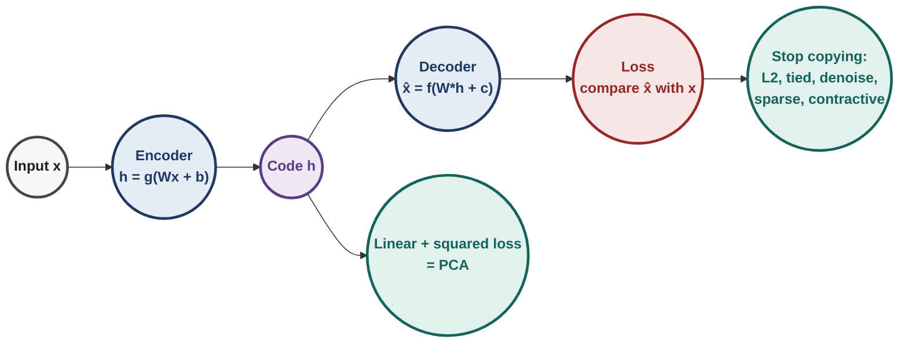
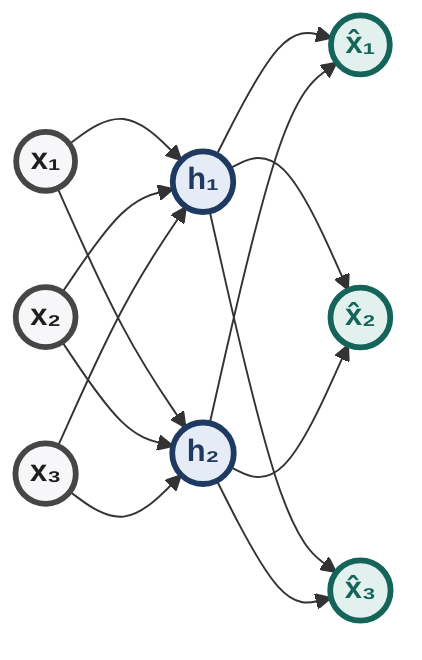
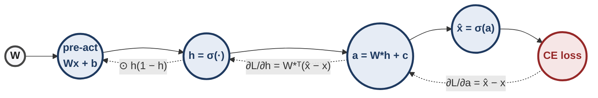
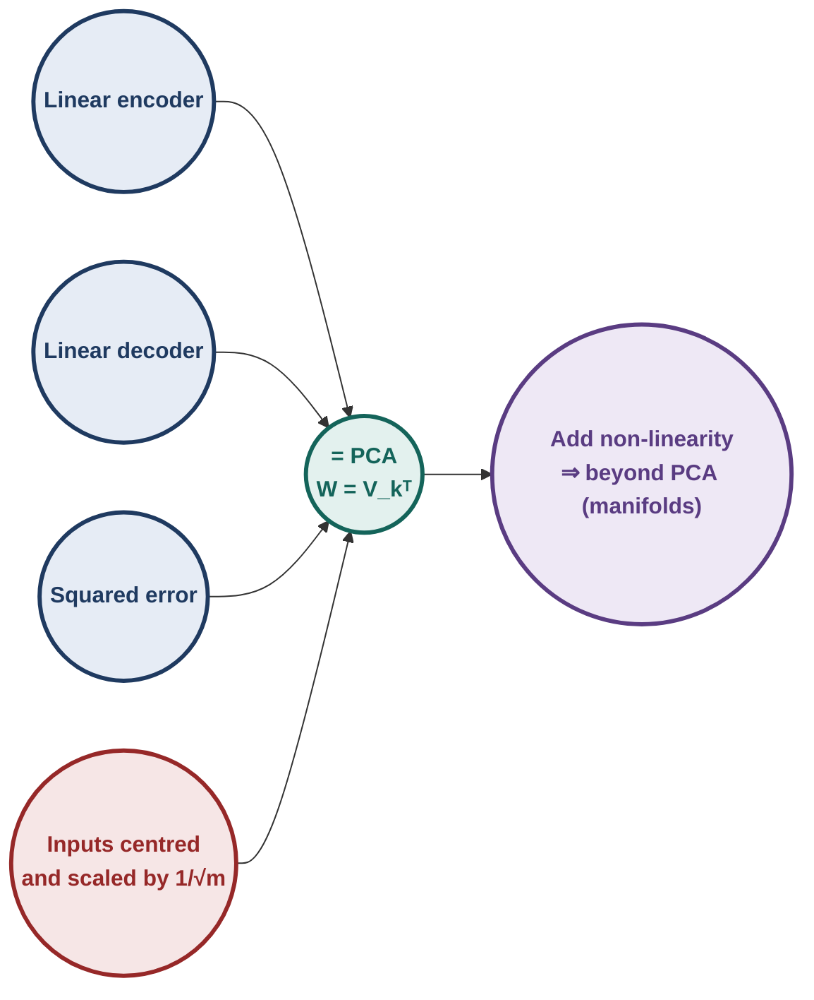
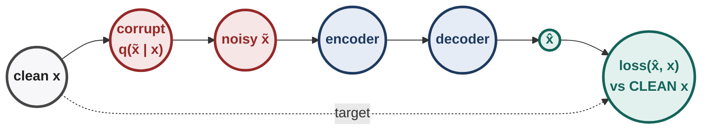
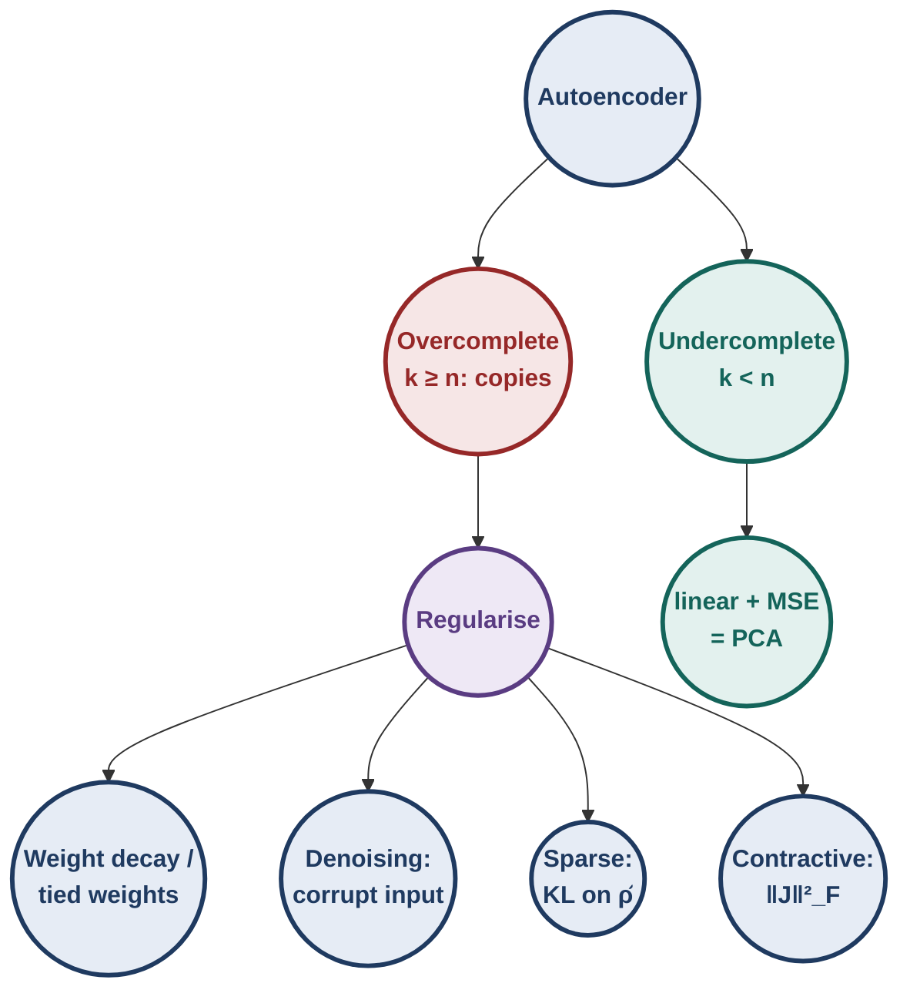
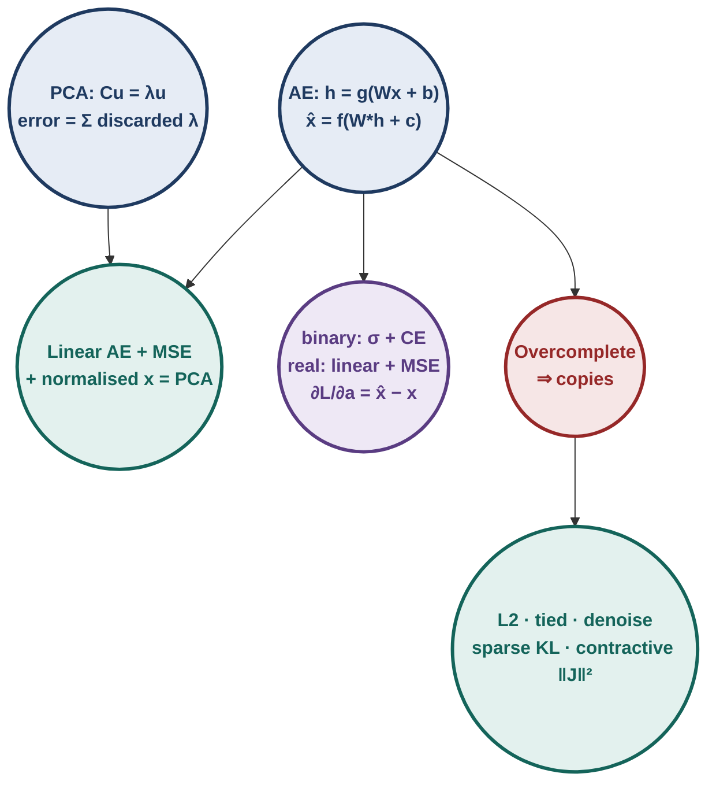

# Deep Learning : Illustrated Notes for Week 5

## Contents

- **Week 5 — Autoencoders and relation to PCA, regularisation in autoencoders, denoising, sparse and contractive autoencoders** ✓
  - 5.0 Week-5 map
  - 5.1 PCA refresher (the yardstick for autoencoders)
  - 5.2 The autoencoder: encoder, decoder, loss
  - 5.3 Link between PCA and autoencoders
  - 5.4 Regularisation in autoencoders (why, weight decay, tied weights)
  - 5.5 Denoising autoencoders
  - 5.6 Sparse autoencoders
  - 5.7 Contractive autoencoders
  - 5.8 The autoencoder family side by side
  - 5.9 Week-5 exam toolkit & practice set

---

## 5.0 Week-5 map

**[Intuition]** Weeks 1–4 were **supervised**: every $\mathbf x$ came with a label $y$. Week 5 asks: can a network learn something useful from $\mathbf x$ **alone**? The trick is to make $\mathbf x$ its own label. Squeeze the input through a narrow code $\mathbf h$ and ask the network to rebuild $\mathbf x$ from it. If it can, $\mathbf h$ must hold the important structure of the data.

Two questions drive the week:
1. **What does an autoencoder learn?** In the simplest (linear) case: exactly PCA.
2. **How do we stop it from cheating** (copying input to output)? Regularise: weight decay, tied weights, noise, sparsity, contraction.

> [!TIP]
> **Everyday pictures for the whole week.**
> - **An autoencoder is a student summarising a chapter** into a few lines, then rewriting the chapter from the summary. A good summary lets you rebuild the chapter.
> - **Undercomplete** = a short summary (forced to keep only what matters). **Overcomplete** = a summary longer than the chapter (it can just copy).
> - **Denoising** = rebuilding a page from a photocopy with smudges.
> - **Sparse** = a summary that may use only a few keywords at a time.
> - **Contractive** = a summary that barely changes when the chapter has a typo.

---

## 5.1 PCA refresher (the yardstick for autoencoders)

### 5.1.1 Setup

Data matrix $X\in\mathbb R^{m\times n}$ ($m$ examples as rows, $n$ features), **mean-centred** (each column has mean 0). Covariance:
$$C=\frac1m X^\top X\in\mathbb R^{n\times n}.$$
PCA looks for new axes (unit vectors $\mathbf u$) along which the data **varies most**, so that a few axes keep most of the information.

### 5.1.2 [Derivation] Why the axes are eigenvectors of $C$

The projection of example $\mathbf x_i$ on a unit direction $\mathbf u$ is the number $\mathbf u^\top\mathbf x_i$. Its variance over the data is
$$\frac1m\sum_i(\mathbf u^\top\mathbf x_i)^2=\mathbf u^\top\Big(\frac1m\sum_i\mathbf x_i\mathbf x_i^\top\Big)\mathbf u=\mathbf u^\top C\,\mathbf u.$$
Maximise $\mathbf u^\top C\mathbf u$ subject to $\mathbf u^\top\mathbf u=1$. Lagrangian: $\mathbf u^\top C\mathbf u-\lambda(\mathbf u^\top\mathbf u-1)$. Set the gradient to 0:
$$2C\mathbf u-2\lambda\mathbf u=0\ \Longrightarrow\ \boxed{C\mathbf u=\lambda\mathbf u}.$$
So $\mathbf u$ is an **eigenvector**, and the variance along it is $\mathbf u^\top C\mathbf u=\lambda\mathbf u^\top\mathbf u=\lambda$. Pick the eigenvector with the **largest** eigenvalue first, then the next (orthogonal) one, and so on.

| Fact | Why |
|---|---|
| Principal directions = eigenvectors of $C$ | Lagrange condition above |
| Variance along PC $i$ = $\lambda_i$ | $\mathbf u_i^\top C\mathbf u_i=\lambda_i$ |
| Fraction of variance kept by top $k$ | $\sum_{i\le k}\lambda_i\,/\,\sum_i\lambda_i$ |
| Mean squared reconstruction error with top $k$ | $\sum_{i>k}\lambda_i$ (the discarded eigenvalues) |
| PCs are uncorrelated | eigenvectors of a symmetric matrix are orthogonal |
| Via SVD $X=U\Sigma V^\top$ | $C=V\frac{\Sigma^2}{m}V^\top$: PCs = columns of $V$, $\lambda_i=\sigma_i^2/m$ |

### 5.1.3 [Ex] PCA by hand on four points

Points $(2,1),(-2,-1),(1,2),(-1,-2)$; the mean is already $(0,0)$.

| Line | Calculation | Result |
|---|---|---|
| 1 | $\frac14\sum x^2=\frac{4+4+1+1}{4}$ | 2.5 |
| 2 | $\frac14\sum y^2=\frac{1+1+4+4}{4}$ | 2.5 |
| 3 | $\frac14\sum xy=\frac{2+2+2+2}{4}$ | 2 |
| 4 | $C=\begin{bmatrix}2.5&2\\2&2.5\end{bmatrix}$; $\det(C-\lambda I)=(2.5-\lambda)^2-4=0$ | $\lambda=4.5,\ 0.5$ |
| 5 | eigenvectors | $\mathbf u_1=\tfrac1{\sqrt2}(1,1)$, $\mathbf u_2=\tfrac1{\sqrt2}(1,-1)$ |
| 6 | variance kept by PC1 | $4.5/5=90\%$ |
| 7 | 1-D codes $h=\mathbf u_1^\top\mathbf x$ | $2.121,\,-2.121,\,2.121,\,-2.121$ |
| 8 | MSE of 1-D reconstruction | $\lambda_2=0.5$ |

**Check line 8 by hand:** $(2,1)$ has code $h=3/\sqrt2=2.121$, reconstruction $h\,\mathbf u_1=(1.5,1.5)$, error $(0.5,-0.5)$, squared length $0.5$. Every point gives 0.5, so the mean is 0.5 $=\lambda_2$. ✓

<b>Try it yourself</b>: eigenvalues 6, 3, 1. How much variance does one component keep, and what is the reconstruction MSE?

Kept: $6/10=60\%$. MSE: the discarded eigenvalues, $3+1=4$.

---

## 5.2 The autoencoder: encoder, decoder, loss

### 5.2.1 Definition

A feedforward network trained to reproduce its own input:
$$\mathbf h=g(W\mathbf x+\mathbf b)\quad\text{(encoder)},\qquad \hat{\mathbf x}=f(W^*\mathbf h+\mathbf c)\quad\text{(decoder)}.$$
With $\mathbf x\in\mathbb R^n$ and $\mathbf h\in\mathbb R^k$: $W$ is $k\times n$, $W^*$ is $n\times k$.

| Type | Condition | What happens |
|---|---|---|
| **Undercomplete** | $k<n$ | $\mathbf h$ is a compressed code; to rebuild $\mathbf x$ it must keep the important factors (like PCA) |
| **Overcomplete** | $k\ge n$ | $\mathbf h$ can simply **copy** $\mathbf x$ (e.g. $W=I$); perfect reconstruction, nothing learned. Needs regularisation (§5.4) |

(An undercomplete 3 → 2 → 3 autoencoder: the code layer is the bottleneck.)

### 5.2.2 Choosing the decoder and loss

The decoder's output must live where $\mathbf x$ lives, and the loss must match.

| Input type | Decoder $f$ | Loss (one example) |
|---|---|---|
| **binary** $x_j\in\{0,1\}$ | logistic $\sigma$ (outputs in (0,1)) | cross-entropy $-\sum_j\big[x_j\ln\hat x_j+(1-x_j)\ln(1-\hat x_j)\big]$ |
| **real** $x_j\in\mathbb R$ | **linear** (identity) | squared error $\tfrac12\sum_j(\hat x_j-x_j)^2$ |

The encoder $g$ is usually a sigmoid or tanh; over the dataset we average (or sum) the per-example loss.

**[!]** A sigmoid decoder for real-valued inputs is a classic trap: it can never output values outside (0,1).

### 5.2.3 [Derivation] Both pairings give the same output gradient

Let $\mathbf a=W^*\mathbf h+\mathbf c$ be the decoder pre-activation.

- **Sigmoid + cross-entropy:** $\dfrac{\partial\mathcal L}{\partial\hat x_j}=-\dfrac{x_j}{\hat x_j}+\dfrac{1-x_j}{1-\hat x_j}=\dfrac{\hat x_j-x_j}{\hat x_j(1-\hat x_j)}$, and $\dfrac{\partial\hat x_j}{\partial a_j}=\hat x_j(1-\hat x_j)$. Multiply: $\dfrac{\partial\mathcal L}{\partial a_j}=\hat x_j-x_j$.
- **Linear + squared error:** $\hat x_j=a_j$, so $\dfrac{\partial\mathcal L}{\partial a_j}=\hat x_j-x_j$ directly.

$$\boxed{\frac{\partial\mathcal L}{\partial\mathbf a}=\hat{\mathbf x}-\mathbf x}$$
Then the usual backprop (Week 3):
$$\frac{\partial\mathcal L}{\partial W^*}=(\hat{\mathbf x}-\mathbf x)\,\mathbf h^\top,\qquad \frac{\partial\mathcal L}{\partial\mathbf h}=W^{*\top}(\hat{\mathbf x}-\mathbf x),\qquad \frac{\partial\mathcal L}{\partial W}=\Big[\frac{\partial\mathcal L}{\partial\mathbf h}\odot g'(\cdot)\Big]\mathbf x^\top.$$

### 5.2.4 [Ex] One forward and backward pass by hand

Binary input $\mathbf x=(1,0,1)$, two sigmoid hidden units, no biases,
$W=\begin{bmatrix}0.5&-0.5&0.5\\-0.5&0.5&0.5\end{bmatrix}$, sigmoid decoder with $W^*=W^\top$, cross-entropy loss.

**Forward, line by line:**

| Line | Calculation | Result |
|---|---|---|
| 1 | $W\mathbf x=(0.5-0+0.5,\ -0.5+0+0.5)$ | $(1,\ 0)$ |
| 2 | $\mathbf h=\sigma(1,0)$ | $(0.7311,\ 0.5)$ |
| 3 | $a_1=0.5(0.7311)-0.5(0.5)$ | 0.1155 |
| 4 | $a_2=-0.5(0.7311)+0.5(0.5)$ | −0.1155 |
| 5 | $a_3=0.5(0.7311)+0.5(0.5)$ | 0.6155 |
| 6 | $\hat{\mathbf x}=\sigma(\mathbf a)$ | $(0.5289,\ 0.4711,\ 0.6492)$ |
| 7 | $\mathcal L=-[\ln0.5289+\ln(1-0.4711)+\ln0.6492]$ | $0.637+0.637+0.432=\mathbf{1.706}$ |

**Backward, line by line:**

| Line | Calculation | Result |
|---|---|---|
| 8 | $\hat{\mathbf x}-\mathbf x$ | $(-0.4711,\ 0.4711,\ -0.3508)$ |
| 9 | $\partial\mathcal L/\partial W^*_{11}=(\hat x_1-x_1)h_1=-0.4711\times0.7311$ | −0.3444 |
| 10 | $\partial\mathcal L/\partial\mathbf h=W^{*\top}(\hat{\mathbf x}-\mathbf x)$ | $(-0.6466,\ 0.2957)$ |
| 11 | $\odot\,h(1-h)=(0.1966,\ 0.25)$ | $(-0.1271,\ 0.0739)$ |
| 12 | $\partial\mathcal L/\partial W_{11}=-0.1271\times x_1$ | −0.1271 |

**[Intuition]** Read line 8 as "push each output toward its target": $\hat x_1$ and $\hat x_3$ are too low (negative error, GD raises them), $\hat x_2$ is too high.

<b>Try it yourself</b>: x = (0, 1), x̂ = (0.2, 0.6). Loss and ∂L/∂a?

$\mathcal L=-[\ln(1-0.2)+\ln0.6]=0.2231+0.5108=0.734$. $\partial\mathcal L/\partial\mathbf a=\hat{\mathbf x}-\mathbf x=(0.2,\,-0.4)$.

---

## 5.3 Link between PCA and autoencoders

### 5.3.1 The statement

> An autoencoder is **equivalent to PCA** when (1) the encoder is **linear**, (2) the decoder is **linear**, (3) the loss is **squared error**, and (4) the inputs are **normalised**: $\hat x_{ij}=\dfrac{1}{\sqrt m}\Big(x_{ij}-\dfrac1m\sum_{k}x_{kj}\Big)$.

Normalisation (4) makes $X^\top X$ **equal to the covariance matrix** (centring removes the mean, the $1/\sqrt m$ gives the $1/m$). Without it, the "PCA" you recover is of the wrong matrix.

### 5.3.2 [Derivation] Why the optimum is PCA

With linear layers and no biases, stack all examples as rows: codes $H=XW^\top$ ($m\times k$), reconstructions $\hat X=HW^{*\top}$. The total squared error is
$$\sum_i\lVert\mathbf x_i-\hat{\mathbf x}_i\rVert^2=\lVert X-HW^{*\top}\rVert_F^2.$$
1. $HW^{*\top}$ is a product through a $k$-dimensional layer, so its **rank is at most $k$**.
2. **Eckart–Young:** the best rank-$k$ approximation of $X=U\Sigma V^\top$ in Frobenius norm is $U_k\Sigma_kV_k^\top$ (keep the top $k$ singular values).
3. So we want $HW^{*\top}=U_k\Sigma_kV_k^\top$. One choice that works: $W^*=V_k$ and $H=U_k\Sigma_k$.
4. Can the encoder produce that $H$? From $X=U\Sigma V^\top$, $XV_k=U_k\Sigma_k$. So $H=XV_k$, i.e. $W^\top=V_k$, $W=V_k^\top$.

$$\boxed{W=V_k^\top\ \text{(encoder)},\qquad W^*=V_k\ \text{(decoder)},\qquad \mathbf h=V_k^\top\mathbf x}$$
The columns of $V_k$ are the top-$k$ eigenvectors of $X^\top X$ (= covariance, thanks to the normalisation): **the code is the PCA projection**, and encoder and decoder are transposes of each other.

**[!] Fine print (exam favourites):**
- A trained linear AE spans the **same subspace** as PCA; its weights may be any invertible mix of the top-$k$ eigenvectors (any $W^*=V_kA$, $W=A^{-1}V_k^\top$ gives the same error). The equivalence is about the subspace and the error, not unique weights.
- **Non-linear** encoders/decoders can fit **curved** structure (manifolds) that PCA cannot. This is the main advantage of autoencoders over PCA.

### 5.3.3 [Ex] The four points again, as a linear autoencoder

Use $k=1$, encoder $W=\mathbf u_1^\top=\tfrac1{\sqrt2}(1,1)$, decoder $W^*=\mathbf u_1$.

| $\mathbf x$ | $h=W\mathbf x$ | $\hat{\mathbf x}=W^*h$ | squared error |
|---|---|---|---|
| (2, 1) | 2.121 | (1.5, 1.5) | 0.5 |
| (−2, −1) | −2.121 | (−1.5, −1.5) | 0.5 |
| (1, 2) | 2.121 | (1.5, 1.5) | 0.5 |
| (−1, −2) | −2.121 | (−1.5, −1.5) | 0.5 |

Mean error $0.5=\lambda_2$: the same number PCA gave in §5.1.3. Any other 1-D linear code gives a larger error (try $W=(1,0)$: error is $y^2$, mean $2.5$).

---

## 5.4 Regularisation in autoencoders

### 5.4.1 Why regularise?

- **Overcomplete AE:** with $k\ge n$, the network can learn $\mathbf h\approx\mathbf x$, $\hat{\mathbf x}\approx\mathbf h$ (copy). Zero training error, useless code.
- **Undercomplete but high-capacity AE:** many parameters can still memorise the training set: low training error, poor reconstruction on new data (overfitting).

The fix in every case: add a penalty $\Omega(\theta)$ to the reconstruction loss,
$$\min_\theta\ \mathcal L(\theta)+\Omega(\theta),$$
where $\Omega$ makes "just copy" or "just memorise" expensive.

### 5.4.2 L2 (weight decay)

$$\Omega(\theta)=\frac\lambda2\lVert\theta\rVert^2\quad\Longrightarrow\quad\nabla_W\big(\mathcal L+\Omega\big)=\nabla_W\mathcal L+\lambda W.$$
Small weights keep the hidden units in their linear-ish region and stop the exact identity map from being cheap. (Full analysis of L2 is in Week 6.)

### 5.4.3 Tied weights

Force $W^*=W^\top$. Half the parameters, and the decoder must "undo" the encoder with the same matrix, which limits copying.

**Gradient with tied weights.** $W$ now appears twice, so its gradient is the **sum** of both uses:
$$\nabla_W\mathcal L=\underbrace{\Big[\frac{\partial\mathcal L}{\partial\mathbf h}\odot g'\Big]\mathbf x^\top}_{\text{encoder use}}+\underbrace{\big[(\hat{\mathbf x}-\mathbf x)\,\mathbf h^\top\big]^\top}_{\text{decoder use, transposed}}.$$

**[Ex] Parameter count.** $n=784$ (MNIST pixels), $k=100$:

| | weights | biases | total |
|---|---|---|---|
| untied | $784\cdot100+100\cdot784=156{,}800$ | $100+784=884$ | **157,684** |
| tied | $78{,}400$ | 884 | **79,284** |

---

## 5.5 Denoising autoencoders

### 5.5.1 Idea

Corrupt the input, then ask the network to rebuild the **clean** input:
$$\tilde{\mathbf x}\sim q(\tilde{\mathbf x}\mid\mathbf x),\qquad \mathbf h=g(W\tilde{\mathbf x}+\mathbf b),\qquad \hat{\mathbf x}=f(W^*\mathbf h+\mathbf c),\qquad \text{loss compares }\hat{\mathbf x}\text{ with }\mathbf x.$$

Common corruption (masking noise):
$$P(\tilde x_{ij}=0\mid x_{ij})=q,\qquad P(\tilde x_{ij}=x_{ij}\mid x_{ij})=1-q.$$
For real inputs, Gaussian noise $\tilde{\mathbf x}=\mathbf x+\boldsymbol\epsilon$, $\boldsymbol\epsilon\sim\mathcal N(\mathbf 0,\sigma^2I)$, is also used.

**[Intuition]** Copying is now useless: copying $\tilde{\mathbf x}$ reproduces the noise and is penalised against the clean $\mathbf x$. To fill in a missing pixel the network must know **how features relate** (e.g. "if the pixels around are part of a stroke, this one probably is too"). That knowledge is exactly a good representation.

### 5.5.2 [Ex] Masking noise, line by line

$\mathbf x=(1,0,1,1)$, $q=0.25$.

| Line | Question | Answer |
|---|---|---|
| 1 | expected number of entries masked | $4\times0.25=1$ |
| 2 | expected value $\mathbb E[\tilde x_j]$ | $(1-q)x_j$: $(0.75,0,0.75,0.75)$ |
| 3 | one possible sample | $\tilde{\mathbf x}=(1,0,0,1)$ (third entry masked) |
| 4 | what the loss compares | $\hat{\mathbf x}$ with $\mathbf x=(1,0,1,1)$, **not** with $\tilde{\mathbf x}$ |
| 5 | can masking change $x_2$? | no: it is already 0 (masking only removes information that was there) |

**What the course shows (filters).** On MNIST, a plain AE's first-layer weights look like noise; a DAE's weights look like **stroke and edge detectors**, and higher noise (25% → 50%) gives broader, more robust strokes. With Gaussian noise the learned filters resemble edge detectors.

**[!]** The noise is applied only during **training**. At test time the clean input goes in.

---

## 5.6 Sparse autoencoders

### 5.6.1 Idea

Let the hidden layer be large (even overcomplete), but allow each input to switch on only **a few** hidden units. A sigmoid unit is "active" when its output is near 1, "inactive" near 0.

Average activation of hidden unit $l$ over the $m$ training examples:
$$\hat\rho_l=\frac1m\sum_{i=1}^m h(\mathbf x_i)_l.$$
Pick a small target $\rho$ (e.g. 0.005–0.05) and penalise any $\hat\rho_l$ that drifts away from it:
$$\Omega(\theta)=\sum_{l=1}^k\Big[\rho\ln\frac{\rho}{\hat\rho_l}+(1-\rho)\ln\frac{1-\rho}{1-\hat\rho_l}\Big],\qquad \hat{\mathcal L}=\mathcal L+\Omega.$$
Each term is the **KL divergence** between two Bernoulli distributions, Bernoulli$(\rho)$ and Bernoulli$(\hat\rho_l)$: zero when $\hat\rho_l=\rho$, positive otherwise.

### 5.6.2 [Derivation] The gradient of the penalty

For one term (unit $l$):
$$\frac{\partial\Omega}{\partial\hat\rho_l}=\rho\cdot\Big(-\frac1{\hat\rho_l}\Big)+(1-\rho)\cdot\frac{1}{1-\hat\rho_l}=-\frac{\rho}{\hat\rho_l}+\frac{1-\rho}{1-\hat\rho_l}.$$
Then chain into the weights: $\dfrac{\partial\Omega}{\partial W}=\dfrac{\partial\Omega}{\partial\hat{\boldsymbol\rho}}\cdot\dfrac{\partial\hat{\boldsymbol\rho}}{\partial W}$, and for a sigmoid encoder $\dfrac{\partial\hat\rho_l}{\partial W_{lj}}=\dfrac1m\sum_i h_l(1-h_l)\,x_{ij}$.

Read the sign: **positive** derivative means $\hat\rho_l$ is above target, so gradient descent pushes it **down**; negative means push it up.

### 5.6.3 [Ex] One hidden unit, line by line

Target $\rho=0.05$. Unit $l$ outputs $0.1,0.3,0.2,0.2$ on four examples.

| Line | Calculation | Result |
|---|---|---|
| 1 | $\hat\rho_l=(0.1+0.3+0.2+0.2)/4$ | 0.2 |
| 2 | $\rho\ln(\rho/\hat\rho)=0.05\ln0.25$ | −0.0693 |
| 3 | $(1-\rho)\ln\frac{1-\rho}{1-\hat\rho}=0.95\ln(0.95/0.8)$ | 0.1633 |
| 4 | $\Omega_l$ = line 2 + line 3 | **0.0939** |
| 5 | $\partial\Omega/\partial\hat\rho=-0.05/0.2+0.95/0.8=-0.25+1.1875$ | **+0.9375** (too active: push down) |

If instead $\hat\rho_l=0.02$: $\Omega_l=0.0163$ and $\partial\Omega/\partial\hat\rho=-2.5+0.969=-1.53$ (too quiet: push up). At $\hat\rho_l=\rho$ both are 0.

<b>Try it yourself</b>: ρ = 0.1 and ρ̂ = 0.5. Penalty and derivative?

$\Omega=0.1\ln0.2+0.9\ln1.8=-0.1609+0.5290=0.368$. Derivative $=-0.1/0.5+0.9/0.5=-0.2+1.8=1.6$ (push $\hat\rho$ down).

---

## 5.7 Contractive autoencoders

### 5.7.1 Idea

Make the code **insensitive** to small changes in the input. Measure sensitivity by the Jacobian of $\mathbf h$ with respect to $\mathbf x$ and penalise its size:
$$J_{\mathbf x}(\mathbf h)\in\mathbb R^{k\times n},\quad \big[J\big]_{lj}=\frac{\partial h_l}{\partial x_j},\qquad \Omega(\theta)=\lVert J_{\mathbf x}(\mathbf h)\rVert_F^2=\sum_{l=1}^k\sum_{j=1}^n\Big(\frac{\partial h_l}{\partial x_j}\Big)^2.$$

### 5.7.2 [Derivation] The Jacobian of a sigmoid encoder

$h_l=\sigma\big(\sum_jW_{lj}x_j+b_l\big)$, so by the chain rule
$$\frac{\partial h_l}{\partial x_j}=h_l(1-h_l)\,W_{lj}\quad\Longrightarrow\quad \Omega=\sum_l\big[h_l(1-h_l)\big]^2\sum_jW_{lj}^2.$$
Two ways to make it small: **small weights**, or **saturated** hidden units ($h_l\approx0$ or 1, so $h_l(1-h_l)\approx0$).

### 5.7.3 [Ex] Penalty at the centre vs in saturation

$W=\begin{bmatrix}1&2\\-1&1\end{bmatrix}$, $\mathbf b=\mathbf 0$.

| Case | $\mathbf h$ | $h(1-h)$ | $\Omega$ |
|---|---|---|---|
| $\mathbf x=(0,0)$: pre-activations (0, 0) | (0.5, 0.5) | (0.25, 0.25) | $0.0625\,(1+4+1+1)=\mathbf{0.4375}$ |
| pre-activations (4, −4) | (0.982, 0.018) | (0.0177, 0.0177) | $0.000312(5)+0.000312(2)=\mathbf{0.0022}$ |

**[Intuition] The tug of war.** The reconstruction loss $\mathcal L$ wants $\mathbf h$ to **change** whenever $\mathbf x$ changes (otherwise two different inputs get the same code and cannot both be rebuilt). $\Omega$ wants $\mathbf h$ to change **as little as possible**. The compromise: $\mathbf h$ stays sensitive only along directions the data actually varies in (the data manifold) and ignores everything else. That is the same goal as the denoising AE, reached analytically instead of by sampling noise.

<b>Try it yourself</b>: one sigmoid hidden unit, weights (2, −1), output h = 0.8. Contractive penalty?

$h(1-h)=0.16$, squared $0.0256$, times $\sum w^2=5$: $\Omega=0.128$.

---

## 5.8 The autoencoder family side by side

| Variant | What changes | Penalty / mechanism | What it buys |
|---|---|---|---|
| Undercomplete AE | $k<n$ | the bottleneck itself | compression; linear case = PCA |
| Overcomplete AE | $k\ge n$ | none | **copies**: needs one of the below |
| Weight decay | loss | $\frac\lambda2\lVert\theta\rVert^2$ | small weights, less memorising |
| Tied weights | architecture | $W^*=W^\top$ | half the parameters |
| Denoising | **input** | train on $\tilde{\mathbf x}$, target $\mathbf x$ | robust features (strokes, edges) |
| Sparse | loss | $\sum_l\mathrm{KL}(\rho\,\Vert\,\hat\rho_l)$ | few active units per input |
| Contractive | loss | $\lVert J_{\mathbf x}(\mathbf h)\rVert_F^2$ | code insensitive to small input changes |

**[Exam] Typical multi-select, solved.**

| Statement | Verdict | Why |
|---|---|---|
| AEs can capture non-linear relationships; PCA cannot | ✓ | non-linear encoder/decoder |
| An overcomplete AE without regularisation can learn the identity | ✓ | $k\ge n$ lets $\mathbf h$ copy $\mathbf x$ |
| A DAE's loss compares the output with the corrupted input | ✗ | compares with the **clean** input |
| A sparse AE forces the hidden layer to be small | ✗ | it forces **few active** units; the layer may be large |
| A CAE penalises the derivative of the code w.r.t. the input | ✓ | $\lVert J_{\mathbf x}(\mathbf h)\rVert_F^2$ |
| A linear AE with squared loss on raw (un-centred) data gives exactly PCA | ✗ | inputs must be centred and scaled |
| AEs always need fewer data than PCA / are always faster | ✗ | neither is guaranteed |

---

## 5.9 Week-5 exam toolkit & practice set

**Diagram — Week 5 at a glance**

### 5.9.1 Recognition rules

| See | Think |
|---|---|
| covariance matrix + "first principal component" | top eigenvector; variance = its eigenvalue |
| "fraction of variance retained" | $\sum_{i\le k}\lambda_i/\sum\lambda_i$ |
| "reconstruction error of PCA with $k$ components" | sum of discarded eigenvalues |
| binary inputs | sigmoid decoder + cross-entropy |
| real inputs | linear decoder + squared error |
| "gradient at the decoder pre-activation" | $\hat{\mathbf x}-\mathbf x$ (both pairings) |
| "when does an AE equal PCA" | linear + linear + MSE + centred, $1/\sqrt m$-scaled inputs |
| $k\ge n$ | overcomplete: can copy, needs regularisation |
| "tied weights" | $W^*=W^\top$; gradient = encoder part + decoder part transposed |
| "corrupt input, reconstruct clean" | denoising AE; $P(\tilde x=0)=q$ |
| $\hat\rho_l$, KL, target $\rho$ | sparse AE; $\partial\Omega/\partial\hat\rho=-\rho/\hat\rho+(1-\rho)/(1-\hat\rho)$ |
| Frobenius norm of a Jacobian | contractive AE; $\partial h_l/\partial x_j=h_l(1-h_l)W_{lj}$ |

### 5.9.2 Formula sheet

| Formula | Use |
|---|---|
| $C=\frac1mX^\top X$, $C\mathbf u=\lambda\mathbf u$ | PCA directions |
| $X=U\Sigma V^\top$, $\lambda_i=\sigma_i^2/m$ | PCA via SVD |
| $\mathbf h=g(W\mathbf x+\mathbf b)$, $\hat{\mathbf x}=f(W^*\mathbf h+\mathbf c)$ | autoencoder |
| $-\sum_j[x_j\ln\hat x_j+(1-x_j)\ln(1-\hat x_j)]$ | binary loss |
| $\partial\mathcal L/\partial W^*=(\hat{\mathbf x}-\mathbf x)\mathbf h^\top$ | decoder gradient |
| $W=V_k^\top$, $W^*=V_k$ | optimal linear AE |
| $P(\tilde x_{ij}=0)=q$ | denoising corruption |
| $\hat\rho_l=\frac1m\sum_ih_l(\mathbf x_i)$, $\Omega=\sum_l\big[\rho\ln\frac\rho{\hat\rho_l}+(1-\rho)\ln\frac{1-\rho}{1-\hat\rho_l}\big]$ | sparse AE |
| $\Omega=\sum_l[h_l(1-h_l)]^2\sum_jW_{lj}^2$ | contractive AE, sigmoid encoder |

### 5.9.3 Practice set

1. Covariance $\begin{bmatrix}4&0\\0&1\end{bmatrix}$. First principal direction? Variance kept by one component?
2. Eigenvalues $5,3,1,1$. Smallest $k$ keeping at least 80% of the variance? Reconstruction MSE with $k=1$?
3. Binary $\mathbf x=(1,1,0)$, decoder outputs $\hat{\mathbf x}=(0.9,0.5,0.2)$. Cross-entropy loss and $\partial\mathcal L/\partial\mathbf a$?
4. An AE maps 100 → 20 → 100. Parameters untied vs tied (with biases)?
5. Real-valued inputs in $[-5,5]$. Which decoder and loss? What goes wrong with a sigmoid decoder?
6. Masking noise $q=0.3$ on a 1000-dimensional input. Expected number of masked entries? What is the target of the loss?
7. Sparse AE, $\rho=0.05$, a unit with $\hat\rho=0.05$. Penalty and gradient? Same unit with $\hat\rho=0.5$?
8. Contractive AE, one sigmoid hidden unit with weights $(3,4)$ and output $h=0.5$. Compute $\Omega$.
9. True/False: "A linear autoencoder trained with squared error always learns exactly the eigenvectors as its weights."
10. Creative: you train an overcomplete AE (784 → 1000 → 784) and get almost zero training error after one epoch, but the codes are useless for classification. Name the problem and three distinct fixes from this week, one line each.

### 5.9.4 Answers

1. $(1,0)$ (eigenvalue 4); kept $4/5=80\%$.
2. $k=2$ ($8/10=80\%$); MSE with $k=1$ is $3+1+1=5$.
3. $\mathcal L=-[\ln0.9+\ln0.5+\ln0.8]=0.105+0.693+0.223=1.022$; $\hat{\mathbf x}-\mathbf x=(-0.1,-0.5,0.2)$.
4. Untied $2000+2000+20+100=4120$; tied $2000+120=2120$.
5. Linear decoder + squared error; a sigmoid can only output (0,1), so it can never reach targets like −3 or 4.
6. $300$; the clean input $\mathbf x$.
7. $\Omega=0$, gradient 0. At 0.5: $\Omega=0.05\ln0.1+0.95\ln1.9=-0.1151+0.6098=0.495$; gradient $-0.1+1.9=1.8$.
8. $h(1-h)=0.25$, squared $0.0625$, times $9+16=25$: $\Omega=1.5625$.
9. False: it learns the same **subspace** (any invertible mix of the top-$k$ eigenvectors), and only if inputs are centred/scaled and training reaches the optimum.
10. Overcomplete AE copying the input (identity map). Fixes: denoising (corrupt input, target clean), sparse KL penalty (few active units), contractive penalty (small Jacobian); weight decay or tied weights also count.

### 5.9.5 Worked solutions, line by line

**Q2.** Eigenvalues $5,3,1,1$, total 10.

| Line | Calculation | Result |
|---|---|---|
| 1 | $k=1$: $5/10$ | 50%: not enough |
| 2 | $k=2$: $(5+3)/10$ | 80% ✓ |
| 3 | MSE with $k=1$: discarded $3+1+1$ | 5 |
| 4 | MSE with $k=2$: discarded $1+1$ | 2 |

**Q7.** $\rho=0.05$, $\hat\rho=0.5$.

| Line | Calculation | Result |
|---|---|---|
| 1 | $\rho\ln(\rho/\hat\rho)=0.05\ln0.1$ | −0.1151 |
| 2 | $(1-\rho)\ln\frac{1-\rho}{1-\hat\rho}=0.95\ln1.9$ | 0.6098 |
| 3 | $\Omega$ | 0.495 |
| 4 | $-\rho/\hat\rho+(1-\rho)/(1-\hat\rho)=-0.1+1.9$ | 1.8 > 0, so GD lowers $\hat\rho$ |

**Q8.** $\partial h/\partial x_j=h(1-h)w_j=0.25\,(3,4)=(0.75,1)$; $\Omega=0.75^2+1^2=0.5625+1=1.5625$. ✓ Same as the formula route.

---
