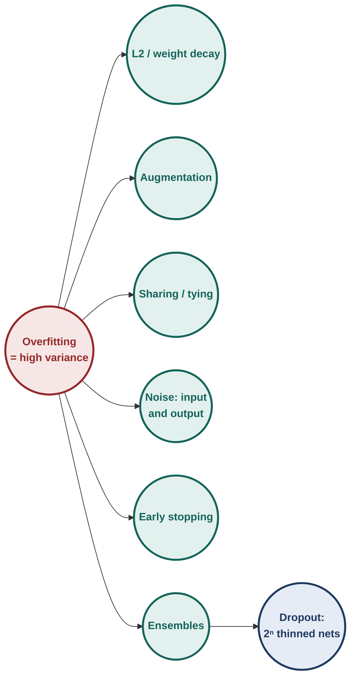
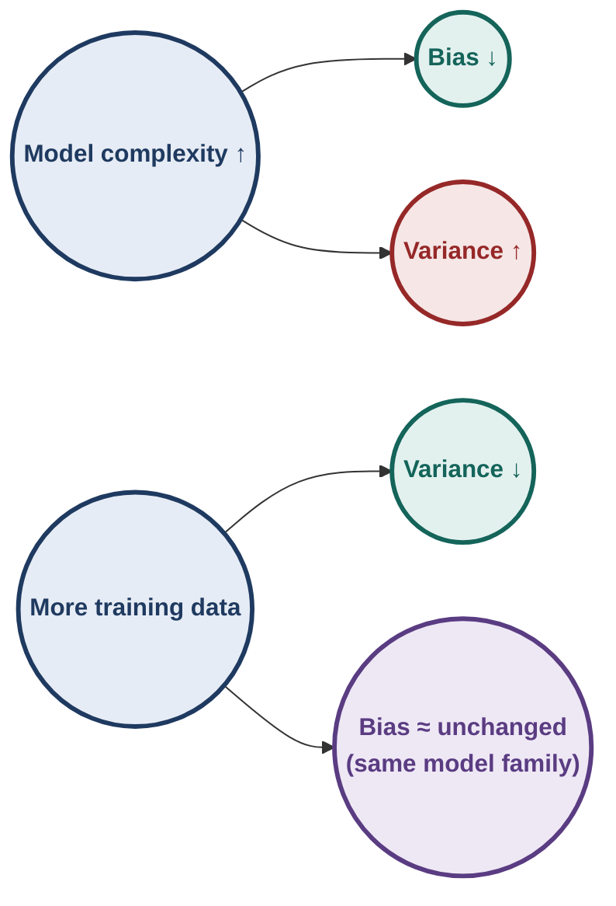
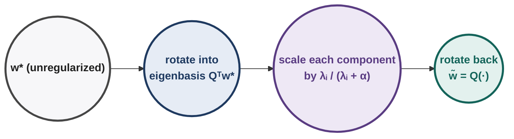
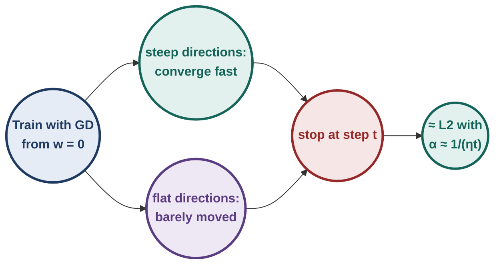
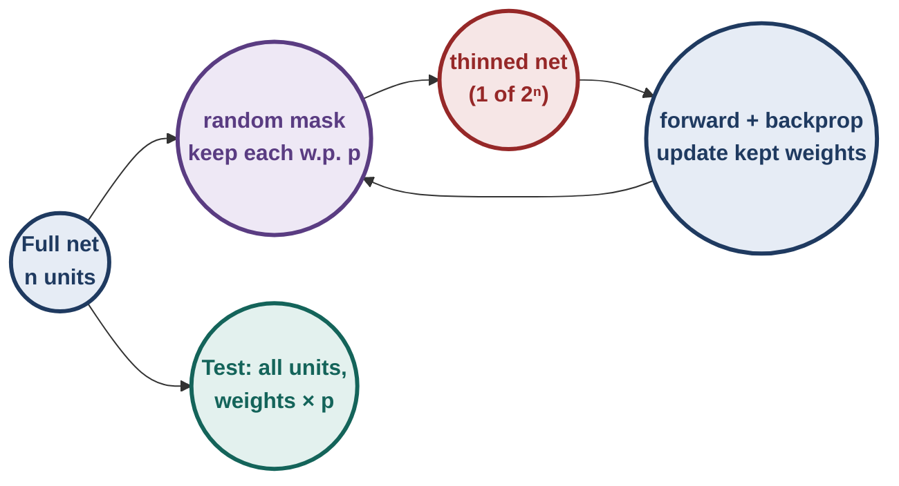
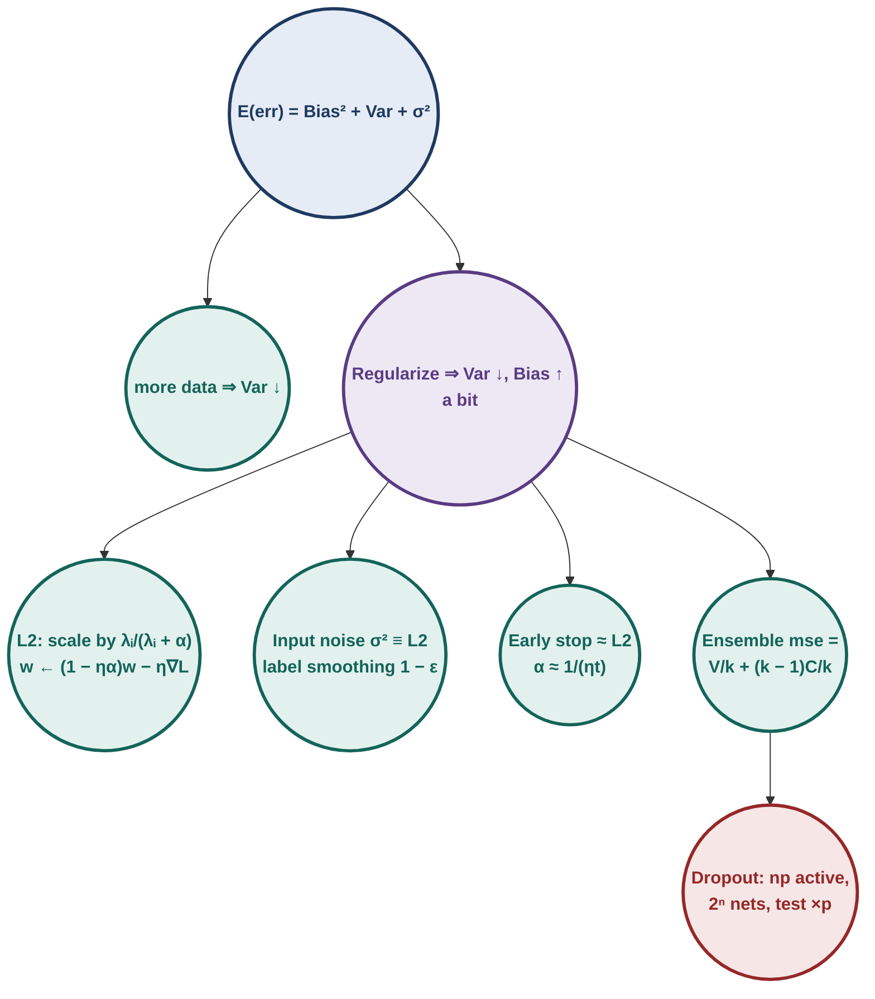

# Deep Learning : Illustrated Notes for Week 6

## Contents

- **Week 6 — Bias-variance trade-off, L2 regularization, early stopping, dataset augmentation, parameter sharing and tying, injecting noise, ensembles, dropout** ✓
  - 6.0 Week-6 map
  - 6.1 Bias and variance
  - 6.2 Train error vs test error (why training error lies)
  - 6.3 L2 regularization
  - 6.4 Dataset augmentation
  - 6.5 Parameter sharing and tying
  - 6.6 Injecting noise at the input
  - 6.7 Injecting noise at the output (label smoothing)
  - 6.8 Early stopping
  - 6.9 Ensemble methods
  - 6.10 Dropout
  - 6.11 Week-6 exam toolkit & practice set

---

## 6.0 Week-6 map

**[Intuition]** Deep networks have millions of parameters, often more than training examples. They can fit the training set perfectly, including its noise, and then do badly on new data. That is **overfitting**, or in this week's language, **high variance**. Every technique this week is a different way to buy lower variance at the price of a little bias.

| Technique | Where it acts | One-line idea |
|---|---|---|
| L2 | loss | penalise large weights |
| Augmentation | data | more (label-preserving) examples |
| Sharing / tying | architecture | fewer free parameters |
| Input noise | data | equivalent to L2 for linear models |
| Output noise | labels | do not chase 100% confidence |
| Early stopping | training time | stop before memorising |
| Ensembles | many models | average out independent errors |
| Dropout | architecture during training | a cheap ensemble of $2^n$ thinned nets |

> [!TIP]
> **Everyday pictures for the whole week.**
> - **Bias** is a dart player whose aim is off; **variance** is a dart player with shaky hands.
> - **L2** is a budget: every unit of weight costs something, so only weights that really help survive.
> - **Early stopping** is leaving the exam hall when you have written the good answers, before you start "correcting" them into mistakes.
> - **Ensembles** are asking several doctors and averaging their opinions. **Dropout** is a team where any member may be absent, so nobody can rely on one star player.

---

## 6.1 Bias and variance

### 6.1.1 Setup (the course's thought experiment)

The truth is $y=f(x)+\varepsilon$, $\varepsilon\sim\mathcal N(0,\sigma^2)$. Draw **many different training sets** from this distribution and fit the same model family to each. At a fixed test point $x$, each fit gives a prediction $\hat f(x)$; the predictions vary from one training set to another.

- **Bias:** how far the **average** prediction is from the truth, $\mathrm{Bias}=\mathbb E[\hat f(x)]-f(x)$.
- **Variance:** how much the predictions **scatter** around their own average, $\mathrm{Var}=\mathbb E\big[(\hat f(x)-\mathbb E[\hat f(x)])^2\big]$.

| Model | Bias | Variance | Picture |
|---|---|---|---|
| Simple (e.g. degree-1 polynomial on a curve) | **high** | low | all fits similar, all wrong in the same way |
| Complex (e.g. degree-25 polynomial) | low | **high** | fits wiggle wildly from one training set to the next |

### 6.1.2 [Derivation] The decomposition

Expected squared error at a new point $(x,y)$:
$$\mathbb E\big[(y-\hat f)^2\big]=\mathbb E\big[(f+\varepsilon-\hat f)^2\big]=\mathbb E\big[(f-\hat f)^2\big]+\sigma^2,$$
because $\varepsilon$ has mean 0 and is independent of $\hat f$ (the test noise was not used for training), so the cross term vanishes. Now add and subtract $\mathbb E[\hat f]$:
$$\mathbb E\big[(f-\hat f)^2\big]=\big(f-\mathbb E[\hat f]\big)^2+\mathbb E\big[(\hat f-\mathbb E[\hat f])^2\big]+\underbrace{2\big(f-\mathbb E\hat f\big)\,\mathbb E\big[\mathbb E\hat f-\hat f\big]}_{=0}.$$
$$\boxed{\mathbb E\big[(y-\hat f)^2\big]=\mathrm{Bias}^2+\mathrm{Variance}+\sigma^2}$$
$\sigma^2$ is the **irreducible error**: no model can beat the noise.

### 6.1.3 [Ex] Bias and variance from four fits

Truth $f(x_0)=3$, noise $\sigma^2=0.5$. Four models trained on four datasets predict $2,4,3,5$ at $x_0$.

| Line | Calculation | Result |
|---|---|---|
| 1 | $\mathbb E[\hat f]=(2+4+3+5)/4$ | 3.5 |
| 2 | $\mathrm{Bias}^2=(3.5-3)^2$ | 0.25 |
| 3 | $\mathrm{Var}=\frac{(-1.5)^2+0.5^2+(-0.5)^2+1.5^2}{4}$ | 1.25 |
| 4 | check: $\mathbb E[(\hat f-f)^2]=\frac{1+1+0+4}{4}$ | $1.5=0.25+1.25$ ✓ |
| 5 | expected test error $=0.25+1.25+0.5$ | **2.0** |

**[Exam] Quiz 2.** A degree-25 polynomial is fit to data $y=f(x)+\varepsilon$; the training set is then enlarged with more samples from the same distribution, model unchanged. Effect?
- ✓ **Variance tends to decrease, bias stays about the same.** More data pins down the wiggly fit (less scatter between datasets), but the family of degree-25 polynomials, and hence how close its *average* fit can get to $f$, is unchanged.
- ✗ "Bias decreases significantly": bias depends on the model family, not the amount of data.
- ✗ "Both become zero": $\sigma^2$ is irreducible, and finite data leaves some variance.
- ✗ "No effect": variance clearly drops.

### 6.1.4 The U-shaped test error

As complexity grows, training error keeps falling, while test error first falls (bias dropping) and then rises (variance exploding). The best model sits at the bottom of the test-error U. Regularization lets us use a complex model but pull it back toward that bottom.

---

## 6.2 Train error vs test error (why training error lies)

### 6.2.1 [Derivation] The gap, via Stein's lemma

Write $\hat f_i=\hat f(x_i)$, $f_i=f(x_i)$, $y_i=f_i+\varepsilon_i$. For any point,
$$\mathbb E[(\hat f_i-y_i)^2]=\mathbb E[(\hat f_i-f_i)^2]+\sigma^2-2\,\mathbb E[\varepsilon_i(\hat f_i-f_i)].$$
- **Test point:** $\varepsilon_i$ was not seen in training, so it is independent of $\hat f_i$ and the last term is 0.
- **Training point:** $\hat f_i$ was fit using $y_i$, so it is correlated with $\varepsilon_i$. **Stein's lemma** (for Gaussian noise) gives $\mathbb E[\varepsilon_i(\hat f_i-f_i)]=\sigma^2\,\mathbb E\big[\partial\hat f_i/\partial y_i\big]$.

Putting the two together (averaging over $m$ training points):
$$\boxed{\text{true error}=\text{training error}+\frac{2\sigma^2}{m}\sum_{i=1}^m\frac{\partial\hat f(x_i)}{\partial y_i}}$$

**[Intuition]** $\partial\hat f(x_i)/\partial y_i$ asks: *if I nudge one training label, how much does the model's prediction at that point follow?* A model that memorises ($\hat f(x_i)=y_i$) has derivative 1 everywhere: maximum optimism. A very rigid model barely reacts: small gap. So **the more a model can bend to individual labels, the more its training error underestimates its true error.** Regularization reduces that sensitivity.

**[Ex]** For ordinary least squares with $p$ parameters, $\sum_i\partial\hat f(x_i)/\partial y_i=p$ (the trace of the "hat" matrix). With $\sigma^2=1$, $m=100$, $p=10$: gap $=2\cdot1\cdot10/100=0.2$. Double the parameters, double the gap.

---

## 6.3 L2 regularization

### 6.3.1 Objective and update

$$\tilde{\mathcal L}(\mathbf w)=\mathcal L(\mathbf w)+\frac\alpha2\lVert\mathbf w\rVert^2,\qquad \nabla\tilde{\mathcal L}=\nabla\mathcal L+\alpha\mathbf w,$$
$$\mathbf w_{t+1}=\mathbf w_t-\eta\nabla\mathcal L(\mathbf w_t)-\eta\alpha\mathbf w_t=\underbrace{(1-\eta\alpha)}_{\text{decay}}\mathbf w_t-\eta\nabla\mathcal L(\mathbf w_t).$$
Every step first **shrinks** the weights by a constant factor, then takes the usual step: hence the name **weight decay**.

**[Exam] End-term.** $J(w)=L(w)+\frac\lambda2w^2$, $w_t=3$, $\partial L/\partial w=4$, $\lambda=0.1$, $\eta=0.05$:

| Line | Calculation | Result |
|---|---|---|
| 1 | $\nabla J=\nabla L+\lambda w=4+0.1\times3$ | 4.3 |
| 2 | $w_{t+1}=3-0.05\times4.3$ | **2.785** |
| 3 | check with the decay form: $(1-0.005)\times3-0.05\times4$ | $2.985-0.2=2.785$ ✓ |

### 6.3.2 [Derivation] Where L2 moves the optimum

Let $\mathbf w^*$ minimise the unregularized loss. Near it, a second-order Taylor expansion (gradient is 0 at a minimum) gives
$$\mathcal L(\mathbf w)\approx\mathcal L(\mathbf w^*)+\tfrac12(\mathbf w-\mathbf w^*)^\top H(\mathbf w-\mathbf w^*),\qquad \nabla\mathcal L(\mathbf w)\approx H(\mathbf w-\mathbf w^*).$$
At the regularized optimum $\tilde{\mathbf w}$: $H(\tilde{\mathbf w}-\mathbf w^*)+\alpha\tilde{\mathbf w}=0$, so
$$\tilde{\mathbf w}=(H+\alpha I)^{-1}H\,\mathbf w^*.$$
Diagonalise $H=Q\Lambda Q^\top$ ($Q$ orthogonal, $\Lambda=\mathrm{diag}(\lambda_i)$):
$$\tilde{\mathbf w}=Q(\Lambda+\alpha I)^{-1}\Lambda\,Q^\top\mathbf w^*\quad\Longrightarrow\quad\boxed{\text{component }i\text{ is scaled by }\frac{\lambda_i}{\lambda_i+\alpha}}$$

| Direction | $\lambda_i$ vs $\alpha$ | factor $\frac{\lambda_i}{\lambda_i+\alpha}$ | meaning |
|---|---|---|---|
| high curvature (loss cares a lot) | $\lambda_i\gg\alpha$ | ≈ 1 | kept |
| low curvature (loss barely cares) | $\lambda_i\ll\alpha$ | ≈ 0 | shrunk away |
| no regularization | $\alpha=0$ | 1 | $\tilde{\mathbf w}=\mathbf w^*$ |

**Effective number of parameters** $=\sum_i\frac{\lambda_i}{\lambda_i+\alpha}<n$: L2 quietly switches off the directions the data does not support.

**[Ex]** Eigenvalues $10,1,0.1$, $\alpha=1$: factors $0.909,\ 0.5,\ 0.091$; effective parameters $\approx1.5$ instead of 3.

**[Ex] 1-D check.** $\mathcal L=(w-4)^2$ (so $H=2$, $w^*=4$), $\alpha=2$. Formula: $\tilde w=\frac{2}{2+2}\cdot4=2$. Direct: minimise $(w-4)^2+w^2$: $2(w-4)+2w=0\Rightarrow w=2$ ✓.

<b>Try it yourself</b>: w = 2, ∂L/∂w = −1, η = 0.1, α = 0.5. New w?

$\nabla\tilde{\mathcal L}=-1+0.5\times2=0$, so $w$ stays at 2: the loss gradient and the decay exactly balance. That is what a regularized optimum looks like.

---

## 6.4 Dataset augmentation

Create new training examples by applying transformations that **do not change the label**: rotations, shifts, crops, flips, scaling, colour/brightness changes, small noise. More (realistic) data ⇒ lower variance (§6.1.3).

**[!]** The transform must preserve the label. Flipping a "6" vertically makes a "9"; rotating a "b" can make a "q". Choose transforms that respect the task.

---

## 6.5 Parameter sharing and tying

- **Sharing:** the same weights are used at many places. CNNs (Week 8) use one small filter across the whole image, so a layer needs hundreds of parameters instead of millions.
- **Tying:** two parts of a network are forced to have related weights, e.g. autoencoder decoder $W^*=W^\top$ (Week 5).

Both reduce the number of **free** parameters, which reduces variance.

---

## 6.6 Injecting noise at the input

### 6.6.1 [Derivation] Noise = L2 for a linear model

Model $\hat y=\sum_iw_ix_i$. Train on noisy inputs $\tilde x_i=x_i+\varepsilon_i$, $\varepsilon_i\sim\mathcal N(0,\sigma^2)$ independent. The prediction becomes $\tilde y=\hat y+\sum_iw_i\varepsilon_i$, and
$$\mathbb E\big[(\tilde y-y)^2\big]=\mathbb E\big[(\hat y-y)^2\big]+2\,\mathbb E\Big[(\hat y-y)\sum_iw_i\varepsilon_i\Big]+\mathbb E\Big[\Big(\sum_iw_i\varepsilon_i\Big)^2\Big].$$
- Middle term: the noise is independent with mean 0, so it is **0**.
- Last term: $\sum_iw_i^2\mathbb E[\varepsilon_i^2]+\sum_{i\ne j}w_iw_j\mathbb E[\varepsilon_i]\mathbb E[\varepsilon_j]=\sigma^2\sum_iw_i^2$.

$$\boxed{\mathbb E\big[(\tilde y-y)^2\big]=\mathbb E\big[(\hat y-y)^2\big]+\sigma^2\lVert\mathbf w\rVert^2}$$
Training with Gaussian input noise **is** L2 regularization with $\alpha/2=\sigma^2$ (for linear models; approximately for others). The denoising autoencoder of Week 5 is the same idea.

**[Ex]** $\mathbf w=(2,-1)$, $\sigma^2=0.1$: implicit penalty $0.1\times(4+1)=0.5$.

---

## 6.7 Injecting noise at the output (label smoothing)

Hard one-hot targets push the network to output probability exactly 1, which needs logits going to infinity: overconfidence and large weights. **Soft targets** with $k$ classes and a small $\varepsilon$:
$$y_{\text{correct}}=1-\varepsilon,\qquad y_{\text{other}}=\frac{\varepsilon}{k-1}.$$

**[Ex]** $k=10$, $\varepsilon=0.1$: correct $0.9$, each other class $0.1/9=0.0111$.

Prediction gives the correct class $0.7$ and $0.0333$ to each of the others:

| Target | Cross-entropy | Minimised when |
|---|---|---|
| hard $(1,0,\dots)$ | $-\ln0.7=0.357$ | $p_{\text{correct}}\to1$ (logits → ∞) |
| smoothed $(0.9,0.011,\dots)$ | $-[0.9\ln0.7+9(0.0111)\ln0.0333]=0.661$ | $p_{\text{correct}}=0.9$ exactly |

The smoothed target has a **finite** optimum, so the weights have no reason to grow without bound.

---

## 6.8 Early stopping

### 6.8.1 The procedure

Track validation error during training. Keep the best weights so far. If validation error has not improved for **$p$ epochs** (patience), stop and return the best weights.

**[Ex]** Validation errors by epoch: $0.50,\,0.42,\,0.38,\,0.37,\,0.39,\,0.38,\,0.40,\,0.41$, patience $p=3$.

| Epoch | Val error | Best so far | Epochs without improvement |
|---|---|---|---|
| 1 | 0.50 | 0.50 (ep 1) | 0 |
| 2 | 0.42 | 0.42 (ep 2) | 0 |
| 3 | 0.38 | 0.38 (ep 3) | 0 |
| 4 | 0.37 | **0.37 (ep 4)** | 0 |
| 5 | 0.39 | 0.37 | 1 |
| 6 | 0.38 | 0.37 | 2 |
| 7 | 0.40 | 0.37 | **3 ⇒ stop** |

Training stops after epoch 7 and returns the **epoch-4** weights. (Epoch 6 improved on epoch 5 but not on the best, so it does not reset the counter.)

### 6.8.2 [Derivation] Early stopping behaves like L2

Take the quadratic loss of §6.3.2, start from $\mathbf w_0=\mathbf 0$, run GD with rate $\eta$. In the eigenbasis each component evolves independently (Week 4, §4.1):
$$(Q^\top\mathbf w_t)_i=\big[1-(1-\eta\lambda_i)^t\big](Q^\top\mathbf w^*)_i.$$
Compare L2: $(Q^\top\tilde{\mathbf w})_i=\frac{\lambda_i}{\lambda_i+\alpha}(Q^\top\mathbf w^*)_i=\big[1-\frac{\alpha}{\lambda_i+\alpha}\big](Q^\top\mathbf w^*)_i$.

They match when $(1-\eta\lambda_i)^t=\frac{\alpha}{\lambda_i+\alpha}$. Take logs and use $\ln(1+x)\approx x$ for small $\eta\lambda_i$ and small $\lambda_i/\alpha$: $-t\eta\lambda_i\approx-\lambda_i/\alpha$, so
$$\boxed{\alpha\approx\frac{1}{\eta\,t}}$$
**Stopping after $t$ steps ≈ L2 with strength $1/(\eta t)$.** Stop earlier ⇒ stronger regularization.

**[Ex]** $\eta=0.01$, $t=1000\Rightarrow\alpha\approx0.1$. Compare the kept fraction per direction:

| $\lambda_i$ | early stopping $1-(1-\eta\lambda)^t$ | L2 $\frac{\lambda}{\lambda+0.1}$ |
|---|---|---|
| 10 (steep) | 1.000 | 0.990 |
| 0.05 (flat) | 0.394 | 0.333 |

Same pattern: steep directions are learned fully, flat directions are held back because GD has not had time to travel along them.

---

## 6.9 Ensemble methods

### 6.9.1 Idea

Train several models and combine them (average for regression, vote/average probabilities for classification). Ways to get different models: **bagging** (each model trained on a bootstrap sample, i.e. $m$ examples drawn **with replacement**), different architectures, hyperparameters, features or random initialisations.

### 6.9.2 [Derivation] When averaging helps

Model $i$ has error $\varepsilon_i$ at a test point with $\mathbb E[\varepsilon_i^2]=V$ and $\mathbb E[\varepsilon_i\varepsilon_j]=C$ ($i\ne j$). The ensemble's error is $\frac1k\sum_i\varepsilon_i$:
$$\mathrm{mse}_{\text{ens}}=\mathbb E\Big[\Big(\frac1k\sum_i\varepsilon_i\Big)^2\Big]=\frac1{k^2}\Big[\underbrace{kV}_{i=j\text{ terms}}+\underbrace{k(k-1)C}_{i\ne j\text{ terms}}\Big]=\boxed{\frac Vk+\frac{k-1}{k}C}$$

| Errors are | $C$ | $\mathrm{mse}_{\text{ens}}$ | Verdict |
|---|---|---|---|
| perfectly correlated | $V$ | $V$ | no gain at all |
| independent | 0 | $V/k$ | error falls like $1/k$ |
| anti-correlated | $<0$ | below $V/k$ | best case |

**[Ex]** $k=5$, $V=1$: $C=0\Rightarrow0.2$; $C=0.5\Rightarrow0.1+0.4=0.6$; $C=1\Rightarrow1$.

**[Exam] Quiz 2** ($V=12$).
- $k=2$, fixed $V$: which $C\in[-V,V]$ minimises the mse? $\mathrm{mse}=6+\frac C2$, increasing in $C$, so **$C=-V$**, giving $6-6=0$ (the two errors cancel exactly).
- $k\to\infty$ with $C=C_0>0$: $\frac Vk\to0$ and $\frac{k-1}{k}\to1$, so $\mathrm{mse}\to\mathbf{C_0}$. Correlated errors are a floor that no number of models can break.

---

## 6.10 Dropout

### 6.10.1 The procedure

**Training:** at every step, keep each unit (input or hidden) **independently with probability $p$** (the retention probability) and remove it with probability $1-p$, together with its connections. Do forward and backward passes on this **thinned** network; only the surviving weights get gradient updates. Draw a fresh mask at the next step.

**Testing:** use the full network, with each unit's outgoing weights **multiplied by $p$** (weight scaling), so every unit's expected contribution matches training.

| Quantity | Formula |
|---|---|
| expected number of active units (layer of $n$) | $np$ |
| number of distinct thinned networks | $2^n$ (each unit in or out) |
| test-time weights | $p\,W$ |
| "inverted dropout" (common in code) | divide by $p$ during training, no scaling at test |

**[Exam] Quiz 2.** $n=10$ units, $p=0.7$: expected active units $=10\times0.7=$ **7**; thinned sub-networks $=$ **$2^{10}$** (not $10$, $10^2$ or $10!$).

### 6.10.2 [Ex] Why weights are scaled by $p$ at test time

Two hidden units with outputs $h=(2,4)$, outgoing weights $(1,1)$, $p=0.5$. Enumerate the four equally likely masks:

| Mask | Output |
|---|---|
| both dropped | 0 |
| only unit 1 | 2 |
| only unit 2 | 4 |
| both kept | 6 |
| **average** | **3** |

The full network would output $6$. Scaling the weights by $p=0.5$ gives $0.5\times6=3$: it reproduces the **average over all thinned networks** in a single pass (exactly so for a linear output; an excellent approximation otherwise).

### 6.10.3 Why dropout works

- **Ensemble view:** each step trains a different one of $2^n$ thinned networks; they all **share** weights, so it is an ensemble of exponentially many models at the cost of one. Test-time scaling approximates averaging them.
- **No co-adaptation:** a unit cannot rely on specific other units being present, so it must learn features that are useful on their own. (Course example: a "nose detector" cannot depend on the "eye detector" always firing; the network learns redundant evidence.)
- **Noise view:** dropout injects multiplicative noise into hidden units, a cousin of §6.6.

**[!] Traps.**
- $p$ here is the probability of **keeping** a unit. Some sources (and PyTorch) parametrise by the drop rate $1-p$; read the question.
- No dropout at test time; only the scaling.
- Typical values: $p\approx0.8$ for inputs, $0.5$ for hidden units.

---

## 6.11 Week-6 exam toolkit & practice set

**Diagram — Week 6 at a glance**

### 6.11.1 Recognition rules

| See | Think |
|---|---|
| several model predictions at one point + true value | bias = mean − truth; variance = spread around the mean |
| "more training data, same model" | variance ↓, bias unchanged |
| "more complex model" | bias ↓, variance ↑ |
| "why training error is optimistic" | $+\frac{2\sigma^2}{m}\sum\partial\hat f_i/\partial y_i$ |
| L2 gradient step with numbers | $w-\eta(\nabla L+\alpha w)$ |
| Hessian eigenvalues + $\alpha$ | factors $\lambda_i/(\lambda_i+\alpha)$ |
| Gaussian input noise on a linear model | L2 with penalty $\sigma^2\lVert\mathbf w\rVert^2$ |
| soft targets | $1-\varepsilon$ and $\varepsilon/(k-1)$ |
| patience question | count epochs since the **best** value; return the best epoch's weights |
| "early stopping equivalent L2" | $\alpha\approx1/(\eta t)$ |
| $V$, $C$, $k$ ensemble | $V/k+(k-1)C/k$; $k\to\infty\Rightarrow C$ |
| dropout counts | $np$ active, $2^n$ thinned nets, test weights $\times p$ |

### 6.11.2 Formula sheet

| Formula | Use |
|---|---|
| $\mathbb E[(y-\hat f)^2]=\mathrm{Bias}^2+\mathrm{Var}+\sigma^2$ | decomposition |
| $\text{true}=\text{train}+\frac{2\sigma^2}{m}\sum_i\frac{\partial\hat f(x_i)}{\partial y_i}$ | Stein's lemma gap |
| $\mathbf w\leftarrow(1-\eta\alpha)\mathbf w-\eta\nabla\mathcal L$ | weight decay |
| $\tilde{\mathbf w}=Q(\Lambda+\alpha I)^{-1}\Lambda Q^\top\mathbf w^*$ | L2 optimum |
| $\mathbb E[(\tilde y-y)^2]=\mathbb E[(\hat y-y)^2]+\sigma^2\lVert\mathbf w\rVert^2$ | input noise |
| $(1-\eta\lambda_i)^t\approx\frac{\alpha}{\lambda_i+\alpha}$, $\alpha\approx\frac1{\eta t}$ | early stopping ≈ L2 |
| $\mathrm{mse}_{\text{ens}}=\frac Vk+\frac{k-1}kC$ | ensembles |
| $np$, $2^n$, $pW$ | dropout |

### 6.11.3 Practice set

1. True $f(x_0)=5$, $\sigma^2=1$. Five models predict $4,6,5,7,8$. Bias², variance, expected test error?
2. Hessian eigenvalues 9 and 1, $\alpha=1$, $Q^\top\mathbf w^*=(10,10)$. Find $Q^\top\tilde{\mathbf w}$ and the effective number of parameters.
3. $w=1.5$, $\partial L/\partial w=2$, $\alpha=0.2$, $\eta=0.1$. One L2-regularized GD step.
4. Linear model $\mathbf w=(3,4)$ trained with input noise $\sigma^2=0.04$. Implicit penalty?
5. Validation errors: $0.9,0.7,0.6,0.62,0.58,0.59,0.60,0.61,0.57$, patience 3. When does training stop and which epoch's weights are returned?
6. Ensemble with $k=4$, $V=8$, $C=2$. mse? What if $C=0$?
7. A layer has 20 units, retention $p=0.8$. Expected active units, number of thinned networks, test-time weight factor?
8. Label smoothing with $k=5$, $\varepsilon=0.2$. Target vector for class 2?
9. GD with $\eta=0.001$ is stopped after 500 steps. Equivalent L2 strength?
10. Least squares with $p=10$ parameters, $m=50$ points, $\sigma^2=0.5$. Expected gap between true and training error?
11. Multi-select: which reduce variance? (a) more data (b) larger polynomial degree (c) dropout (d) L2 (e) bagging.
12. Creative: training accuracy 99.8%, validation accuracy 81%, and validation loss started rising at epoch 12 of 60. Diagnose and give a fix from four different sections of this week.

### 6.11.4 Answers

1. Mean 6, Bias² $=1$; Var $=\frac{4+0+1+1+4}{5}=2$; error $=1+2+1=4$.
2. Factors $\frac9{10}=0.9$, $\frac12=0.5$ ⇒ $(9,5)$; effective parameters $1.4$.
3. $1.5-0.1(2+0.2\times1.5)=1.5-0.23=1.27$.
4. $0.04\times(9+16)=1$.
5. Best 0.58 at epoch 5; epochs 6, 7, 8 do not beat it ⇒ stop after epoch 8, return epoch-5 weights (the 0.57 at epoch 9 is never seen).
6. $2+\frac34\times2=3.5$; with $C=0$: $2$.
7. $16$; $2^{20}$; $0.8$.
8. $(0.05,\ 0.8,\ 0.05,\ 0.05,\ 0.05)$.
9. $\alpha\approx1/(0.001\times500)=2$.
10. $\frac{2\times0.5\times10}{50}=0.2$.
11. (a), (c), (d), (e).
12. Overfitting (high variance). Fixes: early stopping around epoch 12 (§6.8), L2/weight decay (§6.3), dropout (§6.10), data augmentation (§6.4); ensembles (§6.9) also work.

### 6.11.5 Worked solutions, line by line

**Q1.**

| Line | Calculation | Result |
|---|---|---|
| 1 | mean $(4+6+5+7+8)/5$ | 6 |
| 2 | Bias² $(6-5)^2$ | 1 |
| 3 | deviations from 6: $-2,0,-1,1,2$; squares $4,0,1,1,4$ | sum 10 |
| 4 | Var $10/5$ | 2 |
| 5 | error $1+2+\sigma^2$ | 4 |

**Q5.**

| Epoch | 1 | 2 | 3 | 4 | 5 | 6 | 7 | 8 |
|---|---|---|---|---|---|---|---|---|
| val | 0.90 | 0.70 | 0.60 | 0.62 | 0.58 | 0.59 | 0.60 | 0.61 |
| best | 0.90 | 0.70 | 0.60 | 0.60 | **0.58** | 0.58 | 0.58 | 0.58 |
| no-improve count | 0 | 0 | 0 | 1 | 0 | 1 | 2 | **3 ⇒ stop** |

Patience is counted from the **last improvement of the best value** (epoch 5), so the counter reset at epoch 5.

**Q6.** $\frac Vk=\frac84=2$; $\frac{k-1}{k}C=\frac34\times2=1.5$; total $3.5$. With independent errors ($C=0$) it would be $2$, a factor $k=4$ below a single model's $8$; the correlation costs the extra $1.5$.

---
