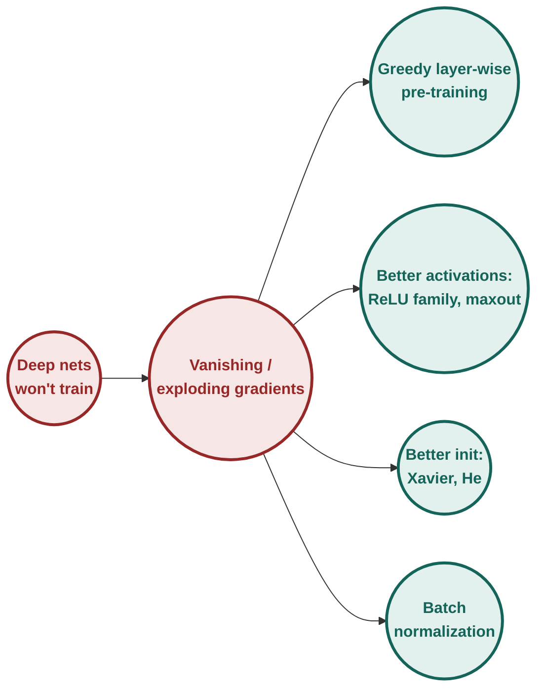
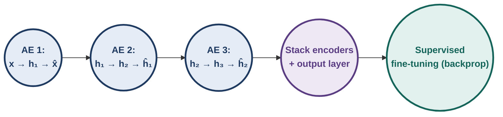
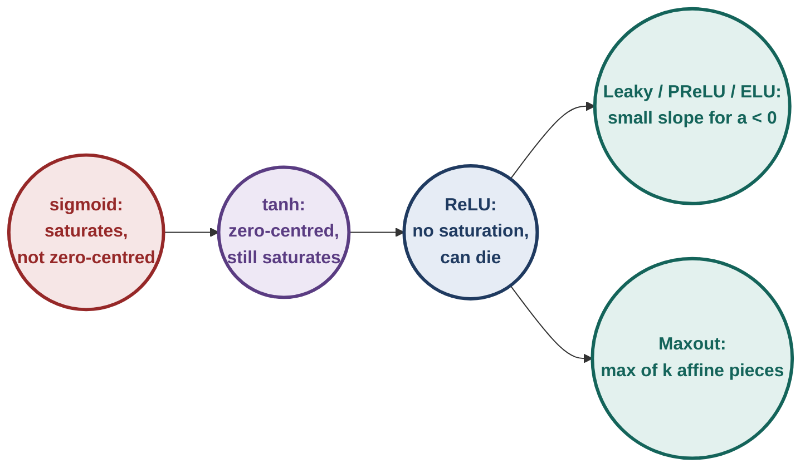
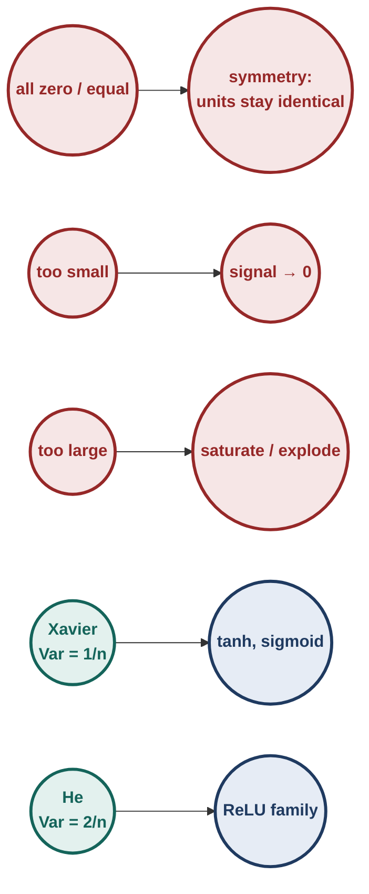
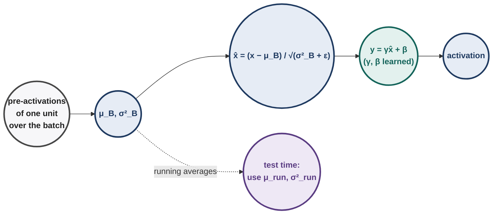
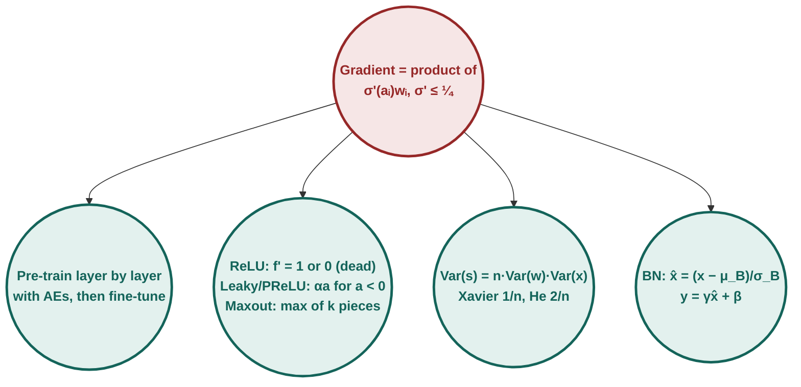

# Deep Learning : Illustrated Notes for Week 7

## Contents

- **Week 7 — Greedy layer-wise pre-training, better activation functions, better weight initialization, batch normalization** ✓
  - 7.0 Week-7 map
  - 7.1 Why deep networks were hard to train
  - 7.2 Greedy layer-wise pre-training
  - 7.3 Better activation functions
  - 7.4 Better weight initialization
  - 7.5 Batch normalization
  - 7.6 Week-7 exam toolkit & practice set

---

## 7.0 Week-7 map

**[Intuition]** Until about 2006, networks with more than two or three hidden layers simply did not train well. The gradient reaching the early layers was tiny (or huge), so those layers learned almost nothing. Week 7 is the toolkit that fixed this, in historical order:

1. **Pre-training** (2006): give every layer a good starting point, one layer at a time.
2. **Better activations** (ReLU and family): stop the gradient from shrinking at every layer.
3. **Better initialization** (Xavier, He): start with weights that keep signals at a sensible size.
4. **Batch normalization** (2015): keep each layer's inputs at a sensible size *during* training.

> [!TIP]
> **Everyday pictures for the whole week.**
> - **Vanishing gradient** is a message whispered down a long line of people: each one passes on only a quarter of what they heard.
> - **Pre-training** is building a tower one floor at a time, letting each floor settle before adding the next, then levelling the whole thing at the end.
> - **Initialization** is tuning the volume of every speaker in a chain so the signal neither fades out nor blasts.
> - **Batch norm** is a sound engineer at every floor, re-centring and re-scaling the signal before it goes up.

---

## 7.1 Why deep networks were hard to train

### 7.1.1 [Derivation] The gradient is a long product

For a chain of sigmoid layers $h_{i}=\sigma(a_i)$, $a_i=w_ih_{i-1}$ (one unit per layer, to see the pattern), backprop (Week 3) gives
$$\frac{\partial\mathcal L}{\partial w_1}=\frac{\partial\mathcal L}{\partial h_L}\prod_{i=2}^{L}\Big(\sigma'(a_i)\,w_i\Big)\cdot\sigma'(a_1)\,h_0.$$
Every layer contributes a factor $\sigma'(a_i)w_i$. Since $\sigma'\le\frac14$:
- with $|w_i|\le1$, each factor is at most $\frac14$: the gradient **vanishes** exponentially with depth;
- with large $|w_i|$, factors can exceed 1: the gradient **explodes**.

**[Ex]** 10 sigmoid layers, weights 1, best case $\sigma'=0.25$ everywhere: $0.25^{10}\approx9.5\times10^{-7}$. The first layer learns a million times slower than the last.

**[Exam] End-term multi-select (sigmoid network, cross-entropy).**

| Statement | Verdict |
|---|---|
| The gradient at each layer depends on the gradient propagated from the layer above | ✓ (chain rule) |
| Since $\sigma'(z)\le0.25$, repeated multiplication can shrink gradients toward zero | ✓ |
| A very large gradient can cause huge weight updates and unstable training | ✓ (exploding) |
| Small gradients always make the loss decrease | ✗ (they make learning crawl; they guarantee nothing) |

---

## 7.2 Greedy layer-wise pre-training

### 7.2.1 The procedure (Hinton et al. 2006; Bengio et al. 2007)

Train the network **one layer at a time, unsupervised**, then fine-tune everything with labels.

1. Train an autoencoder (Week 5) on the inputs $\mathbf x$: $\mathbf x\to\mathbf h_1\to\hat{\mathbf x}$. Keep the encoder.
2. Compute $\mathbf h_1$ for every training example. Train a second autoencoder on these codes: $\mathbf h_1\to\mathbf h_2\to\hat{\mathbf h}_1$. Keep its encoder.
3. Repeat for as many layers as wanted ("greedy": each layer is optimised on its own, never revisited during this phase).
4. Stack the encoders, add an output layer, and **fine-tune the whole network** with backprop on the labelled task.

**[Ex] Counting.** A 784 → 500 → 250 → 10 classifier, untied autoencoders:

| Stage | Network | Parameters |
|---|---|---|
| AE 1 | 784 → 500 → 784 | $784\cdot500+500+500\cdot784+784=785{,}284$ |
| AE 2 | 500 → 250 → 500 | $500\cdot250+250+250\cdot500+500=250{,}750$ |
| Fine-tune | 784 → 500 → 250 → 10 | encoders kept, decoders thrown away, new 250 → 10 layer added |

### 7.2.2 Why does it work? Two explanations

| View | Claim | Supporting observation |
|---|---|---|
| **Better optimization** | pre-training starts the weights in a region where the loss is easier to descend | pre-trained deep nets reach lower **training** error |
| **Better regularization** | pre-training restricts weights to a region tied to the input distribution, like a prior | pre-trained nets generalise better for the same training error |

Studies (Erhan et al. 2010) found evidence for both. The lasting lesson: **where you start matters** and the problem is mostly optimization. Better activations, initializations, normalization and optimizers (Week 4) now make pre-training unnecessary for most supervised nets, but the idea lives on in modern pre-trained models.

---

## 7.3 Better activation functions

### 7.3.1 Why non-linear at all

Without non-linear activations, $W_L\cdots W_2W_1\mathbf x$ is one matrix times $\mathbf x$: any depth collapses into a **linear** model (Week 2). The question is *which* non-linearity trains best.

### 7.3.2 Sigmoid: three problems

1. **Saturation.** At large $|a|$, $\sigma'(a)\approx0$: the neuron's weights stop updating.
2. **Not zero-centred.** Outputs are always positive. For a neuron fed by sigmoid outputs $h_j>0$, $\partial\mathcal L/\partial w_j=\delta\cdot h_j$: **every** weight gradient has the **same sign** as $\delta$. In 2-D the update can only point into the first or third quadrant, so reaching a target that needs one weight up and the other down takes a zig-zag.
3. **Costly:** $e^{-a}$ per neuron.

**[Ex] Same-sign gradients.** $\mathbf h=(0.6,0.9)$, $\delta=-0.5$: gradients $(-0.3,-0.45)$, both negative, so both weights increase together, even if the optimum wants one up and one down.

**[Exam] Quiz 2.** A sigmoid layer whose weights grow so that $a=15$: $\sigma'(15)=\sigma(15)(1-\sigma(15))\approx3.1\times10^{-7}\approx0$. **The neuron has saturated** (not 0.25, which is the maximum, at $a=0$).

### 7.3.3 tanh

$\tanh(a)=2\sigma(2a)-1\in(-1,1)$, $\tanh'(a)=1-\tanh^2(a)$, maximum 1 at $a=0$.
- ✓ **zero-centred** (fixes problem 2), larger maximum gradient than sigmoid.
- ✗ still **saturates** for large $|a|$.

### 7.3.4 ReLU

$$f(a)=\max(0,a),\qquad f'(a)=\begin{cases}1&a>0\\0&a<0\end{cases}$$
- ✓ **no saturation** for $a>0$; gradient passes through unchanged.
- ✓ **cheap** (a comparison), and converges much faster in practice (about 6× in AlexNet's experiments).
- ✗ not zero-centred.
- ✗ **dead neurons:** if a unit's pre-activation is negative for **every** input, its gradient is always 0 and it never recovers.

**[Ex] How a neuron dies.** Inputs in $[0,1]^2$, $\mathbf w=(0.5,0.3)$. After a large update the bias becomes $b=-10$. The largest possible pre-activation is $0.5+0.3-10=-9.2<0$, so the unit outputs 0 and has gradient 0 for every input, forever. Remedies: initialise $b$ to a small positive value (e.g. 0.01), use a smaller learning rate, or use a leaky variant.

**[Exam] Quiz 2.** ReLU unit with $a=15$ for most examples, then a large negative bias update drives $a<0$ for all future inputs: **$f'(a)=0$; the neuron stops updating and may stay "dead" permanently.**

### 7.3.5 Leaky ReLU, Parametric ReLU, ELU

| Name | $f(a)$ | $f'(a)$ for $a<0$ | Note |
|---|---|---|---|
| Leaky ReLU | $\max(0.01a,\,a)$ | 0.01 | never fully dead |
| Parametric ReLU | $\max(\alpha a,\,a)$, $\alpha$ **learned** | $\alpha$ | the slope is a parameter |
| ELU | $a$ if $a>0$, else $\alpha(e^{a}-1)$ | $\alpha e^{a}$ | smooth; outputs mean closer to 0; needs $e^a$ |

**[Exam] Quiz 2 (Leaky ReLU, $\alpha=0.1$).** $w_1=2$, $w_2=-3$, $x_1=4$, $x_2=3$, no bias.

| Line | Calculation | Result |
|---|---|---|
| 1 | $a=2(4)+(-3)(3)$ | **−1** |
| 2 | $f(a)=\max(0.1\times(-1),\,-1)$ | **−0.1** |
| 3 | why Leaky ReLU here | a small non-zero gradient (0.1) flows when $a<0$, avoiding permanently dead neurons |

**[Exam] End-term (PReLU, $\alpha=0.1$).** $\mathbf x=(3,-2)$, $\mathbf w=(0.5,1.5)$, $b=0.5$: $z=1.5-3+0.5=-1$, so $f(z)=0.1\times(-1)=$ **−0.1**.

### 7.3.6 Maxout

A maxout unit takes the **max over $k$ affine functions** of its input:
$$h=\max_{j=1..k}\big(\mathbf w_j^\top\mathbf x+b_j\big).$$
- ReLU is maxout with pieces $(\mathbf w^\top\mathbf x+b)$ and $0$; Leaky ReLU is pieces $(\mathbf w^\top\mathbf x+b)$ and $0.01(\mathbf w^\top\mathbf x+b)$. So maxout **generalises** them, and with enough pieces can approximate any convex function.
- No saturation, no dead units (some piece is always the max and passes gradient).
- Cost: $k$ times the parameters ($k=2$ doubles them).
- **Gradient flows only through the winning piece**; the losing pieces get 0 for that example.

**[Exam] End-term (ReLU vs maxout).** 2 inputs, 2 hidden units, linear output with weights $(1,1)$, all biases 0, $\mathbf x=(1,2)$.

| Line | Scenario A: ReLU, $W=\begin{bmatrix}1&-2\\-1&1\end{bmatrix}$ | Result |
|---|---|---|
| 1 | $W\mathbf x=(1-4,\ -1+2)$ | $(-3,\ 1)$ |
| 2 | ReLU | $(0,\ 1)$ |
| 3 | $\hat y_A=0+1$ | **1** |
| 4 | $\nabla_{w_{11}}\mathcal L$: unit 1 has $a=-3<0$, so ReLU$'=0$ | **0** |

| Line | Scenario B: maxout, unit 1 pieces $G^{(1)}=\begin{bmatrix}1&-2\\-1&1\end{bmatrix}$, unit 2 pieces $G^{(2)}=\begin{bmatrix}-1&2\\1&-1\end{bmatrix}$ | Result |
|---|---|---|
| 5 | unit 1: $\max(1-4,\ -1+2)=\max(-3,1)$ | 1 |
| 6 | unit 2: $\max(-1+4,\ 1-2)=\max(3,-1)$ | 3 |
| 7 | $\hat y_B=1+3$ | **4** |
| 8 | does maxout unit 1 get a gradient? | **Yes**: through its winning piece $(-1,1)$, even though it sees the same pre-activations that killed ReLU unit 1 |

### 7.3.7 All activations at a glance

| $a$ | −2 | 0 | 2 |
|---|---|---|---|
| sigmoid $\sigma(a)$ | 0.119 | 0.5 | 0.881 |
| $\sigma'(a)$ | 0.105 | **0.25** | 0.105 |
| tanh | −0.964 | 0 | 0.964 |
| $\tanh'$ | 0.071 | **1** | 0.071 |
| ReLU | 0 | 0 | 2 |
| Leaky ReLU (0.01) | −0.02 | 0 | 2 |
| ELU ($\alpha=1$) | −0.865 | 0 | 2 |

| Activation | Zero-centred | Saturates | Dead units | Cost |
|---|---|---|---|---|
| sigmoid | ✗ | ✓ (both sides) | ✗ | exp |
| tanh | ✓ | ✓ (both sides) | ✗ | exp |
| ReLU | ✗ | ✗ (for $a>0$) | ✓ | cheapest |
| Leaky / PReLU | ≈ | ✗ | ✗ | cheap |
| ELU | ≈ (mean near 0) | only toward $-\alpha$ | ✗ | exp |
| maxout | depends | ✗ | ✗ | $k\times$ params |

(Good to know beyond the course list: modern transformers often use **GELU** $a\,\Phi(a)$ and **SiLU/Swish** $a\,\sigma(a)$, smooth ReLU-like curves.)

---

## 7.4 Better weight initialization

### 7.4.1 Zero (or equal) initialization: the symmetry problem

If all weights into a layer start equal, every unit in that layer computes the **same** output, receives the **same** gradient, gets the **same** update, and stays identical forever. A layer of 500 units behaves like one unit.

**[Ex] Watch the symmetry survive.** $\mathbf x=(1,2)$, two sigmoid hidden units with all weights $0.5$, linear output with weights $(1,1)$, target $y=0$, loss $\frac12(\hat y-y)^2$.

| Line | Calculation | Result |
|---|---|---|
| 1 | pre-activations $0.5+1$ for both units | $(1.5,\ 1.5)$ |
| 2 | $\mathbf h=\sigma(1.5)$ | $(0.8176,\ 0.8176)$ |
| 3 | $\hat y=0.8176+0.8176$ | 1.635 |
| 4 | output-weight gradients $(\hat y-y)h_j$ | $(1.337,\ 1.337)$: equal |
| 5 | hidden-weight gradients, row $j$: $(\hat y-y)v_j\,h_j(1-h_j)\,\mathbf x$ | rows $(0.244,\ 0.488)$ and $(0.244,\ 0.488)$: equal |

After the update the two units are still identical, and they will be at every later step. **Random initialization breaks the symmetry.**

### 7.4.2 [Derivation] How weight size scales the signal

Pre-activation of a unit with $n$ inputs: $s=\sum_{i=1}^n w_ix_i$. Assume $w_i$ and $x_i$ independent, zero mean. Then
$$\mathrm{Var}(w_ix_i)=\mathbb E[w_i^2]\,\mathbb E[x_i^2]=\mathrm{Var}(w)\,\mathrm{Var}(x),\qquad \mathrm{Var}(s)=n\,\mathrm{Var}(w)\,\mathrm{Var}(x).$$
Each layer multiplies the variance by $n\,\mathrm{Var}(w)$:

| Choice | Factor per layer | After many layers |
|---|---|---|
| $n\,\mathrm{Var}(w)<1$ (too small) | shrinks | activations → 0; gradients vanish |
| $n\,\mathrm{Var}(w)>1$ (too large) | grows | tanh/sigmoid saturate; or values explode |
| $n\,\mathrm{Var}(w)=1$ | 1 | signal size preserved ✓ |

**[Ex] Too small.** $n=500$, $w\sim\mathcal N(0,0.01^2)$: factor on the standard deviation $\sqrt{500\times10^{-4}}=0.224$ per layer; after 10 layers $0.224^{10}\approx3\times10^{-7}$.
**[Ex] Too large.** $n=100$, $w\sim\mathcal N(0,1)$: standard deviation multiplied by $\sqrt{100}=10$ per layer; after 5 layers $10^5$. Every tanh unit is pinned at ±1.

### 7.4.3 Xavier (Glorot) initialization: for tanh / sigmoid

Set $n\,\mathrm{Var}(w)=1$:
$$\boxed{\mathrm{Var}(w)=\frac1{n_{\text{in}}}}\quad\Longrightarrow\quad w\sim\frac{\mathcal N(0,1)}{\sqrt{n_{\text{in}}}}.$$
Balancing the backward pass too gives Glorot's compromise $\mathrm{Var}(w)=\frac{2}{n_{\text{in}}+n_{\text{out}}}$, often used as a uniform distribution $U\big[-\sqrt{6/(n_{\text{in}}+n_{\text{out}})},\ +\sqrt{6/(n_{\text{in}}+n_{\text{out}})}\big]$.

### 7.4.4 He initialization: for ReLU

ReLU zeroes the negative half of $s$. For $s$ symmetric about 0, $\mathbb E[\mathrm{ReLU}(s)^2]=\frac12\mathrm{Var}(s)$: the second moment is **halved** at every layer. Compensate with a factor 2:
$$\boxed{\mathrm{Var}(w)=\frac{2}{n_{\text{in}}}}\quad\Longrightarrow\quad w\sim\mathcal N(0,1)\cdot\sqrt{\frac2{n_{\text{in}}}}.$$

**[Ex]**

| $n_{\text{in}}$ | Xavier std $1/\sqrt n$ | He std $\sqrt{2/n}$ |
|---|---|---|
| 256 | 0.0625 | 0.0884 |
| 400 | 0.05 | 0.0707 |
| 512 | 0.0442 | 0.0625 |

<b>Try it yourself</b>: n = 100 inputs, Var(x) = 1, Var(w) = 0.04. Var(s)? What Var(w) would keep it at 1?

$\mathrm{Var}(s)=100\times0.04\times1=4$. To keep it at 1: $\mathrm{Var}(w)=1/100=0.01$ (Xavier), i.e. std 0.1.

---

## 7.5 Batch normalization

### 7.5.1 Motivation

Good initialization makes the activations well-scaled **at the start**. During training the weights change, so the distribution of every layer's inputs keeps shifting ("internal covariate shift"), and layers deep in the network keep chasing a moving target. **Batch norm** re-standardises each unit's pre-activation on every mini-batch, throughout training.

### 7.5.2 The transform (one unit, one mini-batch of $m$ values $x_1..x_m$)

$$\mu_B=\frac1m\sum_ix_i,\qquad \sigma_B^2=\frac1m\sum_i(x_i-\mu_B)^2,$$
$$\hat x_i=\frac{x_i-\mu_B}{\sqrt{\sigma_B^2+\epsilon}},\qquad \boxed{y_i=\gamma\,\hat x_i+\beta}$$
- $\hat x$ has mean 0 and variance 1 over the batch.
- $\gamma,\beta$ are **learned** (one pair per unit). They let the network choose any mean and scale; with $\gamma=\sqrt{\sigma_B^2+\epsilon}$ and $\beta=\mu_B$ it recovers the original values. So BN never reduces what the network can represent.
- Applied to pre-activations, before the non-linearity (course placement). The layer's own bias becomes redundant (any bias is subtracted with $\mu_B$; $\beta$ takes its role).
- BN is differentiable, so backprop passes through it (including through $\mu_B$ and $\sigma_B$).

### 7.5.3 [Ex] Batch norm, line by line

One unit, batch of pre-activations $(2,4,6,8)$, $\gamma=2$, $\beta=1$, $\epsilon\approx0$.

| Line | Calculation | Result |
|---|---|---|
| 1 | $\mu_B=(2+4+6+8)/4$ | 5 |
| 2 | $\sigma_B^2=\frac{9+1+1+9}{4}$ | 5 |
| 3 | $\sqrt{\sigma_B^2}$ | 2.236 |
| 4 | $\hat x=(x-5)/2.236$ | $(-1.342,\ -0.447,\ 0.447,\ 1.342)$ |
| 5 | $y=2\hat x+1$ | $(-1.683,\ 0.106,\ 1.894,\ 3.683)$ |
| 6 | check | $y$ has mean $\beta=1$ and std $\gamma=2$ ✓ |

### 7.5.4 Test time

At test time there may be a single example, so no batch statistics. Use **running averages** collected during training, e.g. with momentum 0.9:
$$\mu_{\text{run}}\leftarrow0.9\,\mu_{\text{run}}+0.1\,\mu_B,\qquad \sigma^2_{\text{run}}\leftarrow0.9\,\sigma^2_{\text{run}}+0.1\,\sigma_B^2.$$
**[Ex]** $\mu_{\text{run}}=0$, first batch mean 5 ⇒ $0.5$; next batch mean 7 ⇒ $0.9(0.5)+0.1(7)=1.15$.

### 7.5.5 Why it helps

| Effect | Reason |
|---|---|
| larger learning rates are safe | activations cannot drift to huge values |
| less sensitive to initialization | each layer is re-standardised anyway |
| fewer saturated units | pre-activations kept near the sigmoid/tanh centre |
| mild **regularization** | $\mu_B,\sigma_B$ depend on which examples share the batch: a small noise, a cousin of dropout |

**[!] Traps.**
- Learnable parameters per unit: **2** ($\gamma,\beta$); the running mean and variance are stored statistics, **not** learned by gradient.
- Statistics are computed **per unit across the batch**, not across units of one example (that is layer norm).
- Tiny batches give noisy $\mu_B,\sigma_B$; with batch size 1, $\hat x$ is always 0.

---

## 7.6 Week-7 exam toolkit & practice set

**Diagram — Week 7 at a glance**

### 7.6.1 Recognition rules

| See | Think |
|---|---|
| many sigmoid layers, gradient at layer 1 | product of factors $\le\frac14$: vanishing |
| $\lvert a\rvert$ large with sigmoid/tanh | saturated, $\sigma'\approx0$ |
| "all weight gradients of a neuron have the same sign" | inputs all positive (sigmoid outputs): not zero-centred |
| ReLU with $a<0$ for **every** input | dead neuron, $f'=0$ forever |
| Leaky / PReLU with numbers | compute $a$ first; if $a<0$ output $\alpha a$ |
| maxout | evaluate every piece, take the max; gradient only to the winner |
| "all weights initialised to the same value" | symmetry, units stay identical |
| "variance of pre-activation" | $n\,\mathrm{Var}(w)\,\mathrm{Var}(x)$ |
| tanh/sigmoid init | Xavier $1/n$ (or $2/(n_{\text{in}}+n_{\text{out}})$) |
| ReLU init | He $2/n$ |
| BN with a batch of numbers | mean, population variance ($\div m$), standardise, then $\gamma\hat x+\beta$ |
| BN at test time | running averages, not the test batch |

### 7.6.2 Formula sheet

| Formula | Use |
|---|---|
| $\frac{\partial\mathcal L}{\partial w_1}\propto\prod_i\sigma'(a_i)w_i$ | vanishing / exploding |
| $\sigma'(a)=\sigma(1-\sigma)\le\frac14$, $\tanh'=1-\tanh^2\le1$ | saturation |
| $\max(0,a)$, $\max(\alpha a,a)$, ELU $\alpha(e^a-1)$ | ReLU family |
| $h=\max_j(\mathbf w_j^\top\mathbf x+b_j)$ | maxout |
| $\mathrm{Var}(s)=n\,\mathrm{Var}(w)\,\mathrm{Var}(x)$ | init analysis |
| Xavier $\mathrm{Var}(w)=\frac1{n_{\text{in}}}$ or $\frac2{n_{\text{in}}+n_{\text{out}}}$; He $\frac2{n_{\text{in}}}$ | initialization |
| $\hat x=\frac{x-\mu_B}{\sqrt{\sigma_B^2+\epsilon}}$, $y=\gamma\hat x+\beta$ | batch norm |

### 7.6.3 Practice set

1. A sigmoid unit has $a=-15$. What is $\sigma'(a)$ and what does it mean for learning?
2. Upper bound on the factor contributed by 6 sigmoid layers (weights of magnitude ≤ 1) to the first layer's gradient.
3. Leaky ReLU with slope 0.01: weights $(1,-2,0.5)$, inputs $(2,3,4)$, bias 0. Output and local derivative?
4. PReLU with $\alpha=0.25$, $z=-4$. Output? If $\alpha$ is learnable, what is $\partial f/\partial\alpha$ here?
5. Maxout unit with pieces $(1,1)$, $(2,-1)$, $(-1,2)$ (no biases), input $\mathbf x=(1,1)$. Output, and which piece gets the gradient?
6. A ReLU unit has $\mathbf w=(1,1)$, $b=-5$, inputs in $[0,2]^2$. Alive or dead?
7. Xavier and He standard deviations for $n_{\text{in}}=200$.
8. Batch $(3,3,6,12)$, $\gamma=0.5$, $\beta=2$. Batch-norm outputs.
9. True/False: (a) Initialising all weights to 0.01 works because it is not zero. (b) BN adds two learnable parameters per unit. (c) Pre-training is supervised.
10. Creative: a 20-layer tanh network initialised with $w\sim\mathcal N(0,1)$ and 300 inputs per layer barely trains. Explain with numbers and give two fixes from this week.

### 7.6.4 Answers

1. $\sigma'(-15)\approx3.1\times10^{-7}$: saturated; the unit's weights barely update.
2. $0.25^6\approx2.4\times10^{-4}$.
3. $a=2-6+2=-2$; output $-0.02$; derivative $0.01$.
4. $f=0.25\times(-4)=-1$; $\partial f/\partial\alpha=z=-4$.
5. Pieces give $1+1=2$, $2-1=1$, $-1+2=1$: output 2; only piece 1's weights get a gradient for this input.
6. Largest pre-activation $2+2-5=-1<0$: dead.
7. Xavier $1/\sqrt{200}=0.0707$; He $\sqrt{2/200}=0.1$.
8. $\mu=6$, $\sigma^2=13.5$, $\sigma=3.674$; $\hat x=(-0.816,-0.816,0,1.633)$; $y=(1.592,1.592,2,2.816)$.
9. (a) False: equal values still give symmetry (and may be badly scaled). (b) True ($\gamma,\beta$). (c) False: layer-wise phase is unsupervised; only fine-tuning uses labels.
10. Per-layer std factor $\sqrt{300\times1}\approx17.3$: pre-activations are huge, every tanh saturates at ±1, $\tanh'\approx0$, gradients vanish. Fixes: Xavier init ($\mathrm{Var}(w)=1/300$, std 0.058), and batch norm; switching to ReLU with He init also works.

### 7.6.5 Worked solutions, line by line

**Q8.**

| Line | Calculation | Result |
|---|---|---|
| 1 | $\mu_B=(3+3+6+12)/4$ | 6 |
| 2 | deviations $-3,-3,0,6$; squares $9,9,0,36$ | sum 54 |
| 3 | $\sigma_B^2=54/4$ | 13.5 |
| 4 | $\sigma_B$ | 3.674 |
| 5 | $\hat x=$ deviations $/3.674$ | $(-0.816,\ -0.816,\ 0,\ 1.633)$ |
| 6 | $y=0.5\hat x+2$ | $(1.592,\ 1.592,\ 2,\ 2.816)$ |

**Q10.**

| Line | Calculation | Result |
|---|---|---|
| 1 | $\mathrm{Var}(s)=300\times1\times\mathrm{Var}(x)$ | $300\,\mathrm{Var}(x)$ |
| 2 | std factor $\sqrt{300}$ | 17.3 per layer |
| 3 | typical $\lvert a\rvert$ | ≫ 3, so $\tanh(a)\approx\pm1$ |
| 4 | $\tanh'(a)=1-\tanh^2(a)$ | ≈ 0 at every layer |
| 5 | Xavier: $\mathrm{Var}(w)=1/300$ | factor 1 per layer ✓ |

---
