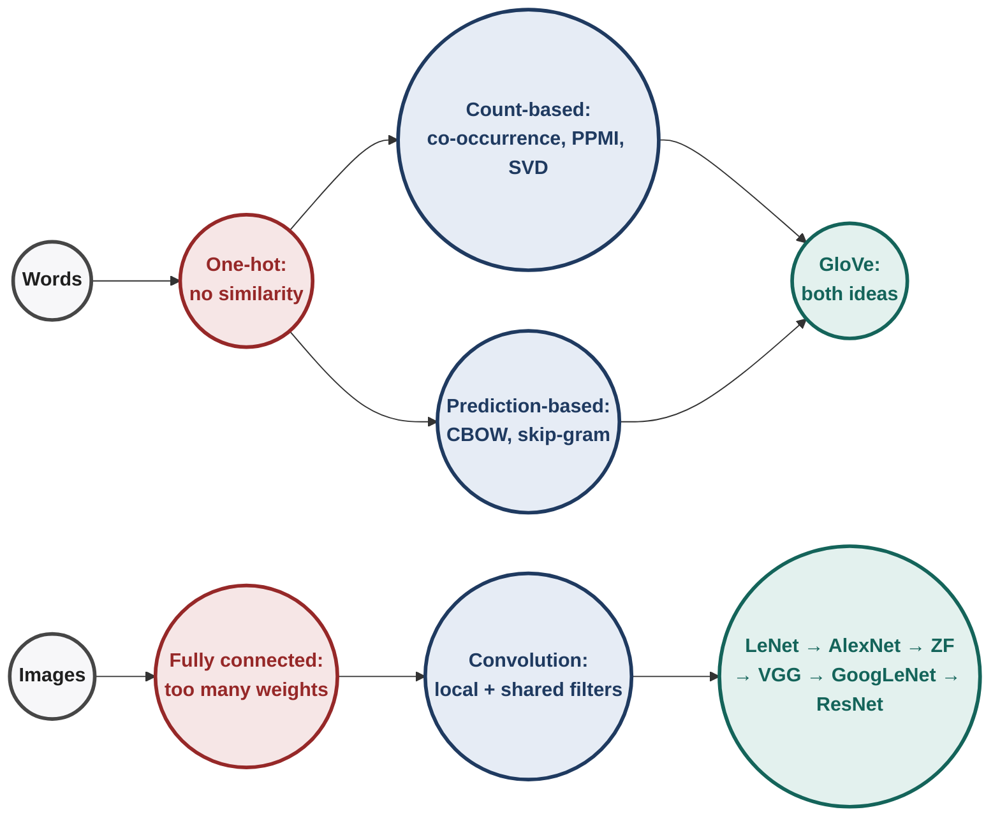
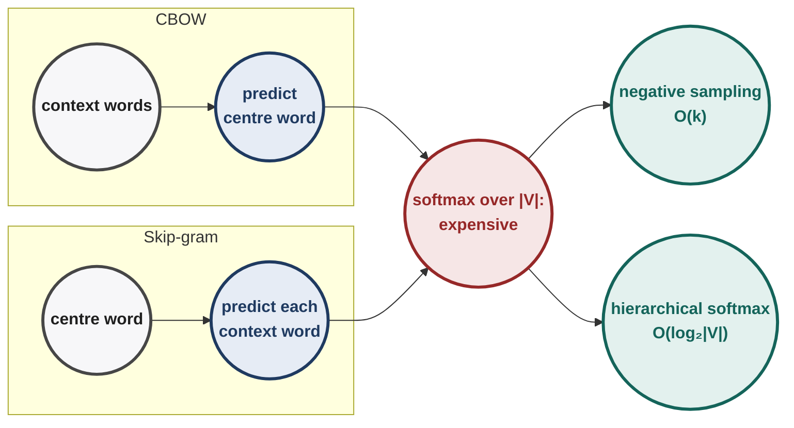
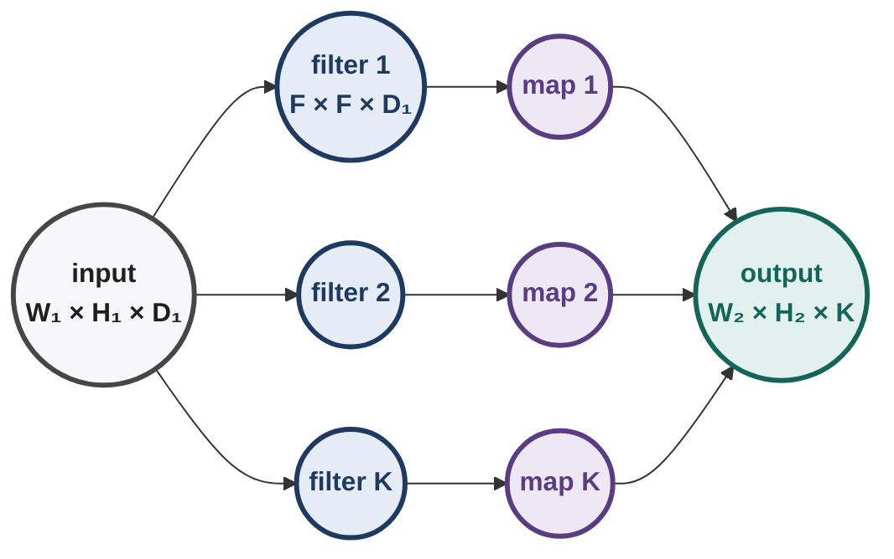
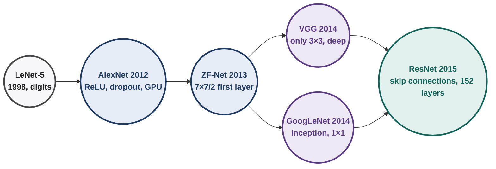
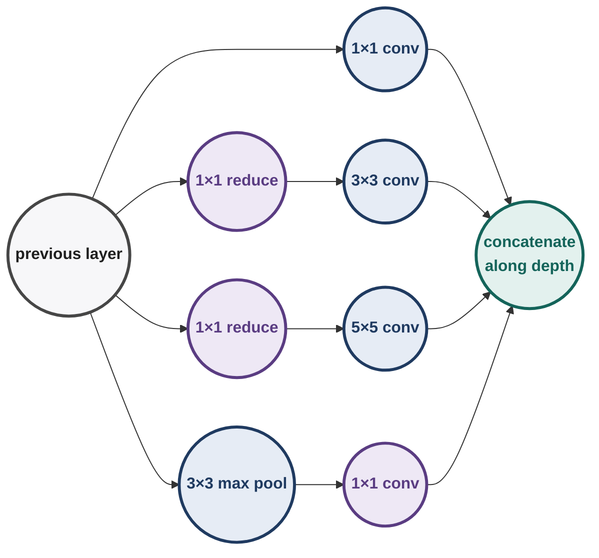
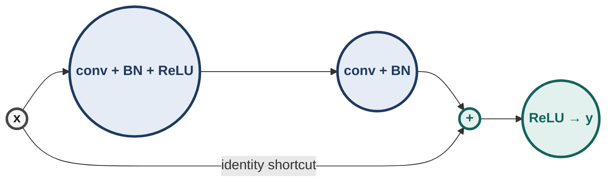
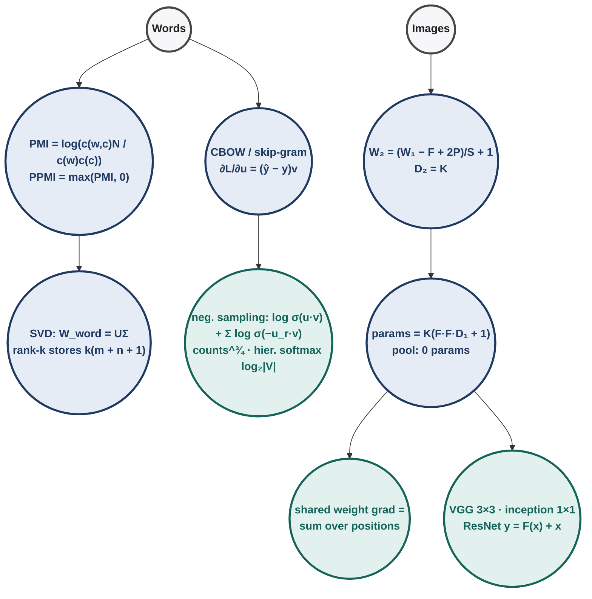

# Deep Learning : Illustrated Notes for Week 8

## Contents

- **Week 8 — Learning vectorial representations of words; convolutional neural networks; LeNet, AlexNet, ZF-Net, VGGNet, GoogLeNet, ResNet** ✓
  - 8.0 Week-8 map
  - **Part A: words as vectors**
  - 8.1 One-hot representations and their problem
  - 8.2 Count-based: co-occurrence, PMI, PPMI
  - 8.3 SVD for word representations
  - 8.4 CBOW (predict the word from its context)
  - 8.5 Skip-gram, negative sampling, hierarchical softmax
  - 8.6 GloVe and evaluating word vectors
  - **Part B: convolutional neural networks**
  - 8.7 The convolution operation
  - 8.8 Output size, padding and stride
  - 8.9 Parameters: sparse connectivity and weight sharing
  - 8.10 Pooling and a full parameter count
  - 8.11 Backpropagation through a convolution
  - 8.12 The architectures: LeNet, AlexNet, ZF-Net, VGGNet, GoogLeNet, ResNet
  - 8.13 Week-8 exam toolkit & practice set

---

## 8.0 Week-8 map

**[Intuition]** Week 8 has two halves joined by one idea: **the right representation makes learning easy.**
- **Words:** a network cannot use the string "cat". Turn every word into a vector whose geometry carries meaning (similar words, nearby vectors).
- **Images:** a fully connected layer on a $224\times224\times3$ image would need tens of millions of weights per neuron layer and ignores the fact that nearby pixels belong together. Convolutions reuse one small detector everywhere.

> [!TIP]
> **Everyday pictures for the whole week.**
> - **A word is known by its neighbours:** if two words keep turning up beside the same words ("coffee" and "tea" both sit near "cup", "hot", "drink"), they probably mean similar things.
> - **A convolution filter is a stamp-sized magnifying glass** slid over the whole picture, asking the same question ("is there a vertical edge here?") at every spot.
> - **Pooling is squinting:** keep the strongest signal in each small window, forget exactly where it was.

---

# Part A: words as vectors

## 8.1 One-hot representations and their problem

Vocabulary $V$ of size $|V|$ (e.g. 50,000). Word $i$ is the vector with a 1 in position $i$ and 0 elsewhere.

| Property | Value | Consequence |
|---|---|---|
| dimension | $\lvert V\rvert$ | huge and sparse |
| Euclidean distance between any two different words | $\sqrt2$ | "cat–dog" as far apart as "cat–truck" |
| cosine similarity between any two different words | 0 | no notion of similarity at all |

We want **dense, low-dimensional** vectors where similar words are close.

---

## 8.2 Count-based: co-occurrence, PMI, PPMI

### 8.2.1 The co-occurrence matrix

Rows are words, columns are **context** words. Entry $X_{ij}$ = number of times context word $j$ appears within a window of $k$ words of word $i$ in the corpus. Each row is now a (long) vector describing the company the word keeps.

Problems and fixes:

| Problem | Fix |
|---|---|
| frequent words ("the", "a") dominate every row | drop stop words, or cap counts, $\min(\text{count},t)$ |
| raw counts reward frequency, not association | **PMI** |
| PMI of unseen pairs is $\log0=-\infty$; negative values are unreliable | **PPMI** = $\max(\mathrm{PMI},0)$ |
| rows are still $\lvert V\rvert$-dimensional and sparse | **SVD** (§8.3) |

### 8.2.2 [Derivation] PMI

PMI compares how often $w$ and $c$ actually co-occur with how often they would if they were independent:
$$\mathrm{PMI}(w,c)=\log\frac{p(c\mid w)}{p(c)}=\log\frac{p(w,c)}{p(w)\,p(c)}=\log\frac{\mathrm{count}(w,c)\cdot N}{\mathrm{count}(w)\cdot\mathrm{count}(c)},$$
using $p(w,c)=\frac{\mathrm{count}(w,c)}N$, $p(w)=\frac{\mathrm{count}(w)}N$, $p(c)=\frac{\mathrm{count}(c)}N$ (the $N$'s leave one $N$ in the numerator).

| PMI | Meaning |
|---|---|
| > 0 | co-occur **more** than chance (associated) |
| = 0 | independent |
| < 0 | co-occur **less** than chance |

$$\mathrm{PPMI}(w,c)=\max\big(\mathrm{PMI}(w,c),\,0\big)$$

**[Exam] End-term.** $N=10{,}000$, $\mathrm{count}(w)=50$, $\mathrm{count}(c)=40$, $\mathrm{count}(w,c)=10$, natural log:

| Line | Calculation | Result |
|---|---|---|
| 1 | $\frac{\mathrm{count}(w,c)\,N}{\mathrm{count}(w)\,\mathrm{count}(c)}=\frac{10\times10000}{50\times40}$ | 50 |
| 2 | $\ln50$ | **3.91** |
| 3 | a second pair with PMI $=-1.0986$: PPMI | $\max(-1.0986,0)=$ **0** |

### 8.2.3 [Ex] A small PPMI matrix

Counts (rows: words, columns: contexts):

| | learning | network | pizza | row sum |
|---|---|---|---|---|
| deep | 10 | 6 | 0 | 16 |
| neural | 6 | 10 | 1 | 17 |
| cheese | 0 | 1 | 8 | 9 |
| col sum | 16 | 17 | 9 | $N=42$ |

| Pair | Calculation | PMI | PPMI |
|---|---|---|---|
| (deep, learning) | $\ln\frac{10\cdot42}{16\cdot16}=\ln1.641$ | 0.495 | 0.495 |
| (deep, network) | $\ln\frac{6\cdot42}{16\cdot17}=\ln0.926$ | −0.076 | 0 |
| (neural, network) | $\ln\frac{10\cdot42}{17\cdot17}=\ln1.453$ | 0.374 | 0.374 |
| (cheese, network) | $\ln\frac{1\cdot42}{9\cdot17}=\ln0.275$ | −1.293 | 0 |
| (cheese, pizza) | $\ln\frac{8\cdot42}{9\cdot9}=\ln4.148$ | 1.423 | 1.423 |
| (deep, pizza) | $\ln0$ | $-\infty$ | 0 |

**[Intuition]** Rare pairs that co-occur a lot (cheese–pizza) get the highest PPMI; PMI corrects for "network" being common.

---

## 8.3 SVD for word representations

### 8.3.1 The recipe

Factorise the (PPMI) matrix $X\in\mathbb R^{m\times n}$ ($m$ words, $n$ contexts): $X=U\Sigma V^\top$. Keep the top $k$ singular values: $\hat X=U_k\Sigma_kV_k^\top$, the best rank-$k$ approximation (Eckart–Young, as in Week 5).
$$\boxed{W_{\text{word}}=U_k\Sigma_k\in\mathbb R^{m\times k},\qquad W_{\text{context}}=V_k\in\mathbb R^{n\times k}}$$
Row $i$ of $W_{\text{word}}$ is a $k$-dimensional, dense word vector.

### 8.3.2 [Derivation] Why $U\Sigma$ and not just $U$

Word similarity in the approximated matrix is $\hat X\hat X^\top$ (dot products of rows). Since $V_k^\top V_k=I$:
$$\hat X\hat X^\top=U_k\Sigma_kV_k^\top V_k\Sigma_kU_k^\top=(U_k\Sigma_k)(U_k\Sigma_k)^\top=W_{\text{word}}W_{\text{word}}^\top.$$
So the short $k$-dimensional rows of $U_k\Sigma_k$ have **exactly the same dot products** as the long $n$-dimensional rows of $\hat X$: same similarities, far fewer numbers.

**[Exam] End-term.** $X_{\text{PPMI}}\in\mathbb R^{1000\times800}$, SVD truncated to $k=50$.

| Statement / question | Answer | Why |
|---|---|---|
| numbers stored for a rank-1 truncation $\sigma_1\mathbf u_1\mathbf v_1^\top$ | **1801** | $1000+800+1$ |
| $W_{\text{word}}=U\Sigma\in\mathbb R^{1000\times50}$ gives 50-d vectors for the 1000 words | ✓ | §8.3.1 |
| $W_{\text{context}}=V\in\mathbb R^{800\times50}$ represents the 800 contexts | ✓ | §8.3.1 |
| SVD needs an iterative gradient-based procedure like CBOW | ✗ | it is a closed-form matrix factorisation |
| since $V^\top V=I$, $\hat X\hat X^\top=W_{\text{context}}W_{\text{context}}^\top$ | ✗ | it equals $W_{\text{word}}W_{\text{word}}^\top$ |

In general a rank-$k$ truncation of an $m\times n$ matrix stores $k(m+n+1)$ numbers instead of $mn$.

---

## 8.4 CBOW (predict the word from its context)

### 8.4.1 The model

**Continuous bag of words:** given the context, predict the centre word. With one context word $c$ (one-hot $\mathbf x_c$):
$$\mathbf h=W_{\text{context}}\,\mathbf x_c=\mathbf v_c\ \ (\text{the column of }c),\qquad \hat y_w=\frac{\exp(\mathbf u_w^\top\mathbf v_c)}{\sum_{w'\in V}\exp(\mathbf u_{w'}^\top\mathbf v_c)},\qquad \mathcal L=-\log\hat y_w.$$
$\mathbf v$ = context vectors, $\mathbf u$ = word (output) vectors, both $k$-dimensional. Multiplying by a one-hot vector just **selects a column**: no real multiplication happens. With several context words, $\mathbf h$ is the sum (or average) of their columns.

### 8.4.2 [Derivation] The updates pull the right pair together

$\mathcal L=-\mathbf u_w^\top\mathbf v_c+\log\sum_{w'}\exp(\mathbf u_{w'}^\top\mathbf v_c)$. Differentiate:
$$\frac{\partial\mathcal L}{\partial\mathbf u_{w'}}=(\hat y_{w'}-y_{w'})\,\mathbf v_c,\qquad \frac{\partial\mathcal L}{\partial\mathbf v_c}=\sum_{w'}(\hat y_{w'}-y_{w'})\,\mathbf u_{w'},$$
with $y_{w'}=1$ for the true word and 0 otherwise. So the GD step is
- true word: $\mathbf u_w\leftarrow\mathbf u_w+\eta(1-\hat y_w)\mathbf v_c$ (moves **toward** $\mathbf v_c$);
- every other word: $\mathbf u_{w'}\leftarrow\mathbf u_{w'}-\eta\hat y_{w'}\mathbf v_c$ (moves **away**).

Words that appear in the same contexts are all pulled toward the same $\mathbf v_c$'s, so they end up close to each other.

### 8.4.3 [Ex] One CBOW step, line by line

$|V|=3$, $k=2$, context vector $\mathbf v_c=(1,0)$, word vectors $\mathbf u_1=(1,1)$, $\mathbf u_2=(0,1)$, $\mathbf u_3=(-1,0)$. True word: 1. $\eta=0.5$.

| Line | Calculation | Result |
|---|---|---|
| 1 | scores $\mathbf u_{w}^\top\mathbf v_c$ | $(1,\ 0,\ -1)$ |
| 2 | softmax $\frac{e^{1},e^{0},e^{-1}}{e+1+e^{-1}}$ | $(0.665,\ 0.245,\ 0.090)$ |
| 3 | $\mathcal L=-\ln0.665$ | 0.408 |
| 4 | $\mathbf u_1+0.5(1-0.665)\mathbf v_c$ | $(1.168,\ 1)$ |
| 5 | $\mathbf u_2-0.5(0.245)\mathbf v_c$ | $(-0.122,\ 1)$ |
| 6 | $\mathbf u_3-0.5(0.090)\mathbf v_c$ | $(-1.045,\ 0)$ |
| 7 | $\partial\mathcal L/\partial\mathbf v_c=(0.665-1)\mathbf u_1+0.245\mathbf u_2+0.090\mathbf u_3$ | $(-0.425,\ -0.090)$ |
| 8 | $\mathbf v_c-0.5\times$ line 7 | $(1.212,\ 0.045)$ |

**[!] The bottleneck.** Line 2 sums over the **whole vocabulary**. With $|V|=50{,}000$, every training pair needs 50,000 dot products. §8.5 fixes this.

---

## 8.5 Skip-gram, negative sampling, hierarchical softmax

### 8.5.1 Skip-gram

The reverse of CBOW: given the word $w$, predict each context word $c$ in its window: $p(c\mid w)=\mathrm{softmax}(\mathbf u_c^\top\mathbf v_w)$. Same softmax cost over $|V|$, so it needs a cheaper objective.

### 8.5.2 Negative sampling

Turn "which of 50,000 words?" into many cheap **yes/no** questions. $D$ = observed (word, context) pairs, labelled 1; $D'$ = random (word, random word) pairs, labelled 0, about $k$ per positive pair. Model $P(\text{real}\mid w,c)=\sigma(\mathbf u_c^\top\mathbf v_w)$. Maximise
$$\sum_{(w,c)\in D}\log\sigma(\mathbf u_c^\top\mathbf v_w)+\sum_{(w,r)\in D'}\log\sigma(-\mathbf u_r^\top\mathbf v_w).$$
(Using $1-\sigma(z)=\sigma(-z)$ for the negatives.) Cost per pair: $k+1$ sigmoids instead of $|V|$ exponentials.

**Sampling negatives.** Draw $r$ with probability $\propto\mathrm{count}(r)^{3/4}$. The power $\frac34$ flattens the distribution so rare words are sampled more often than their raw frequency.

| count | raw share | share with $^{3/4}$ |
|---|---|---|
| 100 | 0.901 | 0.827 |
| 10 | 0.090 | 0.147 |
| 1 | 0.009 | 0.026 |

### 8.5.3 [Exam] End-term: one negative-sampling step

Loss for one positive pair and one negative: $L=-\log\sigma(\mathbf w^\top\mathbf c)-\log\sigma(-\mathbf w_{\text{neg}}^\top\mathbf c)$, with $\mathbf w=(1,0)$, $\mathbf c=(1,1)$, $\mathbf w_{\text{neg}}=(0,1)$; update $\mathbf w$ with $\eta=0.5$.

| Line | Calculation | Result |
|---|---|---|
| 1 | $\mathbf w^\top\mathbf c=1$; $\mathbf w_{\text{neg}}^\top\mathbf c=1$ | |
| 2 | $-\ln\sigma(1)=-\ln0.7311$ | 0.3133 |
| 3 | $-\ln\sigma(-1)=-\ln0.2689$ | 1.3133 |
| 4 | $L$ | **1.627** |
| 5 | $\partial L/\partial\mathbf w=-(1-\sigma(\mathbf w^\top\mathbf c))\mathbf c=-\sigma(-1)\mathbf c$ (the negative term has no $\mathbf w$) | $-0.2689\,(1,1)$ |
| 6 | $\mathbf w_{\text{new}}=\mathbf w-0.5\times$ line 5 | $(1.1345,\ 0.1345)$ |
| 7 | $\cos(\mathbf w_{\text{new}},\mathbf c)=\frac{1.269}{1.1424\times1.4142}$ | **0.785** |

Before the step $\cos(\mathbf w,\mathbf c)=1/\sqrt2=0.707$: the update pulled the word toward its true context.

**Where the gradient comes from:** $\frac{d}{dz}[-\log\sigma(z)]=-(1-\sigma(z))$, and $z=\mathbf w^\top\mathbf c$ gives $\partial z/\partial\mathbf w=\mathbf c$.

### 8.5.4 Hierarchical softmax

Put the vocabulary at the leaves of a binary tree. $p(w\mid\text{context})$ is the product of left/right sigmoid decisions $\sigma(\pm\mathbf u_{\text{node}}^\top\mathbf h)$ along the path from the root to $w$. Cost: path length $\approx\log_2|V|$. For $|V|=65{,}536$: 16 sigmoids instead of 65,536 exponentials. The probabilities over all leaves still sum to 1 automatically.

---

## 8.6 GloVe and evaluating word vectors

### 8.6.1 GloVe (global vectors)

Count methods use **global** statistics but train no predictor; prediction methods learn well but only see one window at a time. GloVe asks the vectors to explain the global counts directly:
$$\mathbf v_i^\top\tilde{\mathbf v}_j+b_i+\tilde b_j\approx\log X_{ij},\qquad J=\sum_{i,j}f(X_{ij})\big(\mathbf v_i^\top\tilde{\mathbf v}_j+b_i+\tilde b_j-\log X_{ij}\big)^2.$$
(Start from $\mathbf v_i^\top\tilde{\mathbf v}_j\approx\log P(j\mid i)=\log X_{ij}-\log X_i$; the $\log X_i$ term and symmetry are absorbed into biases.)
Weighting $f(x)=(x/x_{\max})^{\alpha}$ for $x<x_{\max}$, else 1 (typically $\alpha=0.75$, $x_{\max}=100$): rare pairs count less, very frequent pairs do not dominate, and $f(0)=0$ removes $\log0$.
**[Ex]** $f(25)=0.25^{0.75}=0.354$; $f(400)=1$.

### 8.6.2 Evaluating word vectors

| Task | How |
|---|---|
| Semantic relatedness | correlate $\cos(\mathbf v_a,\mathbf v_b)$ with human similarity scores |
| Synonym detection | pick the candidate with the highest cosine |
| Analogy | $\mathbf v_{\text{king}}-\mathbf v_{\text{man}}+\mathbf v_{\text{woman}}\approx\mathbf v_{\text{queen}}$: answer = $\arg\max_w\cos(\mathbf v_w,\ \cdot)$ |

**Count vs predict.** Early comparisons favoured prediction (word2vec), but with tuned hyperparameters SVD on PPMI is competitive; in fact skip-gram with negative sampling has been shown to implicitly factorise a shifted PMI matrix ($\mathrm{PMI}-\log k$). The two families are closer than they look.

---

# Part B: convolutional neural networks

## 8.7 The convolution operation

### 8.7.1 1-D

A weighted sum of a few neighbouring inputs, with the **same** weights at every position:
$$s_t=\sum_{a}x_{t+a}\,w_a.$$
(Strictly, convolution flips the kernel, $\sum_ax_{t-a}w_a$; deep-learning libraries compute the unflipped version, cross-correlation, and still call it convolution. Since the weights are learned, it makes no difference.)

**[Ex]** $\mathbf x=(1,2,3,4,5)$, $\mathbf w=(1,0,-1)$: $s=(1-3,\ 2-4,\ 3-5)=(-2,-2,-2)$. A constant slope gives a constant response: this filter is a slope detector.

### 8.7.2 2-D

$$S_{ij}=\sum_{a}\sum_{b}I_{i+a,\,j+b}\,K_{a,b}.$$
Slide the $F\times F$ kernel over the image; at each position multiply element-wise and add.

**[Ex] A vertical-edge filter.** $I=\begin{bmatrix}1&2&0&1\\0&1&3&1\\2&1&0&2\\1&0&1&3\end{bmatrix}$, $K=\begin{bmatrix}1&0&-1\\1&0&-1\\1&0&-1\end{bmatrix}$ (left column minus right column), stride 1, no padding.

| Position | left column sum | right column sum | $S$ |
|---|---|---|---|
| top-left | $1+0+2=3$ | $0+3+0=3$ | 0 |
| top-right | $2+1+1=4$ | $1+1+2=4$ | 0 |
| bottom-left | $0+2+1=3$ | $3+0+1=4$ | −1 |
| bottom-right | $1+1+0=2$ | $1+2+3=6$ | −4 |

$S=\begin{bmatrix}0&0\\-1&-4\end{bmatrix}$: strongest response where the right side is much brighter than the left.

### 8.7.3 Depth

For an input of depth $D_1$ (e.g. 3 for RGB), every filter is $F\times F\times D_1$: it always spans the **full depth**. One filter produces **one** 2-D feature map. $K$ filters stacked give an output of depth $K$.

---

## 8.8 Output size, padding and stride

### 8.8.1 [Derivation] The output-size formula

Pad the input with $P$ zeros on each side: width $W_1+2P$. A filter of width $F$ can start at positions $0,S,2S,\dots$ as long as it fits, i.e. start $\le W_1+2P-F$. The number of starting positions is
$$\boxed{W_2=\frac{W_1-F+2P}{S}+1,\qquad H_2=\frac{H_1-F+2P}{S}+1,\qquad D_2=K}$$
(take the floor if the division is not exact).

| Special case | Result |
|---|---|
| "same" output size with $S=1$ | $P=\frac{F-1}{2}$ ($F=3\Rightarrow P=1$, $F=5\Rightarrow P=2$, $F=7\Rightarrow P=3$) |
| no padding, $S=1$ | each layer shrinks by $F-1$ |
| stride 2 | output roughly halves |

### 8.8.2 [Exam] Quiz 2 and end-term, solved

| Question | Working | Answer |
|---|---|---|
| $48\times48\times3$, $7\times7$ kernel, $S=1$: padding for same size | $\frac{48-7+2P}{1}+1=48\Rightarrow2P=6$ | $P=$ **3** |
| same input, $P=0$, $S=1$, $K=4$: output shape | $\frac{48-7}{1}+1=42$; depth $=K$ | **$42\times42\times4$** |
| parameters of that layer | $4\times(7\cdot7\cdot3+1)=4\times148$ | **592** |
| $300\times300\times6$, ten $15\times15\times6$ kernels, $P=0$, output $96\times96\times10$: stride | $\frac{300-15}{S}+1=96\Rightarrow285/S=95$ | $S=$ **3** |

**[!] Trap.** The output depth is the number of **filters**, never the input depth (the $42\times42\times3$ option is wrong).

---

## 8.9 Parameters: sparse connectivity and weight sharing

### 8.9.1 Counting

$$\boxed{\#\text{params}=K\,(F\cdot F\cdot D_1+1)}$$
($F\cdot F\cdot D_1$ weights per filter plus one bias per filter.) It does **not** depend on the image size.

**[Ex] Conv vs fully connected.** $32\times32\times3$ input to a $28\times28\times6$ output.

| Layer | Parameters |
|---|---|
| fully connected | $3072\times4704\approx14.45$ million |
| six $5\times5\times3$ filters | $6\times(75+1)=456$ |

### 8.9.2 Why it works

- **Sparse connectivity:** each output looks at only an $F\times F$ patch (local structure: neighbouring pixels are related).
- **Weight sharing:** the same filter is applied everywhere (a feature useful in one corner is useful in another).
- **Receptive field grows with depth:** a unit in layer 2 sees $3\times3$ units of layer 1, each of which sees $3\times3$ pixels, so it sees a $5\times5$ patch of the image. Deep layers see large regions while every layer stays local.

---

## 8.10 Pooling and a full parameter count

### 8.10.1 Pooling

Summarise each small window; applied to each depth slice separately; **no parameters**. Output size $\frac{W_1-F}{S}+1$ (floor), depth unchanged.

**[Ex]** $2\times2$ pooling, stride 2, on $\begin{bmatrix}1&3&2&1\\4&6&5&0\\3&1&1&2\\0&2&4&8\end{bmatrix}$:

| Window | values | max | average |
|---|---|---|---|
| top-left | 1, 3, 4, 6 | 6 | 3.5 |
| top-right | 2, 1, 5, 0 | 5 | 2 |
| bottom-left | 3, 1, 0, 2 | 3 | 1.5 |
| bottom-right | 1, 2, 4, 8 | 8 | 3.75 |

Max pooling: $\begin{bmatrix}6&5\\3&8\end{bmatrix}$; average pooling: $\begin{bmatrix}3.5&2\\1.5&3.75\end{bmatrix}$. Pooling gives a little **translation invariance** (a feature shifted by one pixel often lands in the same window).

### 8.10.2 [Exam] End-term: total parameters of a small CNN

Input $32\times32\times3$ → Conv1 (16 filters $3\times3$, $S=1$, $P=0$) → MaxPool $2\times2$/2 → Conv2 (32 filters $3\times3$, $S=1$, $P=0$) → MaxPool $2\times2$/2 → FC 64 → output 10.

| Layer | Output shape | Parameters |
|---|---|---|
| Conv1 | $30\times30\times16$ | $16(3\cdot3\cdot3+1)=448$ |
| MaxPool | $15\times15\times16$ | 0 |
| Conv2 | $13\times13\times32$ | $32(3\cdot3\cdot16+1)=4640$ |
| MaxPool | $\lfloor13/2\rfloor=6$: $6\times6\times32=1152$ | 0 |
| FC | 64 | $64(1152+1)=73{,}792$ |
| Output | 10 | $10(64+1)=650$ |
| **Total** | | **79,530** |

**[!] Traps:** the conv2 filter depth is 16 (the previous layer's depth), not 3; the pool after a 13-wide map floors to 6; the FC layer holds 93% of all parameters.

---

## 8.11 Backpropagation through a convolution

### 8.11.1 Rule

A convolution is a fully connected layer with most weights forced to 0 and the rest **shared**. A shared weight's gradient is the **sum** of its contributions at every position where it was used:
$$\frac{\partial\mathcal L}{\partial w_{ab}}=\sum_{i,j}\frac{\partial\mathcal L}{\partial o_{ij}}\cdot\underbrace{f'(z_{ij})}_{\text{activation}}\cdot\underbrace{I_{i+a,\,j+b}}_{\text{input under }w_{ab}}.$$
A weight gets **zero** gradient if it only ever sits on zero inputs, or only on positions where ReLU is off.

### 8.11.2 [Exam] Quiz 2, solved

$I=\begin{bmatrix}0&0&0\\0&0&0\\1&1&1\end{bmatrix}$, filter $\begin{bmatrix}w_1&w_2\\w_3&w_4\end{bmatrix}$, $S=1$, $P=0$, ReLU after, no bias.

| Line | Calculation | Result |
|---|---|---|
| 1 | $z_{11}=z_{12}=$ (top two rows are all 0) | 0 |
| 2 | $z_{21}=z_{22}=w_1\cdot0+w_2\cdot0+w_3\cdot1+w_4\cdot1$ | $w_3+w_4>0$ |
| 3 | inputs under $w_1,w_2$ at every position | always 0 ⇒ gradient **0** |
| 4 | inputs under $w_3,w_4$ in the bottom row of outputs | 1 ⇒ can be non-zero |
| 5 | non-zero gradient possible for | **$w_3,\ w_4$** |
| 6 | $\frac{\partial\mathcal L}{\partial w_3}=\sum_{ij}\frac{\partial\mathcal L}{\partial o_{ij}}f'(z_{ij})I_{\cdot}$ with all $\frac{\partial\mathcal L}{\partial o_{ij}}=1$ | $0+0+1\cdot1\cdot1+1\cdot1\cdot1=$ **2** |

### 8.11.3 [Ex] A variant with ReLU switching some positions off

$I=\begin{bmatrix}1&0&2\\0&0&0\\3&1&0\end{bmatrix}$, $K=\begin{bmatrix}1&-1\\1&1\end{bmatrix}$, ReLU, all $\partial\mathcal L/\partial o_{ij}=1$.

| Line | Calculation | Result |
|---|---|---|
| 1 | $z=\begin{bmatrix}1&-2\\4&1\end{bmatrix}$ | top-right position is off (ReLU' = 0) |
| 2 | sum the input patches of the three active positions: $\begin{bmatrix}1&0\\0&0\end{bmatrix}+\begin{bmatrix}0&0\\3&1\end{bmatrix}+\begin{bmatrix}0&0\\1&0\end{bmatrix}$ | $\nabla K=\begin{bmatrix}1&0\\4&1\end{bmatrix}$ |

---

## 8.12 The architectures: LeNet, AlexNet, ZF-Net, VGGNet, GoogLeNet, ResNet

ImageNet (ILSVRC) top-5 error, as on the classic chart: AlexNet 16.4% (2012) → ZF-Net 11.7% (2013) → VGG 7.3% and GoogLeNet 6.7% (2014) → ResNet 3.6% (2015).

### 8.12.1 LeNet-5 (handwritten digits)

| Layer | Output | Parameters |
|---|---|---|
| input | $32\times32\times1$ | |
| C1: 6 filters $5\times5$ | $28\times28\times6$ | $6(25+1)=156$ |
| S2: pool $2\times2$/2 | $14\times14\times6$ | 0 |
| C3: 16 filters $5\times5\times6$ | $10\times10\times16$ | $16(150+1)=2416$ |
| S4: pool $2\times2$/2 | $5\times5\times16=400$ | 0 |
| F5: 120 | 120 | $120(401)=48{,}120$ |
| F6: 84 | 84 | $84(121)=10{,}164$ |
| output: 10 | 10 | $10(85)=850$ |
| total | | ≈ 61.7 K (≈ 60 K in the original, which connected C3 to only some S2 maps) |

The template every later CNN follows: **conv → pool → conv → pool → fully connected**.

### 8.12.2 AlexNet (2012)

| Layer | Output | Parameters |
|---|---|---|
| input | $227\times227\times3$ | |
| conv1: 96 @ $11\times11$, $S=4$ | $\frac{227-11}{4}+1=55$: $55\times55\times96$ | $96(363+1)=34{,}944$ |
| max pool $3\times3$, $S=2$ | $27\times27\times96$ | 0 |
| conv2: 256 @ $5\times5$, $P=2$ | $27\times27\times256$ | 614,656 |
| max pool $3\times3$/2 | $13\times13\times256$ | 0 |
| conv3: 384 @ $3\times3$, $P=1$ | $13\times13\times384$ | 885,120 |
| conv4: 384 @ $3\times3$, $P=1$ | $13\times13\times384$ | 1,327,488 |
| conv5: 256 @ $3\times3$, $P=1$ | $13\times13\times256$ | 884,992 |
| max pool $3\times3$/2 | $6\times6\times256=9216$ | 0 |
| FC6, FC7: 4096 each | 4096 | 37,752,832 and 16,781,312 |
| FC8: 1000 | 1000 | 4,097,000 |
| total | | ≈ 62.4 M (conv ≈ 3.7 M, FC ≈ 58.6 M) |

(Counted without the original two-GPU split, which halved some conv layers' connections; the method is what is tested.)

**What made it work:** ReLU instead of tanh, dropout in the FC layers, heavy data augmentation, overlapping max pooling, training on GPUs (plus local response normalisation, since dropped from practice).

### 8.12.3 ZF-Net (2013)

Same skeleton as AlexNet, tuned by **visualising** what each layer learned: first layer $7\times7$ filters with stride 2 (instead of $11\times11$, stride 4) to keep more fine detail, and more filters in conv3–conv5 (512, 1024, 512).

### 8.12.4 VGGNet (2014)

Only $3\times3$ convolutions (stride 1, padding 1) and $2\times2$ max pools (stride 2); 16 or 19 weight layers; about **138 M** parameters, most in the first FC layer ($7\cdot7\cdot512\cdot4096\approx102.8$ M).

**[Derivation] Why stack $3\times3$.** Two stacked $3\times3$ layers see a $5\times5$ patch; three see $7\times7$ (in general $n$ stacked $3\times3$ layers see $(2n+1)\times(2n+1)$). With $C$ channels in and out:

| Same receptive field | Weights | $C=64$ |
|---|---|---|
| one $5\times5$ | $25C^2$ | 102,400 |
| two $3\times3$ | $2\cdot9C^2=18C^2$ | 73,728 |
| one $7\times7$ | $49C^2$ | 200,704 |
| three $3\times3$ | $27C^2$ | 110,592 |

Fewer parameters **and** more non-linearities (a ReLU after each layer).

### 8.12.5 GoogLeNet (2014): the inception module

**Problem:** which filter size is best at each layer? **Answer:** use $1\times1$, $3\times3$, $5\times5$ convolutions and $3\times3$ max pooling **in parallel** and concatenate their outputs along depth.
**Problem 2:** that is very expensive. **Fix: $1\times1$ convolutions** to shrink the depth first.

**[Intuition] A $1\times1$ convolution** looks at one pixel at a time but across **all** $D_1$ channels: it is a small fully connected layer applied at every pixel, mapping depth $D_1\to K$ (with a ReLU). It changes depth without touching width or height.

**[Ex] The bottleneck saves 10×.** Input $28\times28\times192$, want $28\times28\times32$ from a $5\times5$ conv (same padding).

| Route | Multiplications | Parameters |
|---|---|---|
| direct $5\times5\times192$, 32 filters | $28\cdot28\cdot32\cdot(5\cdot5\cdot192)=120.4$ M | $32(4800+1)=153{,}632$ |
| $1\times1$ to 16 channels, then $5\times5$ to 32 | $28\cdot28\cdot16\cdot192=2.4$ M + $28\cdot28\cdot32\cdot(5\cdot5\cdot16)=10.0$ M $=12.4$ M | $3088+12{,}832=15{,}920$ |

Other ideas: **global average pooling** at the end ($7\times7\times1024\to1024$) instead of a huge FC layer (which would need $7\cdot7\cdot1024\cdot1000\approx50$ M weights); auxiliary classifiers in the middle to inject gradient; 22 layers with about 12× fewer parameters than AlexNet.

### 8.12.6 ResNet (2015): residual connections

**The puzzle.** A 56-layer plain CNN had **higher training error** than a 20-layer one. Not overfitting (that would show only in test error): the deeper net was simply harder to optimise. Yet a deeper net could in principle copy the shallow one and set its extra layers to the identity, so the problem is that layers find it hard to learn the identity.

**The fix.** Let a block learn only the **change** it makes:
$$\boxed{\mathbf y=F(\mathbf x)+\mathbf x}$$
If the identity is best, the block only needs $F(\mathbf x)=0$, which is easy (weights near 0).

**[Derivation] Gradients flow through the shortcut.** $\dfrac{\partial\mathbf y}{\partial\mathbf x}=\dfrac{\partial F}{\partial\mathbf x}+I$. Even if $\partial F/\partial\mathbf x$ is tiny, the identity term carries the gradient straight back, so stacking many blocks does not make it vanish (contrast with the product of factors $\le\frac14$ in Week 7).

Other ingredients: batch norm after every conv, He initialization (Week 7), no dropout, global average pooling, **bottleneck blocks** ($1\times1$ reduce → $3\times3$ → $1\times1$ expand) in the deeper versions, 152 layers. ResNet-50's last convolutional block outputs a $7\times7\times2048$ feature map: 49 spatial locations, each a 2048-dimensional vector (used later in the course for attention over image regions).

### 8.12.7 Side by side

| Net | Year | Depth | Key idea | Params |
|---|---|---|---|---|
| LeNet-5 | 1998 | 7 | conv-pool-conv-pool-FC template | ≈ 60 K |
| AlexNet | 2012 | 8 | ReLU, dropout, augmentation, GPUs | ≈ 60 M |
| ZF-Net | 2013 | 8 | smaller first filter/stride, chosen by visualisation | ≈ AlexNet |
| VGG-16 | 2014 | 16 | only 3×3 convs, deep and uniform | ≈ 138 M |
| GoogLeNet | 2014 | 22 | inception, 1×1 bottlenecks, global avg pool | ≈ 5–7 M |
| ResNet | 2015 | 152 | residual (skip) connections | ≈ 60 M (ResNet-152) |

---

## 8.13 Week-8 exam toolkit & practice set

**Diagram — Week 8 at a glance**

### 8.13.1 Recognition rules

| See | Think |
|---|---|
| one-hot similarity | cosine 0, distance $\sqrt2$ for every pair |
| counts $\mathrm{count}(w,c)$, $\mathrm{count}(w)$, $\mathrm{count}(c)$, $N$ | PMI formula; negative ⇒ PPMI 0 |
| "numbers stored for rank-$k$ SVD" | $k(m+n+1)$ |
| "which matrix gives word vectors" | $W_{\text{word}}=U\Sigma$ (rows), $W_{\text{context}}=V$ |
| CBOW/skip-gram softmax step | scores → softmax → $(\hat y-y)$ times the other vector |
| negative sampling loss | $-\log\sigma(\text{pos})-\sum\log\sigma(-\text{neg})$; only the positive term involves $\mathbf w$ if negatives are other words' vectors |
| "why $^{3/4}$" | boosts rare words as negatives |
| conv output size | $(W_1-F+2P)/S+1$, depth $=K$ |
| "same padding" | $P=(F-1)/2$ for $S=1$ |
| parameter count | $K(F\cdot F\cdot D_1+1)$; pooling 0; FC $=(\text{in}+1)\times\text{out}$ |
| which filter weights get gradient | the ones that ever sit on non-zero inputs at active (ReLU on) positions |
| $1\times1$ convolution | changes depth only; bottleneck |
| "two $3\times3$ vs one $5\times5$" | same receptive field, $18C^2$ vs $25C^2$ |
| deeper plain net has higher **training** error | degradation (optimisation), fixed by residual blocks |

### 8.13.2 Formula sheet

| Formula | Use |
|---|---|
| $\mathrm{PMI}=\log\frac{\mathrm{count}(w,c)N}{\mathrm{count}(w)\mathrm{count}(c)}$ | association |
| $\hat X=U_k\Sigma_kV_k^\top$, $W_{\text{word}}=U_k\Sigma_k$ | SVD word vectors |
| $\hat y_w=\mathrm{softmax}(\mathbf u_w^\top\mathbf v_c)$, $\partial\mathcal L/\partial\mathbf u_{w'}=(\hat y_{w'}-y_{w'})\mathbf v_c$ | CBOW |
| $\log\sigma(\mathbf u_c^\top\mathbf v_w)+\sum_r\log\sigma(-\mathbf u_r^\top\mathbf v_w)$ | negative sampling |
| $\mathbf v_i^\top\tilde{\mathbf v}_j+b_i+\tilde b_j\approx\log X_{ij}$ | GloVe |
| $W_2=\frac{W_1-F+2P}{S}+1$ | output size |
| $K(F^2D_1+1)$ | conv parameters |
| $\frac{\partial\mathcal L}{\partial w_{ab}}=\sum_{ij}\frac{\partial\mathcal L}{\partial o_{ij}}f'(z_{ij})I_{i+a,j+b}$ | conv backprop |
| $\mathbf y=F(\mathbf x)+\mathbf x$, $\frac{\partial\mathbf y}{\partial\mathbf x}=\frac{\partial F}{\partial\mathbf x}+I$ | residual block |

### 8.13.3 Practice set

1. $N=1000$, $\mathrm{count}(w)=20$, $\mathrm{count}(c)=50$, $\mathrm{count}(w,c)=5$. PMI (natural log) and PPMI?
2. A $5000\times4000$ PPMI matrix is truncated to rank 100. Numbers stored? Fraction of the original?
3. CBOW scores $(2,1,0)$ for three words; the true word is the first. Softmax and loss? Compare with §8.4.3.
4. Word counts $81,16,1$. Negative-sampling probabilities with the $\frac34$ power?
5. Hierarchical softmax with $|V|=10^6$: about how many sigmoid evaluations per prediction?
6. Input $64\times64\times3$, 16 filters $5\times5$, $S=1$, $P=0$. Output shape and parameters?
7. "Same" padding for $F=3$ and $F=5$ (stride 1)?
8. $2\times2$ max pooling with stride 2 on a $15\times15\times32$ map. Output shape and parameters?
9. A $1\times1$ convolution maps $56\times56\times256$ to depth 64. Output shape and parameters?
10. Input width 128, $F=8$, $P=0$, output width 31. Stride?
11. Two stacked $3\times3$ conv layers vs one $5\times5$, 128 channels in and out, no biases. Parameters of each?
12. 1-D: input $(1,0,2,3)$, filter $(w_1,w_2)$, stride 1, no activation, all $\partial\mathcal L/\partial o=1$. Find $\partial\mathcal L/\partial w_1$ and $\partial\mathcal L/\partial w_2$.
13. True/False: (a) Pooling layers have learnable parameters. (b) The output depth of a conv layer equals the input depth. (c) In a residual block, the gradient through the block is at least the identity term.
14. Creative: you must design a layer that turns a $28\times28\times480$ map into $28\times28\times64$ features with $5\times5$ context while keeping multiplications under 50 million. Show the plan and its cost.

### 8.13.4 Answers

1. $\ln\frac{5\times1000}{20\times50}=\ln5=1.609$; PPMI $1.609$.
2. $100(5000+4000+1)=900{,}100$, which is $4.5\%$ of $20{,}000{,}000$.
3. Same as §8.4.3: $(0.665,0.245,0.090)$, loss $0.408$. Softmax is unchanged when every score shifts by the same constant.
4. $81^{3/4}=27$, $16^{3/4}=8$, $1^{3/4}=1$; shares $27/36=0.75$, $8/36=0.222$, $1/36=0.028$ (raw: $0.827,0.163,0.010$).
5. $\log_2 10^6\approx20$.
6. $60\times60\times16$; $16(75+1)=1216$.
7. $P=1$ and $P=2$.
8. $\lfloor(15-2)/2\rfloor+1=7$: $7\times7\times32$; 0 parameters.
9. $56\times56\times64$; $64(256+1)=16{,}448$.
10. $(128-8)/S+1=31\Rightarrow S=4$.
11. $2\times9\times128^2=294{,}912$ vs $25\times128^2=409{,}600$.
12. $\partial\mathcal L/\partial w_1=1+0+2=3$; $\partial\mathcal L/\partial w_2=0+2+3=5$.
13. (a) False. (b) False (equals the number of filters). (c) True ($\partial F/\partial\mathbf x+I$).
14. $1\times1$ conv to 16 channels: $28\cdot28\cdot16\cdot480=6.0$ M; then $5\times5$ conv to 64 with same padding: $28\cdot28\cdot64\cdot(25\cdot16)=20.1$ M; total ≈ 26.1 M (direct would be $28\cdot28\cdot64\cdot25\cdot480=602$ M).

### 8.13.5 Worked solutions, line by line

**Q6.**

| Line | Calculation | Result |
|---|---|---|
| 1 | $W_2=\frac{64-5+0}{1}+1$ | 60 |
| 2 | depth $=K$ | 16 |
| 3 | weights per filter $5\cdot5\cdot3$ | 75 |
| 4 | parameters $16\times(75+1)$ | 1216 |

**Q12.**

| Output | uses | $w_1$ sits on | $w_2$ sits on |
|---|---|---|---|
| $o_1=w_1x_1+w_2x_2$ | $(1,0)$ | 1 | 0 |
| $o_2=w_1x_2+w_2x_3$ | $(0,2)$ | 0 | 2 |
| $o_3=w_1x_3+w_2x_4$ | $(2,3)$ | 2 | 3 |
| **sum** (all $\partial\mathcal L/\partial o=1$) | | **3** | **5** |

**Q14.**

| Line | Calculation | Result |
|---|---|---|
| 1 | direct: $28\cdot28\cdot64\cdot(5\cdot5\cdot480)$ | 602 M: too many |
| 2 | $1\times1$ reduce to 16: $28\cdot28\cdot16\cdot480$ | 6.0 M |
| 3 | $5\times5$ on 16 channels, 64 filters: $28\cdot28\cdot64\cdot400$ | 20.1 M |
| 4 | total | ≈ 26.1 M ✓ under 50 M |

---
